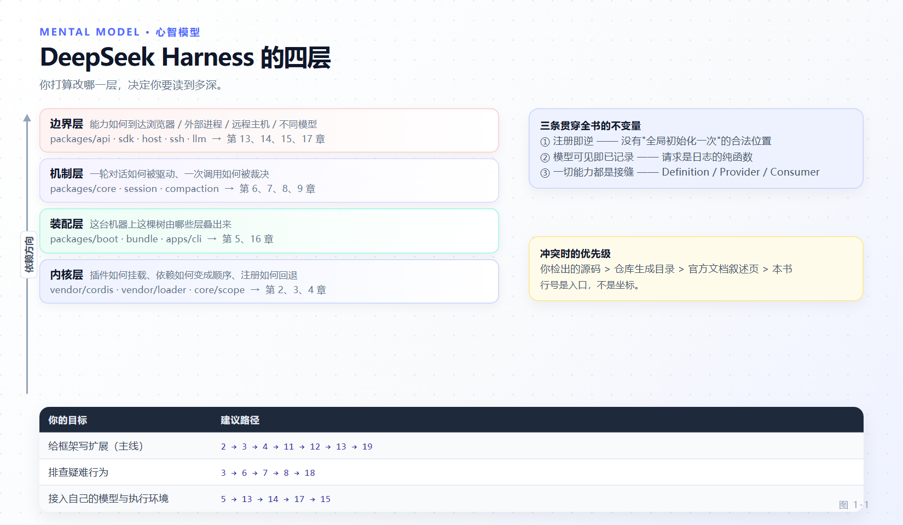

# 第 1 章 高级导读：四层心智模型

[返回目录](README.md) · [下一章：Cordis 内核 →](02-cordis-kernel.md)

> **本章目标**
>
> - 建立一套能撑住全书的四层模型：内核、装配、机制、边界。
> - 记住三条贯穿始终的不变量，它们能解释大部分"设计得很别扭"的地方。
> - 明确本书与官方文档的分工，避免把两边读成重复内容。
> - 选一条适合自己的阅读路径，并学会自己复核本书的每一条断言。

DeepSeek Harness 的官方入门线（[develop/basic](https://deepseek-harness.github.io/deepseek-harness/develop/basic/)）教你写出第一个插件、第一个工具、第一份配置。本书从那里继续：**当你想换掉框架的一个零件，而不是在它旁边加一个零件时，需要知道什么。**

## 1.1 前置

默认你已经具备：

- 能启动 Web UI 或 headless，配好模型，跑完一次真实任务。
- 写过至少一个导出 `apply` 的 Cordis 插件，知道 `ctx.effect()` 会随卸载回退。
- 用 `defineTool` 定义过带参数 schema 与渲染逻辑的工具。
- 见过 `cordis.yml` / `cordis.patch.yml` / `--patch`，知道 profile 与 bundle 各是什么。

如果这些还不熟，请先读配套的[入门教材](https://github.com/John-Shao/dsh-beginner-tutorial)或官方入门线。本书不会重讲这些概念，但会在需要时给出准确锚点。

## 1.2 四层模型

dsh 的代码可以按"改它需要知道什么"切成四层。**你打算改哪一层，决定了你需要读到多深。**



*图 1-1 · 四层自下而上：Cordis 内核提供挂载与回退；装配层决定这棵树上有哪些行；机制层实现 agent 的实际行为；边界层把能力暴露给浏览器、进程与远程主机。*

| 层 | 它回答的问题 | 主要代码 | 本书章节 |
|---|---|---|---|
| **内核** | 插件如何被挂载、依赖如何变成顺序、注册如何回退 | `vendor/cordis`、`vendor/loader`、`packages/core/scope` | 2、3、4 |
| **装配** | 这台机器上这棵树由哪些层叠出来、每行配置从哪来 | `packages/boot/*`、`packages/bundle/*`、`apps/cli` | 5、16 |
| **机制** | 一轮对话如何被驱动、一次工具调用如何被裁决、事实如何被记录 | `packages/core/*`、`packages/session/*`、`packages/compaction/*` | 6、7、8、9 |
| **边界** | 能力如何到达浏览器、外部进程、远程主机与不同模型 | `packages/api/*`、`packages/sdk/*`、`packages/host/*`、`packages/ssh/*`、`packages/llm/*` | 13、14、15、17 |

四层之间是**依赖方向**，不是重要性排序。边界层出问题常常要回到机制层定位；机制层的很多"绕"其实是内核层约束的直接后果。

## 1.3 三条不变量

全书反复出现的三条约束。它们是最省心的预测工具：看到某个设计无法用这三条解释，多半是你找到了 bug 或文档过期处。

### ① 注册即逆（registrations are reversible effects）

任何注册都必须能撤销，撤销顺序由注册结构决定。

```ts
// vendor/cordis/src/fiber.ts:415-417
effect(execute: () => SyncEffect, label?: string): Disposable<Promise<void>>
effect(execute: () => Effect, label?: string): AsyncDisposable<Promise<void>>
```

后果：没有"全局初始化一次"的合法位置；服务注册是构造函数的副作用；监听器注册本身就是 effect；子插件的销毁是父插件的一个 effect。热更新能工作，只是因为这条规则被严格执行。

### ② 模型可见即已记录（model-visible means logged）

任何进入模型请求的内容，都必须能从会话日志重建。

```
// docs/architecture.md:128
**Model-visible means logged.** Every model request must be reconstructable from the log.
```

后果：system prompt 不是请求字段而是历史节点；请求配置是全量快照事件；自定义事件要进历史就必须注册纯投影；压缩不是"删消息"而是"替换节点并留下影子价格"。

### ③ 一切能力都是接缝（every capability is a seam）

一项能力由三个角色组成：Service Definition（拥有 `ctx.<key>`）、Provider（实现）、Consumer（使用，通常是模型可见的工具）。

```
// docs/glossary.md（capability-seam 条目）
The seam is the complete capability, never one role.
```

后果：把文件系统指向远端沙箱，Bash、PTY、LSP 会一起过去，因为没有 provider 分叉；子 agent 从"进程内新孩子"到"另一个产品里的一轮委派"共用一个接口；新增能力时如果只写了 Consumer 而没有 Definition，那不是接缝，是耦合。

## 1.4 全书地图

19 章按"机制 → 定制 → 工程"三段推进：

| 段 | 章节 | 你能获得什么 |
|---|---|---|
| 内核与装配 | 2、3、4、5 | 解释任何一次插件不加载；设计可热更的注册；改启动装配 |
| 工作原理 | 6、7、8、9 | 在正确的事件域插入策略；理解一次请求的全部装配；控制上下文预算 |
| 地形与选型 | 10、11 | 判断新行为该落在哪一层，不返工 |
| 定制与扩展 | 12、13、14、15、16、17 | 写能力包、换 provider、接模型、加 HTTP 面与 UI、做低代码定制、演进持久格式 |
| 工程与交付 | 18、19 | 五层排查、可观测性、性能证据；完成一次产品级交付 |

附录 A 是进阶术语表，附录 B 是服务与接缝索引，附录 C 是源码阅读地图——三附录都设计成"边读代码边翻"的形态。

## 1.5 四条阅读路径

| 你的目标 | 建议顺序 |
|---|---|
| 给框架写扩展（主线） | 2 → 3 → 4 → 11 → 12 → 13 → 19 |
| 排查疑难行为 | 3 → 6 → 7 → 8 → 18 |
| 接入自己的模型与执行环境 | 5 → 13 → 14 → 17 → 15 |
| 评估/审计这套架构 | 1 → 2 → 4 → 8 → 11 → 附录 B |

第 6、7、8 章是全书密度最高的三章，也是其余章节反复回指的公共底座。即使你只关心扩展开发，也建议至少通读第 7 章。

## 1.6 本书与官方文档的分工

官方文档站（<https://deepseek-harness.github.io/deepseek-harness/>）是**契约与目录的权威**：事件签名、配置字段、工具 schema、持久化类型都在生成式参考里，且随版本更新。

本书是**机制与不变量的解释**：为什么 epoch 要拼成字符串、为什么审批在守卫之前、为什么压缩会留下孤儿锁。这些内容官方参考页通常不重复。

两边冲突时按这个优先级：

1. 你检出的源码；
2. 仓库里的生成式目录（`docs/config-catalog.md`、`docs/tool-catalog.md`、`docs/persistence-catalog.md`）；
3. 官方文档站的叙述页；
4. 本书。

本书在若干处明确指出文档与源码不一致的地方（各章末尾的"偏差"小节与附录 C）。这些不是对文档的批评——文档会更新，而本书的定位就是"带行号的快照"。

## 1.7 版本与自我复核

本书基于 DeepSeek Harness `0.2.2-alpha.2`（源码提交 `f3803c9`（2026-10-28）），Cordis 内核版本 `4.0.6-alpha.1`。所有源码引用形如 `packages/core/agent-loop/src/agent.ts:287`，路径以仓库根为基准。

复核一条断言的三种方式：

```sh
# 1) 直接看代码
sed -n '283,300p' packages/core/agent-loop/src/agent.ts

# 2) 看这台机器实际启动的插件树（第 5 章）
dsh --profile web --dump-config

# 3) 重新生成目录，检查本书引用的事实是否仍在生成物里
pnpm run gen-doc-graphs && git diff --stat docs/
```

行号会漂移。本书尽量把行号当"最近的入口"而不是精确坐标——真正的定位靠符号名与文件路径。

## 1.8 本章小结

- 四层模型（内核 / 装配 / 机制 / 边界）决定你需要读到哪里。
- 三条不变量——注册即逆、模型可见即已记录、一切能力都是接缝——能解释绝大多数"看起来很绕"的设计。
- 官方文档给契约与目录，本书给机制与不变量；冲突时源码与生成目录优先。
- 行号是入口不是坐标，学会用 `--dump-config` 与生成脚本自己复核。

**检查点**

1. 你想给某个会话换一套工具能力集，动的是哪一层？（答：装配层写 preset 行 + 内核层的作用域注册，机制层不改。）
2. "压缩后模型仍相信旧的 runtime context"违反哪条不变量？（答：模型可见即已记录——快照必须被显式替换或清除，第 9 章 9.4。）
3. 一个只有 Consumer 工具、没有 Definition 的能力，问题在哪？（答：它不是接缝，无法被替换，违反第三条不变量。）

**延伸阅读**

- 官方 [概念参考](https://deepseek-harness.github.io/deepseek-harness/reference/)、[Cordis 速览](https://deepseek-harness.github.io/deepseek-harness/reference/cordis-primer)、[能力接缝](https://deepseek-harness.github.io/deepseek-harness/reference/capability-seams)
- 配套入门教材：[dsh-beginner-tutorial](https://github.com/John-Shao/dsh-beginner-tutorial)
- 下一章：[Cordis 内核：插件、注册表与 Fiber 生命周期](02-cordis-kernel.md)
