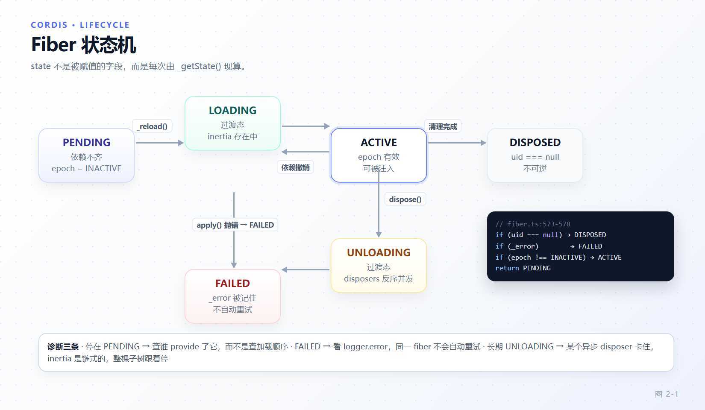
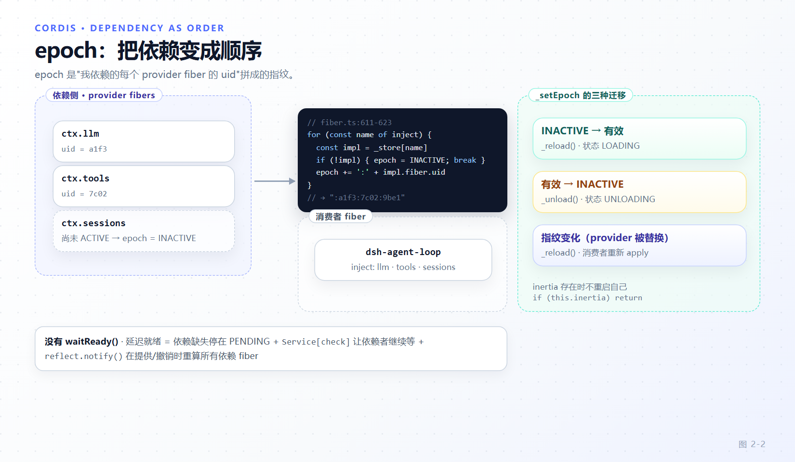

# 第 2 章 Cordis 内核：插件、注册表与 Fiber 生命周期

[← 上一章：高级导读：四层心智模型](01-mental-model.md) · [下一章：可逆 effect、服务与五种事件分派 →](03-effects-services-events.md)

> **本章目标**
>
> - 说清 Cordis 到底"注册"了什么：以回调函数为键的注册表、以 fiber 为实例的生命周期载体。
> - 掌握 `FiberState` 六个状态的真实推导规则，能解释一个插件为什么会停在 `PENDING`。
> - 理解 `epoch` 字符串如何把"依赖"变成"顺序"，以及依赖变化时重载与卸载的分界。
> - 分清 `rawConfig` 与 `effectiveConfig`，理解配置校验、volatile 与更新瀑布。
> - 建立一条排查直觉：先看 fiber 状态，再看它注入了什么，最后看谁提供了那个服务。

第 1 章把 dsh 概括为"一棵没有特权内核的插件树"。本章拆开这棵树看：树节点是 fiber，节点之间的关系由服务可用性决定，而整棵树的稳定性来自一个约束——**每一次注册都必须能撤销**。

本章讨论 vendored 的 Cordis 内核（`vendor/cordis/package.json`，版本 `4.0.6-alpha.1`）。它是 8 个实现文件加一个转发入口 `index.ts`，共 2725 行：`context.ts`、`events.ts`、`fiber.ts`、`logger.ts`、`reflect.ts`、`registry.ts`、`service.ts`、`utils.ts`。读完本章你会同意：dsh 的"高级感"几乎全部建立在这两千行之上。

## 2.1 插件的三种形态与一个元数据面

Cordis 不要求插件继承任何基类，也不存在 `definePlugin` 这样的工厂函数（全仓库搜不到）。一个插件就是**一个可调用物加一组可选元数据字段**：

```ts
// vendor/cordis/src/registry.ts:91-95
export type Plugin<T = any> =
  | Plugin.Function<T>
  | Plugin.Constructor<T>
  | Plugin.Object<T>
```

三种形态的可调用签名分别是（`vendor/cordis/src/registry.ts:121-134`）：

```ts
/** Function plugin called with `(ctx, config)`. */
export interface Function<T = any> extends Base<T> { (ctx: Context, config: T): any }
/** Class plugin constructed with `(ctx, config)`. */
export interface Constructor<T = any> extends Base<T> { new (ctx: Context, config: T): any }
/** Object plugin with an `apply(ctx, config)` method. */
export interface Object<T = any> extends Base<T> { apply(ctx: Context, config: T): any }
```

共享的元数据面 `Plugin.Base` 只有五个字段，它们决定了 Cordis 为你做什么（`vendor/cordis/src/registry.ts:100-110`）：

| 字段 | 类型 | 作用 |
|---|---|---|
| `name` | `string?` | fiber 诊断信息与 logger 名称 |
| `Config` | `StandardSchemaV1<any, T>?` | 启动前校验配置 |
| `inject` | `Inject?` | 需要的服务名；**全部可用之前不加载** |
| `provide` | `string \| string[]?` | 本插件提供的服务名 |
| `intercept` | `Dict<boolean>?` | 声明消费哪些服务的 intercept 配置 |

一个关键区分：`apply` 只属于对象形态。函数插件是被**直接调用**的，`resolve()` 把三种形态归一成一个可执行回调（`vendor/cordis/src/registry.ts:222-228`），随后 `isConstructor` 决定 fiber 用 `new` 还是普通调用（`vendor/cordis/src/fiber.ts:248-263`）：

```ts
execute: function () {
  if (isConstructor(runtime.callback)) {
    const instance = new runtime.callback(this.ctx, this.config)
    for (const hook of instance?.[symbols.initHooks] ?? []) {
      hook()
    }
    return instance?.[symbols.init]?.()
  } else {
    return runtime.callback(this.ctx, this.config)
  }
},
```

注意类插件的 `init` 是被 `symbols.init` 显式触发的——这正是 `Service` 基类能把 `[Service.init]` 生成器方法变成生命周期钩子的原因（第 3 章）。

仓库对形态有硬性约定：**服务包默认导出类，函数插件用命名导出**（`name` / `inject` / `Config` / `apply`），混用会被 Loader 静默丢弃（`packages/AGENTS.md:5`，事故记录见 `docs/postmortem/0001-acp-default-export-drops-inject.md`）。这是初级作者最常踩的一个坑。

## 2.2 注册表以回调为键，fiber 才是实例

`RegistryService` 的内部存储是这样的（`vendor/cordis/src/registry.ts:197`）：

```ts
_internal = new Map<Function, Plugin.Runtime>()
```

**键是插件的回调函数本身，不是字符串 id。** 每个 `Runtime` 记录被同一插件的所有 fiber 共享（`vendor/cordis/src/registry.ts:136-145`）：

```ts
/** Mutable registry record shared by all fibers of one plugin callback. */
export interface Runtime {
  name?: string
  /** Every live fiber of this plugin (one per `ctx.plugin()` call). */
  fibers: DisposableList<Fiber>
  /** The executable entrypoint all fibers share (registry identity key). */
  callback: globalThis.Function
  Config?: StandardSchemaV1
}
```

于是"`ctx.plugin(A)` 调用两次"的含义清楚了：注册表里只有一条 `Runtime`，但有两个 fiber，各自持有独立配置与独立 effect 栈。同一个插件被多个 agent 分别挂载，靠的就是这一点。

`ctx.plugin()` 的实现值得逐行读（`vendor/cordis/src/registry.ts:316-336`）：

```ts
plugin(plugin: Plugin, config?: any, getOuterStack = buildOuterStack()) {
  const callback = this.resolve(plugin)
  if (!callback) throw new Error('invalid plugin, expect function or object with an "apply" method, received ' + typeof plugin)
  this.ctx.fiber.assertActive()

  let runtime = this._internal.get(callback)
  if (!runtime) {
    let name = plugin.name
    if (name === 'apply') name = undefined
    runtime = { name, callback, fibers: new DisposableList(), Config: plugin.Config }
    this._internal.set(callback, runtime)
  }

  const fiber = new Fiber(this.ctx, config, Inject.resolve(plugin.inject), runtime, getOuterStack)
  const wrapped = Object.create(fiber) as Fiber & PromiseLike<Fiber>
  wrapped.then = (onFulfilled, onRejected) => fiber.await().then(onFulfilled, onRejected)
  return wrapped
}
```

三个容易忽略的细节：

1. `name === 'apply'` 时把名字清空——对象形态 `{ apply() {} }` 的 `Function.name` 是 `"apply"`，直接拿来当插件名会让所有匿名对象插件都叫 `apply`。
2. 返回值是 `Object.create(fiber)` 并挂上 `then`，所以 fiber **既是对象又是 thenable**。`await ctx.plugin(...)` 等的是"加载完成"，不是"卸载完成"；不 await 也完全合法，这正是 dsh 大多数插件不 await 自己的子插件的原因。
3. `assertActive()` 意味着**已卸载的 context 上不能再挂插件**。异步回调里 `ctx.plugin(...)` 抛错，多半是这个。

那 `id` 在哪里？在 Loader 层，不在 Cordis 内核。`EntryTree.store: Dict<Entry>` 按 id 存条目（`vendor/loader/src/config/tree.ts:14`），`ensureId()` 在你没写 id 时随机生成一个（`vendor/loader/src/config/tree.ts:52-59`）：

```ts
ensureId(options: Partial<EntryOptions>) {
  if (!options.id) {
    do {
      options.id = Math.random().toString(16).slice(2, 10)
    } while (this.store[options.id])
  }
  return options.id!
}
```

这一行解释了一个常见的"见了鬼"现象：**patch 行不写 `id`，每次热更新都会重挂一次**——因为 id 是随机数，Loader 无法把新行和旧行认成同一个条目（`docs/cordis-tutorial/06-composition-and-hmr.md:58` 提到过这个后果）。嵌套 id 用 `EntryTree.sep`（`:`）分隔并逐段进入子树解析（`vendor/loader/src/config/tree.ts:61-73`），这是 preset 内部插件树的寻址方式（第 5 章）。

## 2.3 Fiber 状态机：六个状态，四行推导

生命周期状态是六个（`vendor/cordis/src/fiber.ts:147-154`）：

```ts
export const enum FiberState {
  PENDING, LOADING, ACTIVE, FAILED, DISPOSED, UNLOADING,
}
```

但 `state` 不是逐个赋值的字段，而是每次由 `_getState()` 现算（`vendor/cordis/src/fiber.ts:575-578`）：

```ts
if (this.uid === null) return FiberState.DISPOSED
if (this._error) return FiberState.FAILED
if (this._runner.epoch !== INACTIVE) return FiberState.ACTIVE
return FiberState.PENDING
```

优先级是**吸收式**的：一旦 `uid` 置空（已销毁），任何错误都不再改变结论；错误优先于"epoch 有效"；而 `LOADING` / `UNLOADING` 只在状态迁移的瞬间由 `_updateState()` 显式写入，属于过渡态。



*图 2-1 · 六个状态里只有四个是稳定态。`LOADING` 与 `UNLOADING` 是 `inertia` 存在期间的过渡态；`DISPOSED` 由 `uid === null` 判定，不可逆。*

由此可以推出三条实用诊断规则：

- **停在 `PENDING`**：`inject` 里某个服务当前没有可用 provider。查"谁 `provide` 了它"，而不是查加载顺序。
- **`FAILED`**：`apply()` 或 `[Service.init]` 抛过异常，`_error` 被记住；同一个 fiber 不会自动重试。
- **`UNLOADING` 很久**：某个异步 disposer 卡住了。`inertia` 是链式的（见 2.5 节），所以一个卡住的清理会让整棵子树都停在卸载中。

状态变化会广播 `internal/status`，并且**只在 ACTIVE 与非 ACTIVE 之间切换时**通知服务可用性（`vendor/cordis/src/fiber.ts:581-595`）：

```ts
private _updateState(callback: () => void | FiberState) {
  const oldState = this.state
  this.state = callback() ?? this._getState()
  if (oldState === this.state) return
  this.context.emit('internal/status', this, oldState)
  // only notify changes between ACTIVE and NON-ACTIVE states
  if (oldState !== FiberState.ACTIVE && this.state !== FiberState.ACTIVE) return
  for (const key of Reflect.ownKeys(this.ctx.reflect.store)) {
    const impl = this.ctx.reflect.store[key as symbol]
    if (impl.fiber !== this) continue
    this.ctx.reflect.notify([impl.name])
  }
}
```

这段代码是"服务可用性驱动一切"的实现点：一个 provider 从 `LOADING` 变 `ACTIVE`，`reflect.notify()` 会重算所有依赖它的 fiber。

## 2.4 epoch：把依赖变成顺序

Cordis 没有 `dependsOn` 列表，也不做拓扑排序。顺序完全由 `inject` 派生，载体是一个叫 `epoch` 的字符串。`_refresh()` 就是全部逻辑（`vendor/cordis/src/fiber.ts:611-623`）：

```ts
_refresh() {
  let epoch: string | boolean = false
  epoch = ''
  for (const name of Object.keys(this.inject)) {
    const impl = this._store[name]
    if (!impl) {
      epoch = INACTIVE
      break
    }
    epoch += ':' + impl.fiber.uid
  }
  this._setEpoch(epoch)
}
```

含义：**epoch 是"我依赖的每个服务的 provider fiber 的 uid"拼成的指纹**。缺一个依赖就是 `INACTIVE`；全都齐了就是一个形如 `:uid1:uid2` 的字符串。然后 `_setEpoch()` 决定该加载还是该卸载（`vendor/cordis/src/fiber.ts:625-639`）：

```ts
private _setEpoch(epoch: string) {
  const oldEpoch = this._runner.epoch
  if (epoch === oldEpoch) return
  this._runner.epoch = epoch
  if (this.inertia) return
  this._updateState(() => {
    if (epoch !== INACTIVE && oldEpoch === INACTIVE) {
      this.inertia = this._reload()
      return FiberState.LOADING
    } else {
      this.inertia = this._unload()
      return FiberState.UNLOADING
    }
  })
}
```

三个设计决定值得注意：

1. **依赖 provider 的 fiber 被重建 → 我的 uid 指纹变了 → 我也重载。** 服务实现热替换时，消费者会跟着重新 `apply`，因此消费者永远看不到"半新半旧"的依赖。
2. **`if (this.inertia) return`：正在加载或卸载中的 fiber 不重启自己。** 迁移期间的依赖抖动被吸收，等 `inertia` 落地后由后续刷新收敛。
3. **从"无依赖"到"有依赖"走 `_reload`，从"有"到"无"走 `_unload`。** 所以 `inject` 命中的服务被撤销（provider 卸载且没有新 provider）会让消费者进入卸载而不是重载。



*图 2-2 · epoch 是依赖 provider 的 uid 指纹。`INACTIVE → 有效` 触发 `_reload`；`有效 → INACTIVE` 触发 `_unload`；指纹变化（provider 被替换）同样触发 `_reload`。*

`_checkImpl()` 补上最后一块：服务可以带一个可用性谓词（`vendor/cordis/src/fiber.ts:597-608`）：

```ts
_checkImpl(name: string) {
  const impl = this.ctx.reflect._getImpl(name, true)
  if (!impl) return delete this._store[name]
  try {
    if (impl.check && !impl.check.call(getTraceable(this.ctx, impl.value))) {
      return delete this._store[name]
    }
  } catch (error) {
    impl.fiber.ctx.logger.error(error)
    return delete this._store[name]
  }
  this._store[name] = impl
}
```

`impl.check` 来自 `Service[check]`（`vendor/cordis/src/service.ts:15`）。这就是"服务已注册但还没准备好"的表达方式：provider 存在，但 `check` 返回假，于是消费者继续 `PENDING`。

> 别把这条机制当成 dsh 的常见写法。全仓源码里实现 `[Service.check]()` 的只有 vendored Loader（`vendor/loader/src/index.ts:175`，在 `:102` 用它 provide 自己）；Harness 侧的服务一律靠"构造完即 ACTIVE"加自身的 `await` 来表达就绪。你要给一个慢启动服务加可用性谓词时，这是可用的官方钩子，但请先确认 `await` 语义确实不够。

> **注意**：Cordis 里没有 `waitReady()` 这样的 API。"延迟就绪"是三件事的合成——依赖缺失停在 `PENDING`、`Service[check]` 让依赖者继续等、`reflect.notify()` 在提供/撤销时重算所有依赖 fiber。

## 2.5 父子关系：子 fiber 的 disposer 挂在父 effect 上

一个插件 `apply` 里调用 `ctx.plugin(Child)`，子插件何时被清理？答案是：**子 fiber 的销毁本身就是父 fiber 的一个 effect**。这段是理解 Cordis 可组合性的钥匙（`vendor/cordis/src/fiber.ts:265-297`）：

```ts
this.dispose = parent.fiber.effect(() => {
  const remove = runtime.fibers.push(this)
  return async () => {
    this.uid = null
    emitPluginDisposed(this.context, this)
    if (this.ctx.registry.has(runtime.callback)) {
      remove()
      if (!runtime.fibers.length) {
        this.ctx.registry.delete(runtime.callback)
      }
    }
    this._setEpoch(INACTIVE)
    // A PENDING fiber can already own effects registered by an
    // internal/plugin observer. Its epoch is still INACTIVE, so
    // _setEpoch() has no transition to drive; explicitly unload that
    // pre-activation work before reporting disposal complete.
    if (!this.inertia) {
      this._updateState(() => {
        this.inertia = this._unload()
        return FiberState.UNLOADING
      })
    }
    while (this.inertia) {
      await this.inertia
    }
  }
}, 'ctx.plugin()')
```

逐点拆解：

- `dispose` 注册在**父 fiber** 上，label 是 `'ctx.plugin()'`。卸载父 fiber 即递归卸载全部子 fiber——这就是"插件树"的树形语义来源。
- `this.uid = null` 让 `_getState()` 立刻判定 `DISPOSED`，即使清理尚未完成。**状态表达的是"意图"，不是"进度"**。
- 只有当注册表里还认这个 callback 时才 `remove()`：HMR 已经替换过实现时，旧 fiber 不该去动新 `Runtime` 的 fiber 列表。
- 注释里那条"PENDING 也要显式 `_unload()`"是真实教训：一个从未激活的 fiber 也可能已经拥有 effect（比如 `internal/plugin` 观察者注册的），不显式卸载就会漏清理。
- `while (this.inertia) await this.inertia` 是**静默（quiescence）边界**：清理过程中可能又派生出新的 inertia，循环直到链耗尽。

`inertia` 还解释了 `Scope.dispose()` 为什么能被安全地并发调用（第 4 章）：`packages/core/scope/src/index.ts:115-118` 的 `quiesceFiber()` 就是 `await Promise.resolve(fiber.dispose())` 加同样的 `while (fiber.inertia)` 循环。

## 2.6 配置：raw 与 effective 是两个东西

配置校验走 Standard Schema 协议，而不是硬编码某个校验库（`vendor/cordis/src/fiber.ts:50-62`）：

```ts
runtime.Config['~standard'].validate(config)
```

dsh 的 `z` 是 vendored 的 schemastery，它的实例带 `'~standard': StandardSchemaV1.Props`（`vendor/schemastery/src/index.ts:154`）。这意味着**换校验库不需要动 Cordis**。

fiber 上有两个配置读点，故意分开（`vendor/cordis/src/fiber.ts:641-657`）：

| 读点 | 含义 | 何时用 |
|---|---|---|
| `rawConfig` | 下次激活用的原始输入，不求值表达式、不校验 | HMR 重挂、profile recompose |
| `effectiveConfig` | 当前已发布实例的配置，不克隆不重解析 | 运行期读取；需要活性时先看 `state` |

生效链上有两次可拦截的瀑布：`fiber.resolveConfig(raw)` 先跑 `internal/config` 再校验；`fiber.update(config, noSave)` 先跑 `internal/update`，**监听者可以否决整次重启**。dsh 的全局 `internal/update` 观察者在 boot 阶段注册（`packages/boot/app-boot/src/index.ts:1229`），HMR 的更新事务就挂在这里（第 5 章）。

合并优先级只有三层，而且**是浅合并**：Loader 条目 `config` → 注入时该服务的 `intercept` 链（`vendor/cordis/src/service.ts:86-102`）→ schema 的 `.default()`。`vendor/cordis/src/service.ts:97` 有一个 `this['Config']?.merge` 分支，但 vendored schemastery 没有静态 `merge`（只有内部函数 `merge()`，`vendor/schemastery/src/index.ts:805`），实际永远走 `Object.assign({}, ...configs)`。

> 建立"分层覆盖"心智模型时必须记住这点：**patch 行按 id 替换整段 config，不做深合并**（`packages/boot/app-boot/README.zh.md:208`）。第 5 章会看到它在 profile 层的具体后果，也是第 16 章"低代码定制"的第一条纪律。

volatile 是正交的第二条通道。`z...volatile()` 让字段变成只读引用 `Volatile<T>`（只有 `get()`，`vendor/cosmokit/src/volatile.ts:8-13`），Loader 检测到"只有 volatile 字段变了"时就地提交 `rawConfig`、发 `loader/volatile-update`、**不卸载 fiber**（`vendor/loader/src/config/entry.ts:142-152`）。真实例子：

```ts
// packages/core/agent-default-model/src/index.ts:51-55
static Config = z.object({
  provider: z.string().required().volatile(),
  // ...
})
```

选型规则很简单：改这个字段需要重建插件内部状态 → 普通字段；只是"下次决策时读到的值变了" → volatile。

## 2.7 可逆性：注册即 effect

Cordis 的 `effect` 有两个重载（`vendor/cordis/src/fiber.ts:415-417`）：

```ts
effect(execute: () => SyncEffect, label?: string): Disposable<Promise<void>>
effect(execute: () => Effect, label?: string): AsyncDisposable<Promise<void>>
```

`_execute()` 接受四种可逆形态：直接返回 disposer、返回 `Promise<disposer>`、返回**同步可迭代**（生成器逐个收集）、返回异步可迭代（epoch 变更后立即停止收集）。生成器形态是 dsh 里最优雅的一种，`ScopedLayers.effect()` 就用它把"撤销"和"通知"排成两步（第 4 章）。

卸载时 disposers **反序并发**执行（`vendor/cordis/src/fiber.ts:702-713`）：`await Promise.all(this._disposables.clear().map(...))`，其中 `DisposableList.clear()` 返回反序数组（`vendor/cordis/src/utils.ts:5-40`）。但**同一个 effect 内部**的多个 disposer 是串接的（`vendor/cordis/src/fiber.ts:431-440`）：`disposables.splice(0).reverse()` 之后用 `task.then(...)` 逐个链接。

> 官方教程里"多个异步 disposer 并发运行"的说法只在 fiber 卸载层成立（`docs/cordis-tutorial/02-lifecycle-and-effects.md:94`）。写清理逻辑时若依赖并发，请把它们放进同一个 fiber 的不同 effect；若依赖顺序，请放进同一个生成器 effect 的多个 `yield`。

`effectInertia`（`vendor/cordis/src/fiber.ts:112-117`）允许外部 owner 加入他人已启动的清理；`getEffects()` 输出 `EffectMeta` 诊断树（`vendor/cordis/src/fiber.ts:568-572`）——`internal/fiber-info` 与 inspector 读的就是这棵树，第 18 章的调试部分会用到它。

## 2.8 服务：注册是构造函数的副作用

`Service` 抽象基类的构造函数就是注册点（`vendor/cordis/src/service.ts:11-59`）：

```ts
constructor(protected ctx: Context, name: string) {
  name ??= this.constructor['provide'] as string
  let self = this
  const tracker: Tracker = { associate: name, property: 'ctx' }
  if (self[symbols.invoke]) {
    self = createCallable(name, joinPrototype(Object.getPrototypeOf(this), Function.prototype), tracker)
  }
  self.ctx = ctx
  self.name = name
  defineProperty(self, symbols.tracker, tracker)
  self.ctx.reflect.provide(name, self, this[symbols.check])
  return self
}
```

`provide` 内部是一个 label 为 `ctx.provide("name")` 的 effect，所以**服务随 owning fiber 卸载而自动消失**——不需要任何显式注销。`[Service.invoke]` 让服务变成可调用对象（`ctx.logger()` 就是这么来的）；`[Service.check]` 是 2.4 节那个可用性谓词。

存储结构值得记一张图：`ReflectService.store: Dict<Impl, symbol>` **以 isolation symbol 为键**（`vendor/cordis/src/reflect.ts:209`），`Impl = { name, fiber, value?, check? }`（`vendor/cordis/src/reflect.ts:116-125`）。读取走代理 `handler.get`（`vendor/cordis/src/reflect.ts:135-171`）：沿 fiber 链向上找 `fiber.store[prop]`，**如果这个名字出现在 `inject` 里却没找到，直接抛错**——"强制注入即硬失败"，不会给你一个 `undefined` 让你慢慢踩雷。

`ctx.get(name, strict)` 是逃生舱：跳过 `inject` 需求，`strict` 时只认 `ACTIVE` 的 provider（`vendor/cordis/src/reflect.ts:233-243`）。`ctx.extend / isolate / intercept` 构成 realm（`vendor/cordis/src/context.ts:99-145`），isolate map 与 intercept map 都是原型链字典。

> **术语校正**：Cordis 内核里没有 `@local` 这个概念。最接近的是 Loader 的 `isolate`：`isolate: { name: true }` 得到按条目隔离的 `LocalRealm`（symbol 后缀 `#<entry.id>`），`isolate: { name: 'label' }` 得到跨条目共享的 `GlobalRealm`（后缀 `@label`）——见 `vendor/loader/src/config/isolate.ts:27-66`。同一个服务名在不同 realm 下是两个不同的实现，这是"一份代码、多份状态"的官方手段，也是 preset 里放服务行必须带 `isolate` 的原因（第 5 章、第 16 章）。

## 2.9 本章小结

- 插件是"可调用物 + 五个元数据字段"，形态有三种；`apply` 只属于对象形态，函数插件被直接调用。
- 注册表以**回调函数**为键，`Runtime` 被同一插件的所有 fiber 共享；id 是 Loader 层的事，不写 id 会随机生成，于是每次热更新都重挂。
- `FiberState` 由四行规则现算：`DISPOSED` 看 `uid`，`FAILED` 看 `_error`，`ACTIVE` 看 epoch，其余是 `PENDING`。
- `epoch` 是依赖 provider 的 uid 指纹，它把"依赖"变成"顺序"，也让服务替换自动传导到消费者。
- 子 fiber 的销毁是父 fiber 的一个 effect；`inertia` 循环是静默边界；未激活的 fiber 也要显式卸载。
- 配置分 `rawConfig` / `effectiveConfig`，合并是浅合并，volatile 是"不重挂即生效"的正交通道。
- 服务注册是构造函数的副作用，随 fiber 自动消失；`inject` 声明了却拿不到会抛错。

**检查点**

1. 一个插件 `inject: ['llm']`，`ctx.llm` 有 provider 但 `Service[check]` 返回假。它的 `state` 是什么？（答：`PENDING`——`_checkImpl` 把它从 `_store` 里删掉了。）
2. 你写了一条 patch、忘了 `id`，热更新后配置看起来"没生效"，其实每次都重挂了。怎么确认？（答：看 `internal/status` 日志，或对比两次 `--dump-config` 里该行的 id 是否稳定。）
3. 服务实现的 fiber 被 HMR 替换，消费者会怎样？（答：epoch 指纹变化 → `_reload`，消费者重新 `apply`。）

**延伸阅读**

- 官方 [Cordis 教程 · 生命周期与 effect](https://deepseek-harness.github.io/deepseek-harness/develop/cordis-tutorial/02-lifecycle-and-effects)
- 官方 [框架能力 · 生命周期](https://deepseek-harness.github.io/deepseek-harness/develop/framework/)
- 官方 [概念 · Cordis 速览](https://deepseek-harness.github.io/deepseek-harness/reference/cordis-primer)
- 源码：`vendor/cordis/src/fiber.ts`、`vendor/cordis/src/registry.ts`、`vendor/cordis/src/service.ts`
- 下一章：[可逆 effect、服务与五种事件分派](03-effects-services-events.md)
