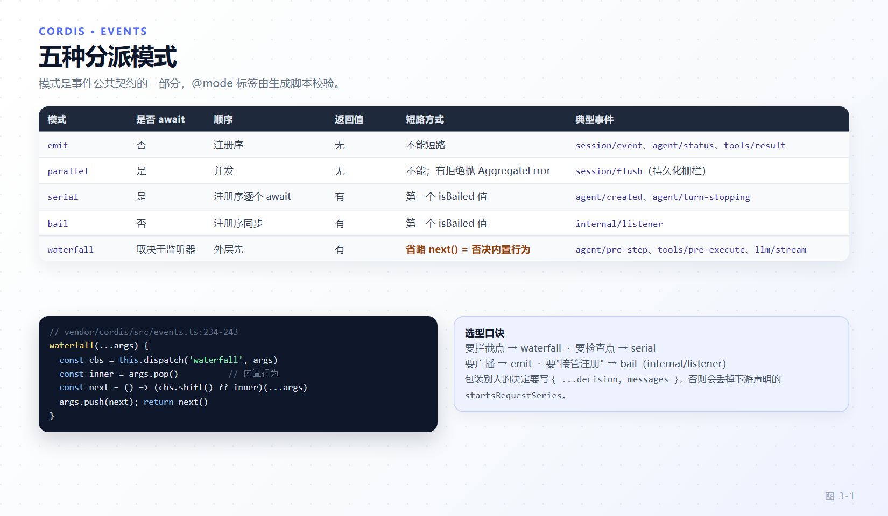

# 第 3 章 可逆 effect、服务与五种事件分派

[← 上一章：Cordis 内核](02-cordis-kernel.md) · [下一章：作用域与 agent 世界的装配 →](04-scope-agent-world.md)

> **本章目标**
>
> - 掌握 `ctx.effect()` 的四种可逆形态，会用生成器形态编排"撤销在前、通知在后"。
> - 分清"fiber 卸载并发"与"单个 effect 内部串接"这两种截然不同的清理语义。
> - 理解 `Service` 的三个符号钩子（`init` / `check` / `invoke`）如何拼出服务的生命周期。
> - 精确掌握五种分派模式的等待性、顺序与返回值，尤其是 waterfall 的 `next()` 否决语义。
> - 建立"三个事件域"的选型直觉：`session/*` 耐久事实、`agent/*` 在飞协调、能力事件策略。

第 2 章解释了插件如何被挂载与销毁。本章讲**插件之间怎样协作**：注册靠 effect，能力靠服务，协调靠事件。这三样东西在 dsh 里不是三种风格选择，而是三种**语义上不可互换**的工具——把该发事件的地方写成服务调用，就丢掉了可拦截性；把该注册为服务的东西做成事件监听器，就丢掉了可替换性。

## 3.1 effect 的四种可逆形态

`ctx.effect()` 的两个重载（`vendor/cordis/src/fiber.ts:415-417`）看起来只是同步/异步之分，实际 `_execute()`（`vendor/cordis/src/fiber.ts:356-400`）接受四种返回形态：

| 返回 | 语义 | 典型用法 |
|---|---|---|
| `() => void` | 同步 disposer | 注册表 `insert` 返回的 undo |
| `Promise<() => void>` | 异步 disposer | 需要 await 关闭的连接 |
| 同步可迭代（生成器） | **逐个收集** disposer | 多步注册、撤销与通知排序 |
| 异步可迭代 | 逐个收集，但 **epoch 变更后立即停止收集** | 长生命周期装配 |

生成器形态最被低估。它的价值不是"能写多个清理"，而是**能表达清理与副作用的相对顺序**：

```ts
// packages/core/scope/src/store.ts:233-263（节选）
const dispose = ctx.effect(function* (this: ScopedLayers<L>) {
  // ... 建立 layer、执行 action、拿到同步 undo
  yield () => {
    undo()
    if (scope !== undefined && layer.isEmpty()) this.scoped.delete(scope)
    if (notify) this.onChange()
  }
  if (notify) this.onChange()
}.bind(this), options.label)
```

`yield` 之前是"注册期"，`yield` 之后是"卸载期"。这段代码把三条纪律压进一个 effect：undo 先于通知执行、只有**完全变空**的聚合层才被回收、通知在注册与卸载两侧对称发生。

> 若你把这三步拆成三个独立 effect，卸载时它们是**并发**的（见 3.2），顺序保证立刻消失。这就是仓库反复强调"如果清理顺序重要，就把相关工作放进同一个 effect"的原因（`docs/cordis-primer.md:45`）。

## 3.2 并发还是串接？两种"同时清理"

卸载一个 fiber 时，它持有的所有 disposers 反序**并发**执行（`vendor/cordis/src/fiber.ts:702-713`）：

```ts
await Promise.all(this._disposables.clear().map(...))
```

`DisposableList.clear()` 返回反序数组（`vendor/cordis/src/utils.ts:5-40`），所以"后注册的先撤销"成立，但"并发"意味着**彼此不等待**。

而**同一个 effect 内部**的多个 disposer 是**串接**的（`vendor/cordis/src/fiber.ts:431-440`）：`disposables.splice(0).reverse()` 之后用 `task.then(...)` 逐个链接，前一个完成才轮到下一个。

于是有了一张明确的决策表：

| 你想要 | 写法 |
|---|---|
| 清理彼此独立、越快越好 | 多个 `ctx.effect()` |
| 清理必须按逆序依次完成 | 一个生成器 `ctx.effect(function* () { ... yield ... })` |
| 清理要等外部 owner 完成 | `effectInertia`（`vendor/cordis/src/fiber.ts:112-117`） |

`effectInertia` 是三者中最微妙的：它允许你把"别人的清理"挂到"自己的 effect"上，用于一个已经启动的 disposer 还没结束时接管其完成信号。第 4 章的 `Scope.dispose()` 与第 18 章的"静默（quiescence）"讨论都会回到这里。

## 3.3 服务的三个符号钩子

`Service` 基类只有一百多行（`vendor/cordis/src/service.ts`），但它定义了 dsh 里所有服务的形状：

| 符号 | 作用 | 谁读它 |
|---|---|---|
| `Service.init` | 实例方法，构造后由 fiber 显式调用；写成生成器即得到"注册期 / 卸载期"两段式 | `fiber.ts:251-260` 的 runner |
| `Service.check` | 可用性谓词；返回假则依赖者继续 `PENDING` | `fiber.ts:597-608` 的 `_checkImpl` |
| `Service.invoke` | 调用体，让服务实例变成可调用对象（`ctx.logger()`） | `service.ts:47-51` 的 `createCallable` |
| `Service.config` | intercept 配置的类型幻影参数 | `service.ts:86-102` 的合并逻辑 |
| `Service.extend` / `tracker` | 派生扩展实例与 context 溯源 | `context.ts` 与 reflect |

一个真实的服务骨架，把三段式生命周期用足：

```ts
// packages/preset/agent-preset/src/index.ts:12-29（节选）
export default class AgentPreset {
  static inject = ['agentPresets']
  static readonly [EntryGroup.key] = true
  static Config: z<Config> = z.object({
    id: z.string().required(), name: z.string(), description: z.string(),
    order: z.number(), plugins: z.array(z.any()).required(),
  }) as z<Config>
  async* [Service.init]() { yield await this.ctx.agentPresets.register(this.config) }
}
```

`async*` + `yield` 就是 3.1 的第四种形态：`register()` 返回的 promise 解析后，其 disposer 被收集；epoch 一旦变更就不再继续收集。而 `static [EntryGroup.key] = true` 声明"我的 `config.plugins` 是子表达式，保留到各自激活为止"——这是 preset 能嵌套一棵子树的原因（第 16 章）。

## 3.4 realm：同一个服务名，多份实现

`ctx.extend` / `ctx.isolate` / `ctx.intercept` 三个操作构成 realm（`vendor/cordis/src/context.ts:99-145`）。存储侧的对应关系是：`ReflectService.store: Dict<Impl, symbol>` **以 isolation symbol 为键**（`vendor/cordis/src/reflect.ts:209`），symbol 由 Realm 派生（`vendor/loader/src/config/isolate.ts:27-66`）：

```ts
access(key: string, create = false) {
  if (create) {
    return this.store[key] ??= Symbol(`${key}${this.suffix}`)
  } else {
    return this.store[key] ?? Symbol(`${key}${this.suffix}`)
  }
}
```

- `LocalRealm`（`isolate: { name: true }`）后缀 `#<entry.id>`：每个 Loader 条目一份实现。
- `GlobalRealm`（`isolate: { name: 'label' }`）后缀 `@label`：多个条目共享一份实现。

这解释了第 11 章的一条判据：**preset 里放 service 行必须带 `isolate` realm**，否则两个 preset 会互相覆盖同一个服务实例。也解释了为什么 preset 挂载完成后要做 leaked 审计：`leakedServices()` 发现服务发布在 root realm 就抛 `Preset services require isolate realms`（`packages/preset/agent-preset-registry/src/mount.ts:69-83`、`:211-213`）；跨 realm 读只能走 `agentPresets.serviceFor()`。

intercept 配置的合并优先级是**越靠近 root 越先生效**，`base` 最先、`head` 最后（`vendor/cordis/src/service.ts:86-102`）。注意实际合并是浅 `Object.assign({}, ...configs)`——`Config.merge` 分支在 vendored schemastery 下永不命中（第 2 章 2.6 节）。

## 3.5 五种分派模式：等待性、顺序、返回值

事件模式只有五个字面量（`vendor/cordis/src/events.ts:32`）：

```ts
export type DispatchMode = 'emit' | 'parallel' | 'serial' | 'bail' | 'waterfall'
```

它们的实现合计约 60 行，语义差异却决定了架构（`vendor/cordis/src/events.ts:177-243`）：

| 模式 | 是否 await | 顺序 | 有返回值 | 实现要点 |
|---|---|---|---|---|
| `emit` | 否 | 注册序 | 否 | `dispatch('emit').map(cb => cb(...args))`，返回的 promise 被丢弃 |
| `parallel` | 是 | 并发 | 否 | `Promise.allSettled` + 有拒绝则抛 `AggregateError` |
| `serial` | 是 | 注册序逐个 await | 是 | 第一个 bail 值即返回 |
| `bail` | 否 | 注册序同步 | 是 | 第一个 bail 值即返回 |
| `waterfall` | 取决于监听器 | 外层先 | 是 | 末位参数是内置 `next`，不调 `next()` 即否决整条链 |

两个容易看漏的细节：`parallel` 内部调用的是 `this.dispatch('emit', args)`，所以 `internal/dispatch` 上报告的类型是 `emit` 而非 `parallel`；`isBailed` 的定义是"非 `null`/`false`/`undefined` 即算 bail"（`vendor/cordis/src/events.ts:13-15`）。



*图 3-1 · 五种模式的等待性、顺序与短路点。waterfall 的唯一短路方式是省略 `next()`；serial/bail 的短路条件是返回值 `isBailed`。*

## 3.6 waterfall：不调 `next()` 就是否决

waterfall 是 around-middleware，实现短到值得逐字读（`vendor/cordis/src/events.ts:234-243`）：

```ts
waterfall(...args: any[]) {
  const cbs = this.dispatch('waterfall', args)
  const inner = args.pop()
  const next = () => {
    const cb = cbs.shift() ?? inner
    return cb(...args)
  }
  args.push(next)
  return next()
}
```

`cbs.shift() ?? inner` 这一行说明：**内置行为本身就是链条的最内层**。监听者不调 `next()`，不只是"我不改结果"，而是"下游监听者和内置行为都不执行"。

dsh 里最重要的一个决策事件正是靠这个语义实现的（`packages/core/agent-loop/src/agent.ts:296-306`）：

```ts
const decision = await this.dispatch.waterfall(
  'agent/pre-step', { messages: claimed, ...position, signal, modelSelection: selection },
  (): Promise<PreStepDecision> => {
    // ... 渲染上下文、投影 runtime context
    return Promise.resolve<PreStepDecision>({ kind: 'enter', messages: /* ... */ })
  })
```

内置 `next` 返回 `{ kind: 'enter' }`。一个想"本轮不进步骤"的策略监听者直接返回 `{ kind: 'reject', ... }` 而不调 `next()`；一个只想追加注入上下文的监听者应当 `return { ...decision, messages }`——**保留下游已经做过的决定**，而不是从零构造。

> 官方 primer 的表格把 waterfall 标成"Awaited? No"（`docs/cordis-primer.md:19-25`），字面上没错（`dispatch` 不 await），但 harness 的 waterfall 返回 Promise，**派发方必须自己 await**。`agent.ts:296` 的 `await` 就是这一条的落地。忘记 await 的监听器链，等于把决策权还给了内置行为。

包装别人的 waterfall 时的纪律：`{ ...decision, messages }` 而不是 `{ kind: 'enter', messages }`，否则会丢掉 `startsRequestSeries` 这类下游声明。这条在 `docs/architecture.md:112` 有明确表述。

## 3.7 serial 的两种用法：能 bail 与不能 bail

`serial` 是"按注册顺序 await 全部"，但它的实际语义取决于事件的返回类型。

- **能 bail 的 serial**：第一个非 `null/false/undefined` 返回值终止链条，例如 `internal/listener`（见 3.9）。
- **不能 bail 的 serial**：如果事件声明的返回类型是 `Promise<void> | void`，那么没有任何监听者能产出 bail 值，`serial` 就退化成"严格串行的观察者链"。

第二种正是 `agent/turn-stopping` 与 `agent/created` 的用法（`packages/core/agent/src/runtime-types.ts:415-421`、`packages/core/agent/src/index.ts:575`）。`agent/created` 之所以必须是 serial 且无 `next()`：它是**发布前的串行装配窗口**，允许 setup 代码注册 scoped 贡献，且不允许任何监听者否决或改写创建结果（第 4 章）。

选型口诀：**要拦截点就 waterfall，要检查点就 serial，要广播就 emit。**

## 3.8 dispatch 的过滤：作用域路由的地基

每次派发都先过 `dispatch()`（`vendor/cordis/src/events.ts:165-175`）：

```ts
dispatch(type: string, args: any[]) {
  const thisArg = typeof args[0] === 'object' || typeof args[0] === 'function' ? args.shift() : null
  const name: string = args.shift()
  if (!name.startsWith('internal/')) {
    this.emit('internal/dispatch', type, name, args, thisArg)
  }
  const filter = thisArg?.[Context.filter]
  return (this._hooks[name] || [])
    .filter(hook => hook.global || !filter || filter.call(thisArg, hook.ctx))
    .map(hook => hook.callback.bind(thisArg))
}
```

四件事：

1. 第一个参数若是对象或函数，被当作派发主体 `thisArg` 移出参数列表——这就是 `ctx.emit(carrier, 'agent/created', ...)` 里 carrier 的位置。
2. 非 `internal/*` 事件一律先广播 `internal/dispatch`，这是框架级事件追踪（第 18 章的调试）的入口。
3. 过滤规则：`hook.global` 放行、无 filter 全放行、否则调用 `filter.call(thisArg, hook.ctx)`。
4. 回调 `bind(thisArg)`，所以监听器里的 `this` 就是派发主体。

第 3 点是全部作用域路由的落点：`scopeTarget()` 造的载体唯一职责就是提供一个 `[Context.filter]` 函数（`packages/core/scope/src/index.ts:170-185`）。第 4 章展开。

## 3.9 `ctx.on` 本身就是 effect

监听器注册没有任何特殊通道，它就是一个 effect（`vendor/cordis/src/events.ts:254-260`）：

```ts
register(label: string, hooks: Hook[], callback: any, options: EventOptions): () => void {
  const method = options.prepend ? 'unshift' : 'push'
  return this.ctx.fiber.effect(() => {
    hooks[method]({ ctx: this.ctx, callback, ...options })
    return () => this.unregister(hooks, callback)
  }, label)
}
```

由此得到三条推论：

- 监听器随注册它的 fiber 卸载而消失，**不需要也不应该手写注销**。
- `prepend: true` 用 `unshift` 抢占顺序——只在"必须先于普通注册者"时使用（`docs/cordis-primer.md:33`）。
- 每条 hook 记录都存了 `ctx`，这正是 3.8 里过滤能工作的原因：Cordis 知道每个监听器是在哪个 context（因而哪个 scope）注册的。

`on()` 在注册前还留了一个扩展口（`vendor/cordis/src/events.ts:296-301`）：

```ts
const result = this.bail(this.ctx, 'internal/listener', name, listener, options)
if (result) return result
```

`internal/listener` 是一个 **bail** 事件：核心服务可以接管特定事件的注册，返回非空值即替代默认注册路径。`EventsService` 自己就是这么给自己注册 `internal/update` 钩子链的（`vendor/cordis/src/events.ts:140-156`）。这是框架内"拦截注册本身"的唯一合法手段。

## 3.10 三个事件域与选型

dsh 把事件划成三个域，域的选择就是"这条信息能不能被重放"的选择（`docs/architecture.md:67-77`）：

| 域 | 载体 | 耐久 | 用途 |
|---|---|---|---|
| 会话事件 | `SessionEventMap` + `session/event` | 是（追加进日志） | 必须活过重载的事实：`turn/*`、`step/*`、`user/message`、`assistant/message`、`tool/call`、`tool/result` |
| agent 事件 | `agent/*` | 否（进程内） | 观察/拦截在飞工作：inbox、step、status、request、pre-step、turn-stopping |
| 能力事件 | `fs/*`、`tools/*`、`telemetry/*` | 否 | 把策略与适配器挂到某个接缝上，不 import 循环 |

一个高频误区是把"UI 需要的状态"直接塞进 `SessionEventMap`。判据是第 8 章的"model-visible ⟺ logged"：**只有需要能从日志重建的内容才配成为会话事件**；纯 UI 状态用投影或 live 事件，实验性记录退让到 `plugin:*` ignorable 命名空间。

反过来，把该持久的东西做成 `agent/*` 监听器状态，代价是刷新即丢——`docs/agent-lifecycle.md:91` 的 SDK 建议正是这个分工：要可重放的转录数据消费 `session/event`，`agent/*` 是实时协调 API。

## 3.11 声明一个事件

事件没有注册表，靠 TypeScript 声明合并 + JSDoc `@mode` 标签：

```ts
declare module '@deepseek-ai/cordis' {
  export interface Events<Type> {
    /** 一次工具调用即将执行。
     * @mode waterfall
     */
    'tools/pre-execute'(this: Scoped<ToolsService>, exec: ToolExecution, next: () => Promise<PreToolDecision>): Promise<PreToolDecision>
  }
}
```

`@mode` 不是文档装饰：`scripts/gen-cordis-catalog.ts` 会**校验声明与派发点是否一致**（`docs/cordis-primer.md:27`）。也就是说，你把一个声明为 waterfall 的事件用 `emit` 派发，生成目录时会红。这是"约定被工具化"的典型例子——写扩展时不要绕过它。

## 3.12 本章小结

- effect 有四种可逆形态；生成器形态的价值在于能表达"撤销与通知的相对顺序"。
- fiber 卸载是反序并发，单个 effect 内部是串接；顺序重要就合并进一个 effect，需要跨 owner 等待就用 `effectInertia`。
- 服务的生命周期由 `Service.init` / `check` / `invoke` 三个符号钩子定义；realm 让同一个服务名拥有多份实现。
- 五种分派模式的差异全在 60 行源码里；`parallel` 在 `internal/dispatch` 上报告为 `emit`，`isBailed` 的判据是"非 null/false/undefined"。
- waterfall 省略 `next()` 是否决内置行为，不只是"不改结果"；包装者必须 `{ ...decision, ... }` 保留下游声明。
- `serial` 在返回类型为 `void` 时退化为严格串行观察者链，这正是 `agent/created` / `agent/turn-stopping` 的用法。
- 监听器注册本身就是 effect，`internal/listener` 是唯一合法的"拦截注册"通道。
- 事件域选择 = 可重放性选择；`@mode` 标签由生成脚本校验，不要绕过。

**检查点**

1. 你要在卸载时"先注销注册表条目，再广播变更"，且广播必须等注销完成。怎么写？（答：同一个生成器 effect，`yield () => { undo(); notify() }`；拆成两个 effect 会变并发。）
2. 一个 `agent/pre-step` 监听者只想加一条注入消息，写成 `return { kind: 'enter', messages: [...msgs, extra] }` 有什么错？（答：丢掉了下游监听者可能设置的 `startsRequestSeries`；应写 `{ ...decision, messages }`。）
3. `ctx.on` 需要手写注销吗？（答：不需要，它本身就是 fiber 上的 effect，卸载时自动移除。）

**延伸阅读**

- 官方 [Cordis 教程 · 生命周期与 effect](https://deepseek-harness.github.io/deepseek-harness/develop/cordis-tutorial/02-lifecycle-and-effects)、[服务](https://deepseek-harness.github.io/deepseek-harness/develop/cordis-tutorial/03-services)、[事件](https://deepseek-harness.github.io/deepseek-harness/develop/cordis-tutorial/04-events)
- 官方 [Cordis API 参考](https://deepseek-harness.github.io/deepseek-harness/reference/cordis-api/events)
- 源码：`vendor/cordis/src/events.ts`、`vendor/cordis/src/service.ts`、`packages/core/scope/src/store.ts`
- 下一章：[作用域与 agent 世界的装配](04-scope-agent-world.md)
