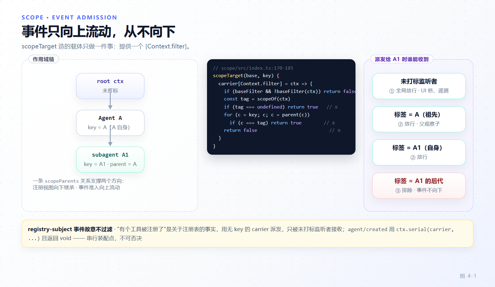

# 第 4 章 作用域与 agent 世界的装配

[← 上一章：可逆 effect、服务与事件分派](03-effects-services-events.md) · [下一章：组合根 →](05-composition-root.md)

> **本章目标**
>
> - 掌握 `dsh-scope` 这个不到 500 行的库为什么是"多 agent 运行时"的地基。
> - 看懂一条 `scopeParents` 关系如何同时支撑两个方向：注册视图向下继承、事件准入向上流动。
> - 会用 `ScopedLayers` / `NamedEntries` 写一个作用域感知的注册表，并理解 `peek()` 为什么故意"链盲"。
> - 分清 shadowing、restriction、scope-local registration 三种"每个 agent 不一样"的机制。
> - 完整走一遍 agent 世界的装配与回收：setup window、`enter`/`announce` 分离、回滚式发布、反序静默。

一个 dsh 进程可以同时跑着主 agent、若干子 agent、别人 fork 出来的会话，每个都可能有不同的工具集、不同的人设、不同的模型选择。第 2 章讲过同一个插件回调可以挂多个 fiber；本章讲**怎样让"这一组注册只属于这个 agent"成为语言级事实**——而不是靠每个消费者自己记得传 `agentId` 过滤。

## 4.1 作用域要解决的问题

朴素做法是给每条注册加一个 `agentId` 字段，读取时过滤。它有三个致命问题：

1. **忘记过滤就是越权**——A 会话的工具出现在 B 会话的 prompt 里。
2. **生命周期与可见性脱钩**——agent 销毁时要遍历所有注册表手工清理，漏一个就泄漏。
3. **事件路由要每个订阅者自己判**——`if (payload.agent.id !== mine) return`。

`packages/core/scope` 的解法是把可见性和生命周期**合并到同一个东西上**：一个 Cordis context。它的模块注释就是全部纲领（`packages/core/scope/src/index.ts:1-6`）：

```ts
/**
 * Scoped-context primitive: mint a Cordis context that tags registrations with
 * an opaque identity and build routing-only event carriers for that identity.
 */
```

一句话：**注册走这个 context，就自动获得"只对这个 agent 可见"和"随这个 agent 回收"两种性质。**

## 4.2 铸造一个作用域

```ts
// packages/core/scope/src/index.ts:137-147
export function createScope(ctx: Context, key: ScopeKey, options?: CreateScopeOptions): Scope {
  if (options?.parent !== undefined) bindScopeParent(key, options.parent)
  const fiber = ctx.plugin(scope)
  const scoped: Context = fiber.ctx.extend({ [kScope]: key })
  let disposing: Promise<void> | undefined
  return {
    ctx: scoped,
    rawDispose: fiber.dispose,
    dispose: () => (disposing ??= quiesceFiber(fiber)),
  }
}
```

三行三个设计决定：

- **`ctx.plugin(scope)` 挂的是一个空函数插件**（`function scope(): void {}`，`:121`）。作用域不需要任何行为，它只需要一个 **fiber 来持有 effect**。第 2 章说过子 fiber 的销毁是父 fiber 的 effect——所以"回收整个作用域"就是"卸载这个空插件"。
- **`extend({ [kScope]: key })` 把身份写进 context**，而不是写进每条注册记录。`scopeOf(ctx)` 读的是继承链上的标记（`:154-156`）。
- **两条销毁路径**：`rawDispose` 保留 Cordis 的精确 disposer 身份，供嵌套进有序复合 effect；`dispose()` 是公开的**共享静默边界**，并发调用等同一次完成（`quiesceFiber`，`:115-118`）。

`ScopeKey` 的类型是 `object`——**按对象身份比较，不看内容**。harness 的约定是"活着的 agent 对象就是它自己作用域的键"（`docs/glossary.md` 的 scope key 条目），但原语本身从不检查这个对象。

## 4.3 一条关系，两个方向

作用域机制支持嵌套（出厂代码里的父子链用在 preset 组合与测试中，而不是让 subagent 继承父作用域——见 4.9）。承载这层关系的只有一个 `WeakMap`：

```ts
// packages/core/scope/src/index.ts:32-39
/** The enclosing scope of each key. One relation powers both directions of
 * scope nesting: registration views inherit DOWN the chain (a child scope
 * sees its ancestors' layers — ScopedLayers), and event admission extends UP
 * it (a listener tagged with an ancestor receives events dispatched to a
 * descendant key — scopeTarget). */
const scopeParents = new WeakMap<ScopeKey, ScopeKey>()
```

- **注册视图向下继承**：子作用域看得到祖先作用域注册的东西（4.5 的 `chainLayers` / `merge`）。
- **事件准入向上流动**：带祖先标签的监听者，会收到派发给后代键的事件。

`bindScopeParent` 的约束很硬（`:72-82`）：一个键**只能绑定一次父节点**，重复绑定直接抛错；只有原始 binder 拿到 `rebind` 句柄；绑定前做环检测（`:54-59`），因为所有链消费者都会走到根。

```ts
export function bindScopeParent(key: ScopeKey, parent: ScopeKey): ScopeParentBinding {
  if (scopeParents.has(key)) {
    throw new Error('dsh-scope: scope key is already bound to a parent; re-linking requires the binding returned by the original bind')
  }
  linkScopeParent(key, parent)
  return { rebind(next: ScopeKey): void { linkScopeParent(key, next) } }
}
```

`rebind` 的文档注释值得读全（`:43-51`）：它只在"旧父节点下产出的东西都不再被保留"时有效——这是 blank-session recompose 的契约，**由持有者自己保证，因为这个关系看不见某个 session 记录了什么**。这类"原语故意不做校验、把不变量交给调用方"的地方，是读 dsh 源码时最需要警觉的地方。

## 4.4 事件准入：只向上，不向下

```ts
// packages/core/scope/src/index.ts:170-185
export function scopeTarget<T extends object>(base: T, key: ScopeKey | undefined): Scoped<T> {
  const baseFilter = (base as { [CordisContext.filter]?: (ctx: Context) => boolean })[CordisContext.filter]
  const carrier = {
    [CordisContext.filter](ctx: Context): boolean {
      if (baseFilter !== undefined && !baseFilter.call(base, ctx)) return false
      const tag = scopeOf(ctx)
      if (tag === undefined) return true
      for (let cursor = key; cursor !== undefined; cursor = scopeParents.get(cursor)) {
        if (cursor === tag) return true
      }
      return false
    },
  }
  carrierKeys.set(carrier, key)
  return carrier as unknown as Scoped<T>
}
```

四条规则，按顺序：

1. 先保留 base 原有的过滤器（接缝自己可能有额外准入条件）。
2. **未打标的监听者全局放行**——不属于任何作用域的观察者（例如 UI 桥、遥测）能看到一切。
3. 监听者标签等于派发键、或是派发键的**祖先** → 放行。
4. 否则拒绝。**标签在派发键下方的，一律排除：事件只向上流动，从不向下。**

第 2 条是"registry-subject 事件保持不过滤"的实现依据：`tools/change`（"有个工具被注册了"）是关于注册表的事实，不是关于某个 agent 的活动，所以它用不带 key 的 carrier 派发，只被未打标监听者接收（`docs/glossary.md` 的 scoped dispatch 条目）。

`Scoped<T>` 类型本身是幻影品牌（`:27`）：它记录主体类型用于派发检查，但**载体不暴露主体的任何属性**——你没法从 carrier 上读出 agent 的字段，主体只能通过事件参数传递。这是防止"顺手拿载体当对象用"的类型护栏。



*图 4-1 · 一次带 carrier 的派发。监听者标签沿 `scopeParents` 向上匹配派发键的祖先链；匹配不到即排除。*

## 4.5 作用域感知的注册表

注册表侧的容器是 `ScopedLayers<L>`（`packages/core/scope/src/store.ts:159-267`）。它持有一个 eagerly 构造的 `global` 层和 `scoped: Map<ScopeKey, L>`，配两张条目表：

- `NamedEntries<V>`：名字唯一，重复错误由调用方工厂给出，`insert` 返回**幂等 undo**，表清空后换掉 Map 实例以切断活迭代器（`:30-105`）。
- `AnonymousEntries<V>`：用 `Symbol()` 做键，**相等的值仍是两条独立注册**（`:114-150`）。

三个读口的语义差别非常关键：

| 方法 | 语义 | 何时用 |
|---|---|---|
| `peek(scope)` | **故意链盲**：只读该作用域自己的层 | 读某一作用域"自己的限制/守卫"，不能悄悄继承祖先的 |
| `chainLayers(scope)` | 沿父链取现有层，远祖先到近者 | 需要继承语义的叠加 |
| `merge(scope, pick)` | 全局命名项 + 作用域覆盖，**近者胜出** | 解析"这个 agent 实际看到哪些条目" |

`peek()` 的注释直接给了理由：*"callers addressing one scope's OWN contributions (its restrictions, its guards) must not silently pick up an ancestor's"*（`:173-179`）。**继承是显式选择的，不是默认发生的**——这是很多"子 agent 意外继承了限制"类 bug 的防线。

写口只有一个：

```ts
// packages/core/scope/src/store.ts:226-266（骨架）
effect(ctx, action, options): () => void {
  const scope = scopeOf(ctx)
  const dispose = ctx.effect(function* (this: ScopedLayers<L>) {
    // 懒建 layer；action 抛错则回收刚建的空层
    yield () => {
      undo()
      if (scope !== undefined && layer.isEmpty()) this.scoped.delete(scope)
      if (notify) this.onChange()
    }
    if (notify) this.onChange()
  }.bind(this), options.label)
  return dispose
}
```

注意三点：**可见性与 effect 归属由同一个 `ctx` 决定**（一次传参，两种性质）；undo 在通知之前收集；只回收**完全变空**的聚合层（一个层可能有多张表，兄弟表还在就不能删）。

消费者样板在 `packages/core/tools/src/index.ts:106`：`new ScopedLayers(scope => new ToolLayer(scope), () => this.ctx.emit('tools/change'))`，`register()` 与 `restrict()` 各自返回 `layers.effect(...)` 的精确 disposer。

## 4.6 三种"每个 agent 不一样"

术语必须分清，否则选型会错（`docs/glossary.md` 的 agent-scope 节）：

| 机制 | 定义 | 组合方式 | 典型用途 |
|---|---|---|---|
| **shadowing** | 同名覆盖：作用域内的工具/段/变量替换它的全局同名孪生 | 按名解析，近者胜出（`merge`） | 每 agent 人设、工具变体 |
| **restriction** | `tools.restrict()` 对**全局**工具集做过滤 | 交集 | 只读会话、plan 模式 |
| **scope-local registration** | 作用域内新增的注册 | 在 restriction 之后合并 | 某 agent 专属工具 |

一条容易被忽略的语义：**被 restriction 滤掉的全局工具，既不出现在 prompt 里，也会拒绝执行**，与"根本不存在"不可区分（`docs/glossary.md`）。这是安全性质——模型不能靠"猜名字调用"绕过限制。`restrict()` 在没有 scope 的 ctx 上直接抛错（`packages/core/tools/src/index.ts:163-166`），因为它天生是"相对某个作用域"的操作。

## 4.7 setup window：注册可以，驱动不行

agent 世界的装配发生在一个有明确边界的时间窗里（`docs/glossary.md` 的 setup window）：作用域与 agent 对象已存在，但 agent/session 尚未发布、`agent/created` 尚未触发、第一条 prompt 尚未装配。

`AgentLoop.initializeAgent` 把这段做成了一个带回滚的发布序列（`packages/core/agent-loop/src/index.ts:622-640`）：

```ts
publication = Promise.withResolvers<void>()
try {
  assertLive()
  await this.appendUnstoredSuffix(stored, session)
  detachSession = agent.ctx.sessions.enter(session)
  agent.ctx.sessions.announce(session)
  assertLive()
  const setupCommit = await raceAbort(setup?.(agent.ctx, agent), abort.signal, id)
  setupCommit?.commit()
  // The mounted backend routes announced live events into the active
  // write handle by session id; the loop only owns the handle itself.
  detachAgent = loopCtx.agents.enter(agent, parentAgent)
  await loopCtx.agents.announce(agent, source, abort.signal)
  ready = true
  return { agent, dispose }
} catch (error: unknown) {
  // Failed initialization must not release queued input into a new turn.
  agent.cancel({ kind: 'disposed' }, { keepInbox: true })
  throw error
}
```

`enter` 与 `announce` 是两个调用，不是一步。为什么拆开？看注册表侧（`packages/core/agent/src/index.ts:484-490`、`:562-580`）：

- `enter(agent, owner)` 建立**权威冲突边界**（同 id 并发创建在这里被拒），并构造 `scopeTarget(agent, agent)` 载体。
- `announce(agent, source, signal)` 才派发 `agent/created`，且用 `ctx.serial(entry.carrier, 'agent/created', {...})`——**串行、无 `next()`、不可否决**。它先置 `entry.announcing = true` 再派发，注释说明原因：*"Mark before dispatch so a listener cannot recursively create a second lifecycle edge"*。

于是 `agent/created` 是一个**串行装配窗口**：setup 代码在里面往 `agent.ctx` 注册 scoped 贡献，注册者按注册顺序依次完成，谁也不能改写或否决"这个 agent 已存在"这一事实。`docs/architecture.md:75` 的"AgentLoop initializes Agents with rollback and awaits serial `agent/created` before queued work"说的就是这段。

失败路径同样讲究：`catch` 里是 `cancel({ kind: 'disposed' }, { keepInbox: true })`——**初始化失败不能把排队的输入释放进一个新 turn**。

## 4.8 回收：反序、静默、不吞错

teardown 是发布的镜像（`packages/core/agent-loop/src/index.ts:498-545`）：

```ts
const teardown = (): Promise<void> => (disposing ??= (async () => {
  abort.abort(...)
  // Teardown failures are collected, never swallowed: registry, scope,
  // and ownership cleanup always run to quiescence, then the memoized
  // disposal rejects with what failed so every racing owner observes it.
  const failures: unknown[] = []
  try {
    if (publication !== undefined) await publication.promise
    if (machine === undefined) await machineReady.promise
    if (machine !== undefined) {
      machine.cancel({ kind: 'disposed' }, { keepInbox: !ready })
      await machine.whenIdle()
    }
    // ... scope.dispose() → handle.close() → detachAgent/detachSession
```

顺序是：`cancel` → `whenIdle()` → `scope.dispose()` → 关闭写 handle → 从注册表摘除。两个注释就是两条纪律：

1. **"Disposal IS a disposed-cause cancel followed by quiescence."** 取消只是请求，静默才是完成。之后还有新工作进来是调用方的 bug（第 18 章把它列为常见事故）。
2. **清理错误收集而非吞掉**，全部跑到静默后，memoized 的 disposal promise 以失败拒绝，让每个并发持有者都观察到。

`if (publication !== undefined) await publication.promise` 这一行也值得停一下：创建期的监听者可能还在 await 中持有 session 与 scope，销毁必须等发布落定。这类"跨异步边界的持有关系"是 dsh 生命周期代码密度最高的地方。

## 4.9 lineage 不是 scope

最后一条边界：作用域只有**两级、扁平**——全局与某个具体作用域。scoped 注册**不会**向下继承到子 agent；父子关系是数据，不是可见性机制（`docs/glossary.md` 的 lineage）：

> **lineage** — parent/child facts carried as data (`parentSession`, durable `delegationDepth`, runtime `subagentDepth`); never affects visibility.

也就是说：`scopeParents` 决定"祖先能看到后代的事件、后代能看到祖先的注册"，而 **lineage 只是记录在日志与运行时里的事实**，供 UI 折叠、深度限制、审计使用。把两者混用，会得到"子 agent 意外继承了父 agent 的工具限制"这类难查的行为。

## 4.10 本章小结

- 作用域把"可见性"与"生命周期"合并到同一个 Cordis context：注册走 `agent.ctx`，两种性质同时得到。
- `createScope` 用一个空插件当 fiber 载体；`rawDispose` 与 `dispose()` 分别服务嵌套编排与并发静默。
- 一条 `scopeParents` 关系支撑两个方向：注册视图向下继承、事件准入向上流动；绑定一次性、环检测、`rebind` 只给原始 binder。
- `scopeTarget` 的准入规则：base 过滤器 → 未打标放行 → 祖先放行 → 其余排除；事件只向上。
- `ScopedLayers` 的 `peek()` 故意链盲、`merge()` 近者胜出；只回收完全变空的聚合层。
- shadowing / restriction / scope-local 是三种不同机制；被 restriction 滤掉的全局工具在 prompt 与执行两侧同时消失。
- setup window 里的 `agent/created` 是串行不可否决的装配点；发布带回滚，回收要求静默。
- lineage 是数据，不影响可见性。

**检查点**

1. 子 agent 为什么看不到父 agent 的 restriction？（答：restriction 是"作用域自己的限制"，注册表用链盲的 `peek()` 读它；只有 `merge`/`chainLayers` 才继承，而限制不走这条路。）
2. 一个遥测监听者想收到所有 agent 的 `agent/status`，它该怎么注册？（答：在**不带 scope 标记**的 context 上注册——未打标监听者全局放行。）
3. `agent/created` 为什么用 `serial` 而不是 `waterfall`？（答：它是发布前的串行装配点，允许注册但不允许任何监听者否决或改写创建结果。）

**延伸阅读**

- 官方 [能力 seam 与核心服务](https://deepseek-harness.github.io/deepseek-harness/reference/capability-seams)、[核心子系统](https://deepseek-harness.github.io/deepseek-harness/reference/subsystems/core)
- 源码：`packages/core/scope/src/index.ts`、`packages/core/scope/src/store.ts`、`packages/core/agent/src/dispatch.ts`、`packages/core/agent-loop/src/index.ts`
- 下一章：[组合根：profile、bundle、patch 与启动序列](05-composition-root.md)
