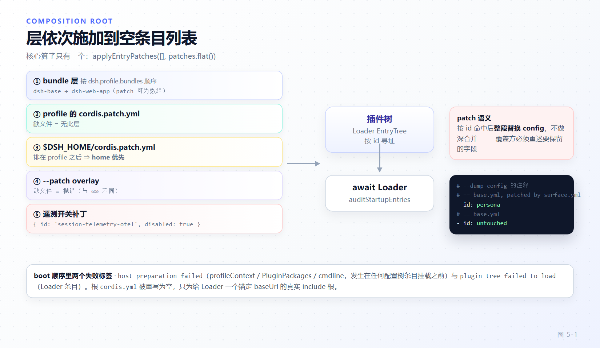

# 第 5 章 组合根：profile、bundle、patch 与启动序列

[← 上一章：作用域与 agent 世界的装配](04-scope-agent-world.md) · [下一章：Agent Loop →](06-agent-loop.md)

> **本章目标**
>
> - 建立"运行中的 dsh 是一棵把若干 patch 层依次施加到空条目列表上的 Cordis 插件树"这一心智模型，确认它没有特权内核。
> - 精确复述从 `installFailLoud` 到 `auditStartupEntries` 的启动序列，并知道每一步的不变量。
> - 掌握层序（bundle → profile → home → `--patch` → 遥测）与"整段替换 config、不做深合并"的优先级规则。
> - 分清两种 patch 文件的失败语义：profile/home 缺文件是"无此层"，bundle/overlay 缺文件是抛错。
> - 读懂 `dsh` 字段 manifest（`DshBundleManifest` / `DshProfileManifest` / `DshClientManifest`）与模板表。
> - 会用 `--dump-config` 求"可加载的 YAML"，理解它与真实挂载为何不会漂移。

第 4 章把 `Context`、realm、scope 这些"装配原语"讲完了。本章讲这些原语是**按什么顺序、由谁**组装成一棵能跑的应用树的。这个组装点在架构里叫**组合根（composition root）**，实现它的主要代码在 `packages/boot/app-boot/`。

## 5.1 第一性原理：没有特权内核

一个反直觉但必须内化的事实：dsh 启动后加载的插件树里，**没有任何一个插件是"内核"**。包括 `agent-loop`、`tool-executor-native`、`webserver` 这些被 `requiredStartupEntryIds`（`packages/boot/app-boot/src/index.ts:949-960`）强制要求激活的条目——它们之所以"必须存在"，只是因为启动审计在检查，而不是因为 Loader 给了它们特殊地位。它们和你在 profile 里手插的一行工具插件，在 Loader 眼里是同一种东西。

那棵树是怎么来的？**把若干 patch 层依次施加到一个空的条目列表上**。核心算子只有一个：`applyEntryPatches`（来自 `@deepseek-ai/cordis-plugin-include`），在 `packages/boot/app-boot/src/profile.ts:755-762` 被包成一个极小的函数：

```ts
// packages/boot/app-boot/src/profile.ts:755-762
export function composeEntries(
  layers: readonly PatchOptions[][], warn: (message: string) => void = () => {},
): EntryOptions[] {
  return applyEntryPatches([], structuredClone(layers.flat()), (message: string, ...args: unknown[]) => {
    let index = 0
    warn(message.replace(/%C/g, () => JSON.stringify(args[index++])))
  })
}
```

`[]` 是起点，`layers.flat()` 是所有层的 patch，按顺序摊平成一个列表。没有别的魔法。`dsh-base` 不是根配置，也不是 `cordis:include`——它只是 `bundles` 数组的第一项，其 `cordis.patch.yml` 对空根做一次 `insert`（见 5.3 的真实文件）。这一句话能挡掉本章末尾列出的第一个常见误区。

## 5.2 精确的启动序列

`boot()`（`packages/boot/app-boot/src/index.ts:1203-1274`）是把一棵配置树变成活体 context 的函数。它的函数体给出了严格的顺序，每一步都有理由：

```ts
// packages/boot/app-boot/src/index.ts:1210-1243（节选）
const ctx = new Context()
// ...
ctx.baseUrl = pathToFileURL(dirname(absoluteConfigPath)).href + '/'
ctx.provide('dshHomePath', dshHomePath)
ctx.on('internal/update', (_config, _noSave, next: () => unknown) => {
  void Promise.resolve(next()).catch((error: unknown) => { ctx.logger.error(error) })
}, { global: true, prepend: true })
await ctx.plugin(Loader)
await prepare?.(ctx)
stage = 'plugin tree failed to load'
await mountRootInclude(ctx, absoluteConfigPath, patches, bareModuleBaseUrl, binName)
await ctx.get('loader')?.await()
if (ctx.get('loader') === undefined) return ctx
await auditStartupEntries(ctx, binName)
```

把完整链路串起来（CLI profile 路径）：

1. **`installFailLoud`**（`packages/boot/app-boot/src/index.ts:882-931`）必须**在 boot 之前**装上，把 `unhandledRejection` / `uncaughtException` 转成一条 `util.inspect` 诊断加 `exit(1)`。为什么先装：Loader 并发挂载条目，晚装会漏掉窗口期里的孤儿 rejection。诊断用 `inspect(err)` 而非 `err.stack`，因为 `node:fs` 错误的 `code` / `path` / `cause` 是可枚举属性，栈行不带它们。
2. **`loadLayeredEnv`**（`packages/boot/app-boot/src/index.ts:236-257`，CLI 在 `apps/cli/src/bin.ts:36` 调用）解析三层环境：**继承环境 > 调用目录 `.env` > `$DSH_HOME/.env`**。它先解析两个文件再应用任何一个，且应用时不覆盖已有名字。安全闸门：任何文件里出现 `BOOTSTRAP_NAMES`（`PATH`、`NODE_OPTIONS`、`HTTP_PROXY`… 见 `packages/boot/app-boot/src/index.ts:134-155`）或带 `DSH_` / `XDG_` / `DYLD_` / `BASH_FUNC_` 前缀（`packages/boot/app-boot/src/index.ts:158`）的名字，**在值被物化之前就抛错**（`readEnvLayer`，`packages/boot/app-boot/src/index.ts:208-221`）。唯一例外是 `$DSH_HOME/.env` 里的四个代理名（`HOME_LAYER_PROXY_NAMES`），因为它不随仓库传播。
3. **`resolveConfigPath`**（`packages/boot/app-boot/src/index.ts:102-110`）做快照感知的路径解析：`DSH_SNAPSHOT=replay` 时把 `cordis.yml` 换成同目录的 `cordis.snapshot.yml`。README 把它列为最小嵌入方入口的一环（`installFailLoud('dsh')` 后 `boot('dsh', resolveConfigPath(...))`）；CLI 的 profile 路径不经过它，而直接从 profile 目录拼 `rootConfig`（`apps/cli/src/profile-boot.ts:313`），回放切换由快照启动器 `profileArgs`（`packages/test-support/session-snapshot/src/launcher.ts:344-368`）在 `--patch` 层面完成。
4. **`composeProfile` / `prepareProfile`**（`apps/cli/src/profile-boot.ts:194-236`）加载 profile、算出运行时 resolution、把 `--patch` 摊平成 overlays，并**重写空的 `cordis.yml`**。为什么要重写：vendored Loader 的树写回可能把已组合的行烘进这个文件，下次启动就会把每个 bundle 的 insert 重复一遍；文件存在只是因为 Loader 需要一个**真实的 include 根**把 `baseUrl` 锚定在 profile 目录上。config dump 锚定同一个文件，所以两者组合在同一个 base 上。
5. **`new Context()` → `ctx.provide('dshHomePath')`**：把 harness-home 路径解析器暴露给 `!!js` 表达式（见 5.6）。
6. **全局 `internal/update` 观察者**（`prepend: true`）：`Fiber.update()` 会丢弃重启 promise，这里先观察它，激活审计才能报出失败的 fiber。
7. **`await ctx.plugin(Loader)`** 安装 Loader 服务本身。
8. **`prepare(ctx)`**：host 准备发生在任何配置树条目挂载之前。CLI 传入的回调（`apps/cli/src/profile-boot.ts:323-339`）在此 `provide('profileContext', ...)`、`provide(DSH_LAUNCH_ENVIRONMENT_KEY, ...)`、`ctx.plugin(PluginPackages, { resolution })`、`provideCmdline(...)`。顺序不变量很硬：这些 host 事实必须在第一个插件 import 之前就位，因为插件的 `!!js` config 可能读 `ctx.profileContext` 或启动快照。
9. **`mountRootInclude`**（`packages/boot/app-boot/src/index.ts:741-788`）注册两个 builtin——`cordis:include`（`ctx.loader.builtins.include`）与 `cordis:group`（`ctx.loader.builtins.group`，`packages/boot/app-boot/src/index.ts:766`）——用固定 id `'include'`（`packages/boot/app-boot/src/index.ts:777-779`）挂载根 Include。固定 id 因为该 id 出现在 Loader 失败链里，随机 id 会让启动诊断跨运行不稳定。挂载前先跑 `prepareProfilePatches`（`packages/boot/app-boot/src/index.ts:772`）做兼容性预检，被策略拒绝的插件永远不会被 import。
10. **`await loader.await()`** 排空条目工作（注意：不会因单个条目失败而整体 reject），随后 `if (ctx.get('loader') === undefined) return ctx` 处理"某个 surface 在启动在飞时 dispose 了整棵树"的情况。
11. **`auditStartupEntries`**（`packages/boot/app-boot/src/index.ts:1156-1170`）施加启动策略：`requiredStartupEntryIds` 里的条目未激活则抛 `StartupError`；其余未激活条目要么并入失败诊断，要么在没有 required 失败时产生一条警告，让成功的兄弟条目继续跑。

## 5.3 层序与优先级

层的顺序由 `readProfilePatches`（`packages/boot/app-boot/src/profile-context.ts:74-85`）定义：

```ts
// packages/boot/app-boot/src/profile-context.ts:74-85（节选）
export function readProfilePatches(binName: string, context: ProfileContext, initialProfile?: Profile): PatchOptions[] {
  const patches = structuredClone([
    ...readBundlePatches(binName, context, initialProfile),
    ...(initialProfile?.patches ?? loadOptionalPatches(binName, context.patchPath) ?? []),
    ...(loadOptionalPatches(binName, join(context.home, PROFILE_PATCH_FILENAME)) ?? []),
    ...context.overlays,
  ])
  const telemetryPatch = resolveTelemetryPatch(context.telemetryDisabledEnv,
    composeEntries([patches]).some(row => row.id === TELEMETRY_ROW_ID))
  if (telemetryPatch !== undefined) patches.push(telemetryPatch)
  return patches
}
```

顺序（从低到高，越靠后越优先）：

1. **bundle 层**：按 `dsh.profile.bundles` 顺序，每个 bundle 把它的 `patch`（一个文件或一个有序列表）摊平进去；
2. **profile 的 `cordis.patch.yml`**（`context.patchPath`，即 `$DSH_HOME/profiles/<name>/cordis.patch.yml`）；
3. **`$DSH_HOME/cordis.patch.yml`**（home 层，机器本地、对每个 profile 生效的偏好）；
4. **`--patch` overlay**（`context.overlays`，argv 顺序）；
5. **遥测开关补丁**（`resolveTelemetryPatch`，`packages/boot/app-boot/src/profile-context.ts:52-55`）。

要点：**profile 层排在 home 层之前，所以 home 优先**——你的机器本地覆盖能压过某个 profile 自己的偏好。而核心算子只有一个 `applyEntryPatches([], patches.flat())`：所有层摊平成一次调用，"越靠后越优先"就是在这个摊平列表里"后面的 patch 覆盖前面的行"。



*图 5-1 · 每一层都在上一层的结果上按 id 整段替换或 insert，最终得到挂载用的条目列表*

真正的坑在这里：**patch 命中 id 后整段替换 `config`，不做深合并**。`packages/bundle/base/cordis.patch.yml` 的头注释把这条写得毫不含糊：

```yaml
# packages/bundle/base/cordis.patch.yml:1-13（节选）
# The dsh-base bundle patch: the shared core of each base-backed profile, applied as
# ONE insert over the empty profile root. Later bundle patches and the user's
# profile cordis.patch.yml address these rows by id, with the last write
# winning per row.
#
# A patch replaces the targeted row's whole `config` rather than merging into
# it, so a row whose value differs by mode does NOT live here ...
```

所以覆盖方**必须重述要保留的字段**。你想改一个 8 字段 config 里的 1 个，得把那 8 个都写出来，否则其余 7 个回到插件默认值。这也解释了为什么"某个值随模式不同"的行不该放进 base：它应该待在各模式 bundle 里，让每一行只由"一个 bundle 层 + 用户层"负责。

`preset` 行沿用同一优先级：一个 `@deepseek-ai/dsh-agent-preset` 声明内部有 `config.plugins` 列表（`packages/preset/agent-preset-registry/src/definition.ts:6-10`），Web 编辑器保存的编辑按 id 覆盖这个 preset 声明的 `config.plugins`（见 `packages/bundle/web-app/presets/standard.patch.yml` 的头注释）——同一条"整段替换、后面的赢"的规则，只是作用域下沉到 preset 内部。

## 5.4 两种 patch 文件的失败语义

同样是缺文件，语义取决于**是谁点名的这个文件**。

- **profile / home 的 `cordis.patch.yml`**：缺文件 = "无此层"，不报错。启动读取路径 `loadProfileDirectory` 用 `existsSync` 先探测再决定读或空（`packages/boot/app-boot/src/profile.ts:708-711`），HMR 重读路径 `readProfilePatches` 用 `loadOptionalPatches`——后者只在 `ENOENT` 时返回 `undefined`，其它读/解析失败抛错（`packages/boot/app-boot/src/index.ts:518-527`）。
- **bundle 的 `cordis.patch.yml` 与 `--patch` overlay**：缺文件 = **抛错**。因为它们被调用方点名了，缺席就是配置错误而非"没有 overlay"。`loadProfileDirectory` 对 bundle 用 `loadOverlayPatches`（`packages/boot/app-boot/src/profile.ts:702`），`composeProfile` 对 `--patch` 同样用 `loadOverlayPatches`（`apps/cli/src/profile-boot.ts:234`）；`loadOverlayPatches` 读不到就抛（`packages/boot/app-boot/src/index.ts:538-546`）。

两个函数共享解析器 `parsePatchList`，它有一条硬约束：**顶层必须是 YAML 数组**：

```ts
// packages/boot/app-boot/src/index.ts:582-584
if (!Array.isArray(parsed)) {
  throw new Error(`${binName}: ${label} ${file} must be a top-level YAML array of loader patch entries`)
}
```

后果：**空文件导致启动失败**（空文件解析出 `undefined`，不是数组）。要禁用某一层，写 `[]` 而不是清空文件。`initProfile` 生成的模板正是这么做的（`packages/boot/app-boot/src/profile.ts:174-178`，末行是 `[]`）。

还有一个粒度差异值得记住：一个 patch 目标行不存在，**不是致命错误**，只是一条 per-entry 的 Loader 警告（`parsePatchList` 注释，`packages/boot/app-boot/src/index.ts:559-566`）。所以一份跨多个 surface 共享的 overlay 不必匹配每一棵树的每一行——文件级错误是致命的，行级 miss 是宽容的。

## 5.5 `dsh` 字段 manifest 与模板表

profile 与 bundle 的组合关系声明在 `package.json` 的 `dsh` 字段里，类型定义在 `packages/util/package-manifest/src/types.ts`：

- `DshBundleManifest`（`packages/util/package-manifest/src/types.ts:70-78`）：`patch: string | string[]`（一个文件或一个**有序**列表）、可选 `platforms`、`listedByDefault`。
- `DshProfileManifest`（`packages/util/package-manifest/src/types.ts:80-84`）：`bundles?: string[]`，有序层列表。
- `DshClientManifest`（`packages/util/package-manifest/src/types.ts:86-100`）：`platform` / `inject` / `immediately` / `external`，由 client-modules 与 client build 消费。

数组形式的真实例子——`packages/bundle/web-app/package.json:46-56` 声明了 5 个有序 patch 文件：

```json
// packages/bundle/web-app/package.json:46-56
"dsh": {
  "bundle": {
    "patch": [
      "./cordis.patch.yml",
      "./presets/standard.patch.yml",
      "./presets/ptc.patch.yml",
      "./presets/minimal.patch.yml",
      "./presets/cordis.patch.yml"
    ]
  }
}
```

`bundlePatchFiles`（`packages/boot/app-boot/src/profile.ts:54-60`）校验并摊平这个声明，`bundlePatchPaths`（`packages/boot/app-boot/src/profile.ts:69-71`）把它解析为绝对路径。对比 `dsh-base` 自己只用一个字符串 `"./cordis.patch.yml"`（`packages/bundle/base/package.json:31-35`）。

随产品交付的模板表在 `packages/util/official-bundles/src/bundles.ts:10-26`：

```ts
// packages/util/official-bundles/src/bundles.ts:10-26
export const PROFILE_TEMPLATES: Record<string, ProfileTemplate> = {
  acp:      { bundles: ['@deepseek-ai/dsh-base', '@deepseek-ai/dsh-acp-app'] },
  web:      { bundles: ['@deepseek-ai/dsh-base', '@deepseek-ai/dsh-web-app'] },
  headless: { bundles: ['@deepseek-ai/dsh-base', '@deepseek-ai/dsh-headless'] },
  sdk:      { bundles: ['@deepseek-ai/dsh-base', '@deepseek-ai/dsh-sdk-app'] },
  'sdk-minimal': { bundles: ['@deepseek-ai/dsh-sdk-minimal'] },
}
```

`web` / `headless` / `sdk` / `acp` 都在 `dsh-base` 之上叠一个模式 bundle；**`sdk-minimal` 是唯一不叠 base 的模板**，它只列自己的独立 bundle。bundle 解析有两种锚点，且顺序固定为**安装优先**（`resolveBundleDir`，`packages/boot/app-boot/src/profile.ts:651-662`）：先 dsh 安装，再 profile 目录——这条契约保证 `dsh-base` 永远来自运行中的那份安装，绝不会取到 profile 本地的一份陈旧副本。

## 5.6 真实 cordis.yml 行与 `!!js`

`!!js` 是 Loader 的 YAML 自定义标签，把标量变成一段相对每个条目的可注入 context 求值的表达式。`packages/boot/app-boot/src/index.ts:261-266` 注释说明 dialect 直接从 include 导入（`entryListSchema`），好让"patch 解析"与"config dump"永不与"实际挂载"漂移。

真实例子——`snapshots/sdk/bash-tool/cordis.yml` 里 `!!js` 既用于取路径，也用于三元判断：

```yaml
# snapshots/sdk/bash-tool/cordis.yml:14-18
- id: session-persistence-jsonl
  name: '@deepseek-ai/dsh-session-persistence-jsonl'
  config:
    root: !!js dshHomePath('sessions')
    compression: !!js "process.env.DSH_SNAPSHOT === undefined ? 'zstd' : 'none'"
```

`dshHomePath` 之所以在表达式里可用，就是 5.2 第 5 步的 `ctx.provide('dshHomePath', dshHomePath)`。

`disabled: !!js` 是层优先级的典型体现。base 里 `plugin-manager` 与 `hmr` 两行默认这样写：

```yaml
# packages/bundle/base/cordis.patch.yml:27-32
    # Profile configuration reloads by default; module roots are opt-in.
    - id: hmr
      name: '@deepseek-ai/dsh-hmr'
      disabled: !!js "!ctx.get('profileContext')"
      config:
        root: []
```

`!ctx.get('profileContext')`：非 dsh profile 启动（比如别的嵌入方直接 `ctx.plugin`）时它没有 `profileContext`，于是 hmr / plugin-manager 自动禁用；dsh launcher 启动时 `prepare` 已经提供了 `profileContext`（5.2 第 8 步），所以它们启用。**HMR 开关其实是 YAML 控制的**，不是某个 CLI flag：base 开，`headless`（`packages/bundle/headless/cordis.patch.yml:35-36`）、`acp`（`packages/bundle/acp-app/cordis.patch.yml:22-23`）、`sdk`（`packages/bundle/sdk-app/cordis.patch.yml:23-24`）用一行 `- id: hmr` `disabled: true` 关掉，`sdk-minimal` 则整行省略（它不叠 base，压根没有这一行）。

最小禁用式 overlay（`apps/cli/config/examples/ptc.yml`）示范了怎么用一个 `--patch` 文件把原生执行切成 PTC：

```yaml
# apps/cli/config/examples/ptc.yml
- id: tool-executor-native
  disabled: true

- id: tool-executor-ptc
  disabled: false
```

注意它不需要重述 executor 的任何 config——它只翻 `disabled` 开关，config 保持插件默认。这正是"整段替换"的补集：只写你要改的字段，行本身若命中则整段 config 被这个 patch 里的 config 替换（这里没有 config，所以是纯 disable）。

## 5.7 `--dump-config`：不求值的可加载 YAML

`renderConfigDump`（`packages/boot/app-boot/src/index.ts:633-696`）打印的是**可加载的 YAML 文档**，不是求值后的 JSON。三个关键行为：

- **`!!js` 原样打印、不求值**。dump 用 include 的 `entryListSchema` 渲染（`packages/boot/app-boot/src/index.ts:709`），所以表达式保留成 `!!js` 标量，dump 出来的文件可以直接当配置 include 回去。
- **每段连续同源代码前有 `# ==` 注释**。`groupedDump`（`packages/boot/app-boot/src/index.ts:698-727`）对连续同源行归组，注释格式是 `# == <源文件>, patched by <层>`：

  ```ts
  // packages/boot/app-boot/src/index.ts:708 与 716-718
  lines.push(`# == ${currentLabel}`)
  // label = record.origin，或
  //         `${record.origin}, patched by ${record.patchedBy.join(', ')}`
  ```

- **dump 与真实挂载走同一次调用，所以不会漂移**。函数头注释（`packages/boot/app-boot/src/index.ts:601-632`）说得很清楚：dump 用 `applyEntryPatches` 把 base 加 layers 1..k 逐次快照、按位置 diff 出每行来源；`snapshot_N` 就是挂载的组合，`boot()` 用的是一模一样的参数。因此连 patch-可见性的边角情况（后一层去 patch 一个纯 config 替换刚引入的 group 子行，而单趟 id 索引看不见它）也在 dump 里组合得和挂载一致。

三个 dump 命令的分工（`apps/cli/src/args.ts:111-135` 解析、`apps/cli/src/bin.ts:55-68` 分派）：

- `--dump-config`：完整组合（bundle 层 + profile 层 + home 层 + `--patch` overlay），逐层由 `collectConfigDumpLayers`（`apps/cli/src/dump-config.ts:51-73`）按 bundle→profile→home→argv 顺序收集。
- `--dump-default-config`：**去掉 profile 用户层、home 层与 `--patch` overlay**，只打印 bundle 层——这是给坏掉的 `cordis.patch.yml` 用的恢复诊断（那个文件根本不会被解析）。它和 `--patch` 互斥（`apps/cli/src/args.ts:131-134`）。
- `--dump-config-schema`：不挂载，但**会 import 每个组合模块**去读它的 config schema。README（`packages/boot/app-boot/README.zh.md:54`）警告：只对已信任其插件的 profile 运行它。

三个 dump 都是**boot-free** 的：dump 从不运行 app 命令行 provider，所以它无法显示那些 flag 会决定的值，args 里有 app 参数直接报错（`apps/cli/src/args.ts:125-127`）——打印一棵和同一次调用真实挂载不一样的树只会误导。

## 5.8 CLI 形态与 boot 组成员

`runCli`（`apps/cli/src/bin.ts:26-74`）只有四种 mode：`profile`、`plugin`、`dump-config`、`dump-config-schema`。参数解析在 `parseDshArgs`（`apps/cli/src/args.ts:146-216`），两条规则决定用户体验：

1. **launcher flag 必须在前，`passThroughOptions` 让第一个不认识的 token 之后原样交给应用**（`apps/cli/src/args.ts:165`）。所以 `dsh web --help` 打印的是 web 应用自己的帮助，不是 launcher 的；`dsh --profile tui --resume abc` 带着 `--resume abc` 启动 tui。启动器只解析它拥有的东西：profile、`--patch`、config dump。app flag 归 app 插件自己管（通过 `ctx.cmdlineArgs` 拿同一份不可变快照，见第 8 步的 `provideCmdline`）。
2. **`dsh <name>` 是 `dsh --profile <name>` 的缩写**。第一个非 `-`、非 `plugin` 的 token 会被展开成 `['--profile', ...argv]`（`apps/cli/src/args.ts:206-208`）。裸 `dsh -h`（没有 profile 可交给 app）才打印 launcher 自己的帮助。

```ts
// apps/cli/src/args.ts:206-209
const expanded = first !== undefined && !first.startsWith('-') && first !== 'plugin'
  ? ['--profile', ...argv]
  : argv
program.parse(expanded, { from: 'user' })
```

`dsh plugin` 实际转发给 pnpm，只截获三个 DSH 自有命令：`allow-version` / `revoke-version` / `version-exemptions`（`apps/cli/src/plugin.ts:18-63`，判据在 `plugin.ts:20`）。其余参数全部原样进 pnpm（`runPlugin` → `runPluginCommand` / `runProfilePnpm`，`apps/cli/src/plugin.ts:93-98`），在 profile 目录里执行。`allow-version` 会先打一条隐私警告并要求 `--accept-risk`，因为它绕过的是精确版本的兼容性闸门。

boot 组的其余成员各占一个 `ctx` key，把"启动"延展成"运行时可管理启动后的组合"：

| 包 | `ctx` key | 拥有什么 |
|---|---|---|
| `cmdline`（`packages/boot/cmdline/src/index.ts`） | `cmdlineArgs` / `appExit` / `appReady` | launcher flag 之后原样传入的 app 参数、有界退出、就绪信号 |
| `hmr`（`packages/boot/hmr/src/index.ts:27`） | `hmr` | 单一串行队列 `runExclusive`（`packages/boot/hmr/src/index.ts:267-276`）串行化模块/配置重载，`reconcileProfile`（`packages/boot/hmr/src/index.ts:925`）重读 bundle 层并 `recomposeProfile` |
| `config-editor`（`packages/boot/config-editor/src/index.ts:17`） | `configEditor` | 经 Loader 应用并持久化 profile 配置，与热重载互斥 |
| `plugin-manager`（`packages/boot/plugin-manager/src/index.ts:307`） | `pluginManager` | 当前 profile 插件/bundle 管理，复用 CLI 的 pnpm 操作 |
| `plugin-market`（`packages/boot/plugin-market/src/index.ts:38`） | `pluginMarket` | 读取用户配置的插件索引，供发现页与 `plugin_market` 工具 |

`hmr` 的队列值得一个精确说明：`runExclusive` 把调用方拥有的变更与所有自动重载路径串行化（并拒绝嵌套事务），`reconcileProfile` 必须在这个队列内运行、且要求 `profileContext`。它有一个 app-ready 门（`applicationReady` / `ctx.appReady`，`packages/boot/hmr/src/index.ts:369-373`）：重载只在应用启动完成后触发。README 明确写着"包安装/删除在该队列之外执行；HMR 不获取包操作写锁"（`packages/boot/hmr/README.zh.md:59`）。

## 5.9 本章小结与常见误区

- **没有特权内核**：整棵树是 `applyEntryPatches([], patches.flat())` 对一个空条目列表施加所有层的结果；required 条目只是被审计，不被 Loader 特殊对待。
- **启动序列有严格不变量**：fail-loud 前置；`.env` 里 bootstrap-only 名字在物化前就抛；host 准备（`profileContext` / `PluginPackages` / `provideCmdline`）在**任何配置树条目挂载之前**；固定 id `'include'` 挂载根；`loader.await()` 排空后才审计。
- **层序**：bundle → profile → home → `--patch` → 遥测，profile 在 home 之前所以 home 优先；patch 命中 id **整段替换 config**，覆盖方要重述保留字段；`preset` 在 `config.plugins` 内部沿用同一优先级。
- **两种缺文件语义**：profile/home 缺 = 无此层；bundle/`--patch` 缺 = 抛错；顶层必须数组，空文件失败，禁用写 `[]`。
- **manifest**：`patch` 可以是字符串或有序数组；模板表里 `sdk-minimal` 是唯一不叠 base 的；bundle 解析安装优先。
- **dump 不求值、可加载、带 `# ==` 来源注释**，且与真实挂载同一次调用所以不漂移。

**检查点**

1. 你在 home `cordis.patch.yml` 里写了 `- id: hmr` 只带 `config: { base: './x' }`，为什么运行起来 hmr 的 `root: []` 没了？（答：patch 整段替换 config 不做深合并，你只写了 `base`，`root` 回到插件默认；要保留 `root: []` 得重述它。）
2. 为什么 `prepare(ctx)`（提供 `profileContext`）必须排在 `mountRootInclude` 之前？（答：base 里 `disabled: !!js "!ctx.get('profileContext')"` 在条目挂载时就要读 `profileContext`；晚提供会让这些行按"无 profileContext"= 禁用错挂。）
3. 把某层 `cordis.patch.yml` 清空成 0 字节文件，下一次启动会怎样？（答：解析出非数组，抛错启动失败——禁用应写 `[]`。）

**延伸阅读**

- 官方 [子系统总览](https://deepseek-harness.github.io/deepseek-harness/reference/subsystems/)（boot 页尚未发布到站点，仓库内见 `docs/subsystems/boot.md`）、[配置目录](https://deepseek-harness.github.io/deepseek-harness/reference/config-catalog)、[组合与 HMR 教程](https://deepseek-harness.github.io/deepseek-harness/develop/cordis-tutorial/06-composition-and-hmr)
- 源码：`packages/boot/app-boot/src/index.ts`（`boot` / `mountRootInclude` / `auditStartupEntries` / `renderConfigDump`）、`packages/boot/app-boot/src/profile.ts`（层组合与 bundle 解析）、`packages/boot/app-boot/src/profile-context.ts`（层序）、`apps/cli/src/{bin,args,profile-boot,plugin,dump-config}.ts`、`packages/util/official-bundles/src/bundles.ts`
- 相邻章：[第 4 章 作用域与 agent 世界的装配](04-scope-agent-world.md)、[第 6 章 Agent Loop](06-agent-loop.md)、[第 11 章 扩展点地图与选型](11-extension-map.md)
