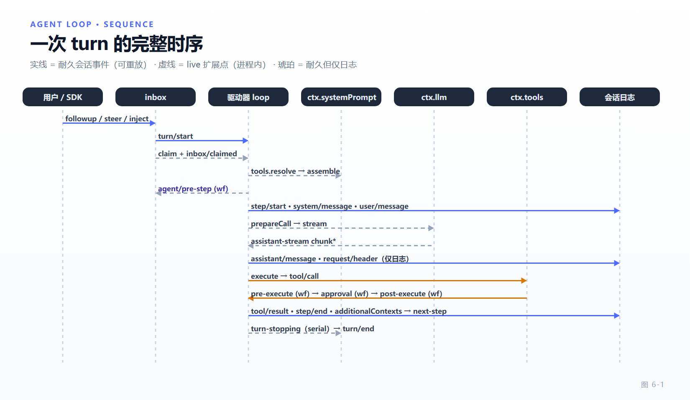

# 第 6 章 Agent Loop：turn、step 与请求装配

[← 上一章：组合根](05-composition-root.md) · [下一章：工具执行管线 →](07-tool-pipeline.md)

> **本章目标**
>
> - 精确区分 turn、step、round、exchange 四个层级，不再把它们当同义词。
> - 走通一次 step 的完整源码路径：claim → resolve → assemble → pre-step → prepareCall → 提交 → 冻结 → 流式 → 工具 → step/end。
> - 理解"重试不重复装配"这条不变量在源码里的落点。
> - 知道 `agent/pre-step` 的三种决定各自会留下什么耐久痕迹。
> - 掌握取消、失败与"缺失工具结果"的补全语义。

`packages/core/agent-loop` 只有一个 `ReactLoopAgent` 类实现了 `Agent` 接口（`packages/core/agent-loop/src/agent.ts:112`），它的内部是一台相位机 `idle | maintenance | running{turn, step}`（`:53-61`）。本章按这台机器的真实跳转顺序讲，而不是按概念图讲。

## 6.1 四个层级：turn / step / round / exchange

`docs/glossary.md` 的定义是权威的，抄在这里：

| 术语 | 定义 | 谁负责 |
|---|---|---|
| **step** | 一次模型请求 + 它引发的工具执行 | loop |
| **turn** | 一轮被准入的输入排空，直到模型和它的工具停止、或终局策略介入；包含 0 个或多个 step | loop |
| **round** | 包住 turn 的外层策略迭代，例如 goal round 或一次 fresh-agent Ralph 尝试 | 该策略自己，**不统计会话内所有 turn** |
| **exchange** | 从"首个 step 准入人类输入的那个 turn"起，到下一个这样的 turn 为止的连续 turns | UI 折叠语义 |

两个高频误解：

- **turn 可以包含零个 step。** 首个 claim 被 `agent/pre-step` 拒绝、或返回的 `enter` 消息为空，都会关闭一个耐久 turn 而不进步骤（`agent.ts:348-359`）。所以"有 `turn/start` 必有 `step/start`"是错的。
- **round 计数器不属于 loop。** goal 的轮次上限、Ralph 的尝试次数都是外层策略自己的账本，与 turn 数无关。

## 6.2 一个 inbox，两种唤醒目标

驱动器只有一个输入口。`followup` / `steer` / `inject` 三种语义最终都汇到 `send(message, target, wakeup)` → `inbox.splice` → `wakeDriver`（`agent.ts:170-189`）。

`ReactLoopInbox` 把每一次变更归一成**一条耐久 `agent/inbox/spliced` 追加**，再按消息发 live 的 `agent/inbox/inserted|claimed|discarded`（`packages/core/agent-loop/src/inbox.ts:108-113`、`:186-231`）。fold 侧拒绝越界 splice 与重复 `MessageId`（`:26-64`）。

投递目标只有两个：`'next-step'` 与 `'next-turn'`。区别在 `turn()` 里体现（`agent.ts:342`、`:400`）：turn 边界用 `next-turn`，同一 turn 内的后续 step 用 `next-step`。这就是"注入的上下文要等一条唤醒消息才生效"的机制来源——`docs/architecture.md:110`。

运行中收到唤醒不会打断当前 step，而是 latch 一个 `wakeRequested`（`agent.ts:230-251`）；驱动器整体运行在 `loopCtx.agents.withInitiator(this, () => this.kick())` 里（`:250`），所以"谁发起了这段工作"能沿异步链传播（进程内 initiator，见第 13 章的子 agent 委派）。

`kick()` 的全部内容是 `while (await this.turn()) {}`（`agent.ts:270`）——turn 返回真表示还有事可做。

## 6.3 preStep：装配发生在决定之前

`preStep()` 是整章信息密度最高的一段（`packages/core/agent-loop/src/agent.ts:283-309`）：

```ts
const claimed = this.inbox.claim(target, position.turn)
const selection = this.model.current()
if (selection === undefined) {
  throw new Error(`agent "${this.id}" has no provider/model: ...`)
}
const toolSet = await this.loopCtx.tools.resolve({ agent: this, modelSelection: selection, signal })
try {
  const assembly = await this.loopCtx.systemPrompt.assemble({ ...assembleContextFor(this, signal), modelSelection: selection, toolSet })
  signal.throwIfAborted()
  const decision = await this.dispatch.waterfall(
    'agent/pre-step', { messages: claimed, ...position, signal, modelSelection: selection },
    (): Promise<PreStepDecision> => {
      const sections = renderContextSections(assembly)
      const context = this.runtimeContext.project(joinContextSections(sections), sections)
      return Promise.resolve<PreStepDecision>({ kind: 'enter', messages: context === undefined ? claimed : [...claimed, context] })
    })
```

顺序里藏着四条不变量：

1. **模型选择先被快照**。`AssembleContext.modelSelection` 与 `agent/pre-step.modelSelection` 携带同一份快照，**重试期间保持不变**；未指定 reasoning effort 时用适配器默认（`docs/architecture.md:112`）。
2. **工具集在决定之前就已 resolve**。`tools.resolve()` 每个提议步骤解析一次，返回 step 所有的冻结 `ResolvedToolSet`（第 7 章）；被拒绝时 `toolSet` 会被 dispose（`agent.ts:309`）。
3. **prompt 装配也在决定之前**。`system-prompt/assemble` 瀑布拿到的 toolSet 就是这一步要用的 toolSet。
4. **runtime context 只在 fallback 里投影**。也就是说：只有当没有任何监听者否决内置行为时，才会计算并追加 runtime context。一个替换了 `messages` 的监听者要自己负责上下文。

> 官方 `docs/architecture.md:86-88` 那行 `-> agent/pre-step; project runtime context at fallback` 说的就是第 4 点。它是"上下文工程"与"循环"的接缝，第 9 章会接到这里。

## 6.4 决定的三种结果

`PreStepDecision` 是判别联合（`packages/core/agent/src/runtime-types.ts:139-146`），loop 对三种结果留下不同的耐久痕迹：

| 决定 | loop 行为 | 日志痕迹 |
|---|---|---|
| `{ kind: 'reject' }` | 已 claim 的批次保持移除状态，本轮**不花 step**，`turn/end` 记 `blocked` | `turn/start` + `turn/end`，无 `step/start` |
| `enter` 但消息为空（首个 claim） | 关闭 turn，`completed` | 同上 |
| `enter(messages)` | `step/start`，进入 6.5 | 完整 step 序列 |

claim 是**破坏性**的：被拒绝的消息不会退回 inbox。这个语义解释了一个常见现象——"我加了个 pre-step 守卫，结果用户消息凭空消失了"。想保留请显式重新 `inject`。

`enter` 还可以带 `startsRequestSeries`，声明"这是一串新请求的开始"。loop 据此决定是否记一条新的 `request/header`（reason 为 `series`，或信封也变了时 `change` + `startsSeries: true`）。**包装别人决定的监听者必须用 `{ ...decision, messages }` 保留这个声明**（第 3 章 3.6 节）。

## 6.5 step 的重试循环：装配只做一次

`step()` 内部是 `while (true)` 重试环（`agent.ts:445-490`）。关键在**哪些步骤只在第一次尝试执行**：

```ts
// agent.ts:630-648（要点）
// 1) 已废弃的 agent/request 瀑布：只调控制参数
//    监听者若改了 provider / model / effort → 硬错误
// 2) 绑定适配器
const preparedCall = await this.loopCtx.llm.prepareCall(proposedConfig, signal)
//    只容忍 NO_ADAPTER
```

然后是提交阶段（`agent.ts:455-477`）：

```ts
for (const { message, intent } of commits) {
  this.session.append('system/message', { turn, step, message }, intent)
}
let contextAdmitted = false
if (firstAttempt) {
  for (const message of decision.messages) {
    if (message.source.kind === 'runtime-context') {
      if (context !== undefined && !contextAdmitted) {
        this.session.append('user/message', context, { surfaceOp: 'append' })
        contextAdmitted = true
      }
    } else {
      this.session.append('user/message', message, { surfaceOp: 'append' })
    }
  }
}
if (context !== undefined && !contextAdmitted) {
  this.session.append('user/message', context, { surfaceOp: 'append' })
}
firstAttempt = false
```

逐条读：

- **system prompt 是历史节点，不是请求头字段。** 每次尝试都按注册事实重算并逐节点 reconcile，落成 `system/message`；空文本清除它，有能力的路由追加更新，其他路由在第一个 system 节点处合并（`docs/architecture.md:112`）。第 9 章展开。
- **准入的 user 消息只在首次尝试提交。** `if (firstAttempt)` 与末尾 `firstAttempt = false` 一起保证：重试不会把同一条用户消息追加两遍。
- **runtime context 消息可以被替换**。当 `decision.messages` 里出现 `source.kind === 'runtime-context'` 时，loop 用 `context` 变量指向的那条替换它，且只准入一次（`contextAdmitted` 门）。
- **prepareCall 与提交之间取消，两边都不落盘**。`docs/architecture.md:91` 的"cancellation commits neither system nor users"由这段的同步性保证：`preparedCall` 能力 governs prompt admission，取消发生在两个异步阶段时，同步准入还没跑。

`buildRequest()`（`agent.ts:656-743`）负责最后一步：记 `request/header`（`initial`/`resume`/`change`/`series`，`packages/core/session/src/types.ts:279`）、发工具增删的 `developer/message` 通知、按需记 `request/context`、对派生消息**按身份深冻结一次**，最后冻结请求对象 `{ ...header.config, messages: deriveMessages(), toolHistory, tools, sessionId, signal }`——**没有 `system` 字段**，因为 system 已经在 messages 里。

> 这条链实现了第 8 章的纲领：**每次请求都是日志的纯函数**。重试不重复装配、不重复 `agent/pre-step`、不重复准入用户（`docs/agent-lifecycle.md:87`）。

## 6.6 流式：一次尝试、一条结算

```ts
const stream = preparedCall?.stream(request) ?? this.loopCtx.llm.stream(request)
```

（`agent.ts:490`）优先用绑定好的 prepared call；`llm/stream` 瀑布仍然生效，但它是**单次消费**的，所以每次重试都要新的 `prepareCall()`。

每次尝试对应一个 `AssistantStreamAttempt`（`packages/core/agent-loop/src/assistant-stream.ts:18（`start`/`chunk`/`end` 在 `:49-109`）`）：发 `start`、逐帧发 `chunk`、**恰好一个终局 `end`**；`end.outcome` 只有在耐久追加成功后才是 `committed`，否则 `abandoned`。取消时把已送达文本以 `interrupted: true` 结算（`agent.ts:502-519`）。

两条耐久结算路径的分工（第 8 章会给出"为什么"）：

| 事件 | 触发 | 是否进入模型历史 |
|---|---|---|
| `assistant/message` | 成功（包括无内容与 `max-tokens` 结束） | 是，且内嵌紧凑计时流 |
| `assistant/attempt` | 失败、被重试、被取消、流错误的已结算尝试 | 否，仅日志 |

live 的 `agent/assistant-stream` 是 Web UI 增量渲染的唯一来源；**它是进程内的，不是 write-ahead log**——结算前硬进程崩溃不会留下任何耐久流。

请求错误走 `agent/request-error` 瀑布（`agent.ts:548-563`）：监听者返回 `{ kind: 'retry' }` 且不调 `next()` 即在同一 step 内重入尝试环，复用已渲染的装配。

## 6.7 工具批次与 additionalContexts

```ts
// agent.ts:587-604
const maxParallelToolCalls = this.loopCtx.agentLoop.config.maxParallelToolCalls.get()
try {
  const result = await this.loopCtx.tools.execute({
    calls: toolCalls, signal, agent: this, log: { turn, step },
    maxParallelToolCalls, toolSet: decision.toolSet,
  })
  for (const context of result.additionalContexts) {
    this.inbox.splice('next-step', this.inbox.nextStep.length, 0, [context])
  }
  return result.concluded ? { kind: 'completed' } : null
} catch (error: unknown) {
  if (!(error instanceof ToolBatchExecutionError)) throw error
  for (const context of error.partial.additionalContexts) { /* ... */ }
  throw error.cause
}
```

三个语义：

- **`additionalContexts` 落在 `next-step`**，即"本 turn 的下一个 step 会看到它"，不会插进刚完成的这条结果旁边。第 7 章解释为什么 PTC 模式故意省略它。
- **`concluded` 是工具主动结束 turn 的权利**（例如 plan 模式退出、ask-user 得到终答）。返回 `{ kind: 'completed' }` 让 turn 直接收口。
- **批次失败时先 ferry 部分上下文，再抛 `error.cause`**。原始错误穿透，但已经产生的上下文不丢。

`log: { turn, step }` 这个参数决定了 `tool/call` / `tool/result` 是否由执行器落盘（第 7 章 7.7）。

## 6.8 取消、终局与缺失结果

`cancel(cause, options)` 先按 `keepInbox` 决定是否清空 inbox，再 abort 相位控制器（`agent.ts:191-197`）；`turn/end` 记录一份**拷贝过的** `AgentCancelCause`（`:94-109`、`:402-407`）——拷贝是故意的，防止调用方后续修改原因对象污染耐久记录。

turn 的结束原因由 `TurnEndReasonMap` 声明合并扩展（`packages/core/session/src/types.ts:206-238`）：loop 写 `completed` / `max-tokens` / `blocked` / `aborted` / `error`，另有两种 **loop 从不实时发出**的补记 closer——`interrupted`（resume 为未闭合的历史 turn 补上，冷读时合成）与 `forked`（只有 fork seed 携带）。自然停止前会过一次 `agent/turn-stopping`——**serial、无 `next()` 的终局检查点**（`agent.ts:396`），这是第 3 章 3.7 节说的"退化为严格串行观察者链"的实例，也是"想拦住这一轮继续"的正确挂载点。

失败 step 收尾前，`ToolCallRecovery` 会给没有结果的调用补上 `TOOL_OUTCOME_UNKNOWN` 或 `TOOL_NOT_STARTED`（`agent.ts:363-384`，实现在 `packages/core/session/src/repair.ts:15-18`、`:105`、`:188-189`）。这条不变量很重要：**模型历史里不能出现"有 call 无 result"的悬空调用**，否则下一次请求在 provider 侧直接非法。

## 6.9 完整事件序列

下表按源码顺序给出一次带工具调用的 turn。`docs/agent-lifecycle.md` 的 Mermaid 图是好的近似，但它在三处与源码有偏差（见 6.10 的坑），画图和排查请以本表为准。

| # | 事件 | 类型 | 落点 |
|---|---|---|---|
| 1 | `agent/inbox/spliced` | 耐久 | `inbox.ts:223` |
| 2 | `agent/inbox/inserted` | live emit | `inbox.ts:228` |
| 3 | `agent/status` running | live emit | `agent.ts:166`/`:243` |
| 4 | `turn/start` | 耐久 | `agent.ts:336` |
| 5 | `agent/inbox/spliced`（纯删除）+ `agent/inbox/claimed` | 耐久 + live | `inbox.ts:109-111` |
| 6 | `tools.resolve` → `system-prompt/assemble` | live waterfall | `agent.ts:292`、`system-prompt/src/index.ts:682` |
| 7 | `agent/pre-step` | live waterfall | `agent.ts:296` |
| 8 | `step/start` | 耐久 | `agent.ts:361` |
| 9 | `agent/request`（已废弃） | live waterfall | `agent.ts:630` |
| 10 | `llm.prepareCall` | 服务调用 | `agent.ts:644` |
| 11 | `system/message` / `user/message` | 耐久 surface | `agent.ts:460`、`:467-476` |
| 12 | `request/header` / `developer/message` / `request/context` | 耐久（header 与 context **仅日志**） | `agent.ts:677`、`:700`、`:722` |
| 13 | `llm/stream` → `agent/assistant-stream` start/chunk* | live waterfall + emit | `agent.ts:490-496`、`assistant-stream.ts:49/60` |
| 14 | `assistant/message` \| `assistant/attempt` → stream end(`committed`) | 耐久 + live 终局 | `agent.ts:576`/`:546`、`assistant-stream.ts:78` |
| 15 | `agent/request-error`（仅失败路径） | live waterfall | `agent.ts:548` |
| 16 | `tool/call` | 耐久（执行器落） | `tools/src/batch.ts:247` |
| 17 | `tools/pre-execute` → `approval/request` → guards → `tools/execute` | live waterfall | `pipeline.ts:199`、`user-approval/src/index.ts:308`、`:299` |
| 17b | `approval/asked` / `approval/decided` | 耐久（仅日志审计） | `user-approval/src/index.ts:252`、`:259` |
| 18 | `tools/post-execute` → `tools/result` | live waterfall + emit | `pipeline.ts:487`、`:408` |
| 19 | `tool/result` | 耐久 surface | `batch.ts:256` |
| 20 | `agent/inbox/spliced`/`inserted`（additionalContexts） | 耐久 + live | `agent.ts:595` |
| 21 | `step/end` | 耐久 | `agent.ts:388` |
| 22 | `agent/turn-stopping` | live serial | `agent.ts:396` |
| 23 | `turn/end` | 耐久 | `agent.ts:422` |
| 24 | `agent/status` idle / `agent/error` | live emit | `agent.ts:277`→`:166`、`:264` |



*图 6-1 · 耐久事件（实线，进 `session/event`，可重放）与 live 扩展点（虚线，进程内）在同一时间轴上的交错。*

## 6.10 三处文档与源码的偏差

读官方图时注意（都是本表与源码核对的结果）：

1. `docs/architecture.md:106` 说"不在耐久清单里的都是 live 扩展点"，但会话日志里还有一批耐久事件不由 loop 写：`request/header`、`developer/message`、`request/context`、`agent/inbox/spliced` 出自 loop（`agent.ts:677`、`:700`、`:722`、`inbox.ts:223`），而 `model/selection` 出自 `packages/core/agent/src/model-selection.ts:114`、`approval/asked|decided` 出自 `packages/interaction/user-approval/src/index.ts:252`、`:259`、`sandbox/mode` 出自 `packages/sandbox/sandbox-policy/src/session-mode.ts:54`；其中 header 与 context 是**耐久但仅日志**（`packages/core/session/src/types.ts:394-410`）。
2. `docs/agent-lifecycle.md:59-65` 把 `tool/call`/`tool/result` 的落盘归给 Driver，实际由所选执行器的 `BatchSettlement` 落，且**仅在 loop 传了 `log` 时**（`packages/core/tools/src/batch.ts:243-280`）。
3. `docs/agent-lifecycle.md:44` 写"bound prepared call through `llm/stream` waterfall"，源码优先调用 `preparedCall.stream()`（`agent.ts:490`）——瀑布仍然生效，但它是单次消费的，因此每次重试都要重新 prepare。

## 6.11 本章小结

- turn 可含零个 step；round 是外层策略的账本；exchange 是 UI 折叠概念。
- 一个 inbox、两种投递目标；运行中唤醒只 latch，不打断。
- 装配（resolve + assemble）发生在 `agent/pre-step` **之前**；runtime context 只在内置 fallback 里投影。
- claim 是破坏性的；`reject` 会留下"有 turn 无 step"的耐久痕迹。
- 重试不重复装配、不重复 pre-step、不重复准入用户；prepareCall 与提交之间取消则两边都不落盘。
- 一次尝试一条结算：成功进 `assistant/message`（内嵌紧凑流），失败/取消进 `assistant/attempt`（仅日志）。
- `additionalContexts` 落 `next-step`；`concluded` 让工具结束 turn；批次失败先 ferry 部分上下文。
- 取消 = disposed-cause cancel + 静默；失败 step 必须补齐缺失的 `tool/result`。

**检查点**

1. 你在 `agent/pre-step` 里 return `{ kind: 'reject' }`，用户消息去哪了？（答：保持在已 claim 的移除状态，不会退回 inbox；日志里有 `turn/start`/`turn/end`，无 step。）
2. 为什么 system prompt 走 `system/message` 而不是请求里的 `system` 字段？（答：让它成为可重放的耐久历史节点，从而"请求是日志的纯函数"；见第 8、9 章。）
3. 一次请求失败后重试，`agent/pre-step` 会再跑一次吗？（答：不会。重试复用已渲染的装配，只做 prepareCall + reconcile。）

**延伸阅读**

- 官方 [Agent 生命周期](https://deepseek-harness.github.io/deepseek-harness/reference/agent-lifecycle)、[概念 · Turn Flow](https://deepseek-harness.github.io/deepseek-harness/reference/)
- 源码：`packages/core/agent-loop/src/agent.ts`、`inbox.ts`、`assistant-stream.ts`、`packages/core/agent/README.md`
- 下一章：[工具执行管线与策略接缝](07-tool-pipeline.md)
