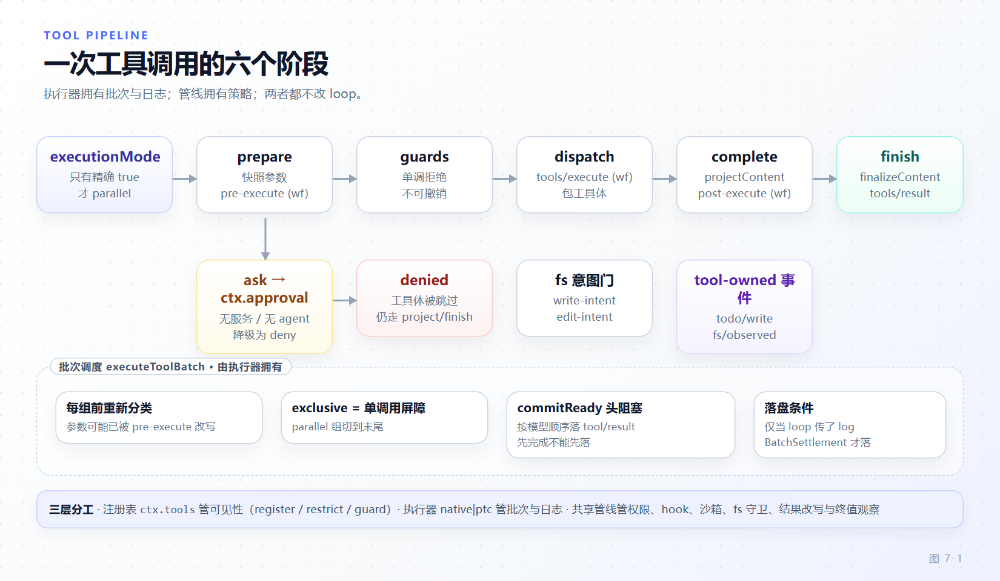

# 第 7 章 工具执行管线与策略接缝

[← 上一章：Agent Loop](06-agent-loop.md) · [下一章：会话日志 →](08-session-log.md)

> **本章目标**
>
> - 分清工具栈的三层：作用域注册表、可替换执行器、共享调用管线，各自能改什么。
> - 掌握 `defineTool` 的契约边界：什么被自动校验、什么必须手写、什么必须是纯函数。
> - 理解 `resolve()` 产出的 step-owned `ResolvedToolSet` 为什么是"条件工具"的基础。
> - 走通管线六个阶段与三个瀑布，知道拒绝、审批、守卫、超时各自挂在哪。
> - 掌握批次调度的 fail-closed 并发语义与"结果相邻性"约束。

第 6 章里 loop 只调了一个方法：`ctx.tools.execute({ calls, signal, agent, log, maxParallelToolCalls, toolSet })`。这一章把这一个调用展开——它是 dsh 里策略密度最高的一段代码，也是"模型能力"与"部署约束"真正握手的地方。

## 7.1 三层，不要混

| 层 | 拥有者 | 职责 | 不该做 |
|---|---|---|---|
| 注册表 | `packages/core/tools`（`ctx.tools`） | 作用域可见性、限制、守卫、执行器选择 | 决定怎么调度 |
| 执行器 | `tool-executor-native` / `tool-executor-ptc` | 解析原始批次、调度、取消、Session 落 `tool/call`/`tool/result` | 塞业务策略 |
| 调用管线 | `packages/core/tools/src/pipeline.ts` | 两个执行器共用的策略链：权限、hook、沙箱、fs 守卫、结果改写、终值观察、渲染 | 决定批次顺序 |

这个拆分是刻意的：**执行器拥有原始批次与日志，管线拥有策略**。所以换一个执行器（native → PTC）不会改变任何一条审批规则；加一条策略也不需要碰 loop。`docs/tool-execution-pipeline.md:6` 的原话是"without changing the loop"。

## 7.2 `defineTool` 的契约边界

签名（`packages/core/tools/src/schema.ts:555`）：

```ts
export function defineTool<const S extends ParameterSchemaSpec, const O extends ValueSchemaSpec>(
  options: DefineToolOptions<S, O>,
): ToolDefinition
```

`const` 泛型参数是为了把字面量 schema 的类型推到底。它给你三件事，也拿走三件事：

**给你的：**

1. **参数结构校验**。包装后的 `execute` 先跑 `validate(args)`，违规抛 `ToolArgsError`（`schema.ts:598-602`）：

```ts
async execute(args: unknown, exec: ToolRunContext): Promise<JsonValue> {
  const violations = validate(args)
  if (violations.length > 0) throw new ToolArgsError(violations)
  return userExecute(args as InferArgs<S>, exec) as Promise<JsonValue>
},
```

2. **输出类型推断**。返回值类型由 `output.schema` 反推，`InferValue` 递归深度限制在 16 层（`schema.ts:154-173`）。
3. **模型可见投影的白名单**。只有允许出现在 schema 里的键会被投影给模型（`schema.ts:641-646`）。

**拿走的：**

1. 跨字段规则、非空串、正数——**仍要手写**。`packages/todo/tool-todo/src/index.ts` 的 `toTodoList()` 就是范例：schema 保证形状，函数保证语义。
2. 副作用与外部调用的重试/超时策略——那是 `tools/execute` 包装者与 `packages/guard/timeout-policy` 的事。
3. "让 UI 好看"的自由度：`presentCall` / `presentResult` **必须是纯函数**（第 12 章详述），因为它们同时跑在实时流与 session-log 回放两条路上。

## 7.3 注册、限制与守卫

`ToolsService` 用第 4 章的 `ScopedLayers` 持有每个作用域的注册与已编译限制（`packages/core/tools/src/index.ts:63-87`、`:106`）。三个写口对应三种语义：

```ts
// 注册（可带条件）
register(definition, options: ToolRegistrationOptions = {})   // index.ts:128
// 限制：只对某个作用域生效，作用于全局集合，按交集组合
restrict(...)                                                  // index.ts:162-189
// 守卫：单调拒绝，不可被后续监听者撤销
guard(...)                                                     // index.ts:384-386
```

`restrict()` 在没有作用域的 ctx 上直接抛错（`:163-166`），并拒绝 `run_code` 与未注册名字。`guard()` 的定位在 `docs/tool-execution-pipeline.md:64` 说得很清楚：**"owner policy that must not be reordered remains a registered guard"**——普通 `tools/pre-execute` 监听者的顺序是可协商的，守卫不是。

条件注册是 v0.2.1-rc.2 引入的破坏性变更，`resolve()` 每步只对每个工具求值一次 `when`（`packages/core/tools/src/index.ts:264-280`）：

```ts
for (const [name, definition] of view.visible) {
  const registration = view.registrations.get(name)
  let enabled: boolean
  try {
    enabled = registration?.when === undefined || await registration.when(context)
  } catch (cause: unknown) {
    signal.throwIfAborted()
    throw new ToolActivationError(name, cause)
  }
  if (enabled) admitted.set(name, definition)
}
```

产出的是一个 **step 所有的冻结 `ResolvedToolSet`**：只准入那个确切 agent、只在定义未变时有效。`when` 抛错 → `TOOL_ACTIVATION_FAILED`；名字不在集合里 → `UNKNOWN_TOOL`。

> 一个常见的连带影响：`system-prompt/assemble` 的返回值**不再携带 `tools`**（升级指南 `docs/upgrade-guide/v0.2.1-rc.2/conditional-tools/guide.md`）。还在读 `assembly.tools` 的监听者会拿到 `undefined` 并在运行时报错。

## 7.4 执行器选择：就近、每作用域一个、撤回不回落

```ts
// packages/core/tools/src/index.ts:357-367
private selectExecutor(scope?: ScopeKey): ToolExecutor {
  let record: Registration | undefined
  for (const key of scopeChainOf(scope)) {
    record = this.scoped.get(key)
    if (record !== undefined) break
  }
  record ??= this.root
  const executor = record?.executor
  if (executor === undefined) throw new ToolExecutorUnavailableError()
  return executor
}
```

三条规则：

1. **每个作用域只能有一个执行器**——`setExecutor()` 在已有执行器时直接抛错（`:328`）。
2. **沿作用域链就近选择**，找不到才用 root。
3. **撤回的选择保持不可用，不静默回落**（`docs/subsystems/tools.md:714`、`:722``）。一个已注册的批次即使执行器随后卸载也会由它结算完（`index.ts:371-373` 的注释）。

`setExecutor()` 还顺手做了一件聪明事：执行器可以带 `sections`，注册成 prompt 段，但段文本只有在**该执行器确实被选中时**才渲染（`:332-342`）：

```ts
text: ({ scope, toolSet }) => {
  if (this.selectExecutor(scope) !== executor) return ''
  return typeof section.text === 'function' ? section.text(this.definitions(scope, toolSet)) : section.text
},
```

这就是"切到 PTC 模式，prompt 里才出现 `run_code` 说明"的实现——不需要任何全局开关。

## 7.5 六个阶段

`ToolExecutionPipeline` 把一次调用切成六段（`packages/core/tools/src/pipeline.ts`）：

```
executionMode → prepare → dispatch → complete → finish → (批次落盘)
```

| 阶段 | 行号 | 做什么 | 失败会怎样 |
|---|---|---|---|
| `executionMode` | `:105-114` | fail-closed 决定并发模式 | 分类器抛错 → `exclusive` |
| `prepare` | `:190-233`（`createExecution` 在 `:116-182`）| 快照并冻结参数、执行器拒绝、`tools/pre-execute`、`ask` → 审批、守卫、取消检查 | deny / 抛错 → 规范化错误结果 |
| `dispatch` | `:258-325` | `tools/execute` 包住 `dispatchToolBody`，融合 caller/wrapper signal，收集延迟上下文，规范化结果 | 包装者抛错 → 规范化 |
| `complete` | `:336-364` | `projectContent` → `tools/post-execute` → 取消覆盖 | 抛错 → 规范化 |
| `finish` | `:374-389`（`applyFinalContent`/`notifyResult` 在 `:391-419`）| `materializeFinalResult` → `finalizeContent` → `tools/result` 通知 | 快照失败被规范化后再走一遍 |

`executionMode` 的 fail-closed 值得单独记：

```ts
executionMode(exec: ToolExecutionInput): ToolExecutionMode {
  const tool = this.resolveExecution(exec.name, exec.agent, exec.parent !== undefined, exec.toolSet)
  if (!tool?.isConcurrencySafe) return { kind: 'exclusive' }
  try {
    const concurrencySafe: unknown = tool.isConcurrencySafe(exec.arguments)
    return concurrencySafe === true ? { kind: 'parallel' } : { kind: 'exclusive' }
  } catch {
    return { kind: 'exclusive' }
  }
}
```

**只有精确 `true` 才并行**；未知、隐藏、未声明、非法、抛错——一律独占。这是"并发是申请来的，不是默认给的"。

`finish` 阶段的两个细节体现了观察面的纪律（`pipeline.ts:399-412`）：先把 exec `Object.freeze`，再用 `dispatch('emit', ...)` 手工取 `tools/result` 的回调并**逐个 try**，观察者抛错只写 warn 日志——

```ts
/** Notify observers without exposing a mutation or error channel into the outcome. */
private notifyResult(exec: ToolExecution, result: ToolExecutionResult): void {
  Object.freeze(exec)
  // ...
  const reportFailure = (error: unknown): void => {
    this.ctx.logger.warn(`tool "${toolName}" (${callId}): tools/result observer failed: ...`)
  }
```

所以 `tools/result` 是**只读、不可变、无法改变结果**的终值观察点。想改结果，位置在 `tools/post-execute`。

## 7.6 审批在管线里的位置

`docs/tool-execution-pipeline.md:64` 给出准确次序：

```
tools/pre-execute → (ask 时) ctx.approval → 单调 guards → tools/execute → 工具体
```



*图 7-1 · 执行器拥有批次与日志，共享管线拥有策略；`ask` 在守卫之前被审批解决，被拒绝的调用仍会走完 `projectContent` 与 `finish` 以便留下规范结果。*

即：**`ctx.approval` 在 guards 之前解决 ask**。`packages/core/tools/src/pipeline.ts:432-473` 消费审批结果：`allowed-once` 继续，三种非授权各有不同拒绝理由，**没有审批服务或没有 agent 时降级为 deny**（fail closed）。

`ctx.approval` 自己是一个 seam，回答者是 `approval/request` 瀑布的监听者（第 13 章）。ACP 桥只给自己的 agent 应答；没人应答就是 `unavailable` → deny。

## 7.7 批次调度与结果相邻性

`executeToolBatch()`（`packages/core/tools/src/batch.ts:50-96`）的调度规则：

- 每个分组开始前**重新分类**头部调用（`executionMode` 可以再问一次，因为参数可能已被 `tools/pre-execute` 改写）。
- `parallel` 组切到末尾；`exclusive` 是**单调用屏障**。
- 滚动池上限取 `maxParallelToolCalls ?? maxParallel()`。
- `commitReady()` 维护**模型顺序的 head-of-line 游标**：先完成的并行调用不能先落 `tool/result`，必须等头部就绪。
- abort 时为未启动的调用**合成跳过结果**。

`tool/call` 与 `tool/result` 由 `BatchSettlement` 落盘，且**仅当 `input.log` 存在**（`batch.ts:243-280`）。这解释了第 6 章那个 `log: { turn, step }` 参数的作用：loop 传了它，执行器才负责耐久落盘；不传（例如某些嵌套/程序化调用）就只走管线不落日志。

## 7.8 结果编码

成功路径：snapshot → 校验 `output.schema` → `render` → 可选 `presentationMeta`（`pipeline.ts:537-567`）。失败路径被编码成**文本 + 结构化信息**两半（`:695-703`）：

```
Error: <message>
```

外加 `error.info` 里的结构化字段。取消码是 `ABORTED` 与 `ABORTED_BEFORE_DISPATCH`（`:744-769`、`contracts.ts:264-267`）——后者区分"根本没开始"与"开始了被中断"，模型据此判断能否安全重试。

`projectContent` 与 `finalizeContent` 是定义自有的两个内容钩子，次序固定：**`projectContent` 在 `tools/post-execute` 之前安装执行期内容；`finalizeContent` 与 `tools/result` 在其之后**（`docs/tool-execution-pipeline.md:6`）。`finalizeContent` 是"最后一个只改内容的不变量"，它拿到的是快照后的回调，看不到其他结果字段（`pipeline.ts:392-397`）。

## 7.9 PTC：程序化工具调用

PTC（programmatic tool calling）不是"另一种工具"，而是**换一层传输**：模型只看到 `run_code`，真实工具变成程序里的异步绑定。

```ts
// packages/core/tool-executor-ptc/src/index.ts:33-38
this.pipeline = new ToolExecutionPipeline(ctx, {
  get: (name, scope, toolSet) => name === RUN_CODE_NAME ? this.requirePtcTransport() : tools.executable(name, scope, toolSet),
  reject: (name, nested) => !nested && name !== RUN_CODE_NAME
    ? new ToolNotFoundError(name, `only \`${RUN_CODE_NAME}\` is callable directly — call \`${name}\` from inside a \`${RUN_CODE_NAME}\` program instead`)
    : undefined,
})
```

`reject` 在**策略之前**就拒绝对其他名字的直调。SDK 文本由调用 agent 可见 schema 生成（`src/ts-types.ts`、`src/py-types.ts`），程序通过 `ctx.ptcRuntime.resolve/run` 在解析出的沙箱策略下执行，`stateOwner = agent`。

子调用的调度刻意镜像 native 的并发/屏障规则：每次派生 `<parent>:ptc:<n>` 形式的 call id，走单条有序 driver lane，落 `tool/ptc-dispatch-start` / `tool/ptc-dispatch`（仅日志），拒绝以 binding rejection 形式返回，图片结果以 `ptc-mode` 上下文 ferry，`concludesTurn` 只从嵌套成功里转发（`src/ptc.ts:273-757`）。

> **PTC 故意省略 `additionalContexts`**，为的是保持 call/result 相邻性（`docs/tool-execution-pipeline.md:64`）。这是第 6 章 6.7 节那条"additionalContexts 落 next-step"规则的例外：在 PTC 里插一段用户消息会打断程序对结果顺序的预期。

## 7.10 本章小结

- 三层分工：注册表管可见性，执行器管批次与日志，管线管策略；换执行器不改策略，加策略不碰 loop。
- `defineTool` 只保证形状；语义校验、跨字段规则、重试策略仍归你。
- `restrict` 是交集过滤、`guard` 是单调拒绝、`when` 是每步一次的条件准入；被限制掉的全局工具在 prompt 与执行两侧同时消失。
- 执行器"每作用域一个、就近选择、撤回不回落"；prompt 段随选中执行器条件渲染。
- 并发是申请来的：只有 `isConcurrencySafe` 精确返回 `true` 才并行。
- 审批在守卫之前解决 ask；无审批服务即 deny。
- `tool/result` 按模型顺序头阻塞提交；`tool/call`/`tool/result` 只在 loop 传了 `log` 时由执行器落盘。
- `tools/result` 是冻结后的只读观察点；要改结果去 `tools/post-execute`。
- PTC 只暴露 `run_code`，并省略 `additionalContexts` 以保持相邻性。

**检查点**

1. 你想加一条"任何写 `/etc` 的调用一律拒绝，且后续监听者不得撤销"。挂哪里？（答：`ctx.tools.guard()`，不是 `tools/pre-execute`。）
2. 一个工具声明了 `isConcurrencySafe` 但偶尔抛异常，会怎样？（答：该次调用按 `exclusive` 调度；不会崩，也不会并行。）
3. 切到 PTC 后模型直接调 `read_file` 会怎样？（答：在策略之前就被 `ToolNotFoundError` 拒绝，提示应从 `run_code` 程序内调用。）

**延伸阅读**

- 官方 [工具执行流水线](https://deepseek-harness.github.io/deepseek-harness/reference/tool-execution-pipeline)、[工具目录](https://deepseek-harness.github.io/deepseek-harness/reference/tool-catalog)、[工具子系统](https://deepseek-harness.github.io/deepseek-harness/reference/subsystems/tools)
- 源码：`packages/core/tools/src/{index,schema,pipeline,batch,executor,contracts}.ts`、`packages/core/tool-executor-ptc/src/ptc.ts`
- 下一章：[会话日志：模型可见即已记录](08-session-log.md)
