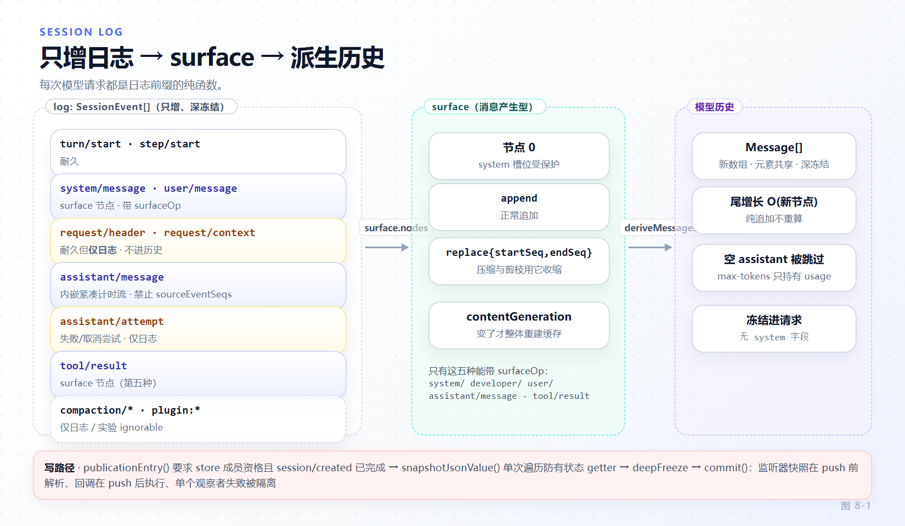

# 第 8 章 会话日志：模型可见即已记录

[← 上一章：工具执行管线](07-tool-pipeline.md) · [下一章：上下文工程与压缩 →](09-context-compaction.md)

> **本章目标**
>
> - 理解"model-visible ⟺ logged"这条纲领为什么是硬约束，以及它排除了哪些"看起来更简单"的设计。
> - 掌握 `SessionEvent` 信封的结构：判别联合、位置品牌、surface 意图与 `ignorable`。
> - 走通一次 append 的完整路径：store 成员资格 → 快照校验 → 深冻结 → 提交 → 广播。
> - 分清 `session/event`（提交后广播）与 `session/flush`（await 的持久化栅栏）。
> - 知道 `deriveMessages()` 的增量缓存边界，以及插件自有消息投影的义务。

第 6、7 章反复出现"耐久"这个词。这一章给出它的定义：**`packages/core/session` 拥有的那条只增日志，就是模型所能看到的全部世界的唯一事实源**。

## 8.1 纲领：模型可见即已记录

`docs/architecture.md:128` 的原文：

> **Model-visible means logged.** Every model request must be reconstructable from the log. New model-visible inputs require session events.

这条约束排除了三种常见设计：

| 被排除的设计 | 为什么不行 | dsh 的做法 |
|---|---|---|
| system prompt 作为请求头字段 | 重启后无法从日志重建当次请求 | `system/message` 是 surface 节点 0（`packages/core/session/src/types.ts:324-338`） |
| 请求配置作为会话 header 状态 | 中途换模型/换工具后历史失真 | `request/header` 全量快照 + `foldRequestHeader()` 取最新（`index.ts:927-937`） |
| 逐 chunk 一条事件 | 持久化/遥测/传输成本按 token 计数 | 一次尝试一条结算事件（8.4） |

于是每次模型请求都是**日志的纯函数**：给定日志前缀 + 代码，就能重放出完全相同的请求。fork、resume、转录、遥测、持久化都从同一批耐久结算派生——这是第 17 章格式演进能成立的前提。

## 8.2 事件信封

`SessionEventMap` 是可声明合并扩展的字典（`packages/core/session/src/types.ts:287`），内核成员包括 `turn/start|end`、`step/start|end`、`user/message`、`developer/message`、`system/message`、`assistant/message`、`assistant/attempt`、`tool/call`、`tool/result`、`request/header`、`request/context`、`session/end-seed`。

落盘信封是真正的判别联合（`types.ts:501`）：

```ts
export type SessionEvent<T extends SessionEventType = SessionEventType> = {
  [K in SessionEventType]: {
    type: K
    seq: SessionSeq
    time: number
    data: SessionEventMap[K]
    ignorable?: true
  } & (K extends SurfaceEventType ? SurfaceIntent<K> : {
    surfaceOp?: never
    sourceEventSeqs?: never
  })
}[T]
```

`switch (event.type)` 即可收窄 `event.data`——这是所有消费者（投影、导出、迁移、UI）能写得简单的根本原因。

只有五种事件携带 surface 意图（`types.ts:447-452`）：`system/message`、`developer/message`、`user/message`、`assistant/message`、`tool/result`。它们带 `surfaceOp: 'append' | { op: 'replace'; startSeq; endSeq }`（`types.ts:470-472`），并且可以用 `sourceEventSeqs` 指向被替换的更早来源。`assistant/message` **禁止** `sourceEventSeqs`，因为它的流已经内嵌（`types.ts:480-482`）。

> 已知不一致：`types.ts:494-499` 与 `docs/persistence-catalog.md:131-132` 在列举 surface 类型时漏了 `developer/message`，与 `SurfaceEventType` 不一致。以 `types.ts:447-452` 为准。

## 8.3 位置是品牌化的四种类型

日志里"第几个事件"这件事有四个不可互换的类型（`types.ts:33-66`）：

| 类型 | 语义 | 边界 |
|---|---|---|
| `SessionSeq` | 已存在事件的序号 | 指向真实事件 |
| `SessionLogOffset` | 间隙、前缀长度、读边界 | 可以等于事件总数（指向"末尾之后"） |
| `SessionSeqCursor` | 含端点水位 = `SessionSeq \| -1` | 无事件时为 `-1` |
| `OptionalSessionSeq` | 可选位置 = `SessionSeq \| null` | 用 `null` 表达缺失 |

前两者是 `Branded` 数字，**不能互相赋值**；后两者是它们的联合。这不是形式主义：把 offset 当 seq 用，在压缩刚替换完节点时会指向完全不同的事件。第 10 章的投影、第 17 章的迁移都靠这套类型把 off-by-one 类错误挡在编译期。

## 8.4 一次 append 的完整路径

写入不是 `log.push()`。它有三道前置和一次受控提交。

**前置**：`publicationEntry()` 要求该 session 已是 store 成员，且 `session/created` 已完成（`index.ts:872-884`）。独立构造的 `Session` 实例**可以** append，只是不广播；被 detach 过的实例（`attachments` 记为 `null`）才会被拒，公告未完成时同样拒（`index.ts:872-884`、`packages/core/session/README.md:34`）。

**快照**：对 payload 与 surface 元数据各做一次 `snapshotJsonValue()`。它是**单次遍历的读取-校验-拷贝**，专门防住有状态 getter（读一次和读两次给出不同值）；随后 `deepFreeze`（`index.ts:806-837`）。

**提交**（`index.ts:892`）：

```ts
private commit(event: SessionEvent, entry: SessionEntry | undefined): void {
  this.surfaceManager.validateNext(event)
  if (entry !== undefined) entry.appending = true
  try {
    const callbackArgs: unknown[] = [this, event]
    const callbacks = entry === undefined ? undefined
      : collectSessionCallbacks(entry.emitCtx, [entry.carrier, 'session/event', ...callbackArgs])
    this.log.push(event)
    this.eventsSnapshot = undefined
    if (entry !== undefined && callbacks !== undefined) {
      invokeContainedSessionObservers(entry.emitCtx, 'session/event', entry.id, callbackArgs, callbacks)
    }
  } finally { /* 复位 appending，补发延迟的 detach */ }
}
```

顺序是关键：**监听器快照在 `push` 之前解析，回调在 `push` 之后执行**。这样回调看到的日志一定包含本事件，而回调注册/注销的新监听器不会在本次派发里被"临时插入"。单个观察者失败被记录并隔离——`session/event` 因此是"提交后、fire-and-forget"的广播（`index.ts:66-76`）。

## 8.5 广播与栅栏：`session/event` vs `session/flush`

| | `session/event` | `session/flush` |
|---|---|---|
| 派发方式 | emit，监听者失败隔离 | parallel，**被 await** |
| 语义 | "有新事实了" | "请把它变成持久" |
| 唯一入口 | store 内 session 的 append | `ctx.sessions.flush()`（`index.ts:1342`） |
| 顺序保证 | 无 | 每个监听者自己保证按 seq 落盘 |

这条区分决定了第 17 章所有后端的写法：`append` 是**尽力而为**，`flush` 才是**栅栏**。把持久化挂在 `session/event` 上而不实现 `session/flush`，就会得到"进程正常退出时数据齐、崩溃时丢一批"的系统。

## 8.6 surface 与 `deriveMessages()` 的增量缓存

`deriveMessages()` 是模型历史的唯一出口（`index.ts:999-1020`）：

```ts
deriveMessages(): Message[] {
  const surface = this.surface
  const nodes = surface.nodes
  const generation = surface.contentGeneration
  if (generation !== this.derivedGeneration) {
    this.derived = []
    this.derivedNodes = 0
    this.derivedGeneration = generation
  }
  for (const seq of nodes.slice(this.derivedNodes)) {
    const msg = this.deriveEventMessage(this.log[seq]!)
    // ...
  }
```

缓存策略是：**纯尾增长只花 O(新节点)**；只有 `replace` 或插件消息投影改变 `contentGeneration` 才整体重建。返回值是新数组、元素共享且深冻结——消费者拿不到可写的历史。

投影规则只有一处：`deriveEventMessage(event, projectedMessages)`（`packages/core/session/src/surface.ts:120-125`）。两条特殊语义都写在源码注释里：

- 空 content 的 `system/developer/message` 投出**零条**消息。
- 空 content 的 `assistant/message` 被跳过——它可能是"只持有 stream/usage 的 max-tokens step"，不能往转录里塞空气（`docs/subsystems/session.md:675-682`）。



*图 8-1 · 只增日志包含仅日志事件（header、context、attempt、compaction 等）；surface 节点序列是其中的消息产生型事件；`deriveMessages()` 从 surface 增量派生出模型历史。*

## 8.7 插件自有消息投影

如果你的事件类型需要被解释成模型可见消息，注册一个**纯投影**：`@messageProjection` 标记 + `ctx.sessions.registerMessageProjection()`（`packages/core/session/README.md:56`、`surface.ts:35-47`）。

义务是硬的：投影必须是纯函数，且**缺定义会同时拒绝 append 与 restore**。也就是说你不能"先落一个自定义事件，之后再看要不要解释"——日志的自洽性优先于插件的便利。分离式读取器（detached reader）必须显式提供同一批投影定义，不能依赖全局注册。

## 8.8 为什么把流嵌进消息

`docs/architecture.md:124` 说每条 `assistant/message` 内嵌"产生其装配内容的确切紧凑计时流"。这个决定的完整理由在 `.agents/notes/implemented/architecture/2026-09-01-v2-embedded-assistant-streams.md`：

- **逐 chunk 一条事件**：持久化、遥测、传输成本按 token 线性增长。
- **只存最终消息**：丢失失败/取消尝试的部分输出与计时，遥测与调试无从重建。
- **折中**：一次尝试 = 一条结算事件。`assistant/message` 内嵌紧凑 `stream`，`assistant/attempt` 仅日志；`expandAssistantStream()` 严格重建原始时序，紧凑化**从不跨越 delta 边界**。

代价被明说：**结算前硬进程崩溃不留下任何耐久流**，`agent/assistant-stream` 不是 write-ahead log（该 Note 第 76 行）。这是有意的取舍——UI 增量性来自 live 事件，耐久完整性来自结算，两者不互相冒充。

## 8.9 扩展事件词汇表

三条纪律（`packages/core/session/README.md:74-78`、`known-event-types.ts:22`）：

1. **命名空间化**。用 `<domain>/<fact>` 形式，别把名字混进内核前缀。
2. **`ignorable` 是给未知事件留的活路**。读侧遇到未知事件名时，只有带 `ignorable` 的才允许跳过；否则 fail closed 拒绝打开。但注意 V3→V4 迁移可能把未知可忽略事件**改名进同一命名空间**，所以不要依赖"名字没被占用"这种假设。
3. **实验包退让到 `plugin:*`**。实验性记录不进已知事件集、不进 persistence schema 指纹、不进兼容历史，单独列在 `docs/experimental-persistence-catalog.md`；`pluginRecordOf(event)` 返回的 `data` 永远是 `unknown`，owner 必须自己校验。

改事件类型还会牵动生成物：`docs/persistence-catalog.md` 的 type fingerprint 表（SHA-256，对口名/值类型/可选性/元组顺序敏感，对注释与字段重排不敏感）由 `verify-persistence-catalog` 保鲜。改完记得 `pnpm run gen-persistence-catalog`（第 17 章）。

## 8.10 本章小结

- 日志是模型世界的唯一事实源；system prompt 与请求信封都是日志节点，不是请求字段。
- `SessionEvent` 是判别联合，五种 surface 事件带 `surfaceOp`，`assistant/message` 禁止 `sourceEventSeqs`。
- 位置有四种品牌类型，混用会在压缩后指向错误节点。
- append = 成员资格检查 + 单次遍历快照 + 深冻结 + 受控提交；监听器快照在 push 前、回调在 push 后。
- `session/event` 是提交后广播，`session/flush` 是被 await 的持久化栅栏。
- `deriveMessages()` 尾增长 O(新节点)，`contentGeneration` 变了才整体重建；投影规则单点在 `deriveEventMessage`。
- 自定义事件若要成为模型可见消息，必须注册纯投影，否则 append 与 restore 一起被拒。
- 内嵌流是"成本 vs 可重建性"的折中，代价是结算前崩溃无耐久流。

**检查点**

1. 你想记录"每次工具调用耗时"给 UI 用，需要新增会话事件吗？（答：不需要——它不是 model-visible。用 live 事件或投影；若要耐久且仅日志，才考虑 `ignorable` 事件。）
2. 一个插件的自定义事件忘了注册投影，会发生什么？（答：append 与 restore 都被拒绝，而不是静默忽略。）
3. `flush()` 返回后能保证什么？（答：所有 `session/flush` 监听者已完成本轮持久化；`append` 只保证尽力而为。）

**延伸阅读**

- 官方 [概念 · Session Logs](https://deepseek-harness.github.io/deepseek-harness/reference/)、[持久化目录](https://deepseek-harness.github.io/deepseek-harness/reference/persistence-catalog)、[会话子系统](https://deepseek-harness.github.io/deepseek-harness/reference/subsystems/session)
- 源码：`packages/core/session/src/{index,types,surface,repair}.ts`、`packages/core/session/README.md`
- 下一章：[上下文工程：system prompt、投影与压缩](09-context-compaction.md)
