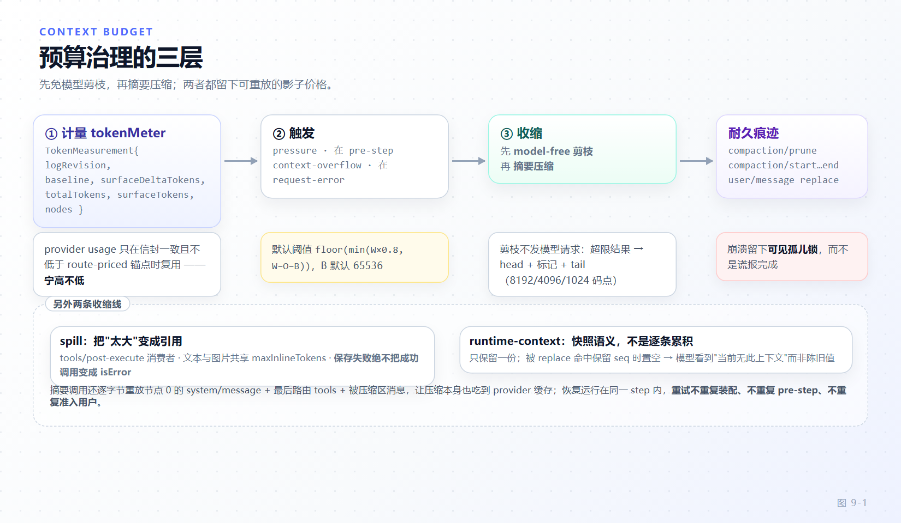

# 第 9 章 上下文工程：prompt 装配、runtime context 与压缩

[← 上一章：会话日志](08-session-log.md) · [下一章：仓库地形与工程骨架 →](10-repo-anatomy.md)

> **本章目标**
>
> - 掌握 `ctx.systemPrompt` 的五类注册口与中央 order 分配，理解"装配是每步一次的水流"。
> - 看懂 system prompt 如何作为 surface 节点被逐节点 reconcile，以及节点 0 为什么受保护。
> - 理解 runtime context 的**快照语义**：为什么压缩后模型看到"当前无此上下文"而不是陈旧值。
> - 建立 token 预算的三层视图：计量（tokenMeter）→ 免模型剪枝（pruner）→ 摘要压缩（compaction）。
> - 知道每种上下文注入手段的耐久后果与缓存代价。

第 8 章确立了"模型可见即已记录"。本章回答另一半问题：**怎样让模型每步只看到该看的，同时保证看到的东西都能被重放**。dsh 的答案是把上下文工程拆成三条正交的线——装配（每步算什么）、投影（耐久值怎么保持新鲜）、预算（超了怎么收缩）。

## 9.1 五类注册口

`ctx.systemPrompt`（`packages/core/system-prompt/src/index.ts:434`）提供五个注册口，语义各不相同：

| 注册口 | 行号 | 产出 | 何时用 |
|---|---|---|---|
| `section` | `:483` | prompt 文本段 | 稳定的能力说明、策略说明 |
| `context` | `:518` | 上下文条目（可 required） | 每步可能变化的事实 |
| `suppressRuntimeContext` | `:535` | 抑制开关 | 压缩、plan 等需要"清空易变事实"的模式 |
| `tools` | `:550` | 工具 schema 提供者 | 由 `ctx.tools` 调用，一般不手动注册 |
| `variable` | `:566` | 模板变量 | 供 `{{name}}` 插值 |

顺序是**中央分配**的，不是各包自选（`SECTION_ORDERS`，`:136-170`）：

```ts
const SECTION_ORDERS = {
  HARNESS_IDENTITY: -1000,
  DEPLOYMENT_PERSONA_PREFIX: 0,
  PLAN_POLICY: 500,
  TEAM_POLICY: 600,
  PTC_ONLY: 800,
  FILE_REFERENCE: 900,
  TOOL_BASH: 1000,
  // ...
}
```

这条纪律值得单独强调：**新增一段 prompt 要在中央表里申请 order**，而不是挑一个"看起来合适的数字"。prompt 前缀的稳定性直接决定 provider 的 KV cache 命中率（各包 README 末尾强制的 `## Model Experience` 一节就是要求作者显式回答 What the model sees / Token effect / KV Cache effect）。

## 9.2 装配的完整水流

`assemble()` 每步执行一次，顺序是（`:625-685`）：

1. **变量**：全局先、近作用域后（`:625-634`）——同名变量按作用域链 shadowing。
2. **段**：合并 shadowing 后按 `order` 排序，同 order 再按码元序比名字（`:657`、`:253-255`）。
3. **工具**：从 tool provider 取，`structuredClone` 后**从原型上摘掉**（防止引用泄漏进请求），再 `orderTools` 排序并插入 `<unlisted-tools>` 标记（`:639-673`、`:207-245`）。
4. **瀑布**：`system-prompt/assemble`（`:682-685`）：

```ts
const transformed = await this.ctx.waterfall(
  scopeTarget(this, scope), 'system-prompt/assemble', assembly, context,
  () => Promise.resolve(assembly),
)
```

注意 carrier：这个瀑布是**作用域过滤**的，一个 agent 的装配监听者不会看到别的 agent 的装配。

5. **瀑布之后的两种收口**（`:686-693`）：

```ts
if (completeSection === undefined && !runtimeContextSuppressed) return { ...transformed, tools }
const requiredContexts = new Set([...contextByName.values()].filter(entry => entry.required === true).map(entry => entry.name))
return {
  ...transformed,
  tools,
  sections: completeSection === undefined ? transformed.sections : [completeSection],
  contexts: runtimeContextSuppressed ? transformed.contexts.filter(entry => requiredContexts.has(entry.name)) : transformed.contexts,
}
```

`complete: true` 的段（`PromptSection.complete`，`:75`）**独占整个 sections**；`suppressRuntimeContext` 生效时只保留 `required` 的 contexts。这两条是"某些模式下模型必须只看这一份说明"的实现手段，比"注册一个优先级特别高的段"可靠得多。

> 第 7 章已经提醒：`assembly.tools` 从 v0.2.1-rc.2 起不再随瀑布传递，工具集改由 `resolve()` 的 `toolSet` 决定。还在读 `assembly.tools` 的监听者会拿到 `undefined`。

插值是严格的 `{{name}}`（`renderPrompt`，`:295-300`；`interpolate()`，`:345-382`），未定义变量不会被静默吞掉。段之间以非空拼接，`joinContextSections` / `renderContextSections` 产出耐久快照（`:319-342`）。

## 9.3 system prompt 是历史节点

装配结果不会直接进请求。它由 `SystemPromptProjection` 与日志里既有的 `system/message` 节点做**逐节点 reconcile**，再作为历史的一部分被 `deriveMessages()` 派生（第 8 章 8.1）。决策依据是"这条路由能不能追加"和"这是不是新请求系列的开始"（`packages/core/agent-loop/src/runtime-context.ts:93-115`，决策见 `.agents/notes/implemented/architecture/2026-09-02-system-prompt-as-surface-node.md`）：

- 空文本 → 清除它。
- 有能力的路由 → 追加更新。
- 其他路由 → 在第一个 system 节点处合并。
- **节点 0 受保护**：它是 system 槽位，不允许被别的消息占掉。

第 6 章 6.5 里那段 `for (const { message, intent } of commits) { this.session.append('system/message', ...) }` 就是这条链的落盘点。

## 9.4 runtime context：快照语义，不是逐条累积

易变事实（工作目录、沙箱模式、tmux 状态、当前时间）如果每条都追加一条用户消息，历史会被陈旧值淹没。dsh 的做法是**只保留一份当前快照**，并在快照被压缩掉时明确表达"当前没有"。

`RuntimeContextProjection` 的构造就说明了这一点（`packages/core/agent-loop/src/runtime-context.ts:126-150`）：

```ts
constructor(ctx: Context, session: Session) {
  const surface = new Set(session.surface.nodes)
  for (const event of eventsNewestFirst(session)) {
    if (event.type !== 'user/message' || !isOwned(event.data)) continue
    this.retained ??= null
    if (surface.has(event.seq)) {
      this.retained = { seq: event.seq, text: textOf(event.data) }
      break
    }
  }
  ctx.on('session/event', (subject, event) => {
    if (subject !== session) return
    if (event.type === 'user/message' && isOwned(event.data)) {
      this.retained = { seq: event.seq, text: textOf(event.data) }
    } else if (this.retained
      && isReplacementSurfaceEvent(event)
      && event.sourceEventSeqs?.includes(this.retained.seq) === true) {
      this.retained = null
    }
  })
}
```

三个动作：**从新往旧找第一个仍在 surface 上的自有 `runtime-context` 消息**作为保留值；此后靠 `session/event` 跟踪新值；一旦有 `replace` 事件的 `sourceEventSeqs` 命中保留 seq，就把保留**置空**。

`project()` 只在保留值与新值不同时产出候选，空内容改写成一条固定的"清除"句（`:128-168`）。于是压缩掉旧快照之后，模型看到的是"当前无 runtime context"，而不是继续相信一条已经不存在的值。

第 6 章 6.3 的那句"runtime context 只在内置 fallback 里投影"要和这里连起来读：**投影器算出候选，准入由 loop 在提交阶段完成**（`agent.ts:462-477` 的 `contextAdmitted` 门）。

## 9.5 上下文插件家族

`packages/context/README.md:12` 的定调：上下文是耐久的——注入的指令与引用以 **user 角色消息**进入历史，像其他对话内容一样被重放与压缩。

| 插件 | 注入方式 | 耐久痕迹 |
|---|---|---|
| `agent-instructions` | baseline + 刷新，都是带类型 source 的普通 `user/message` | 是（`dsh-base` 默认只挂这一个） |
| `time-context` | `agent/pre-step` 先 `next()` 委托，下游决定 enter 时才追加一条 `source: { kind: 'time-context', form: 'snapshot', sections }` | 是 |
| `session-reference` | pre-step 一次性读目标 session 的当前 surface，预览与 spill 共用同一捕获投影；**所有 `<` 转义**，防止被引用内容伪造 `<referenced-sessions>` 框架 | 是 |
| `file-reference` / `file-reference-local` | 补全候选（路径级），provider 拥有命名空间访问与排序，**不读文件内容** | 由宿主适配器决定 |
| `tmux-context` / `harness-dev-context` | runtime-context 行 | 走 9.4 的快照语义 |

`time-context` 的"先 `next()` 再决定"是 waterfall 礼仪的标准示范（第 3 章 3.6）：观察者不该在别的监听者还没表态时就抢先修改。

`agent-instructions` 的预算分别作用于 user-global 链与项目链（`maxBytes`，其 README 第 64 行），两条链不互相挤占。

## 9.6 计量：provider usage 什么时候能信

`ctx.tokenMeter.measure(session, requestHeader?)` 返回一份可共享的不可变测量（`packages/llm/token-meter/src/types.ts:22-38`）：

```ts
TokenMeasurement { logRevision, baseline, surfaceDeltaTokens, totalTokens, surfaceTokens, nodes }
```

复用规则很严：**只有"最新成功调用的规范信封与 `requestHeader` 相同，且总量不低于该调用的 route-priced 锚点"时才复用 provider 报告的 usage**，否则整体重定价（`docs/subsystems/token-meter.md:29`）。计量按 session 隔离 fold，压力消费者共享同一份带修订版本的测量，避免各自重算。

这个"锚点"设计的动机：provider 报告的 usage 可能因为缓存计费、部分计量而**低于**按路由价格重算的结果；宁可重算也不要低估，因为低估会让压缩来得太晚。

## 9.7 压缩的三层与两种触发

`ctx.compaction` 是三态接缝（`packages/compaction/compaction/src/index.ts:119`）：`compactIfNeeded`（`:136`）/ `compactNow`（`:162`）/ `compactRegion`（`:187`）。后端 `compaction-basic` 消费两种触发（`CompactionTrigger = 'pressure' | 'context-overflow'`，`packages/compaction/compaction/src/index.ts:32`）：

- **pressure**：在 `agent/pre-step` 里、请求派生**之前**检查。
- **context-overflow**：只在 `agent/request-error` 里、且只有规范化的上下文溢出才触发。

一旦触发成立，顺序固定：**先可选的免模型剪枝，再摘要选择**（`docs/agent-lifecycle.md:87`）。

`compaction-tool-result-pruner` 是 model-free 的一侧：不发模型请求，只把超限工具结果替换成 head + 标记 + tail（阈值 8192 码点，保留 head 4096 + tail 1024，`packages/compaction/compaction-tool-result-pruner/src/config.ts:11-13`）。每次替换由**紧邻其前的 `compaction/prune` 影子价格事件**定价，并且强制"替换必须紧随本事件同步追加"（`packages/compaction/compaction/src/types.ts:73-89`）——否则重放时价格与效果对不上。

恢复运行在**同一个开启的 step 内**，且只有当剪枝或摘要真的推进了 surface 替换 generation 才重试；否则原始请求错误保持权威。**重试不重复装配、不重复 pre-step、不重复准入用户**（第 6 章 6.5 的重试不变量在这里被复用）。

可重放性靠两条：`compaction/*` 四种事件**全部仅日志**（`types.ts:24/34/72/82`），锁由 `compaction/start`…`compaction/end` 括号表达——崩溃留下**可见的孤儿锁**而不是谎报完成；summary 事件带 `provider`/`model`/`maxTokens?`/`usage?` 与可选 `rawOutput` + `llmStreamCall: true`，使一次性的 summarise 调用可由"日志 + 代码"重建。真正进入模型历史的是紧随其后、以 `compactCheckpointSource(compactionId)` 标注 source 的那条 `user/message` `replace`（`compaction/checkpoint.ts`）。

摘要还刻意复用 provider 热前缀：**逐字节重放节点 0 的 `system/message` + 最后路由的 tools + 被压缩区消息**（`compaction-basic/README.md:116`），让摘要调用本身也吃到缓存。

默认阈值是 `floor(min(W×0.8, W−O−B))`，`B = headroomTokens` 默认 65536，保留 `W−O` 的新近 16%（`compaction-basic/src/config.ts:20-23,75-79`）。



*图 9-1 · 计量决定"要不要收缩"，触发决定"从哪条路进来"，收缩本身先免模型剪枝、再摘要；三条线各自留下可重放的耐久痕迹，崩溃时留下可见孤儿锁而不是谎报完成。*

## 9.8 spill：把"太大"从错误变成引用

`ctx.spillStore` 只有一个方法：`saveText(input: SaveTextSpill): Promise<SpillRef>`（`packages/spill/spill/src/index.ts`）。返回的 `SpillLocator` 是品牌化不透明句柄，消费方用 `retrievalHint` 渲染而**不解析它**（`docs/subsystems/spill.md:79-86`）。本地后端写 `<root>/session-<sha256(sessionId)>/<random>-<safeName>`，`0700` 目录 + `open(path,'wx',0o600)` 防符号链接劫持（`:92`）。

策略侧 `spill-policy` 是 `tools/post-execute` 消费者：`maxInlineTokens` 让**文本与图片共享同一预算**，头尾各分一半、图片整块取舍；存不下时保留原内容；**保存失败绝不把一次成功的调用变成 `isError`**（`spill-policy/README.md:63-65`、`docs/subsystems/spill.md:92`）。

> 这条"失败不改变成功语义"是第 18 章错误处理讨论的一个范例：spill 是优化，不是功能。优化失败应当静默降级，而不是污染模型看到的结论。

## 9.9 本章小结

- 上下文工程分三条线：装配（每步）、投影（保持耐久值新鲜）、预算（收缩）。
- 五类注册口语义不同；prompt 段顺序由中央表分配，直接关系 KV cache。
- 装配末尾有两条收口：`complete: true` 独占 sections，`suppressRuntimeContext` 只留 required contexts。
- system prompt 是 surface 历史节点，逐节点 reconcile，节点 0 受保护。
- runtime context 是快照语义：只保留一份，被压缩掉时显式表达"当前无"。
- 计量宁高不低：provider usage 只在信封一致且不低于 route-priced 锚点时复用。
- 压缩先免模型剪枝、再摘要；影子价格事件必须紧邻替换；锁以孤儿形式可见。
- spill 是优化，保存失败不改变调用成功语义。

**检查点**

1. 你想让模型"每步都知道当前 git 分支"，该注册 section、context 还是 runtime-context？（答：context/runtime-context——它是每步可能变的易变事实；section 是稳定说明，会被前缀缓存惩罚。）
2. 压缩把旧的 runtime-context 消息替换掉了，模型会不会继续相信陈旧值？（答：不会；`sourceEventSeqs` 命中保留 seq 时投影器把保留置空，并追加一条"清除"句。）
3. 为什么 `compaction/start` 崩溃后留下孤儿锁是正确行为？（答：谎报完成会让后续请求在溢出状态上继续；可见的孤儿锁让恢复逻辑与人都能判断。）

**延伸阅读**

- 官方 [系统提示子系统](https://deepseek-harness.github.io/deepseek-harness/reference/subsystems/system-prompt)、[压缩子系统](https://deepseek-harness.github.io/deepseek-harness/reference/subsystems/compaction)、[token 计量](https://deepseek-harness.github.io/deepseek-harness/reference/subsystems/token-meter)
- 源码：`packages/core/system-prompt/src/index.ts`、`packages/core/agent-loop/src/runtime-context.ts`、`packages/compaction/*`、`packages/context/*`
- 下一章：[仓库地形与工程骨架](10-repo-anatomy.md)
