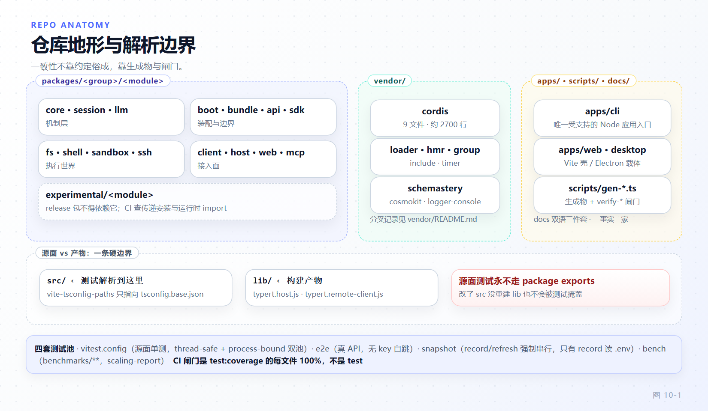

# 第 10 章 仓库地形与工程骨架

[← 上一章：上下文工程与压缩](09-context-compaction.md) · [下一章：扩展点地图与选型 →](11-extension-map.md)

> **本章目标**
>
> - 在 380+ 个工作区包的地形里快速定位：`apps/` / `packages/<group>/<pkg>` / `vendor/` / `docs` / `scripts` 各自承载什么。
> - 记住一个模块的标准骨架，并理解 `src/`（源面）与 `lib/`（产物面）的解析边界为何是硬约束。
> - 掌握命名与角色纪律：服务包 default export、函数插件 named export 且无 default、单数/复数 `ctx` key、角色后缀的适用边界。
> - 认清"生成物即真相"：哪些文档由脚本生成、`--check` 如何把关、`docs/module-graph.md` 其实是 peer 图而非分层规则。
> - 了解入口闸门、构建/开发脚本、四套主 Vitest 配置、`lefthook.yml` 与实验能力门控这些"保持整仓一致"的机制。

前九章讲的是运行时。本章讲**这个仓库本身怎么组织**——因为你要加的每一个扩展包都得落在这套骨架上，否则闸门会让你红。主线只有一句话：**这个规模的 monorepo 靠"生成物 + 闸门"保持一致，而不是靠人记住约定**。

## 10.1 分层地形

顶层目录的角色在根 `AGENTS.md:15-77` 的 layout 块里逐行声明（该块不含 `apps/`；`apps/` 由 `pnpm-workspace.yaml:8-9` 声明，其中写明 apps/cli owns the `dsh` bin）。主要区域：

- **`apps/`**：产品装配层，不是库。`cli`（拥有 `dsh` bin）、`web`、`desktop`（Electron 载体）、`desktop-host`、`plugin-market-generator`。
- **`packages/<group>/<pkg>`**：所有 `@deepseek-ai/dsh-<name>` 工作区包，路径**恰好两层深**——group 是主题分组（纯容器：无 `package.json`、无源码），包坐在它下面一级。group 名单很长：`core`、`session`、`llm`、`host`、`api`、`sdk`、`bundle`、`boot`、`client`、`context`、`fs`、`shell`、`sandbox`、`skill`、`subagent`、`compaction`、`typert`、`preset`、`mcp`、`experimental`、`test-support`、`util`… （完整表见 `AGENTS.md:20-69`）。
- **`vendor/`**：源码级 vendored 的 Cordis 框架与其基础库——`cordis`、`loader`、`include`、`group`、`timer`、`hmr`、`schemastery`、`cosmokit`、`logger-console`。它们被复制进仓而非用 npm 依赖，为的是 harness 完全拥有框架层（可审计、可打补丁、可钉版）。`vendor/README.md:3-5` 说明每个包都改用 `@deepseek-ai` scope（`cordis` → `@deepseek-ai/cordis`，`@cordisjs/plugin-x` → `@deepseek-ai/cordis-plugin-x`），并有一张 manifest 表记录上游版本与 commit。对 vendored 包的引用用 `workspace:~`，这样本地构建解析工作区包、发布范围允许同 minor 补丁更新。
- **`docs/` / `scripts/` / `benchmarks/` / `snapshots/` / `.agents/notes/`**：文档、闸门与生成器、性能门、录制的会话夹具、架构决策记录（ADR）。`.agents/notes/` 分 `implemented/`（现在时描述已发布现实）、`proposed/`、`rejected/`、`archived/`（冻结历史，永不当作现行权威）。

工作区 glob 声明在 `pnpm-workspace.yaml`：

```yaml
# pnpm-workspace.yaml:1-9
packages:
  - vendor/*
  - packages/*/*
  # The Landlock launcher is developed with its harness consumers but keeps
  # its native build and publication scripts under native/system.
  - native/system
  - native/system/packages/*
  # Product assemblies over the package tier; apps/cli owns the `dsh` bin.
  - apps/*
```



*图 10-1 · 地形分区与"测试解析 src、配置子进程跑 lib"的边界*

一个数字上的坑先说清：网上流传"dsh 有 500+ 包"。按锁文件 `pnpm-lock.yaml` 的 JS importers 计，本仓注册的 JavaScript 工作区包是 **383 个**——恰好等于 `packages/*/*` 下 369 个模块 + `apps/*` 5 个 + `vendor/*` 9 个；`native/`、`python/` 是另外的运行时面，不在 JS importer 计数里。写作和评审时以 383 为准。

## 10.2 一个模块的标准骨架

`docs/cookbook/adding-a-package.md:9-23` 给了逐文件清单，实测每个模块目录都长这样（以 `packages/core/agent-default-model/` 为例）：

```text
package.json      tsconfig.json     tsdown.config.ts
src/              lib/              tests/
locale/           README.md         README.zh.md
README.i18n.yaml
```

关键不变量在 `check-workspace-constraints.ts`（`pnpm run constraints`）里强制（`docs/cookbook/adding-a-package.md:27`）：`private: true`、`type: module`、`main: "lib/index.js"`、`types: "lib/types/index.d.ts"`、`@deepseek-ai/cordis` **同时**在 `peerDependencies`（`packages/shell/tool-bash/package.json:16-24`）与 `devDependencies`（同范围）。真实 `exports` 块（`packages/shell/tool-bash/package.json:16-28`）：

```json
"exports": {
  ".": {
    "types": "./lib/types/index.d.ts",
    "default": "./lib/index.js"
  },
  "./src/*": "./src/*",
  "./package.json": "./package.json",
  "./locale/*.json": "./locale/*.json"
}
```

Client 包多一个 `dsh.client` 声明和一个 `./client` 子路径。真实例子（`packages/client/connection/package.json:21-36`）：

```json
"exports": {
  "./client": {
    "types": "./lib/types/client/index.d.ts",
    "node": "./lib/client.node.js",
    "browser": "./lib/client.browser.js",
    "default": "./lib/client.browser.js"
  }
},
"dsh": { "client": { "inject": [], "platform": "web", "immediately": true } }
```

**`src/` vs `lib/` 的解析边界**是本章最容易被忽视的硬约束：

- 源面测试**永不解析到 `lib/`**。`vitest.config.ts:22` 把 `vite-tsconfig-paths` 只指向 `tsconfig.base.json`，那里的 `@deepseek-ai/dsh-*` paths 映射到 `./packages/<group>/<pkg>/src/index.ts`，注释直说"paths must win over package exports so built `lib/` never loads a second module-singleton copy"（`vitest.config.ts:19-21`）。若测试落到 `lib/`，同一个服务类会有两份实例，`WeakMap`/单例状态全乱。
- `lib/` 是产物面：Config 子进程在纯 Node 下跑构建好的 `lib/`（`AGENTS.md:132`），tsdown 只消费前一道 tsc 发到 `lib/types` 的 JS（`docs/development.md:107`）。
- 包内相对 import 用显式 `.ts` 后缀（`export * from './types.ts'`），编译器在产物里改写成 `.js`，声明文件里保留 `.ts` 让 NodeNext 消费方解析到同级 `.d.ts`（`docs/cookbook/adding-a-package.md:29`）。

`src/types.ts` **只放类型、无运行时代码**（`packages/AGENTS.md:25`）；测试放包级 `tests/`，不放 `src/__tests__/`。

## 10.3 命名与角色纪律

这是写扩展前必须内化的一条分叉（`packages/AGENTS.md:5`）：

> **服务包 default-export 其服务类；函数插件 named-export `name` / `inject` / `Config` / `apply` 且没有 default export。混用两种形态会让 Loader 丢掉函数插件的 namespace。**

这条有 postmortem 背书（`docs/postmortem/0001-acp-default-export-drops-inject.md`）：一个函数插件若同时提供了 default export，Loader 会取那个 default 而丢弃 named 的 `inject` 声明——插件"看起来挂上了"，但它的依赖从没注入。所以选形态不是风格问题，是先决定"这是服务还是函数插件"。同理，可选服务用 `ctx.get(name)` 读，`ctx.<name>` 属性代理对拓扑敏感、留给声明式注入（`packages/AGENTS.md:6`）。

`ctx` key 的单复数也是一条规则（`docs/cookbook/adding-a-package.md:50`）：**单数 key 对一个引擎/策略/resolver/controller/store，复数 key 对一个拥有多个命名成员的注册表**，类角色与 key 数必须一致。本章例子对照：`hmr`（单数，一个协调器）、`pluginManager`（单数）、`sessions`/`tools`（复数，注册表）。

角色后缀表在 `docs/cookbook/adding-a-package.md:52-70`，每一行都带"何时用/何时别用"。摘几行最能防错的边界：

| 后缀 | 用在 | 不要用在 |
|---|---|---|
| `Store` | 拥有一份数据、主要提供 CRUD/snapshot/订阅 | 校验状态机、仲裁权限、调度工作、拥有 provider 优先级——一个 map 不足以成为 store |
| `Registry` | 拥有一组动态命名注册（含去重/优先级/生命周期/释放） | 主契约是 dispatch、执行、取消、策略、编排 |
| `Runtime` | 跑实时工作，跨调用拥有 dispatch/取消/provider 协调 | 只存记录、返回目录、解析一个值、持配置 |
| `Resolver` | 从输入算出或找到一个答案，**不拥有该答案的生命周期** | 拥有可变集合或长时执行 |
| `Provider` | 提供某个能力定义的一个实现（多个可并存时加机制/厂商限定词） | 它本身就是能力定义、provider registry 或 consumer runtime |
| `Controller` | 接受命令/用户意图，改一处既有域或展示状态 | 执行任意工作、拥有 provider 群、只做展示换算 |

命名要"命名当下真实存在的稳定职责"，不命名第一个实现、不命名未来的扩展、不命名 Cordis 基类（`docs/cookbook/adding-a-package.md:48`）。

最后一条对扩展作者最反直觉：**plugin 内不得硬编码可调常量**（`AGENTS.md:143`）：

> deployment-varying 的选择必须是经 schemastery 校验、可从 `cordis.yml` 改的 `Config` 字段；一个 `DEFAULT_*` 常量或测试钩子**不算**可配置性。协议常量、外部规范、安全不变量保持固定。

README 的末尾有固定两节（`packages/AGENTS.md:28-29`，模板 `docs/cookbook/adding-a-package.md:81-106`）：`## Model Experience`（含 `#### What the model sees` / `#### Token effect` / `#### KV Cache effect` 三个有序字段，用实现填，不许套话）和 `## Known Limitations and Deferred Work`（记录持久的消费端缺口与非显然的维护约束；普通清理留在源码 TODO）。两节都有校验脚本把关（`scripts/verify-package-readme-model-experience.ts`、`scripts/verify-package-readme-limitations.ts`）。

## 10.4 生成物即真相

一批文档不是手写、而是从源码生成并**用 `--check` 当闸门**，头部就带"do not edit by hand"。对应关系（各生成器脚本实测）：

| 文档 | 生成器 | `--check` |
|---|---|---|
| `docs/capability-seams.md` | `scripts/gen-doc-graphs.ts` | 是（`gen-doc-graphs.ts:5`） |
| `docs/module-graph.md` | `scripts/gen-module-graph.ts` | 是 |
| `docs/tool-catalog.md` | `scripts/gen-tool-catalog.ts` | 是（`--check` 校验已提交产物） |
| `docs/persistence-catalog.md` | `scripts/gen-persistence-catalog.ts` | 是 |
| `docs/config-catalog.md` | `scripts/gen-config-catalog.ts` | 是（`gen-config-catalog.ts:7`） |

**别手改这些文件**——改源码或改生成器，重跑 `pnpm run doc-sync`。

两个误解要纠正：

1. `docs/module-graph.md` **是 peer 依赖图，不是分层规则**。它的标题就叫"Shared-instance dependency graph"，正文（`docs/module-graph.md:5`）写得很清楚："peer 表示消费端需要提供共享实例，不包括普通运行时 dependency 或仅开发期关系……边 `a --> b` 表示包 `a` peer 依赖包 `b`。" 它画的是"哪些包必须共享同一实例"，跟"谁允许调用谁"无关。真正的**分层约束**在 `docs/architecture.md`（尤其 `## Where new behavior goes`，`docs/architecture.md:142`）、`packages/AGENTS.md:14`（业务分支归独立包、经注册面挂载）、`docs/subsystems/web-client.md`。把 module-graph 当分层依据会得出完全错误的结论。

2. `docs/tool-catalog.md` 不是 AST 扫出来的。生成器头注释（`scripts/gen-tool-catalog.ts:873`）说明它**真实启动每个 tool plugin 在真 context 上、读 `ctx.tools.schemas()`**，因为 tool schema 静态不可知（运行时 spread 枚举、拼接描述、config 驱动命名、MCP 的 raw-JSON-Schema）。它还带一个 **completeness guard**：globs `packages/*/tool-*`，任一 tool 包没进生成器的 boot manifest 就抛错（`scripts/gen-tool-catalog.ts:750-758`）——新工具包"忘记写进文档"会直接把 CI 弄红：

```ts
// scripts/gen-tool-catalog.ts:750-758（节选）
const onDisk = globSync('packages/*/tool-*', { cwd: scanRoot })
// ...
const missing = onDisk.filter(dir => !listed.has(dir))
if (missing.length > 0) {
  throw new Error(
    `gen-tool-catalog: ${missing.length} tool package(s) not in the boot manifest: ${missing.join(', ')}. `
```

`config-catalog` 与 `persistence-catalog` 同理：`gen-config-catalog.ts` 从包入口、config 类型、JSDoc、静态 schemastery schema 生成，每个包必须归类、引用的类型必须无冲突解析（`gen-config-catalog.ts:1-8`）。

## 10.5 入口闸门与开发脚本

`scripts/verify-application-entrypoints.ts:1-5` 的闸门把"什么是合法的 Node 应用入口"变成显式归类：

> 强制 dsh profile 是**唯一**受支持的 Node 应用启动器。vendor CLI、构建工具、测试工具都要被显式归类，而不是留成隐式漏洞。

每个 bin、每个可执行源码、每个根 launcher 脚本都要进一张策略表。`MANIFEST_BIN_ALLOWLIST` 只放行 `apps/cli`（`dsh`）和一个实验 webworker-packer；`ROOT_LAUNCHER_POLICIES` 把 `start:web` 归 `dsh-direct`、`dev:web` 归 `dsh-wrapper`（`scripts/verify-application-entrypoints.ts:56-60`）。任何绕过 `dsh` profile 的 Node 应用路径——哪怕只是"我在 root 加了个 `node xxx.js` 脚本"——都会被判红。

日常开发脚本的真源是 `package.json` 的 `scripts`（`Makefile` 只是短名糖，见 `Makefile:1-2`："The package.json scripts they call stay the source of truth"）：

```json
"build": "tsx scripts/build.ts",
"build:artifacts": "tsx scripts/build.ts --scope artifacts",
"build:check": "tsx scripts/build.ts --scope check",
"test": "pnpm run build:native-system && vitest run",
"test:coverage": "pnpm run build:native-system && vitest run --coverage",
"typecheck": "tsx scripts/build.ts --scope typecheck",
"start:web": "node --import tsx/esm apps/cli/src/bin.ts web"
```

**`build` = `build:artifacts` + `build:check`**（`docs/development.md:92`）。迭代时用 `build:artifacts`（快、只发产物），但**在宣称 TypeScript 工作完成之前必须补一次 `build:check`**（`docs/development.md:99-100`）：`build:check` 只跑 `tsc -p tsconfig.host.json` 和 `tsconfig.client.json`，它既不能发现也不能重建缺失/陈旧的 artifacts 输出——缺输出会以编译错误的形式冒出来。工具链钉死：Node `>=24.9.0`、`pnpm@11.28.5`（`package.json:7-9`）。

覆盖闸门：`pnpm run test:coverage` 对 `packages/*/*/src/**/*` 逐文件要求 **100%**（`vitest.config.ts:423-430`、`docs/testing.md:10`），这才是 CI 闸门。注释还提醒"未覆盖的一行常常是该删的死代码，不是欠一个测试"。`src/types.ts` 之类豁免在 `vitest.config.ts` 的 exclude 列表里。

## 10.6 四套主 Vitest 配置

测试按"是否花钱/是否碰真进程"分成四套 `vitest.*.config.ts`，全部从 `vitest.shared.ts` 共用两样东西：`vitestExecArgv`（`--no-webstorage`，防进程级 Web Storage 遮蔽 jsdom）与 `standardDecoratorPlugin()`（在 Vite 默认 parser 之前用 TS 转译标准装饰器），且**都只把 `vite-tsconfig-paths` 指向 `tsconfig.base.json`**（各配置首行的 `tsconfigPaths({ projects: ['./tsconfig.base.json'] })`）：

- **`vitest.config.ts`**（源面单测）：`pool: 'forks'`（每套 fork 保 Node 稳定性），分两个 project——`thread-safe` 与 `process-bound`（`vitest.config.ts:216-240`），后者单独控制 inventory。这是默认 `pnpm test` 跑的。
- **`vitest.e2e.config.ts`**（真 API、花钱层）：include `packages/*/*/tests/**/*.e2e.ts` 加 `apps/{cli,desktop}/tests/**`。每个测试**无 provider 凭据就自跳**（`vitest.e2e.config.ts:5-6`），keyless CI 不花钱也不红。
- **`vitest.snapshot.config.ts`**（录制会话回放）：`DSH_SNAPSHOT=record|refresh|replay`。`replay`（默认，keyless）从录制的模型响应启动真子进程路径并 diff；`record` 打真 API 更新夹具；`refresh` 回放已提交脚本、更新期望输出。两条纪律：**只有 `record` 读 `.env`**（`vitest.snapshot.config.ts:33-38`），且 **record/refresh 强制串行**（`fileParallelism` 只在 `replay` 为真，`vitest.snapshot.config.ts:63-68`）——record 每场景花真 API 额度，refresh 从夹具回写 volatile 值。
- **`vitest.bench.config.ts`**（CI 性能门）：include `benchmarks/**/*.bench.ts` 加 `.bench.client.ts`，`globalSetup` 用 `benchmarks/support/scaling-report.ts` 清空计时、跑完渲染 `benchmarks/.dsh-report/report.html`，`maxWorkers: 2`。

四套配置的分野本质是**副作用边界**：源面（进程内、可并发）、e2e（真网络、花钱）、snapshot（真子进程、可能花钱）、bench（计时预算）。它们的共用面证明了一件事——**路径解析必须唯一地走 src**，否则四套里任何一套解析到 `lib/` 都会撕裂单例。

## 10.7 提交闸门：lefthook

`lefthook.yml` 的设计哲学写在头部："保持这些本地检查点快；CI 拥有全仓闸门矩阵。" 具体分工：

- **pre-commit 只做快检查**：翻译配对（staged `*.i18n.yaml`，`verify-translation-pairing.ts`）、archived agent notes、`oxlint` staged + `--fix`（`stage_fixed: true`）、尾行空白（`git diff --cached --check`）、pi-ai provider metadata、vendor manifest guard。
- **pre-push 只有 typecheck**（`lefthook.yml` 末段）。
- **hooks 故意不跑测试/快照/构建**——那全是 CI 的活。这是有意的：本地 push 前只保证类型能过，功能验证交给 PR 上的完整矩阵。

`.oxlintrc.json` 是**带注释的 JSON**（JSONC，`$schema` 指向 oxlint 的 configuration_schema，逐条 ignore 后跟 `//` 说明为什么豁免，如 `vendor/**` "保留上游风格"）。lint 跑 `scripts/run-oxlint.ts`，先 `compile-referenced-projects.ts host-contracts` 备好宿主契约（`package.json` 的 `lint` 脚本）。

## 10.8 文档纪律与实验门控

文档由 `docs/AGENTS.md` 治理，四条最硬的：

1. **一事实一家**（tier taxonomy，`docs/AGENTS.md` "one home per fact"）：每个事实归且仅归一个 tier，别处只链接。bugs→postmortem、rationale→Agent Notes、procedures→cookbook、类型定义→subsystems、包契约→README。
2. **双语成对更新**：`x.md` + `x.zh.md` + `x.i18n.yaml`，active-agent 单遍重排 first-use 注解、保留未改的散文。
3. **一段一物理行**（`verify-md-wrap`，用编辑器软折行）；**fenced `ts` 块必须编译**（`doc-typecheck`；`type-equiv` / `public-api` 两类贴法登记在 manifest 防漂移）。
4. **字数上限由 `scripts/doc-budgets.manifest.json` 把关**，`verify-doc-budgets` 拒绝超量或缺失：

```json
// scripts/doc-budgets.manifest.json
{
  "AGENTS.md": 2080,
  "docs/AGENTS.md": 1430,
  "docs/architecture.md": 2410,
  "packages/AGENTS.md": 810
}
```

闸门变红时优先"relocate → condense → 才 raise ceiling"，且目标以下要留至少 5% headroom（`docs/AGENTS.md` 的 Wordcount Budgets 节）。

**实验能力门控**（`packages/experimental/AGENTS.md` + `scripts/experimental-package-policy.ts`）：实验包默认用 `@deepseek-ai/dsh-experimental-` 前缀（`experimental-package-policy.ts:31`），但有 **19 个保留例外名**（`EXPERIMENTAL_PACKAGE_NAME_EXCEPTIONS`，`scripts/experimental-package-policy.ts:9-27`）——这些身份跨实验分类与角色迁移被保留，好让"离开实验状态"时不改名。硬隔离规则（`packages/experimental/AGENTS.md`）：

- 组外 release 包与 app **不得在 `dependencies` / `optionalDependencies` / `peerDependencies` 里点名实验包**；CI（Default-product isolation）还查**传递安装、运行时 import、以及 shipped compositions**。实验包可以依赖 release 包和彼此，测试可用 `devDependencies` 用实验包。
- **实验状态不减免工程/安全/文档/生命周期/测试/快照义务**——这不是草稿区。
- **晋升 = 迁到产品角色 group + 应用该 group 命名规则 + 原子更新受影响的 import 与配置行**（同一 PR），然后复审公开契约、限制、测试证据、发布载荷、运行时依赖方，并指定稳定 owner。

## 10.9 本章小结

- 地形四区：`apps/`（装配）、`packages/<group>/<pkg>`（383 个 `dsh-*` 包，路径恰好两层）、`vendor/`（rescoped 的 Cordis 上游）、`docs`/`scripts`/`benchmarks`/`snapshots`/`.agents/notes`。
- 骨架固定：`package.json`（`main: lib/index.js`、`types: lib/types/index.d.ts`、cordis 同时进 peer+dev）、`tsconfig.json`、`tsdown.config.ts`、`src`/`lib`/`tests`/`locale`/双语 README。源面测试经 `tsconfig.base.json` 只解析 `src`，`lib` 是产物面——解析边界就是单例边界。
- 命名分叉不可混：服务 default-export、函数插件 named-export 且**无 default**（混用丢 namespace）；单数 key 对一个东西、复数对注册表；`Store/Registry/Runtime/Resolver/Provider/Controller` 各有"何时别用"；plugin 不硬编码可调常量，deployment-varying 必是 schemastery 校验的 `Config`。
- 生成物即真相：`capability-seams`/`module-graph`/`tool-catalog`/`persistence-catalog`/`config-catalog` 由各自脚本生成、`--check` 把关；`module-graph` 是 **peer 图不是分层**；`tool-catalog` 真启动每个 tool 并靠 `packages/*/tool-*` glob 做完整性闸门。
- 闸门：`verify-application-entrypoints.ts` 逼每个入口显式归类；`build = build:artifacts + build:check`，宣称完成前必补 `build:check`；coverage 逐文件 100% 才是 CI 门；Node `>=24.9.0`、`pnpm@11.28.5`；`Makefile` 只是短名。
- 四套 Vitest 按副作用分层、共用 `vitest.shared.ts` 且都只指 `tsconfig.base.json`；lefthook pre-commit 跑快检查、pre-push 只 typecheck、**故意不跑测试**；文档守"一事实一家 + 双语成对 + 一物理行 + fenced ts 编译 + 字数 manifest"；实验包靠前缀/19 例外名与"传递安装 + 运行时 import"双重 CI 隔离，晋升要迁组改名同 PR。

**检查点**

1. 你新写一个函数形态插件，既写了 `export const name/inject/apply` 又 `export default function`。后果？（答：Loader 取 default、丢掉 named 的 `inject` 声明，依赖从没注入；函数插件必须**无 default export**。）
2. 把 `docs/module-graph.md` 里"没有 `a → b` 边"当作"`a` 不许调用 `b`"，错在哪？（答：那是 peer 共享实例图，不是分层规则；分层约束在 `architecture.md` 的 Where-new-behavior-goes、`packages/AGENTS.md`、`subsystems/web-client.md`。）
3. 一个普通源面单测为什么不能解析到 `lib/`？（答：`lib/` 是打包产物，解析过去会让同一服务类加载两份实例、破坏单例状态；`vitest.config.ts` 的 `tsconfigPaths` 只指 `tsconfig.base.json` 的 src 映射。）

**延伸阅读**

- 官方 [添加一个包 cookbook](https://deepseek-harness.github.io/deepseek-harness/reference/cookbook/adding-a-package)、[框架开发指南](https://deepseek-harness.github.io/deepseek-harness/develop/framework/)、[参考总览](https://deepseek-harness.github.io/deepseek-harness/reference/)
- 源码/规范：`AGENTS.md:15-143`、`packages/AGENTS.md`、`docs/AGENTS.md`、`packages/experimental/AGENTS.md`、`vendor/README.md`、`docs/cookbook/adding-a-package.md`、`scripts/gen-doc-graphs.ts`、`scripts/gen-tool-catalog.ts`、`scripts/verify-application-entrypoints.ts`、`scripts/experimental-package-policy.ts`、`lefthook.yml`、`vitest.{,e2e.,snapshot.,bench.}config.ts`、`vitest.shared.ts`、`Makefile`
- 相邻章：[第 9 章 上下文工程与压缩](09-context-compaction.md)、[第 11 章 扩展点地图与选型](11-extension-map.md)、[第 12 章 开发一个能力包](12-capability-package.md)
