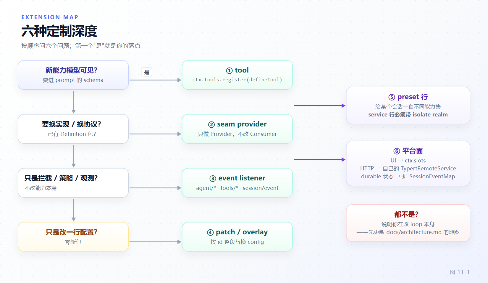

# 第 11 章 扩展点地图与选型

[← 上一章：仓库地形与工程骨架](10-repo-anatomy.md) · [下一章：开发一个能力包 →](12-capability-package.md)

> **本章目标**
>
> - 建立"定制深度"这个坐标系：六种扩展深度各自解决什么问题、各自代价多大。
> - 掌握一条可执行的判据顺序，在动手前把需求映射到唯一落点，而不是写完再找位置。
> - 理解能力接缝（capability seam）的三角色——Service Definition、Service Provider、Consumer——以及"接缝是完整能力，不是单个角色"这条纪律。
> - 会读 `docs/capability-seams.md` 末尾的大表，用它回答"要不要开新包"。
> - 把 `docs/architecture.md:142` 的 "Where new behavior goes" 表当索引用，每条说出源码落点。
> - 认识四种会被评审直接拒掉的写法及其正确替代形状。

第 10 章画完仓库地形；本章起你是扩展作者。作者面对的第一个问题不是"怎么写"，而是"写在哪"。dsh 的答案是一套有先后顺序的判据：六种定制深度，代价按数量级递增。**选错深度的典型症状不是代码写错，而是改了不该改的东西**——改一个 Consumer 去适配新 Provider，改一个中心层去加一条业务分支，或为一个开关新建一个包。

## 11.1 判据顺序：先问"谁感知这个变化"

六个判据必须**按顺序**问，先命中先停。顺序本身就是设计：越靠前改动面越小，越往后越贵。

| 深度 | 触发问题 | 落点 | 主要成本 |
|---|---|---|---|
| ① | 模型要能看见这个新能力吗？ | `ctx.tools.register` | 一个工具包 + tool-catalog |
| ② | 只是换实现或换协议？ | 已有 seam 的 Provider | 一个 Provider 包，**不动 Consumer** |
| ③ | 要拦截、加策略或观测？ | 事件监听器 | 零新包，受 waterfall/serial/emit 语义约束 |
| ④ | 只给某个会话一套不同能力？ | preset 行 | realm 隔离，服务行必须 `isolate` |
| ⑤ | 只是改已有插件的一行配置/开关？ | bundle patch 或 `--patch` overlay | 零新包 |
| ⑥ | 要加 UI 槽位 / HTTP 面 / durable 状态？ | Client 包 / `@Remote` service / `SessionEventMap` | 各自的注册面清单 |

判据不能倒着走，理由很硬：`docs/defensive-patterns/README.md:13` 把它写成仓库级习惯——"通过已注册接缝扩展。新能力去注册；已有 carrier 停止吸收新逻辑，而不是在里面长出一条分支"（*Extend through the registered seam*）。所以判断"我是不是走深了"只剩一个问题：**你的改动是否让一个本来不认识业务的中心层第一次认识了业务**。



*图 11-1 · 六道判据按顺序问，先命中先停；越往右下改动面越大、包越多*

## 11.2 深度①：模型可见能力 → `ctx.tools.register`

模型可见 = 必须进 prompt 装配 = 必须是 session 事实。这条等式写在 `docs/architecture.md:128`："**Model-visible means logged**"——新模型可见输入必须走 session 事件。工具正好同时满足两侧：注册后 schema 自动进装配，调用产生 durable 的 `tool/call` / `tool/result`。

注册接进装配的那几行（`packages/core/tools/src/index.ts:111-118`）：

```ts
constructor(ctx: Context) {
  super(ctx, 'tools')
  ctx.systemPrompt.tools(({ scope, toolSet }) => {
    const executor = this.selectExecutor(scope)
    const description = executor.describe(this.definitions(scope, toolSet))
    return { ...description, knownNames: description.knownNames ?? [...this.view(scope).knownNames] }
  })
}
```

也就是说 `ctx.tools` **本身就是 `ctx.systemPrompt` 的贡献者**：无需触碰 system-prompt，注册即装配。`register` 返回精确 disposer（`:148-152`）——注册是 effect，fiber 卸载即注销。

三条硬约束在注册时即抛错：

- `output` 必须是 `{ schema, render, presentationMeta? }`，缺 `render` 直接 `TypeError`（`packages/core/tools/src/index.ts:130-135`）。
- 名字 `run_code` 被**无条件**保留给 PTC 模式的承载传输，注册与遮蔽都拒（`:145-147`）。动机写在注释里：任何 agent 都可能为自己选中 code mode，按部署默认"还能用"的名字会在 preset 挂上那一刻变成冲突。
- 全局重名的报错文案直接给出正确做法：`for a per-agent variant, register through that agent's `agent.ctx` instead`（`packages/core/tools/src/index.ts:68-70`）。

**判据①的边界**：能力确实是"模型主动调用"的。只有人或 UI 用得上的东西属于深度⑥的槽位或 Remote，不该进 prompt——无谓的 schema 是每步都付的 token（第 9 章）。

## 11.3 深度②：换实现/换协议 → seam 的 Provider 角色

第二个判据回报率最高：**换实现只写 Provider，不碰 Consumer**。它的载体叫能力接缝（capability seam）。

`docs/architecture.md:136` 给出定义：seam 是可交换能力，含三角色——声明接口的 **Service Definition**、实现它的 **Service Provider**、使用它的 **Consumer**（通常是面向模型的工具）。一个包可兼多角色，但**单个角色不构成 seam**。`.agents/notes/implemented/architecture/2026-06-13-capability-seams.md:17` 补了一条容易被忽略的纪律：

> A definition may be an abstract class or a concrete registry service; **it is never a TypeScript `interface`**.

原因在第 2 章：Cordis 的服务注册是构造函数的副作用，`ctx.<key>` 的可用性谓词、`inject` 等待、epoch 传导全都挂在真实类对象上。`interface` 没有运行时身份，既无法注册也无法被判定。所以 Definition 必须拥有 `ctx.<key>` 与词汇类型（vocabulary types），且只依赖契约需要的词汇。

`packages/shell` 是官方范例（同一条 Agent Note 的 `:29` 行点名它）：`dsh-shell` / `dsh-bash-local` + `dsh-bash-sandbox` / `dsh-tool-bash`，三角色各一包。

Definition（`packages/shell/shell/src/index.ts:30-34`、`:64-94`）：

```ts
declare module '@deepseek-ai/cordis' {
  interface Context {
    shell: ShellExecutor
  }
}

export abstract class ShellExecutor extends Service {
  constructor(ctx: Context) {
    super(ctx, 'shell')
  }
  abstract resolve(request: ShellExecRequest): ShellExecSpec
  abstract execute(spec: ShellExecSpec): Promise<ShellExecution>
}
```

Consumer 侧（`packages/shell/tool-bash/src/index.ts:33-34`）只声明服务名，从不 import Provider 类型：

```ts
export const name = 'tool-bash'
export const inject = ['tools', 'shell', 'systemPrompt', 'shellEnv', 'workingDirectory']
```

换 Provider 时 Consumer 一行不改（`packages/shell/bash-sandbox/src/index.ts:39-44` 的自述）：*"Registers as `ctx.shell` in place of the local executor and requires a `ctx.sandbox` provider plus `ctx.sandboxPolicy`; the tool layer is unchanged."* 这正是 seam 的价值：**一次 Provider 替换改变整个产品**。`docs/capability-seams.md:729-730` 把传播面写得很直白——`ctx.shell` 的 Direct consumers 是 `tool-bash`、`tool-pwsh` 与两个 hooks 桥；`ctx.subprocess` 还多包括 PTY 后端、LSP host 与三个进程外 subagent 后端。文件系统与子进程 Provider 共享同一执行世界（第 13 章），把它们指向远端沙箱，Bash、PTY、LSP 一起跟过去。

**合法的一包多角色例外**：`dsh-user-approval`。`docs/capability-seams.md:735` 把 `ctx.approval` 标为 `seam`，但 Implementations 列是空的——因为该包同时是 Definition（`packages/interaction/user-approval/src/index.ts:25-29` 声明 `ctx.approval`）、策略实现与审计写入（`:167` 的 `class ApprovalService extends Service`）以及 runtime-context 贡献者。判据不在"包数 = 角色数"，而在**变化速率**：Agent Note 的 `:25` 行说得很清楚——一个 Provider 一个 Consumer 的能力保持一包，等第二个 Provider 出现再拆；"Don't split preemptively"。

## 11.4 深度③：拦截、策略与观测 → 事件监听器

第三个判据覆盖"什么都不换，只在关键时刻介入"。事件即扩展点（`docs/architecture.md:69`），选域是第一个决定。可用点与分派语义：

| 事件 | 语义 | 声明位置 | 能做什么 |
|---|---|---|---|
| `agent/pre-step` | waterfall，监听者必须 `next()` | `packages/core/agent/src/runtime-types.ts:350` | 接受 / 改写 / 拒绝已认领的消息 |
| `agent/turn-stopping` | **serial，没有 `next()`** | `packages/core/agent/src/runtime-types.ts:417` | 停一轮；调用点 `packages/core/agent-loop/src/agent.ts:396` |
| `tools/pre-execute` | waterfall | `packages/core/tools/src/events.ts:18` | allow / deny / ask / cancel |
| `tools/execute` | waterfall | `packages/core/tools/src/events.ts:29` | 包裹派发生命周期；只有 `exec.signal` 可替换 |
| `tools/post-execute` | waterfall | `packages/core/tools/src/events.ts:41` | 接受 / 替换 / 富化 / 阻断结果 |
| `tools/result` | emit，监听者异常被包含 | `packages/core/tools/src/events.ts:49` | 观测已冻结的最终结果 |
| `session/event` | emit | `packages/core/session/src/index.ts:76` | 订阅 durable 事实流 |

三个坑都在"waterfall"这个词里：

1. **忘了 `next()` 就是拦截**。waterfall 的默认委托是 `next()`；分支不返回它，后面的监听者就看不到这次调用。`docs/cookbook/extension-cookbook.md:5` 自述片段"omit imports ... not copy-paste-complete"，所以把那个权限门补齐再抄：

```ts
// docs/cookbook/extension-cookbook.md:16-30（原片段已自带 import 与 declare，省略的是 `isAllowed` 的实现）
import type { Context } from '@deepseek-ai/cordis'
import type { PreToolDecision, ToolExecution } from '@deepseek-ai/dsh-tools'

declare function isAllowed(exec: ToolExecution): Promise<boolean>

export const name = 'permission-gate'

export function apply(ctx: Context) {
  ctx.on('tools/pre-execute', async (exec, next): Promise<PreToolDecision> => {
    if (!(await isAllowed(exec))) {
      return { kind: 'deny', reason: 'Denied by policy.' }
    }
    return next()
  })
}
```

2. **`agent/turn-stopping` 是 serial 且无 `next()`**，当 waterfall 写会编译不过；`docs/architecture.md:106` 明确列出哪些是 waterfall（`agent/pre-step`、`agent/request`、`llm/stream`、三个 `tools/*`）、哪个是 serial。
3. **监听者顺序不是策略优先级**。审批的 README 写了这条：一次部署只组合一个终态 answerer，兄弟监听者顺序不构成优先级。要单调拒绝请用 `ctx.tools.guard()`（第 12 章），别靠注册顺序。

真实监听器应该小到这种程度（`packages/api/session-controller/src/archived-session-gate.ts:23-31`）：

```ts
export const ArchivedSessionGate: Plugin.Object<void> = {
  name: 'archived-session-gate',
  inject: ['agents', 'sessions', 'workspaceRegistry'],
  apply(ctx: Context): void {
    ctx.on('agent/pre-step', (payload, next) =>
      underArchivedSession(ctx, payload.agent)
        ? Promise.resolve({ kind: 'reject' as const })
        : next())
  },
}
```

一个插件对象、三行判据、一个 `reject`——深度③该有的体积就这么多。

## 11.5 深度④：给某个会话一套不同能力 → preset 行

判据是"差异的作用域"：全局差异走 Provider，**会话差异走 preset**。`docs/architecture.md:150` 把这条写进表里，并带一句必须照做的括号：*"compose an agent preset; a service row there needs an `isolate` realm"*。

`isolate` 不是风格建议，是挂载时的硬校验。`packages/preset/agent-preset-registry/src/mount.ts:213`：

```ts
const leaked = leakedServices(ctx, ctx.fiber)
if (audit.failed.length > 0) throw new Error(audit.failed.join('\n'))
if (leaked.length > 0) throw new Error(`Preset services require isolate realms: ${leaked.join(', ')}`)
```

机制在第 2 章末：Cordis 服务实现以 **isolation symbol 为键**存放在 `ReflectService.store`。没有 realm 的 Provider 把实现写在根 symbol 下——preset 里挂的服务于是被所有 agent 读到，"一份代码、多份状态"退化成"一份代码、一份被污染的状态"。`leakedServices` 的比较逻辑正是这条（`packages/preset/agent-preset-registry/src/mount.ts:58-83`）：遍历 store 的 symbol，凡属挂载子树且键等于根 realm 同名 symbol 者即为泄漏。

真实写法（`packages/bundle/web-app/presets/standard.patch.yml:1-52`，节选）——preset 行放的是 `config.plugins`，group 行带 `isolate`：

```yaml
- insert:
    - id: preset-standard
      name: '@deepseek-ai/dsh-agent-preset'
      config:
        id: standard
        plugins:
          # ...
          - id: planning
            name: cordis:group
            group: true
            isolate:
              planMode: true
            config:
              - id: plan-mode
                name: '@deepseek-ai/dsh-plan-mode'
```

`web-app` 的四个 preset（standard / ptc / minimal / cordis）作为独立 patch 文件列在 `packages/bundle/web-app/package.json` 的 `dsh.bundle.patch` 数组里——preset 本身也是 bundle 层，仍可被上层改。preset 内层还能继续 patch：`docs/architecture.md:25`——preset patch 在该声明的 `config.plugins` 内部施加同样的层序。

## 11.6 深度⑤：只是改一行配置或开关 → patch 层与 `--patch` overlay

如果已有插件的行为只差一个配置值或开关，**新建包就是把简单问题做贵了**。dsh 的分层组合正是为此设计：`docs/architecture.md:25` 的顺序是 profile 的有序 bundle 层 → profile 的 `cordis.patch.yml` → home 层 patch → `--patch` overlay；patch 按 `id` 定位行，**替换该行整个 `config`**，或插入新行。

关键不变量（`docs/user/develop/basic/publish.md` 的 loading order 一节）：替换是整值替换，不是深合并。所以覆写一行必须重述该行需要的全部键——漏写等于把它改回默认值。这也是 `packages/bundle/base/cordis.patch.yml:5-11` 顶部注释强调"按模式取不同值的行不属于 base，属于每个 mode bundle"的原因。

最小可用 overlay（`apps/web/tests/pin-browse-picker.overlay.yml`，零新包）：

```yaml
- id: directory-picker
  disabled: true
- insert:
    - id: directory-picker-browse
      name: '@deepseek-ai/dsh-host-directory-picker-browse'
    - id: ui-directory-picker-browse
      name: '@deepseek-ai/dsh-client-ui-directory-picker-browse'
```

先 `disabled` 再 `insert` 是标准配对：`disabled` 是行级开关，插入的新行提供替代实现。验证靠 `dsh --profile web --dump-config`（`docs/architecture.md:33-35`）——它打印的每一行都可以被你自己的 patch 替换。

`dsh.bundle.patch` 可声明一个文件或有序文件列表，由 `bundlePatchFiles` 校验、`bundlePatchPaths` 解析为绝对路径（`packages/boot/app-boot/src/profile.ts:54-69`）。**没声明 `dsh.bundle` 的包仍会安装，但只作为普通依赖**：`dsh plugin` 打印警告且不激活任何层——所以可安装能力包必须带 bundle manifest（第 12 章）。

## 11.7 深度⑥：UI 槽位、HTTP 面、durable 会话状态与实验能力

判据⑥是"模型看不见、但别的边界要"，分四个小判据与四个注册面：

- **加 UI 槽位 → Client 包 + `ctx.slots`。** `packages/client/AGENTS.md:12` 规定槽名镜像组合路径 `<domain>.<entry>.<hole>`，如 `tool.call.toolview`。业务包不新建槽，而是往已声明的槽注入自己的键（`packages/client/ui-skill/src/client/index.ts:89-92`）：

```ts
ctx.slots.inject('tool.call.toolview', () => ctx.slots.register(
  { name: 'tool.call.toolview', key: 'skill', locale: NS },
  SkillRow,
))
```

坑在注册面数量：`packages/client/AGENTS.md:148` 列了三个**都必需**的声明，缺一个就在更晚、更难读的点上失败——`tsconfig.client.json` 的 `references` 条目、`packages/bundle/web-app/cordis.patch.yml` 的 `dsh.client` 行、`packages/bundle/web-app/package.json` 的依赖。另：`dsh.client` 的 `inject` 是**信息性边**（preflight 展示与 HMR diff），不排序激活；真正的排序只有 Cordis 的"fiber 等服务"。

- **加 HTTP/远程面 → 自己的 service + `@Remote`。** `docs/defensive-patterns/remote-and-api.md:7` 的标题即规则："A new remote capability gets its own service"，并明确 *a single caller is not a reason to merge*。正确形状见 `packages/api/job-controller/src/index.ts:43-59`：`class JobController extends TypertRemoteService`、`super(ctx, 'jobController', { namespace: 'job' })`，`@Remote` 打在**执行操作的具体方法**上而非转发包装（`packages/typert/protocol/src/index.ts:250`、`:282`）。
- **加 durable 会话状态 → 扩 `SessionEventMap`。** declaration merging（第 3 章），生产者只有一行（`packages/todo/tool-todo/src/types.ts:30-34`）：

```ts
declare module '@deepseek-ai/dsh-session/types' {
  interface SessionEventMap {
    /** Whole-list snapshot; latest write wins on replay. Log-only UI state; never derived history. */
    'todo/write': { todos: TodoItem[] }
  }
}
```

代价是持久化契约：`docs/architecture.md:162` 要求 render and replay from the log——事件一旦落盘就要能被历史会话读出（第 17 章）。
- **实验能力 → `packages/experimental/*`。** `packages/experimental/README.md:26` 定义很硬：只有**整个公开契约都是实验性或 internal-only** 的包才属于这里；产品包里的实验开关留在该产品角色。"Experimental" 说的是承诺级别，不是质量豁免——工程、安全、文档、测试与已发布数据义务照样适用。

## 11.8 两张表怎么读：seam 大表、"Where new behavior goes"，以及会被拒的四种写法

`docs/capability-seams.md:649` 之后那张表是生成物（文件头两行：*Generated by `scripts/gen-doc-graphs.ts` - do not edit by hand*），列是 `ctx key | Role | Owner | Implementations | Direct consumers | Companion plugins | Note`。选型的读法是三问，按顺序：

1. **有没有现成 Owner？** 有就别发明新 seam——你要写的要么是该 Owner 的新 Provider（深度②），要么是一条事件监听（深度③）。没有 Owner 才考虑开新包。
2. **Implementations 里是否已有同族？** 已有 `bash-local` / `bash-sandbox` / `pwsh-local` 三族（`docs/capability-seams.md:730`），说明该契约已被至少三种世界满足；你的新执行方式大概率是第四族 Provider 而非新 seam。反之，Implementations 为 `-` 的行（如 `:735` 的 `ctx.approval`）意味着契约目前只有一个持有者——在这里提"再拆一层抽象"缺少证据，`packages/AGENTS.md:12` 的 "Require evidence for public choices" 正管这件事。
3. **Direct consumers 会不会被迫改动？** 这一列决定选错深度的暴露面。`ctx.subprocess` 的 Direct consumers 有七个包（`docs/capability-seams.md:729`），在这条 seam 上改签名会一次震动七方。若你只想改一个 Consumer 的行为，正确落点是 `ctx.tools` 的注册或 `tools/*` 事件，而不是往下钻。**要改两个以上 Direct consumer 才能落地，就回头质疑你的判据。**

Role 列也读：`core` / `seam` / `service` / `bundle`。`bundle` 行（`:725` 的 `ctx.agentLoop`）附带一句关键约束——"extension packages depend on dsh-agent events and services, not on this package"，即**不要直接依赖具体 loop**。

`docs/architecture.md:142` 的 "Where new behavior goes" 表更直接：按**目标**索引，开头一句"New behavior attaches to a documented extension point. Changing the loop itself updates this map"。整段转述并补上源码落点：

| 目标 | 机制 | 源码落点 |
|---|---|---|
| 加模型 Provider | 在 `ctx.llm` 注册 adapter | `packages/llm/llm/src/index.ts:401` |
| 加模型可见能力 | 在 `ctx.tools` 注册，schema 进装配 | `packages/core/tools/src/index.ts:113`、`:128` |
| 给某会话不同能力集 | 组合 agent preset；服务行需 `isolate` realm | `packages/preset/agent-preset-registry/src/mount.ts:213` |
| 加 shell 执行 | 注册 `ctx.shell` 后端；本地经 `ctx.subprocess` 起进程 | `packages/shell/shell/src/index.ts:64` |
| 加持久终端执行 | 注册 `ctx.terminals` 后端 + `dsh-tool-terminal` | `docs/capability-seams.md:732` |
| 加人用命令 | 在 `ctx.commands` 注册，不经模型轮次派发 | `packages/interaction/commands` |
| 管后台任务 | 在 `ctx.jobs` 注册；`job_*` 工具读写/停止 | `packages/jobs/jobs` |
| 外部 webhook 起会话 | 在 `ctx.webhookRuntime` 注册可信规则 + 挂 Provider adapter | `docs/capability-seams.md:753` |
| 加文件系统访问或策略 | 注册 `ctx.fs` Provider 或监听 `fs/*` | `packages/fs/fs/src/index.ts:59`、`:67`、`:77` |
| 约束被派生进程 | 用 `ctx.sandbox` 后端；消费者在 spawn 前包装 argv | `docs/capability-seams.md:733` |
| 拦截请求/工具/轮次 | 用对应 `agent/*` 或 `tools/*` 事件；`agent/turn-stopping` 停一轮 | `packages/core/agent/src/runtime-types.ts:350`、`:417` |
| 加模型可见上下文 | `agent.inject()`，落在下一个被准入的请求 | `docs/cookbook/adding-a-tool.md:49` |
| 加 UI / 编辑器集成 | 驱动 `ctx.agents`，从 `session/event` 渲染 | `packages/core/session/src/index.ts:76` |
| 加 Web Client Chat 节点 | 注册 `ConversationNodeDefinition` + keyed renderer | `packages/client/AGENTS.md:108` |
| 加 durable 会话状态 | 扩 `SessionEventMap`，从日志渲染与回放 | `packages/core/session/src/types.ts:287` |
| 生成会话标题 | 注册唯一的 `ctx.sessionTitle` Provider | `packages/bundle/base/cordis.patch.yml:60` |
| 管同会话目标 | 用 `ctx.goals`，经 `agent/*` 继续 | `packages/goal/goal` |
| 在轮次边界 fork | `ctx.agents.create({ sessionId, seed, inheritedEventCount, meta: { isSeeded: true } })`；只有 agent-loop 发布的会话才持久化 | `packages/core/agent` 工厂 seam |
| 新会话存储后端 | 实现 `SessionPersistence`（`create`/`open`/`stat`/`list`/`export`） | `docs/capability-seams.md:694` |
| 把注册限定到一个 agent | 用该 agent 的 `agent.ctx` | `packages/core/scope`（`scopeOf`） |

最后是四种会被评审拒掉的形状，都有明文出处：

- **一个 public service 方法只有一个内部调用者。** `packages/AGENTS.md:10` 列为反模式："pass a private capability closure instead"。判据是谁在契约外读它——没有外部消费者就不该占用契约面。
- **一个新的 `active` / `current` 单例。** `docs/defensive-patterns/general.md:87` 的标题即"A new active/current singleton is refused"，且 *no default exception*：正确形状是"一份数据、多个视图，每个视图携带自己的引用"。同族规则在 `:104`——共享状态要有具名 owner，模块级 cache / 全局 `WeakMap` / `Symbol.for` / `globalThis.__X__` 都算绕过。
- **一个新 remote 能力挤进已有大 service。** `docs/defensive-patterns/remote-and-api.md:7`：按业务边界拆，不按调用者数量拆；只有一个调用者的能力照样有自己的 service。
- **往中心层加业务分支。** `docs/defensive-patterns/general.md:124`："A business capability owns itself"——能力通过注册面（registry、`slots.inject`、waterfall、事件订阅）挂上去，中心层只持有 registry 结构与销毁生命周期。纯基础设施（日志、传输、存储）是唯一豁免，"架构需要"不构成自助理由。

## 11.9 本章小结

- 六种深度按顺序问，先命中先停；依据是改动面单调递增，选错深度的症状是"改了不该改的东西"。
- ① 模型可见能力 → `ctx.tools.register`，注册即装配（`ctx.tools` 本身就是 `ctx.systemPrompt` 的贡献者）；`run_code` 无条件保留，重名提示改用 `agent.ctx`。
- ② 换实现/换协议 → 已有 seam 的 Provider，Consumer 一行不改；Definition 是抽象类或注册表服务，**不是 TS interface**。
- ③ 拦截/策略/观测 → 事件监听器；waterfall 忘 `next()` 即拦截，`agent/turn-stopping` 是 serial 且无 `next()`，监听者顺序不是优先级。
- ④ 会话差异 → preset 行；服务行必须带 `isolate` realm，否则 `leakedServices` 让挂载直接抛错。
- ⑤ 一行配置/开关 → bundle patch 或 `--patch` overlay；patch 整值替换 `config`，须重述全部键。
- ⑥ UI 槽位、`@Remote` service、`SessionEventMap`、`packages/experimental/*` 各有注册面，也各有必须同时补齐的声明清单。
- 三问读法：先找现成 Owner，再看 Implementations 有无同族，最后看 Direct consumers 是否被迫改动；要改两个以上 consumer 就回头质疑判据。

**检查点**

1. 你要给 Windows 加一种新的 shell 执行方式。`docs/capability-seams.md:730` 告诉你什么？（答：`ctx.shell` 是 `seam`，Owner 是 `dsh-shell`，Implementations 已有 `bash-local`/`bash-sandbox`/`pwsh-local` 同族，Direct consumers 是 `tool-bash`/`tool-pwsh` 与两个 hooks 桥——新 Provider 注册进同一契约，四个 consumer 一行不改；判据②命中。）
2. 你在 `tools/pre-execute` 某分支里 `return { kind: 'deny', ... }`，另一个插件报告策略"没生效"。最可能的两个原因？（答：你的监听者排在前面且直接返回，后面的策略从未被走到——顺序不是优先级机制；或者你漏了 `next()`，waterfall 语义下这就是截断委托。）
3. preset 里挂一个自带服务的插件，启动抛 `Preset services require isolate realms`。改哪一处？（答：给那行加 `isolate` realm——`group: true` 配 `isolate: {...}`，让服务实现落在 realm 私有 symbol 下；见 `packages/preset/agent-preset-registry/src/mount.ts:213`。）

**延伸阅读**

- 官方 [能力接缝](https://deepseek-harness.github.io/deepseek-harness/reference/capability-seams) — 那张大表与生成图
- 官方 [扩展模式 cookbook](https://deepseek-harness.github.io/deepseek-harness/reference/cookbook/extension-cookbook) — 六种插件形状（注意其"非可复制粘贴"自述）
- 官方 [Tool 子系统参考](https://deepseek-harness.github.io/deepseek-harness/reference/subsystems/tools) — `register` / `restrict` / `guard` / 条件激活的完整契约
- 源码：`docs/architecture.md`、`docs/defensive-patterns/README.md`、`.agents/notes/implemented/architecture/2026-06-13-capability-seams.md`、`packages/shell/`
- 上一章：[仓库地形与工程骨架](10-repo-anatomy.md) · 下一章：[开发一个能力包](12-capability-package.md)
