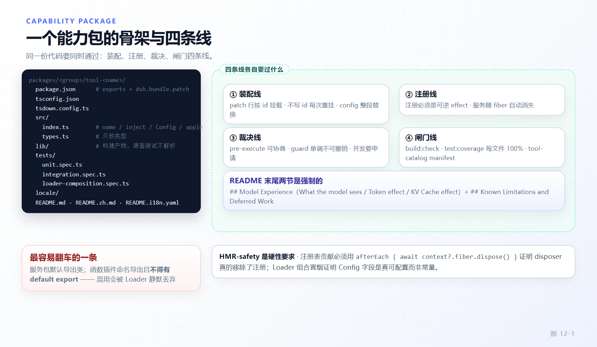

# 第 12 章 开发一个能力包：骨架、工具、配置与测试

[← 上一章：扩展点地图与选型](11-extension-map.md) · [下一章：能力接缝与执行世界 →](13-seams-execution-world.md)

> **本章目标**
>
> - 说出一个能力包的标准目录构成，并解释"源面（source plane）测试永不解析到 `lib/`"这条纪律的机制与出处。
> - 分清服务包与函数插件的两种导出形态，知道混用为什么会让 Loader 丢掉函数插件的 namespace。
> - 逐点走读一个出厂工具 `todo_write` 的完整定义：参数校验、规范 JSON 返回值、纯函数呈现、`presentationMeta` 与 Web Client 的自行推导。
> - 会用 `register(definition, { when })` 做条件注册，说清 `UNKNOWN_TOOL` / `TOOL_ACTIVATION_FAILED` 两种失败，并能指出哪些 cookbook 文档在这一点上已过时。
> - 给出 schemastery `Config` 与 `z...volatile()` 的适用判据，会写 `loader/volatile-update` 监听。
> - 组装测试三件套（行为单测、真 loop 集成、REAL-composition Loader 冒烟）外加 HMR-safety，并说出每条质量闸门命令管你什么。

第 11 章的判据顺序把你送到了某个落点；本章把"落点"变成"包"。主线是判据①（模型可见能力 → `ctx.tools.register`）——最常走、也最容易做错深度——并兑现两笔挂到本章的账：第 7 章 7.2 的"presentCall 必须是纯函数（第 12 章详述）"（12.3）与第 11 章 11.4 的"单调拒绝请用 `ctx.tools.guard()`（第 12 章）"（12.4）。

## 12.1 一个能力包的标准骨架

仓库里最小完整的能力包是 `packages/todo/tool-todo`。它的目录构成就是出厂标准：

```
packages/<group>/<pkg>/
  package.json        # @deepseek-ai/dsh-<name>，exports/files 有硬不变量
  tsconfig.json       # extends tsconfig.base.json，rootDir src，outDir lib/types
  tsdown.config.ts    # 仅当需要自定义 bundle 入口时（如 packages/core/tools）
  src/index.ts        # 服务默认导出，或插件 name/inject/Config/apply
  src/types.ts        # 只放类型，不放运行时代码
  locale/en.json      # 插件展示元数据（meta.title / meta.description）
  lib/                # 构建产物：index.js + types/*.d.ts（不发布 src）
  tests/*.spec.ts     # 包级测试，不用 src/__tests__/
  README.md + README.zh.md + README.i18n.yaml   # 双语对 + 配对哈希记录
```

骨架出处：`docs/cookbook/adding-a-package.md:9-23（该清单不含 `lib/`、`tsdown.config.ts` 与双语 README，那几项来自 `packages/AGENTS.md:25-26` 与实测目录）` 的逐文件清单；`packages/AGENTS.md:25-26` 规定 `src/types.ts` 只放类型、测试放包级 `tests/`；tool-todo 的实际目录与之逐项吻合。tsdown 配置不是每个包都写——`packages/core/tools/tsdown.config.ts:3-13` 是"有第二入口才声明"的例子（`entry: { index, pipeline }`）。

`package.json` 的 `exports` 有一套标准 key 集（`packages/todo/tool-todo/package.json:16-28`）：

```json
"exports": {
  ".": { "types": "./lib/types/index.d.ts", "default": "./lib/index.js" },
  "./client": { "types": "./lib/types/client.d.ts", "default": "./lib/types/client.js" },
  "./src/*": "./src/*",
  "./package.json": "./package.json",
  "./locale/*.json": "./locale/*.json"
}
```

`.` 的 `types`/`default` 与 `./package.json`、`./src/*`、`./locale/*.json` 等不变量由 `pnpm run constraints` 校验（`docs/cookbook/adding-a-package.md:27`）：`main: "lib/index.js"`、`files` 只含 `lib` 产物与认可的运行时资产，绝不发布 `src`；`./package.json` 与 locale 子路径供安装面板不激活插件地读取展示元数据（`adding-a-package.md:116-146`）。

**bundle 声明是另一个维度**。普通能力包（如 tool-todo）只声明 `exports`，由 bundle 层的 patch 行把它挂进组合（`packages/bundle/web-app/package.json:175` 依赖它，preset patch 出现它的插件行）；只有 bundle 包本身声明 `dsh.bundle.patch`（`packages/bundle/web-app/package.json:46-56`，有序文件列表）。第 11 章 11.6 节留的账在这里兑现：**没有 `dsh.bundle` 声明的包仍会安装，但只作为普通依赖，`dsh plugin` 打印警告且不激活任何层**（`docs/user/develop/basic/publish.md:64`）。

"源面测试永不解析到 `lib/`"是骨架里最容易违反的一条。机制只有一处：根 `vitest.config.ts:22` 把 `vite-tsconfig-paths` 的 project 限定为 `./tsconfig.base.json`，其注释写明理由——paths 映射必须赢过 package exports，否则构建产物会"加载第二份模块单例副本"（`vitest.config.ts:18-21`）。策略原文在 `docs/testing.md:45`（bare workspace imports 一律解析到 `src`）和仓库根 `AGENTS.md:148`（source plane 与 artifact plane 永不混用）。构建产物只被显式消费：`lib` 模式子进程与 built smoke。



*图 12-1 · 骨架是静态的，四条线是动态的——包在每条线上的形态各不相同*

## 12.2 命名与角色纪律

`packages/AGENTS.md` 与 `docs/cookbook/adding-a-package.md` 把包面纪律写死成几条，每条都有事故或校验器背书。

**导出形态二选一，不可混用。** 服务包（Service Definition / 注册表这类）默认导出服务类；函数插件具名导出 `name` / `inject` / `Config` / `apply`，**不得有 default export**（`packages/AGENTS.md:5`）。后果不是风格而是运行时的：混用时 Loader 按 default 解包，函数插件的 namespace（含 `inject`）被整个丢掉——这条挂在 postmortem `docs/postmortem/0001-acp-default-export-drops-inject.md` 上，`docs/testing.md:40` 因此要求 Loader 冒烟显式断言 `expect('default' in mod).toBe(false)`。

**包名与 ctx key 都命名"存在的角色"。** 包名固定 `@deepseek-ai/dsh-<name>`（根 `AGENTS.md:131`）；`adding-a-package.md:48` 要求命名稳定当下的职责——不叫第一个实现、不叫可能的未来、不叫 Cordis 基类名。`ctx` key 的单复数有硬语义：**单数 key 对一个引擎/策略/resolver/控制器，复数 key 对注册表或持有多个具名成员的服务**，"class role and key number must agree"（`docs/cookbook/adding-a-package.md:50`）。对照读：`ctx.tools` 是复数注册表（`packages/core/tools/src/index.ts:112` 的 `super(ctx, 'tools')`）。`adding-a-package.md:52-69` 的 `Controller`/`Store`/`Registry`/`Runtime`/`Resolver`/`Policy`… 表格是这套判据的完整版。

**README 末尾是固定两段。** 每个包 README 以规范顺序收尾：`## Model Experience`（其下按序 `What the model sees` / `Token effect` / `KV Cache effect` 三个 H4，模型视角写明看到什么、token 是固定/条件/保留/替换、KV 前缀是否失效）与 `## Known Limitations and Deferred Work`（`docs/cookbook/adding-a-package.md:81-106`，由校验器强制；无局限的包要进 `scripts/verify-package-readme-limitations.ts` 白名单，`packages/AGENTS.md:28-29`）。tool-todo 的 `README.md:118` 与 `:148` 就是这两段的落位。README 与行为同 commit 更新（`packages/AGENTS.md:27`）。

**plugin 内不得硬编码可调常量。** 根 `AGENTS.md:143`："deployment-varying choices are validated `Config` fields changeable from cordis.yml; a `DEFAULT_*` constant or test hook is not configurability"。协议常量、外部规范、安全不变量保持固定；会随部署变化的每一个值必须是 schemastery 校验的 `Config` 字段（教程版在 `docs/user/develop/basic/config.md:78` "Do not hardcode tunable values"）。tool-todo 的 `allowParallelInProgress`（下一节）就是这条的最小样板。

## 12.3 一个出厂工具的真实形态

通读 `packages/todo/tool-todo/src/index.ts`，它是判据①的最短完整闭环。骨架三面：

```ts
// packages/todo/tool-todo/src/index.ts:22-23, 41-43
export const name = 'tool-todo'
export const inject = ['tools', 'sessionProjections']

export const Config: z<Config> = z.object({
  allowParallelInProgress: z.boolean().required(),
})
```

函数插件三件套 `name`/`inject`/`Config`，加 `apply(ctx, config)`（`:118`）。`apply` 里做两件事：向 `ctx.sessionProjections` 注册 `todos` 折叠单元（`:124-135`，`todo/write` 事件更新、`turn/start` 清空），再向 `ctx.tools` 注册工具本体：

```ts
// packages/todo/tool-todo/src/index.ts:136-212（节选）
ctx.tools.register(defineTool({
  name: 'todo_write',
  description: describe(allowParallel),          // 由 Config 决定的措辞（:63-67）
  parameters: {
    todos: {
      type: 'array', required: true,
      items: { type: 'object', additionalProperties: false, properties: {
        content: { type: 'string', required: true, ... },
        status:  { type: 'string', required: true, enum: [...STATUSES], ... },
      } },
    },
  },
  output: {
    schema: { type: 'object', additionalProperties: false, properties: { todos: ..., counts: ... } },
    render: (_args, value) => [{ type: 'text',
      text: `Updated todo list: ${value.counts.pending} pending, ...` }],
  },
  execute(args, exec) {
    const todos = toTodoList(args.todos, allowParallel)   // 语义校验：去重、非空、单一 active
    if (!exec.agent) throw new Error('todo_write requires an owning agent session')
    exec.agent.session.append('todo/write', { todos })
    return Promise.resolve({ todos, counts: { pending: ..., inProgress: ..., completed: ... } })
  },
  presentCall: args => ({ card: 'generic', title: 'Update todo list', kind: 'other', rawInput: args.todos }),
}))
```

逐点拆：

**参数先校验、后执行。** `defineTool` 的签名在 `packages/core/tools/src/schema.ts:555`；它在包装的 `execute` 里先跑 `validate(args)`，违规抛硬 `ToolArgsError`（`schema.ts:598-602`）。schema 管形状，语义归你——`toTodoList()`（`index.ts:80-100`）补的是 DSL 表达不了的跨字段规则（trim 非空、去重、单一 `in_progress`），正是第 7 章 7.2 "拿走的三件事"第一条的出厂示范。`additionalProperties: false`（`index.ts:146`）让模型多写的键在 schema 边界大声失败而不是被静默摊平——落盘快照必须等于模型以为写下的东西（`index.ts:71-75`）。

**`execute` 只返回一个规范 JSON 值。** 契约在 `docs/cookbook/adding-a-tool.md:45`：`output.schema` 用 `ValueSchemaSpec` 声明、根可以是对象/数组/标量/null；注册表把返回值快照为无损 JSON、校验、冻结后交给 `output.render(args, value)`。不要从工具体返回内容块，也不要让调用方解析散文找回字段——`todo_write` 返回 `{ todos, counts }`，`render` 把 counts 翻成一行模型可见文字。

**`presentCall` / `presentResult` 必须是纯函数。** 硬理由在 `docs/cookbook/adding-a-tool.md:85-89`：同一份 presenter 同时跑在**实时流**与 **session-log 回放**两条路上，所以不得有 I/O、不得读会话状态、不得读时钟随机数——`presentCall` 拿不到"文件旧内容"这类调用期才存在的信息，想要就放持久元数据或适配层（`:87`）。`defineTool` 在显示路径上做软校验：过期或不合法的 logged args 让包装返回 `undefined`（回退 generic 卡片）而不是抛错，"display must never crash a replay"（`docs/cookbook/adding-a-tool.md:89`；`schema.ts:610-613` 的注释写的是 it must never throw）。`todo_write` 的 `presentCall`（`index.ts:211`）返回 `{ card: 'generic', ... }`——card-tagged render intent（渲染意图）是中性词汇，工具永不 import UI 类型（`adding-a-tool.md:91`）。

**可回放的呈现事实走 `output.presentationMeta`。** 需要"结果时刻、UI 要能回放"的事实（如 `write`/`edit` 的 applied hunks），由 `output.presentationMeta(args, value)` 从同一份规范值派生 JSON，核心把它持久化在 `tool/result` 事件的 `result.meta` 上，再交给 `presentResult`（`docs/cookbook/adding-a-tool.md:48`；包装点 `schema.ts:590-594`）。`todo_write` 没有元数据需求，所以只声明 `schema` + `render`——这同样是合法最小集（注册表只强制 `output` 必须有 `render`，`packages/core/tools/src/index.ts:130-135`）。

**Web Client 不消费 `presentCall`。** 内置 Web Client 走另一条推导路：`tool/call` 与 `tool/result` 原始事件（含持久 `result.meta`）经 page/follow 传输到浏览器，Client 插件在 **`tool.call.toolview` keyed slot**（第 11 章 11.7 节）从原始事件的参数、内容、错误与元数据自行推导组件 props，对畸形输入回退 generic 行（`docs/cookbook/adding-a-tool.md:93-97`；根 `AGENTS.md:160`）。所以定义了 Host presenter 不等于 Web 里有专用卡片——工具层只保证原始事件里事实齐全。

## 12.4 条件注册与限制：先纠正过时文档

`register` 的完整签名带第二个参数（`packages/core/tools/src/index.ts:128`）：

```ts
register(definition: ToolDefinition, options: ToolRegistrationOptions = {}): () => void
```

`options.when` 是步骤时激活条件（step-time activation condition），契约在 `docs/subsystems/tools.md:196-207`：入参 `{ agent, modelSelection, signal }`（`:184-193`），省略即恒启用，false 则该步的声明与派发同时没有它，条件本身不得改注册、不得启动工具工作。语义全貌在 `docs/subsystems/tools.md:182`：AgentLoop 每个提议步骤调一次 `ctx.tools.resolve()`，产出的 `ResolvedToolSet` 决定该步的声明、执行器 prompt 段与批内每个调用（含 PTC 程序子调用）；同名替换或新限制作废已准入未启动的调用，批结算后 loop 销毁该集合——第 7 章 7.3 节的"每步求值一次"即指这段。

两种失败各有名字：条件求值抛错 → `TOOL_ACTIVATION_FAILED`（`packages/core/tools/src/contracts.ts:146`，终止该轮）；调用名不在该步准入集合 → `UNKNOWN_TOOL`（`contracts.ts:287-303`，在策略管线**之前**拒，实现不被走到）。升级指南 `docs/upgrade-guide/v0.2.1-rc.2/conditional-tools/guide.md:12` 把两者都登记在案，并在 `:14` 写了最容易踩的连带破坏：**`system-prompt/assemble` 瀑布不再携带工具数组**，返回值里的 `tools` 字段被忽略；还在读 `assembly.tools` 的监听者拿到 `undefined` 并在运行时炸。迁移动作在 `:22-23`：过滤改成注册上的 `when`，段回调改传 `context.toolSet` 给 `ctx.tools.get()` / `schemas()`。

**两处文档过时，引用时必须补齐。** `docs/cookbook/adding-a-tool.md` 通篇（最小形状在 `:9-36`）只示范无条件 `register(defineTool({...}))`，未提 `when`、`ResolvedToolSet` 与两种失败码——条件注册的权威在 subsystem 文档与升级指南，不在 cookbook。`docs/cookbook/extension-cookbook.md:5` 则自认片段"omit imports … not copy-paste-complete"。下面是一个补齐 import、可直接落盘的条件注册骨架：

```ts
import type { Context } from '@deepseek-ai/cordis'
import { defineTool } from '@deepseek-ai/dsh-tools'

export const name = 'my-conditional'
export const inject = ['tools']

export function apply(ctx: Context) {
  // 注册是 effect：fiber 卸载即注销（register 返回精确 disposer，index.ts:148-152）
  ctx.tools.register(defineTool({ /* ... */ }), {
    // 每步求值一次；false = 该步声明与派发都没有它（subsystems/tools.md:200-205）
    when: ({ modelSelection }) => modelSelection.provider === 'acme',
  })
}
```

顺带结掉第 11 章 11.4 留的 `guard` 账：与 `when`（准入）、`restrict`（作用域交集过滤，`index.ts:162`）并立的第三个写口是 `ctx.tools.guard(guard)`（`index.ts:384-386`）——**单调拒绝**，在 `tools/pre-execute` 可协商策略与审批之后由共享管线求值（`checkGuards`，`index.ts:393-401`），后续监听者无法撤销。策略要"绝对生效"就登记 guard，靠监听者顺序是大错（第 11 章坑三）。

## 12.5 配置与热更新

配置面从 `Config` 开始：schemastery 模式声明（`packages/todo/tool-todo/src/index.ts:41-43`），Loader 在挂载时校验，错误配置在加载点大声失败（`loader-composition.spec.ts:144-148` 证明缺省/错型直接拒绝挂载；根 `AGENTS.md:144`）。

需要热更新时判据是一个问题："改它是否需要重建插件内部状态？"schemastery 的 `volatile()` 把字段声明为**稳定引用**（stable reference，`vendor/schemastery/src/index.ts:161-165`），Loader 比较原始配置时忽略 volatile 字段：仅 volatile 变化不触发重挂载，新值直接提交进运行中的引用并向所属 fiber 发出一次 `loader/volatile-update`（`docs/cordis-api/inherited.md:38`；细则 `docs/cordis-tutorial/05-config.md:91-95`）。不需要重建内部状态的值（重试参数、模型名、凭据引用）标 volatile；需要重建的（换协议、换后端拓扑）留普通字段，让常规更新流程重挂插件。结构限制：volatile 字段必须位于固定对象路径、不得嵌套在另一个 volatile 之下（`vendor/schemastery/src/index.ts:493-494`）。

监听范式看 `packages/llm/llm-deepseek/src/host.ts:81-90`：注册拿到句柄，收到通知后**自己 diff、自己决定怎么换**：

```ts
const registration = ctx.llm.registerAdapter([provider], adapter)
let registeredPolicy = dependencies.options().retryPolicy
ctx.on('loader/volatile-update', () => {
  let policy: typeof registeredPolicy
  try { policy = dependencies.options().retryPolicy }
  catch (error) { ctx.logger.warn(error); return }
  if (deepEqualJson(policy, registeredPolicy)) return
  registration.replace([provider])   // 用新依赖重建 adapter，原子替换
  registeredPolicy = policy
})
```

要点：`loader/volatile-update` 通知不带新值本身（带的是变更路径数组），读新值走 `config.<field>.get()`（或如上重新求值 `options()`）；等值变化自己吞掉；替换用注册句柄的 `replace`，不是 dispose+register 的手忙脚乱。监听者名单生成可查（`docs/event-producer-consumer.md:113`）。

配置变更的最后一课来自 patch 层：**patch 按 `id` 定位行后整段替换该行的 `config`，不做深合并**（`docs/user/develop/basic/publish.md:131`）。覆写一行必须重述该行全部键，漏写等于改回默认——第 11 章 11.6 说过这条；写包时的推论是：`Config` 每个字段都要能经受"被整段重写"的读法。

## 12.6 测试三件套

一个出厂工具的测试是三层加一条硬纪律，`packages/todo/tool-todo/tests/` 的四个 spec 恰好一一对应。

**行为单测**（`tool-todo.spec.ts`）：真注册表、真执行器、真管线，假 agent 壳包真 `Session`，经 `executeToolFixture`（`@deepseek-ai/dsh-tool-testkit`）走完整 `ctx.tools.execute`（`tool-todo.spec.ts:19-24` 自述）。校验规则、错误文案、边界都在这一层。

**真 loop 集成**（`integration.spec.ts:17-24`）：脚本化 mock 模型驱动**真实**工具过完整轮次——

```ts
async function harness(adapter: MockAdapter): Promise<Context> {
  const ctx = new Context()
  await mountAgentLoopTestDependencies(ctx)
  await ctx.plugin(AgentLoop, { agents: [] })
  await ctx.plugin(ToolTodo, { allowParallelInProgress: true })
  ctx.llm.registerAdapter(['mock'], adapter)
  return ctx
}
```

只有模型是假的；`tool/call`、`tool/result` 与工具追加的 `todo/write` 都断言在真实 session log 上（`:50-75`），第二条用例钉死 last-write-wins（`:77-100`）。

**REAL-composition Loader 冒烟**（`loader-composition.spec.ts`）：政策出自 `packages/AGENTS.md:7` 与 `docs/testing.md:39`——产品可见插件必须有非单元的 REAL-composition 测试，手搭 `ctx.plugin(...)` 不算数。这个 spec 把含 `tool-todo` 行的 `cordis.yml` 写进临时目录、经真 Loader + Include 挂载（`:59-97`），然后证明**两副面孔都跟着 Config 走**：`allowParallelInProgress: false` 时模型可见描述含 "keep exactly one todo"、并行写入被拒且 `todo/write` 不落盘（`:105-122`）；true 时描述与执行同时放开（`:124-139`）。文件头注释（`:2-4`）把意图写明：证明这个字段是真可配置，非常量伪装。

**HMR-safety 是注册贡献的硬纪律**：每个注册表贡献都要有"卸载贡献它的 fiber、观察注册消失"的测试（`packages/AGENTS.md:19`、`docs/testing.md:9`）。单文件形态是 `tool-todo.spec.ts:217-225` 的用例（"unregisters the tool when its contributing fiber is disposed"）；跨切面形态是 `loader-composition.spec.ts:27-32` 的 `afterEach`——每个用例后 `await context?.fiber.dispose()`，证明 disposer 真的移除了注册。三段骨架（单测 setup、`harness(adapter)`、`boot(configLines)`）照抄即可，全部保持源面解析（12.1）。

## 12.7 质量闸门清单与打包分发

包写完了，先看哪些命令会审判它：

| 闸门 | 命令 | 管什么 | 出处 |
|---|---|---|---|
| 构建顺序 | `build:artifacts` → `build:check` | 前者出产物，后者对最新产物类型检查全仓 tests/scripts；宣称完成前必须后者 | 根 `AGENTS.md:120`、`docs/development.md:99-100` |
| 覆盖率 | `test:coverage` | CI 闸门是它而**不是** `test`：`packages/*/*/src` 每文件 100%（statements/branches/functions/lines，`perFile: true`） | 根 `AGENTS.md:87,119`、`docs/testing.md:10`、`vitest.config.ts:258,423-431` |
| 工具目录 | `verify-tool-catalog`（doc-sync 叶子） | 新 `tool-*` 包必须进 `scripts/gen-tool-catalog.ts` 的 `TOOL_PACKAGES` boot manifest，否则 completeness guard 抛红 | `gen-tool-catalog.ts:748-761`、`run-gates.ts:847` |
| 文档图 | `pnpm run gen-doc-graphs` | 改了 seam/事件/组合面后重新生成 capability-seams 大表等生成物；CI 用 `--check` 校验新鲜 | 根 `package.json:185-186`、`run-gates.ts:835` |
| Client i18n | `verify-client-ui-i18n` | 有 client 面时，硬编码产品文案直接拒 | 根 `AGENTS.md:158`、`run-gates.ts:418` |
| 类型 | `pnpm run typecheck` | 两个聚合（host/client）全量检查 | `docs/development.md:102` |

lefthook 的分工要背下来：`pre-commit` 只做暂存快检（配对记录、staged lint、whitespace 等），**pre-push 只有 `pnpm run typecheck`**（`lefthook.yml:46-49`），hooks 里刻意不跑任何测试——头部注释原话"Keep these local checkpoints fast; CI owns the full repository-wide gate matrix"（`lefthook.yml:1-2`；分工说明 `docs/development.md:142-146`）。specs 在 forked workers 里并发跑，"只在单独运行时通过的 spec 是 spec 的缺陷"（`packages/AGENTS.md:20`）。

**打包与分发**是闸门的另一面，起点是分清两份 manifest。**Bundle** 是"这个包贡献什么"——npm 包在 `package.json` 声明 `dsh.bundle.patch`，指向插入/覆写插件行的补丁；**profile** 是"哪些 bundle 按什么序组合"——`$DSH_HOME/profiles/<name>` 目录下由 `dsh.profile.bundles` 有序列表加用户自己的 `cordis.patch.yml` 构成（`docs/user/develop/basic/publish.md:11-16`）。你写 bundle，用户只有 profile，没有包同时是两者。手写 bundle manifest 的最小形状（`publish.md:36-44`，此处节选，原块另含 `version` 与加载入口 `main`）：

```json
{
  "name": "dsh-hello-plugin",
  "type": "module",
  "files": ["index.js", "cordis.patch.yml"],
  "dsh": { "bundle": { "patch": "./cordis.patch.yml" } }
}
```

`patch` 接受单文件或有序列表（12.1 的 web-app 是列表形态）；`engines.dsh` SemVer 范围声明兼容的 DSH 版本，安装与启动都会拒绝越界 bundle（`publish.md:66`）。profile manifest 永远不手写——`dsh plugin` 创建 base-backed profile 并维护其 bundle 列表（`publish.md:75`）。

**`dsh plugin` 是 pnpm 的转发面。** `apps/cli/src/plugin.ts:17-20`：DSH 只截获三个子命令 `allow-version` / `revoke-version` / `version-exemptions`，其余参数原样交给 profile 目录里的 pnpm（`:93-98` 调 `runProfilePnpm`/`runPluginCommand`）。兼容性拒绝不是死胡同：不兼容项会打印**确切的恢复命令**（`dsh plugin --profile <name> allow-version <pkg>@<ver> --dsh-version <ver> --accept-risk`，`:100-102`）。

**git 源包的 build-script 坑。** 从 git 安装取的是源码不是产物；作者侧要提供自包含的 `prepare` 脚本（pnpm 在 git 安装后执行它），用户侧 pnpm ≥10 会拦下该脚本直到显式放行。`dsh` 在失败时把修法直接说出来：把 pnpm 打印的确切 key 写进 profile 的 `pnpm-workspace.yaml`（`apps/cli/src/plugin.ts:104-106`；政策与示例 `docs/user/develop/basic/publish.md:169-181`）再重跑 `add`：

```yaml
allowBuilds:
  dsh-hello-plugin: true
```

并建议 pin 到 commit（`github:you/hello-plugin#<sha>`）。或者干脆发 npm/tarball，两侧都不需要构建许可。

**破坏性变更必须登记。** 根 `AGENTS.md:11` 一句话："Record each externally perceptible breaking change immediately in an upgrade guide"——落点是 `docs/upgrade-guide/v<version>/<item>/guide.md` 及中文姊妹页，`verify-upgrade-guides` 把关。12.4 的 conditional-tools 指南就是范本：`Change` 讲清什么坏了，`Migration` 给逐条动作。

**先做实验能力，再转正。** 整个公开契约都是实验性的包放 `packages/experimental/<name>`、用 `@deepseek-ai/dsh-experimental-` 前缀（`scripts/experimental-package-policy.ts:31`）；产品包里的实验开关留在该产品角色（`packages/experimental/README.md:26` 段）。默认产品必须与实验隔离——`pnpm run verify-default-product-isolation` 校验实验包不出现在默认安装、运行时 import 与出厂组合里（脚本头注释 `scripts/verify-default-product-isolation.ts:1-5`）。"Experimental" 说的是承诺级别，不是质量豁免。

下一章（第 13 章）把视角从"你的包"转回"包插入的世界"——能力接缝如何在执行世界（shell、fs、sandbox、approval）里被裁决。

## 12.8 本章小结

- 骨架：`package.json`（`exports` 标准 key 集）、`tsconfig.json`、`src/`（`types.ts` 只放类型）、`lib/` 产物、`tests/`、`locale/`、双语 README + `README.i18n.yaml`；bundle 包额外声明 `dsh.bundle.patch`；源面测试经 `vite-tsconfig-paths` → `tsconfig.base.json` 永不解析 `lib/`。
- 纪律：服务包默认导出、函数插件具名 `name/inject/Config/apply` 且无 default；单数 ctx key 对一个引擎、复数对注册表；README 以 Model Experience + Known Limitations 收尾；部署可变值必须是 `Config` 字段。
- `todo_write` 示范工具契约全链：`defineTool` 先校验后执行、`execute` 返回唯一规范 JSON、presenters 纯函数 + 软校验、`presentationMeta` 落 `result.meta`、Web Client 在 `tool.call.toolview` keyed slot 自行推导。
- 条件注册 `register(def, { when })` 每步一次求值；失败两码 `UNKNOWN_TOOL` / `TOOL_ACTIVATION_FAILED`；`assembly.tools` 已成历史；adding-a-tool.md 未覆盖 `when`、extension-cookbook.md 片段非可复制，引用须补 import。
- `volatile()` 判据是"改它要不要重挂插件"；监听范式 = 注册句柄 + diff + `replace`；patch 整段替换 config 不深合并。
- 测试三件套 + HMR-safety：行为单测走 `executeToolFixture`，真 loop 集成只 mock 模型，REAL-composition 经真 Loader 证明 Config 真可配置，`afterEach` 里 `fiber.dispose()` 证明 disposer 真的移除注册。
- 闸门：`build:artifacts`→`build:check`；覆盖率闸门是 `test:coverage`（每文件 100%）不是 `test`；新工具包必须进 `TOOL_PACKAGES`；lefthook 刻意不跑测试。
- 分发：bundle≠profile；`dsh plugin` 转发 pnpm、只截获三个 version 子命令、拒绝时打印确切恢复命令；git 包构建许可写进 profile 的 `pnpm-workspace.yaml`；破坏性变更登记 upgrade-guide；实验能力用 `dsh-experimental-` 前缀并过产品隔离校验。

**检查点**

1. 你写的函数插件同时有 `export default {...}` 和具名 `name/inject/apply`，加载后 `inject` 声明完全失效。违反了哪条纪律？（答：函数插件不得有 default export——Loader 按 default 解包会丢掉整个 namespace；`packages/AGENTS.md:5` 与 postmortem 0001。）
2. 一个在 `system-prompt/assemble` 里读 `assembly.tools` 做过滤的老插件，在新版本 dsh 上拿到 `undefined` 后运行时报错。发生了什么，怎么迁？（答：条件工具改造后 assemble 瀑布不再携带 tools，返回的 `tools` 字段被忽略（`docs/upgrade-guide/v0.2.1-rc.2/conditional-tools/guide.md:14`）；过滤改为注册上的 `when`，段回调传 `context.toolSet`。）
3. 你把并行上限写成模块常量 `const MAX = 4`，评审要求改成 `Config` 字段并补 Loader 冒烟。为什么"有默认值"不算可配置，冒烟要证明什么？（答：根 `AGENTS.md:143`——`DEFAULT_*` 常量不是可配置性；冒烟要证明模型可见描述与执行判定两个面向都跟着 Config 字段走，参照 `loader-composition.spec.ts:2-4`。）

**延伸阅读**

- 官方 [Adding a package cookbook](https://deepseek-harness.github.io/deepseek-harness/reference/cookbook/adding-a-package) — 逐文件清单与角色命名表
- 官方 [Tool 编写参考](https://deepseek-harness.github.io/deepseek-harness/reference/cookbook/adding-a-tool) — execute 契约与卡片渲染意图全表（注意 12.4 的过时提醒）
- 官方 [打包与安装插件](https://deepseek-harness.github.io/deepseek-harness/develop/basic/publish) — bundle/profile 两面与 layer 顺序
- 条件工具升级指南 v0.2.1-rc.2：仓库内 `docs/upgrade-guide/v0.2.1-rc.2/conditional-tools/guide.md`（升级指南未发布到文档站）
- 源码：`packages/todo/tool-todo/`（骨架范本）、`docs/testing.md`、`lefthook.yml`、`apps/cli/src/plugin.ts`
- 上一章：[扩展点地图与选型](11-extension-map.md) · 下一章：[能力接缝与执行世界](13-seams-execution-world.md)
