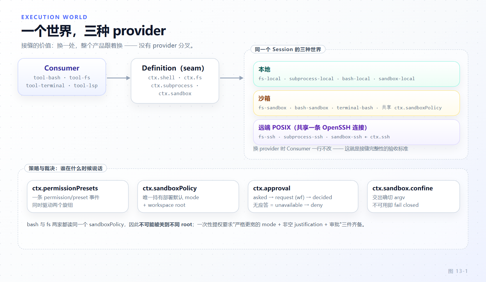

# 第 13 章 能力接缝与执行世界

[← 上一章：开发一个能力包](12-capability-package.md) · [下一章：模型接入层 →](14-llm-adapter.md)

> **本章目标**
>
> - 在 `packages/shell` 的包布局里认出 Service Definition / Provider / Consumer 三角色及依赖方向。
> - 背下执行世界（execution world）不变量：`ctx.fs`、`ctx.subprocess`、`ctx.shell`、`ctx.terminals`、`ctx.sandbox` 必须指向同一个世界，并用 `packages/ssh` 证明它。
> - 精确描述 `ctx.sandbox.confine(argv, policy, signal)`：交出即将 spawn 的确切 argv、provider 报告强制执行程度、不可用时 fail closed。
> - 理解 `ctx.sandboxPolicy` 的优先级规则，以及 bash 与 fs 两家为何不可能被关进不同的 root。
> - 走完审批从 `approval/asked` 审计对到工具管线 allow/deny 的全链路；掌握"不碰 Consumer 写新 Provider"与 `fs/*` 事件门两种扩展路径。

接缝的价值只有一句话——换一处 provider，整个产品跟着换：把 `ctx.fs`、`ctx.subprocess`、`ctx.shell` 整体改指远端沙箱，Bash、PTY、LSP 自动跟着走，消费者一行代码不改。这不是修辞，是一条有证据可查的不变量。

## 13.1 三角色在一族包里的落点

以 bash 接缝为例，`packages/shell` 下的包按角色分三层：

| 角色 | 包 | 交付物 |
|---|---|---|
| Service Definition | `packages/shell/shell` | `ShellExecutor` 抽象类 + `Context.shell` 声明 |
| Provider | `bash-local`、`bash-sandbox`、`pwsh-local`（及 `pwsh-sandbox`） | 继承 `ShellExecutor` 的具体实现 |
| Consumer | `packages/shell/tool-bash` | 只读 `ctx.shell` 的模型侧工具 |

Definition 不含执行逻辑，只声明形状（`packages/shell/shell/src/index.ts:64-93`，节选）：

```ts
// packages/shell/shell/src/index.ts:64-93（节选）
export abstract class ShellExecutor extends Service {
  constructor(ctx: Context) {
    super(ctx, 'shell')
  }
  get sandboxMode(): SandboxMode | undefined {
    return undefined
  }
  abstract resolve(request: ShellExecRequest): ShellExecSpec
  abstract execute(spec: ShellExecSpec): Promise<ShellExecution>
}
```

契约细节有三处要紧。`super(ctx, 'shell')` 定下服务名：一个 context 只允许一个实现，加载第二个会抛（`:36-40`）——"可替换"永远是整体替换。`sandboxMode` 是可选能力事实的默认值（`undefined` = 不沙箱），Consumer 用它决定是否向模型广告升级（escalation）参数。类头注释（`:49-62`）钉死 Provider 的语义不变量：`result` 只对基础设施故障 reject，非零退出/超时/取消都 resolve 成带描述的结果；句柄在 preparation 之后才发布；`readOutput` 增量读取永不重复输出。

Provider 侧：`LocalBashExecutor`（`packages/shell/bash-local/src/index.ts:97-98`）`inject = ['subprocess']`，把命令跑成 `bash -c` 交给 `ctx.subprocess`；`pwsh-local` 的 `PwshLocalExecutor`（`packages/shell/pwsh-local/src/index.ts:123`）是同一接缝的 Windows 实现。`bash-sandbox` 则 Provider 叠 Provider：`SandboxBashExecutor extends LocalBashExecutor`（`packages/shell/bash-sandbox/src/index.ts:45`），它对下游的调用恰好演示接缝之间如何对话：

```ts
// packages/shell/bash-sandbox/src/index.ts:187-188
private confine(command: string, policy: SandboxPolicy, signal?: AbortSignal): Promise<ConfinedArgv> {
  return this.ctx.sandbox.confine(['bash', '-c', command], policy, signal)
}
```

Consumer 侧，`tool-bash` 头注释自称 "Model-facing Consumer of the `ctx.shell` capability seam"（`packages/shell/tool-bash/src/index.ts:2`）：读 `ctx.shell.sandboxMode`（`:207`）、调 `ctx.shell.resolve(...)` / `execute(spec)`（`:278`、`:526-527`），对背后是 bash 还是 pwsh、本地还是沙箱一无所知；执行器报告 confines 而 `ctx.sandboxPolicy` 缺席时直接抛错（`:210-211`），不允许静默降级。

## 13.2 执行世界不变量：五个接缝，一个世界

这五个接缝共同回答"文件在哪、进程在哪、命令在哪、终端在哪、限制在哪"。dsh 的不变量：**它们必须描述同一个世界（execution world），并整体切换**。



*图 13-1 · 五个接缝共同决定一个 Session 的执行世界；三列是本地、沙箱、SSH 的 provider 组合，虚线框内没有 provider 分叉——不存在"文件系统本地、bash 远端"的混搭。*

不变量成立时连锁反应自动发生：Bash 调 `ctx.shell`，其实现底下是 `ctx.subprocess`；PTY 终端 `terminal-bash` 把 `ctx.terminals` 的后端接到 `ctx.subprocess` 的 `spawnTerminal`（`packages/terminal/terminal-bash/src/index.ts:27,187-189`）；LSP "read sources through `ctx.fs` and launch servers through" subprocess 接缝（`packages/lsp/lsp-stdio/src/index.ts:6,154`）。没有 provider 分叉，因为Consumer 侧没有一处代码 import 具体类。

跨接缝的文件身份靠一个刻意设计：`FsTarget.targetKey` 对消费者不透明，但 `processPath(target)` 返回"这个世界里子进程能打开的绝对路径"（`packages/fs/fs/src/index.ts:134-142`）——"consumers may pass this value to another OS capability"。同世界时 fs 解析出的 processPath 直接就是 bash 命令里的路径；宿主路径要进来则需显式桥 `processPathFromHostPath`，默认 `undefined`（`:145-155`）。

## 13.3 最强证据：SSH 一族四条接缝共享一条连接

`packages/ssh/ssh` 拥有连接：`ctx.ssh` 声明在 `packages/ssh/ssh/src/index.ts:54-56`，`SshConnection`（`:59`）管理一条 OpenSSH 连接与一个版本匹配的远端 POSIX helper，"One non-reconnecting SSH session; loss invalidates all active operations"（`:58`）。配置全是部署方事实——host 别名、helper 路径与哈希、远端默认 workspace——"no model argument selects these values"（`:30-52`）：模型不能决定你的执行世界。其余三个包各把一个接缝改指这条连接上的 helper：

```ts
// packages/ssh/fs-ssh/src/index.ts:20-21
export class SshFileSystem extends FileSystem {
  static inject = ['ssh', 'sandboxPolicy']
```

- `fs-ssh`：`SshFileSystem extends FileSystem`，读写与 resolve 全经 RPC 在远端执行（`watch` 未覆写，落基类的 reject）（`packages/ssh/fs-ssh/src/index.ts:20-22`）。
- `subprocess-ssh`：`SshSubprocessRuntime extends SubprocessRuntime`（`packages/ssh/subprocess-ssh/src/index.ts:229-230`），"Remote subprocess and PTY handles"——PTY 也在这里，无需单独的 terminal provider。
- `sandbox-ssh`：`SshSandboxProvider extends SandboxProvider`（`packages/ssh/sandbox-ssh/src/index.ts:10-11`），`confine` 把 argv 与 policy 发到远端，让**同一台远端主机**的 bwrap/Landlock 包裹它；helper 报错一律翻译成 `SandboxUnavailableError`（`:13-31`），继续 fail closed。

四个包共享一条 `ctx.ssh`，所以 fs 看到的、shell 跑掉的、sandbox 关住的、PTY 敲进去的必然在同一台主机上。一个容易忽略的坑：sandbox-policy 拒绝在本地 canonicalize 远端路径（`packages/sandbox/sandbox-policy/src/index.ts:36-40`），物理校验推迟到执行主机每次调用时做——执行世界不变量连路径归一化都站队。

## 13.4 ctx.sandbox：交出确切 argv，报告是否强制执行

沙箱接缝不是"给我一个隔离环境"，而是一个 **argv 包裹器**（`packages/sandbox/sandbox/src/index.ts:168-193`）：

```ts
// packages/sandbox/sandbox/src/index.ts:180-192（节选）
  /**
   * Wrap `argv` so it executes confined under `policy` on this host; the
   * caller spawns the returned argv in place of its own.
   * @param argv - the exact argv the caller is about to spawn (program plus
   *   arguments), NOT a shell string — a shell-shaped consumer passes
   *   `['bash', '-c', command]`.
   */
  abstract confine(argv: readonly string[], policy: SandboxPolicy, signal?: AbortSignal): Promise<ConfinedArgv>
```

provider 返回替代 argv 外加三样报告（`ConfinedArgv`，`:98-124`）：`enforcement: 'full' | 'partial'`——`partial` 意味着该后端管不住所有承诺的文件效果，"must not treat it as full"（`:62-67`）；`denialSignatures`——本后端特有的拒绝方言（bwrap 报 EROFS、Landlock 报 EACCES、Seatbelt 报 EPERM），消费者只匹配这一个后端的签名（`:108-116`）；`runnerFailureRules`——先于拒绝判定的 runner 崩溃证据，"Exit status alone never proves runner failure"（`:81-88`）。区分是安全语义：runner 失败 = 命令根本没跑，拒绝 = 沙箱正确地挡住了它。

policy **每次调用随身携带**，不钉在 provider 上：批准的升级重试就是"同 argv、更宽 policy 的新调用"（`:69-80`）；缺省解析是消费者边界的显式步骤，provider 视 policy 为已完全指定。

fail-closed 是最后一根柱子："confine must return enforcing argv or fail closed at wrap or runner-execution time; silent unconfined passthrough is forbidden"（`:168-173`）。本地后端（bwrap→Landlock→Seatbelt→Windows ACL 探测链，`packages/sandbox/sandbox-local/src/index.ts:2,68-70`）选不出可用 runner 时抛 `SandboxUnavailableError`、携带稳定代码 `SANDBOX_UNAVAILABLE`（`packages/sandbox/sandbox/src/index.ts:126-152`），随 `HarnessError` 穿过 `tool/result`，让调用方把"没有沙箱"与"命令失败"区分开。

## 13.5 ctx.sandboxPolicy：唯一持有部署默认与 root 的地方

`ctx.sandbox` 只包 argv，不持有策略；策略之家是 `ctx.sandboxPolicy`（`packages/sandbox/sandbox-policy/src/index.ts:1-22`）：部署默认 mode、`workspace-write` root、额外可写目录，加 `sandbox/mode` 事件的 session fold（projection 注册在 `:164-172`）。`resolve()`（`:197-205`）：

```ts
// packages/sandbox/sandbox-policy/src/index.ts:197-205
  resolve(request: SandboxPolicyRequest = {}): SandboxExecutionPolicy {
    const { session } = request
    return {
      mode: request.mode ?? (session === undefined ? undefined : this.overrideOf(session)) ?? this.defaultMode,
      workspaceRoot: resolveWorkspaceRoot(session?.header.cwd ?? this.workspaceRoot),
      ...this.additionalWritableRoots === undefined ? {} : { additionalWritableRoots: this.additionalWritableRoots },
      ...session === undefined ? {} : { sessionId: session.id },
    }
  }
```

优先级 = 显式授权（批准升级的目标 mode）> session fold（最后一条 `sandbox/mode` 事件）> 部署默认，默认是 fail-safe 的 `read-only`（Config 文档 `:87-94`）——想要可写 agent 必须显式选择。workspace root 用 session 的不可变 `header.cwd`，agentless 调用回落配置值。

"唯一之家"消灭一整类 bug：`tool-bash` 每次 `sandboxPolicy.resolve({session})` 后把完整 policy 塞给 `ctx.shell`（`packages/shell/tool-bash/src/index.ts:209-215`）；fs 侧 `SandboxedFileSystem` 声明 "the sandbox policy ... is NOT here — ctx.sandboxPolicy"（`packages/fs/fs-sandbox/src/index.ts:42-56`）。两个 enforcing 家族读同一个 resolve，不可能被关到不同 root、不同 mode。执行器与 provider 保持 session-free，策略在调用边界读一次；连系统提示都从同一个 resolve 渲染（`:174-186`），模型看到的政策文本与内核执行的政策同源。

## 13.6 审批：审计对、回答者瀑布与三种降级

`ctx.approval`（`packages/interaction/user-approval/src/index.ts:25-28`，类 `:167`）是工具授权与沙箱升级共用的接缝。`request()` 的持久面（`:242-260`，节选）：

```ts
// packages/interaction/user-approval/src/index.ts:242-260（节选）
  async request(req: ApprovalRequest): Promise<ApprovalOutcome> {
    const session = req.agent.session
    if (!this.approvalStateOf(session).turnOpen) {
      throw new Error('approval.request() outside an open turn: ...')
    }
    const id = ApprovalRequestId(randomUUID())
    session.append('approval/asked', { id, toolName: req.toolName, ... })
    const outcome = await this.decide(req, session)
    session.append('approval/decided', { id, outcome })
    return outcome
  }
```

两条不变量：必须**有开启中的 turn**——审计对要被 turn 的 commit/replay 边界包住，裸落在 turn 之间的事件是崩溃尾部垃圾（`:244-250`）；任何一端 append 提交失败则整个请求 reject，绝不返回未入账的决定（`:232-236`）。

`decide()`（`:293-333`）是判定机。`'never'` 策略在**派发之前**短路成 `rejected`（`:301`）：任何 `prepend: true` 的监听器都能排到"门监听器"前面，监听器形状的门守不住确定性（`:296-300`）。其余请求进入 `approval/request` 回答者瀑布并与 signal 竞速，配三个归一化：同步抛错的监听器先被装进 promise 链再捕获（`:302-306`）；抛错或返回词汇表之外值的回答者归为 `unavailable`——让问题 fail closed，而不是让 tool call fail open（`:311-318`）；abort 赢竞速则迟到答案被丢弃（`:319-332`）。

工具管线是 Consumer（`packages/core/tools/src/pipeline.ts:432-473`）：`ask` 经 `ctx.get('approval')` 机会性解析——没组合审批服务、或会话中途 unmount，都**降级为 deny**（`:437-442`）；agentless 调用同样降级（`:443-448`）。四种 outcome 只有 `allowed-once` 放行，三种非授权各给不同拒绝理由（`:457-471`），让模型分辨"人说不要"（rejected）、"人取消了"（cancelled）与"没有审批通道"（unavailable）。记住不对称：接缝对消费者永远可用（拿不到就 deny），对部署永远可选。

## 13.7 一次性提权与权限预设

沙箱升级是审批之上的编排序列，住在 `packages/sandbox/sandbox/src/escalation.ts`。`WIDER_MODES` 是严格更宽阶梯（`:29-32`）；`validateEscalationArgs` 要求 `sandbox_permissions` 与 `justification` **成对出现且理由非空**（`:44-62`）。`approveEscalation`（`:172-206`）的编排序：重复 effective mode 免审批返回；严格更宽在执行期核对而非写进 schema 枚举（枚举是注册表全局的，effective mode 是每调用事实，`:23-28`）；要求审批与 agent 在场；按 outcome 分支——`allowed-once` 返回目标 mode，`rejected` 抛"停下来解释，不要绕行"，`unavailable` 抛"没有审批通道"（`:181-205`）。批准的 grant 只属于这一次调用。channel 以结构化函数形状 `EscalationApprover` 注入：tool 层闭包 `ctx.approval.request(...)` 递下来（`packages/shell/tool-bash/src/index.ts:241`），sandbox 包因此从不依赖 approval/agent 包（`:9-14`）。

`ctx.permissionPresets`（`packages/interaction/permission-presets/src/index.ts:39-41`、类 `:174`）把用户体验层的"一个旋钮"翻译成执行层的"两个事件"：preset 就是 `{ sandbox, approval }` 二元组（`PresetSpec`，`:58-67`），选择时先追加 `permission/preset`（纯日志的用户意图，不进模型 transcript，`:45-55`），再只对**变化的**旋钮经 `setSandboxMode` / `setApprovalPolicy` 写各自事件（`:398-416`）。投影 fold 同时看三条事件（`:133-137`）：两个策略之家各自只读自己那条，预设身份只是让用户下次能恢复选择。

## 13.8 不碰 Consumer 写一个新 Provider

以 `ctx.fs` 为例。Definition 要求覆写的抽象成员：`resolve` / `processPath` / `fileUrl` / `contains` / `stat` / `lstat` / `readText` / `streamText` / `readBytes` / `readByteRange` / `listDir` / `writeText` / `editText`（`packages/fs/fs/src/index.ts:132-290`），并遵守类头形状不变量："targets must preserve identity across aliases; reads expose regular UTF-8 text or typed errors, listings are stable and content-free, and mutations are atomic"（`:81-86`）。三个可选能力有安全默认：`watch` 默认 reject（`:92-105`）、`sandboxMode` 默认 `undefined`（`:107-121`）、`processPathFromHostPath` 默认 `undefined`（`:145-155`）——不实现即自动声明"没有"。把 loader 条目从 `fs-local` 换成你的包（或 `fs-sandbox`，"INSTEAD OF `dsh-fs-local`, together with a `ctx.sandboxPolicy`, is the whole swap"，`packages/fs/fs-sandbox/src/index.ts:49-56`；或 `ssh` 一族），所有 Consumer 自动换世界。

Provider 之外的行为增量走 `fs/*` 事件门：门由 Definition 声明（`packages/fs/fs/src/index.ts:50-78`）、由 Consumer 在操作边界派发（`packages/fs/tool-fs/src/write.ts:121`、`edit.ts:133`、`read-target.ts:27`）。`fs/write-intent`、`fs/edit-intent` 是单槽瀑布——调 `next()` 得到裸 provider 的无条件写，**第一个返回 intent 的监听器拥有决定**，不合成；`fs/observed` 是 emit，记录权威的存在/缺席观察。`fs-observation-policy` 是扩展的标准形状（`packages/fs/fs-observation-policy/src/index.ts:106-130`）：不注册服务、没有 `inject`，只挂三个监听器，用 WeakMap 记录每个 session 观察过的目标，`fs/write-intent` 据此给出 `createIfAbsent` 或 `replaceIfVersion`，`fs/edit-intent` 拒绝未观察目标（`FS_NOT_OBSERVED`）。它贡献"先读后写"的新鲜度策略而**不改 `ctx.fs`**；provider 只把 intent 变成原子的 CAS/no-clobber 检查。两条纪律：`fs/observed` 监听器必须是同步记录器（emit 不 await，抛错会失败已提交的调用）；intent 监听器占住单槽就**不要**再调 `next()`。

## 13.9 本章小结

Definition 只声明形状与不变量；Provider 整体替换（一个 context 一个实现）；Consumer 永远只经 `ctx.*` 访问——三角色各自独立演化。执行世界不变量要求 `fs` / `subprocess` / `shell` / `terminals` / `sandbox` 同进同退，SSH 一族用共享一条 `ctx.ssh` 的四个 provider 证明了无分叉时 Bash、PTY、LSP 自动跟随。`ctx.sandbox` 是 argv 包裹器：交出确切 argv、报告 enforcement 与方言、无路可关时 `SANDBOX_UNAVAILABLE` fail closed；策略住 `ctx.sandboxPolicy`，显式授权 > session fold > 默认 `read-only`，两家读同一 resolve 故 root 不分叉。审批落 `approval/asked`/`approval/decided` 审计对，`'never'` 派发前短路，异常答案归一 `unavailable`，管线把无服务/无 agent 降级为各有理由的 deny。写新 Provider 靠实现抽象类，写新策略靠事件门监听器——两者互不相碰。

**检查点**

1. 为什么 `confine` 只接受确切 argv 而不接受 shell 字符串？
   答案要点：包裹发生在 spawn 边界——替代 argv 必须与调用者原本要跑的进程逐参数对应，enforcement 声明、denial 方言、runner 失败判定才有归属对象；shell 形状的消费者自己组装 `['bash', '-c', command]` 传入（`packages/sandbox/sandbox/src/index.ts:183-185`）。
2. 策略为 `ask`、没有任何回答者应答，一个工具触发审批。日志与模型分别看到什么？
   答案要点：`approval/asked` 与 `approval/decided`（outcome `unavailable`）成对入账（瀑布无主时兜底 `unavailable`，`packages/interaction/user-approval/src/index.ts:306-318`）；管线 deny，理由 "requires approval, but no approval channel is available"（`packages/core/tools/src/pipeline.ts:467-470`），与用户拒绝（rejected）明文可分。
3. SSH 执行世界里，`workspace-write` 的 root 由谁定、在哪校验？
   答案要点：`ctx.sandboxPolicy.resolve` 用 session 的 `header.cwd`（远端拼写）作 root（`packages/sandbox/sandbox-policy/src/index.ts:201`），列表只验绝对性、不在本地 canonicalize（`:36-40`），物理目录与 symlink 校验由远端执行主机每次调用时做（`packages/sandbox/sandbox/src/index.ts:44-51`）。

**延伸阅读**

- 官方参考：能力接缝 `<https://deepseek-harness.github.io/deepseek-harness/reference/capability-seams>`；子系统 filesystem / shell / sandbox / ssh 在 `/reference/subsystems/` 下同名页面。
- 本仓库文档 `docs/capability-seams.md`、`packages/sandbox/README.md`；第 3 章解释瀑布/emit 的底层机制，第 7 章覆盖工具管线如何把审批接进 `tools/pre-execute`。
