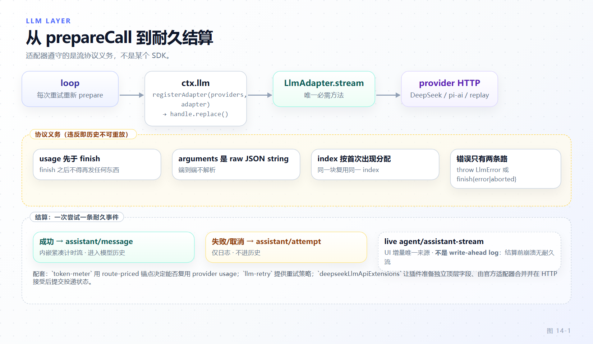

# 第 14 章 模型接入层

[← 上一章：能力接缝与执行世界](13-seams-execution-world.md) · [下一章：平台面 →](15-platform-surfaces.md)

> **本章目标**
>
> - 说清 `ctx.llm` 作为唯一模型出口的拓扑：适配器注册表 + `llm/stream` 瀑布，以及 `LlmAdapter` 里**唯一必需的方法**是 `stream`。
> - 掌握 `registerAdapter` 句柄的双重身份（disposer + `replace`），从 `loader/volatile-update` 监听学会 volatile 与接缝配合的范例。
> - 识别官方 cookbook 的两处过时：目录接缝 `registerConfigurableProviders`；`llm-deepseek` 是 library 而非插件。
> - 背下流协议义务：`usage` 先于 `finish`、`finish` 后噤声、tool-call `arguments` 全程 raw JSON string、错误只有两条合法路径。
> - 理解 `prepareCall` 的代数（每次重试重新 prepare、只派发一次、prepare 与提交之间取消则不落盘），会讲 token-meter 的 usage 复用规则，能搭出可被 `llm-replay` 无网络验证的最小适配器。

第 13 章的接缝替换"在哪执行"；本章替换"跟哪个模型说话"。`ctx.llm` 是全框架唯一模型出口——agent loop、压缩、会话标题生成（`packages/session/session-title-llm/src/index.ts:252`）都从它走。写适配器遵守的是**流协议义务**而不是某个 SDK：官方直连 HTTP 的 `llm-deepseek` 与包装第三方库的 `llm-pi-ai` 内部毫无共同点，对 `LlmRuntime` 却形状一致。

## 14.1 ctx.llm 的拓扑与抽象类表面

`LlmRuntime`（`packages/llm/llm/src/index.ts:354`）= 适配器注册表 + 流式调用 API + 一个拦截点。拦截点是 `llm/stream` 瀑布（`:62-75`）："Waterfall around every streaming model call (retry, replay, routing)"——监听器调 `next()` 抵达解析出的适配器流，或直接 yield 自己的 chunk 短路（`llm-replay` 就靠后者）。loop 构造的请求深冻结且带 `markAgentLoopRequest` 标记，内容是 session log 的纯函数，监听器只读不写（`:67-73`）。基类 `LlmAdapter`（`:208-303`）**只有一个必需方法**：

```ts
// packages/llm/llm/src/index.ts:297-302
  /**
   * Stream one model call as raw chunks. The only required method.
   * @param options - the fully-assembled request; implementations must honor `options.signal`.
   * @returns the chunk stream, obeying the adapter contract documented on `StreamChunk`.
   */
  abstract stream(options: GenerateOptions): AsyncIterable<StreamChunk>
```

其余七个全是带默认实现的可选覆写：`providerInfo`（`:214`）、`providerRetryPolicy`（`:223`）、`imageRequestPricing`（`:236`，必须同步无 I/O，token meter 每次测量都解析它）、`imageRequestTarget`（`:248`，resize 型必须覆写）、`listModels`（`:260`，GUI 目录入口需要）、`resolveModel`（`:273`，provider 中立的模型能力元数据）、`prepareCall`（`:290`，见 14.5）。另有一条网络侧契约：类头注释（`:202-207`）要求**每个 provider HTTP 请求必须携带 `attributionHeaders()`**（`packages/llm/llm/src/attribution.ts:64`），且要在 wire 请求或库的 header hook 处证明加过。

## 14.2 注册与热换路由

`registerAdapter(providers, adapter): AdapterRegistrationHandle`（`packages/llm/llm/src/index.ts:393-401`）：多路由**全有或全无**，任一 provider 已有适配器就抛 `DUPLICATE_ADAPTER`（`:394-395`）；空数组抛 `INVALID_ADAPTER`（`:409`）；注册包在 `ctx.effect` 里随 fiber 释放，HMR 安全（`:408-417`）。句柄有双重身份：

```ts
// packages/llm/llm/src/index.ts:309-326（节选）
export interface AdapterRegistrationHandle {
  /** Release every route this registration currently holds. */
  (): void
  // ...
  replace(providers: string[]): void
}
```

`replace` 的价值在"同实例换路由集合"：已释放后调用抛 `REGISTRATION_DISPOSED`（`:321-323`）。真实用法在官方 DeepSeek 宿主线（`packages/llm/llm-deepseek/src/host.ts:81-90`）：

```ts
// packages/llm/llm-deepseek/src/host.ts:81-90
  const registration = ctx.llm.registerAdapter([provider], adapter)
  let registeredPolicy = dependencies.options().retryPolicy
  ctx.on('loader/volatile-update', () => {
    let policy: typeof registeredPolicy
    try { policy = dependencies.options().retryPolicy }
    catch (error) { ctx.logger.warn(error); return }
    if (deepEqualJson(policy, registeredPolicy)) return
    registration.replace([provider])
    registeredPolicy = policy
  })
```

这是 volatile 配置与接缝配合的范例：retryPolicy 在注册时被快照进 registration；配置变了但插件不重载，`loader/volatile-update` 触发后用 `replace([同一provider])` 原地重注册，新快照生效，路由无空窗、实例不换。配置读取包了 try/catch：坏配置只记日志，旧路由继续服务——接缝不会为一次失败的编辑下线整个 provider。

## 14.3 官方 cookbook 的两处过时

`docs/cookbook/adding-an-llm-adapter.md:9-21` 的 "The shape" 只演示 `registerAdapter`，漏了两件事。

第一，出厂实现还用第二个注册 API：`ctx.llm.registerConfigurableProviders([...])`（`packages/llm/llm/src/index.ts:495`，句柄 `DirectoryRegistrationHandle` 同为 disposer + `replace`，`:330-348`）：

```ts
// packages/llm/llm-deepseek-api-key/src/index.ts:82-84
  ctx.llm.registerConfigurableProviders([
    { provider: PROVIDER, displayName: 'DeepSeek', settingsNs: ctx.fiber.entry?.options.id ?? name, settingsPath: [] },
  ])
```

这是**目录/设置命名空间接缝**：`LlmConfigurableProvider`（`packages/llm/llm/src/types.ts:252-264`）把 provider 路由绑定到用户设置命名空间（`settingsNs`）与其中路径（`settingsPath`），设置页与模型发现据此找到配置。只调 `registerAdapter` 的适配器能跑请求，但在 GUI 的 Models 页不可配置。

第二，cookbook 把 `packages/llm/llm-deepseek` 称作 reference implementation，但**它是 library 不是插件**：入口 `src/index.ts` 是纯再导出 barrel，不导出插件所需的 `name`/`inject`/`apply`；README 明说 "Compose API-key or account plugins ... for provider registration"。真正挂进 profile 的是两张认证皮：`llm-deepseek-api-key`（`packages/llm/llm-deepseek-api-key/src/index.ts:16-17,33`）与 `llm-deepseek-account`（`packages/llm/llm-deepseek-account/src/index.ts:15-16,29`）；`packages/bundle/base/cordis.patch.yml:527-531` 里 `id: llm-deepseek` 挂载的 `name` 正是 `@deepseek-ai/dsh-llm-deepseek-api-key`。坑：把 library 直接写进 profile 不会有任何注册，接缝静默空缺，第一次调用才报 `NO_ADAPTER`。

## 14.4 流协议义务

`StreamChunk` 是适配器与 `LlmRuntime` 之间唯一的语言（`packages/llm/llm/src/types.ts:488-508`）：`block-start` / `text-delta` / `reasoning-delta` / `tool-call-delta` / `block-end` / `usage` / `finish`。协议义务（`docs/cookbook/adding-an-llm-adapter.md:27-33`，两套实现验证过的合同）：

- **`usage` 必须在 `finish` 之前；`finish` 之后不得再发任何东西。** 稳健写法：把 finish/usage 缓冲到 provider 的 end-of-stream 标记再 flush——兼容末尾追发 usage-only chunk 的 provider。
- **tool-call `arguments` 端到端是 raw JSON string**，流内以 `argumentsDelta` 分段；provider 若返回解析好的对象，在 `block-end` 处重新 stringify。
- **块 `index` 按首次出现顺序分配，同一块的增量复用同一 index**——交错流的对齐全靠它。
- **错误只有两条合法路径**：从 `stream()` 抛 `LlmError`（带稳定 code），或以 `finish {kind: 'error' | 'aborted'}` 结束流（带内故障）。`LlmRuntime.stream()` 会把抛出错误归一成终端 `error`/`aborted` finish 再暴露（types.ts:491-494），但仍应按故障类别选一条并写进文档。
- **无法 honour 的 `GenerateOptions` 字段抛 `LlmError(..., 'UNSUPPORTED_OPTION')`**，不许静默丢弃。
- **原生回放元数据放 `finish.replayState`**：最小无损 JSON 投影（`ReplayEnvelope`，types.ts:467-484，对 harness 双盲）。`LlmRuntime` 只在历史与目标路由由**同一适配器实例**持有时才回传；跨模型/跨 provider 是否合法由适配器判定，状态缺失时绝不凭名字推断回放。

外加一条实现义务：`options.signal` 必须传给 fetch 或 SDK（cookbook `:31`）。

## 14.5 prepareCall：每次重试重新绑定，提交边界清晰

`ctx.llm.prepareCall(config, signal)`（`packages/llm/llm/src/index.ts:960`）把"解析完整调用配置、绑定适配器一代"合并为一次动作，返回 `PreparedLlmCall`——文档写明**只能派发一次**，且请求的 call-config 字段必须与 prepare 时一致，否则 `INVALID_PREPARED_CALL`（`:184-192`）：

```ts
// packages/llm/llm/src/index.ts:1000-1008（节选）
        if (dispatched) {
          throw new LlmError('a prepared LLM call can only be dispatched once', 'INVALID_PREPARED_CALL')
        }
        if (!callConfigEquals(options, resolvedConfig)) {
          throw new LlmError(
            'prepared LLM call config changed before adapter dispatch',
            'INVALID_PREPARED_CALL',
          )
        }
```

为什么苛刻：动态适配器若让同一 prepared call 跨两次派发，第一次的模型元数据可能配第二代的端点。适配器侧覆写 `prepareCall(provider, model, signal)`（基类默认 `:290-295`）返回 `PreparedAdapterCall`——"Bind exact model metadata and the eventual request dispatch to one adapter generation"（`:281-290`）。

loop 把这套语义落实成不变量：`step()` 的重试结构是

```ts
// packages/core/agent-loop/src/agent.ts:443-445
    let firstAttempt = true
    while (true) {
      const { config, preparedCall } = await this.prepareRequest(turn, step, decision.selection, signal)
```

`prepareRequest`（`:613-653`）跑 `agent/request` 瀑布后调 `loopCtx.llm.prepareCall(proposedConfig, signal)`（`:644`；`NO_ADAPTER` 是唯一允许绕过 prepared path 的错误，`:646-650`）。失败时 `assistant/attempt` 入账、`agent/request-error` 瀑布给出 `{kind:'retry'}` 后 `continue`（`:543-563`）——回到 while 顶部**重新 prepare**，重试因此携带最新一代配置。

提交边界同样由 prepare 决定：`agent/request` 文档钉死 "Cancellation here or during subsequent `prepareCall()` resolution commits neither"（`packages/core/agent/src/runtime-types.ts:356-360`）——取消落在 prepare 与提交之间时，`system/message`（`agent.ts:453-461`）与本步准入的 `user/message`（`:463-477`）**都还没写**，日志回到步初；`preparedCall?.stream(request) ?? ctx.llm.stream(request)` 在 `:490` 才发生。流一旦开始，耐久结算二选一：成功流落 `assistant/message`（`:574-579`），失败或无内容中断落 `assistant/attempt`（`:521-530`）；两事件都在 `packages/core/session/src/known-event-types.ts:28-29` 注册。



*图 14-1 · loop 每次尝试 prepareCall → `llm/stream` 瀑布（重试/回放/路由在此拦截）→ 适配器的 chunk/usage/finish 协议 → 耐久结算：成功流折叠成 `assistant/message`，`finish{error|aborted}` 与中断折叠成 `assistant/attempt` 并触发 `agent/request-error`。*

## 14.6 重试与计量：llm-retry 与 token-meter

重试归属分三层：路由级策略由适配器 `providerRetryPolicy(provider)` 提供（`packages/llm/llm/src/index.ts:223-225`，prepare 时快照进 `retryPolicy`）；执行者在 `packages/llm/llm-retry`——`inject = ['agents', 'sessionProjections']`（`packages/llm/llm-retry/src/index.ts:22-23`），在 `agent/request-error` 挂监听（`:240`）按策略决策重试，"Each scheduled retry is durable before its cancellable wait"（`:1-5`：重试先入账再等待，崩溃恢复不丢调度）。它故意不管配置：`retryPolicy` 出现在它的 Config 里直接抛错（`:28-38`）。

计量在 `packages/llm/token-meter`：`ctx.tokenMeter.measure(session, requestHeader?)`（`packages/llm/token-meter/src/index.ts:80-82,151`）返回脱离现场的快照：

```ts
// packages/llm/token-meter/src/types.ts:22-35（节选）
export interface TokenMeasurement {
  readonly logRevision: SessionLogOffset
  readonly baseline: TokenMeasurementBaseline
  readonly surfaceDeltaTokens: number
  readonly totalTokens: number
  readonly surfaceTokens: number
  readonly nodes: readonly TokenSurfaceNode[]
}
```

`baseline` 三态（`none` / `estimated` / `usage`，`:16-19`）决定压力锚在哪。复用规则（`src/index.ts:137-145`）最精细：**provider usage 只在"最新成功调用的规范请求信封与本次 `requestHeader` 相同，且总量不低于那次调用的 route-priced 锚点"时才复用**，否则整个信封与 surface 重新定价（判定代码 `:163-176`）——锚点必须同路由同形状才可比，低于全价锚说明不可信。适配器的原料只有两样：`usage` chunk 与 `imageRequestPricing` 声明的图像路由价（缺声明用固定启发式 `heuristicTokens`，`types.ts:37-54`，供压缩的 O(1) 折叠定价）。

## 14.7 DeepSeek wire 扩展：合规加字段的通道

想给 DeepSeek 请求加顶层 JSON 字段，不要塞进 `messages`——附加字段必须留在 messages、系统提示与工具 schema 之外，不增加模型输入 token（`docs/deepseek-llm-api-wire-extensions.md:1-7`）。合规通道是 `ctx.deepseekLlmApiExtensions` 注册表（`packages/llm/deepseek-llm-api-extensions/src/index.ts:1-3,20-22`）：每个插件为一个**独立顶层字段**注册 provider，`prepare(request)` 返回 `{ value, accept? }`（`:24-27`）；注册表按名预留、拒绝空名/重复/与基础请求冲突，全在 HTTP 派发之前（wire 文档 `:20`）。官方适配器每次请求做**一次**准备与接受事务：`prepareExtensions: request => ctx.get('deepseekLlmApiExtensions')?.prepare(request) ?? ...`（`packages/llm/llm-deepseek/src/host.ts:78-79`）合并字段进请求体，HTTP 被接受后才回调各 provider 的 `accept()` 提交投递状态；序列化失败整组弃发、接受失败则贡献者下请求重发（`host.ts:62-73`）。命名规约：扩展字段 snake_case 加保留 `dsh_` 前缀、每字段独立 `version`、DSH 嵌套成员 camelCase（wire 文档 `:11-19`）。

## 14.8 最小骨架与 llm-replay 无网络测试

一个合规的最小适配器（`attributionHeaders` 由 `@deepseek-ai/dsh-llm` 再导出，`packages/llm/llm/src/index.ts:44`；官方适配器用法见 `packages/llm/llm-deepseek/src/adapter.ts:3`）：

```ts
// packages/llm/llm-my-provider/src/index.ts（示意，可编译形状）
import type { Context } from '@deepseek-ai/cordis'
import z from '@deepseek-ai/schemastery'
import { LlmAdapter, LlmError, attributionHeaders } from '@deepseek-ai/dsh-llm'
import type { GenerateOptions, StreamChunk } from '@deepseek-ai/dsh-llm'

export const name = 'llm-my-provider'
export const inject = ['llm']

export interface Config { baseUrl: string; apiKey: string }
export const Config = z.object({ baseUrl: z.string(), apiKey: z.string() })

class MyProviderAdapter extends LlmAdapter {
  constructor(private readonly config: Config) { super() }

  async * stream(options: GenerateOptions): AsyncIterable<StreamChunk> {
    if (options.stop !== undefined && options.stop.length > 0) {
      throw new LlmError('my-provider does not support stop sequences', 'UNSUPPORTED_OPTION')
    }
    const response = await fetch(`${this.config.baseUrl}/v1/stream`, {
      method: 'POST',
      headers: { ...attributionHeaders(), authorization: `Bearer ${this.config.apiKey}` },
      body: JSON.stringify(options),
      signal: options.signal, // 协议义务：必须 honour
    })
    if (!response.ok) throw new LlmError(`my-provider HTTP ${response.status}`, 'PROVIDER_HTTP')
    // 解析 provider 帧；缓冲 terminal 事件到 end-of-stream 标记再 flush：
    const index = 0
    yield { type: 'block-start', index, blockType: 'text' }
    yield { type: 'text-delta', index, text: 'hello' }
    yield { type: 'block-end', index, block: { type: 'text', text: 'hello' } }
    yield { type: 'usage', usage: { inputTokens: 1, outputTokens: 1 } } // usage 先于 finish
    yield { type: 'finish', reason: { kind: 'stop' } }                   // finish 后噤声
  }
}

export function apply(ctx: Context, config: Config): void {
  const registration = ctx.llm.registerAdapter(['my-provider'], new MyProviderAdapter(config))
  // 目录接缝（14.3）注册同 14.3 示例，此处省略
  ctx.effect(() => () => registration(), 'llm-my-provider registration')
}
```

（`finish.reason` 合法 `kind`：`stop` / `tool-calls` / `max-tokens` / `aborted` / `error`，`packages/llm/llm/src/types.ts:163-172`。）注册进 profile 与 `llm-deepseek-api-key` 同法：在 cordis.yml 的 loader 列表加一行挂载插件包（参照 `packages/bundle/base/cordis.patch.yml:527-531` 的形状）；密钥走 schemastery Config + 环境回退（`!!js process.env.MY_KEY`），不在代码里读散密钥（cookbook `:23`）。

无网络验证用 `packages/test-support/llm-replay`（`@deepseek-ai/dsh-llm-replay`）："Keyless snapshot-test LLM replay"，从录制会话的 v3 内嵌 Assistant 流推导每个模型调用的脚本（`src/index.ts:1-6`）；内部同样是 `LlmAdapter`（`ReplayAdapter`，`:859`）经 `ctx.llm.registerAdapter(...)` 接管脚本里的全部路由（`:1109`）。测试 profile 用它替换真实适配器，fresh session 按首调顺序绑定父子脚本，loop、工具管线、压缩在无网络无密钥下确定性重放；抛错与挂起需显式 override。你**自己适配器**的协议合规仍按仓库测试政策单独覆盖（cookbook `:41-43`）。

## 14.9 本章小结

`ctx.llm` 是唯一模型出口；适配器只需实现 `stream`，其余覆写皆有默认。注册是 effect 化的 `registerAdapter`，句柄可 dispose 亦可 `replace`——官方宿主用 `loader/volatile-update` + `replace([provider])` 示范配置热换。Cookbook 少讲两件事：GUI 可配置需要 `registerConfigurableProviders` 目录接缝；`llm-deepseek` 是 library，profile 挂的是认证皮。协议义务核心是顺序与词汇表：usage 先于 finish、finish 后噤声、arguments 全程 raw string、index 首现序、错误只有 throw 与 in-band finish 两条路径、无法 honour 的字段抛 `UNSUPPORTED_OPTION`、回放元数据走 `finish.replayState` 且只在同实例持有时回传。`prepareCall` 把一次调用绑死在一代适配器上；loop 每次重试重新 prepare，prepare 与提交之间取消则 system/user 皆不落盘；成功与失败分别耐久成 `assistant/message` 与 `assistant/attempt`。重试执行归 `llm-retry`、策略归 provider；计量只在信封相同且 usage 不低于全价锚点时复用。加 DeepSeek 顶层字段走 `ctx.deepseekLlmApiExtensions`；离线测试交给 `llm-replay`。

**检查点**

1. 适配器为何必须缓冲 finish/usage 到 provider 的 end-of-stream 标记再 flush？
   答案要点：`usage` 先于 `finish`、`finish` 后不得再发任何东西（`docs/cookbook/adding-an-llm-adapter.md:27`）；而有些 provider 在流末尾追发 usage-only chunk，直接转发会产生 finish 之后的帧。缓冲后按 usage→finish 顺序 flush，既 honour 迟到 usage 又不违反禁声。
2. 一次请求失败、`agent/request-error` 给出 retry 决策后，为什么要重新 `prepareCall` 而不重放同一个 preparedCall？
   答案要点：prepared call 是一次性派发能力（`INVALID_PREPARED_CALL`，`packages/llm/llm/src/index.ts:1000-1002`），且绑定上一代适配器解析的模型元数据与端点快照；动态适配器的设置可能在失败期间已变。loop 的 `while (true)` 回到 `prepareRequest`（`packages/core/agent-loop/src/agent.ts:444-445`），重试因此携带最新一代配置。
3. `measure(session, requestHeader)` 在什么条件下拒绝复用最新一次成功调用的 provider usage？
   答案要点：任一条件触发整体重定价——最新成功调用的规范请求信封与传入 `requestHeader` 不一致（路由/形状不可比），或 usage 总量低于那次调用的 route-priced 锚点（锚点不可信）（`packages/llm/token-meter/src/index.ts:137-145,163-176`）。

**延伸阅读**

- 官方 cookbook `<https://deepseek-harness.github.io/deepseek-harness/reference/cookbook/adding-an-llm-adapter>` 与实践页 `/develop/practice/llm-adapter`；子系统 `/reference/subsystems/llm-streaming`、`/reference/subsystems/token-meter`；wire 扩展 `/reference/deepseek-llm-api-wire-extensions`。
- 第 6 章看 loop 如何驱动 prepare/结算编舞；第 9 章看 `TokenMeasurement` 如何触发压缩；第 3 章的 `ctx.effect` 与瀑布机制是注册与拦截点的底座。
