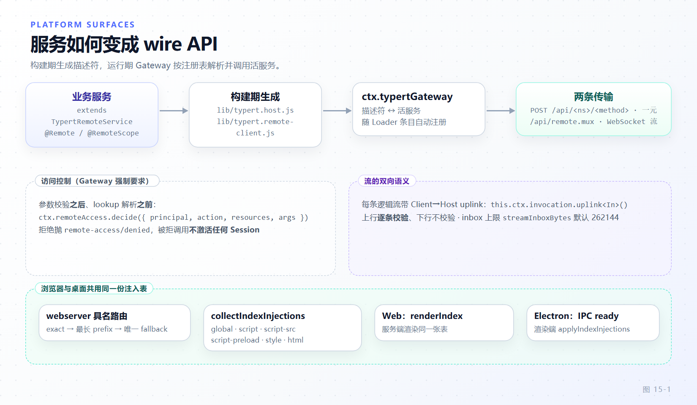

# 第 15 章 平台面：Remote API、Web 与 SDK

[← 上一章：模型接入层](14-llm-adapter.md) · [下一章：低代码定制：patch、preset、skill、command 与 hook →](16-low-code-customization.md)

> **本章目标**
>
> - 说清一个 Cordis 服务如何变成浏览器与外部进程可调用的 API：`@Remote` 声明、构建期生成的描述符与 codec、运行期 Gateway 解析这三段各自发生在哪里。
> - 掌握 Typert 双侧结构（registry 与 loader），以及为什么改一个方法签名之后必须重跑 `pnpm run build:lib`。
> - 区分一元调用的 `POST /api/<ns>/<method>` 与流式调用的 `/api/remote.mux` WebSocket，理解每条逻辑流自带的 Client→Host 上行及其 inbox 上限。
> - 理解 `remote-access` 决策点在调用链上的确切位置，以及"被拒调用不激活任何东西"这条不变量。
> - 建立"失败词汇表只有一个类"的分支纪律：用 `code` 判断而不是 `instanceof`。
> - 能读懂浏览器启动序列与 `dsh.client` manifest，知道设置卡片为什么分成 Host 半边与浏览器半边。

第 5 章的组合根决定 Host 树里有哪些服务；本章决定其中哪些能被浏览器、桌面壳和外部的 Python/Node 进程调用，以及调用失败时对方看到什么。

## 15.1 三条平台面与一条共同链路

dsh 有三条对外表面，它们不是三套协议，而是同一套服务的三种承载：

- **Web**：`packages/host/webserver` 起 HTTP 服务，`packages/api/gateway` 在连接上挂 RPC 与 WebSocket，`apps/web` 在浏览器里加载插件包渲染界面。
- **SDK**：`packages/sdk/client` 把一个 `dsh` CLI 作为子进程拉起，通过 stdin/stdout 的 JSON-RPC 帧通信；Python wheel 打包的是同一个 CLI。
- **协议桥**：ACP（automation-only）与 MCP 把外部对端接到 `ctx.agents`，不经过 Remote 面。

三条路都回答同样四个问题：调用怎么声明（Typert）、字节怎么走（Connection 与 Gateway）、谁能调（remote-access）、失败长什么样（RemoteError）。把这四件事当一个整体看，本章剩下的部分都是它的展开。



*图 15-1 · 一个 Remote 能力从服务声明到两侧消费者的完整链路，标出构建期与运行期的分界。*

## 15.2 Typert 双侧：注册表、自动装载与构建期产物

`ctx.typert`（`packages/typert/registry`）是 Host 侧唯一的 Typert 事实源：schemas、packages 与 local/remote/lookup/context/resource 五个 store，对外暴露 `remotes` / `lookups` / `contexts` / `resources` 四张 provider 表面——`packages/typert/registry/src/service.ts:547-557` 的 `lookups` / `contexts` / `resources` getter。契约面经声明合并进 `TypertRegistryContract`：`register / get / resolve / list / getPackage / listPackages / toJSONSchema`（`packages/typert/registry/src/index.ts:17-27`）。`register()` 返回 awaitable disposer——注册是 Cordis effect，卸载必须对称，这与第 3 章的可逆性约束一致。

运行期装载靠 `packages/typert/loader`。它是普通 Cordis 插件，`inject = ['typert', 'loader']`（`packages/typert/loader/src/index.ts:40-45`，常量 `TYPERT_HOST_EXPORT = './typert'`），只做一件事：观察 Loader 条目，凡从条目挂起来、且其 `package.json` 导出 `./typert` 的包，就 import 它的 Host 面并把模块的 `TYPERT` manifest 注册进 `ctx.typert`，条目卸载时撤回注册。缺 `./typert` 的包静默跳过，显式 `packages` 配置或声明的产物损坏则大声失败。

扫描是**按条目名增量**的：每条 `internal/plugin` 事件把该 fiber 的条目名弄脏，一个微任务 flush 把脏名字与活的 Loader 条目对齐，激活期用同一份脏集种子化全部当前条目（`packages/typert/loader/src/index.ts:476-501`）。错误处理分两档：激活期的失败聚合成一次 `AggregateError` 抛出、让该 fiber 变 FAILED，稳态下每个坏包只记一条日志。判定结果（含"没有 `./typert` 导出"的否定结论）按包名永久缓存——**插件集变化在重启后生效**（`packages/typert/loader/src/index.ts:18-19`）。

构建产物落在各贡献包的 `lib/` 而非源码目录（`docs/api-gateway.md:108-118`）：`typert.host.js` 给 Host Loader 提供运行期反射与严格调用描述符；`typert.remote-client.js` 是给 `api-remotes` 挂载的可装配贡献，含严格描述符与运行期 codec；`typert.remote-client.d.ts` 提供 `TypertRemoteNamespaceMap` / `TypertRemoteScopeMap` 的声明合并，配一张 declaration map 让编辑器从 `ctx.remote.goals.create` 跳回打了 `@Remote` 的真实实现。业务包用 `./typert` 暴露 Host Loader 入口、`./remote` 暴露 Host-for-Client 入口。

这就是那条纪律的来源：**改了签名、码表、namespace 或导出名，必须 `pnpm run build:lib`**（`docs/api-gateway.md:154-158`、`docs/cookbook/adding-a-remote-api.md:105,194`）。Client 的类型、codec 与注册值**只来自最近一次生成的 `lib/typert.remote-client.*`**，它不会去运行中的 Host 发现装饰器；只改实现体不改契约则无需重新生成。从源码 `node --import tsx/esm` 启动时 Host 不执行 TS 装饰器元数据插件，Gateway 靠原型上版本化的描述符退化到 SRC 弱描述符，但 **Client 拒绝挂载没有严格 codec 的 SRC 描述符**（`docs/api-gateway.md:136-142`）——这条不对称经常让人误判"Host 能调通为什么浏览器不行"。
## 15.3 一个 Remote service 的真实样子

`packages/api/job-controller` 是个体量合适的样本，同时含流式与一元两类方法：

```ts
// packages/api/job-controller/src/index.ts:43-44,58-59,75-78,109-110（节选）
export class JobController extends TypertRemoteService {
  static inject = ['jobs', 'typert']

  constructor(ctx: Context, config: Config) {
    super(ctx, 'jobController', { namespace: 'job' })
    // ...
  }

  @Remote({ mode: 'stream' })
  list(request: JobListRequest, signal: AbortSignal): AsyncIterable<JobListFrame> {
    return streamJobRows(this.ctx.jobs, request, { flushMs: this.observeFlushMs }, signal)
  }

  @Remote('kill')
  kill(request: JobKillRequest): JobKillValue { /* ... */ }
}
```

`extends TypertRemoteService` 让 Cordis 服务键与 wire namespace 在构造时显式绑定（`packages/typert/protocol/src/index.ts:250-263`）；已有别的基类的服务可改用 `readonly typertRemote = bindTypertRemote(this, serviceKey)`，两种写法都留下可检视的公开绑定，不依赖编译器往构造函数注入符号。`inject` 里的 `typert` 是必须的——manifest 要进 registry。`super(ctx, 'jobController', { namespace: 'job' })` 把服务键与导出名分开：前者是 Cordis 内部名字，后者是 Client 看到的 `ctx.remote.job`。`@Remote({ mode: 'stream' })` 声明返回 `Iterable` / `AsyncIterable` / `RemoteStream<Out, In>`；`@Remote('kill')` 是带导出名的一元方法，同步返回值即可。

三条容易忽略的约束（`docs/api-gateway.md:58,122`、`docs/defensive-patterns/remote-and-api.md:45-55`）：

1. **`signal: AbortSignal` 必须是 Host 签名的最后一个参数**，它被记进描述符而不进 `args`；生成的 Client 方法接受可选的末尾 `AbortSignal`。
2. **`@Remote` 只标在具体执行业务的方法上**，不标转发壳；方法体只做委托就说明装饰器位置错了。
3. **严格分析要求方法 public、非静态、有具体实现、不是泛型，参数必填、简单标识符命名、不能解构/默认值/rest/可选。** 复杂 Host 对象（`Agent`、`Session`）必须在业务包声明 `TypertLookupMap` 关联其 wire identity，并注册默认解析 provider——Gateway 在调用业务方法前把 `agentId` 解析成 `Agent`；Host 组合可用 `ctx.typert.lookups.configure()` 覆盖某 key 的策略而不改参数名、wire 字段与规范类型符号。

选型纪律是硬的：**一个新能力一个新 service，不复用别人的 controller**（`docs/defensive-patterns/remote-and-api.md:7-14`）。判据不是调用者数量而是业务边界——今天只有一个调用者的能力照样要有自己的 service。理由原文写得清楚：否则一个对象同时代言 auth、Session、workspace 与事件承载，任一条能力的后续改动都落到同一处，两条能力再也无法独立迁移。反向同样约束：需要自己协议的数据（Session 事件流、分页、增量 reduce、投影、实体子流）**不**变成 Remote 方法（`docs/api-gateway.md:162-164`）。同理，`packages/api` 这层只承载通用编排，一个只对单个 feature 成立的 `if` 即使文件在通用层里也是缺陷。

## 15.4 传输：一元走 POST，流走自有 mux

一元路径很短。Client 侧生成的方法是普通对象上的具体函数（不是 Proxy），把调用交给 Connection：`connection.rpc.call('/api', '<ns>/<method>', { args }, signal)`，HTTP 承载映射为 `POST /api/<ns>/<method>`，payload 只有一个具名 `args` 对象（`docs/api-gateway.md:126-128`）。分工也在这里划清：**Connection 拥有**传输、RPC id、响应信封、请求取消与 `/api` 的统一 trust 检查；**Gateway 拥有** Remote 数据协议与业务分派。Gateway 只认领"两段式且拥有严格描述符或活的 SRC 标记"的 endpoint，其余 404；每次调用都从当前注册表解析描述符与活服务、不缓存业务对象，且必须点名它代言的 Peer——已 dispose 的 Peer 以 `gateway/peer-disposed` 拒绝。

流式不走这条 POST 路径。Gateway 在 webserver 上注册一个精确的 upgrade 路由，路径常量是 `packages/api/gateway/src/stream-protocol.ts:7` 的 `REMOTE_STREAM_MUX_PATH = '/api/remote.mux'`，注册发生在 `packages/api/gateway/src/index.ts:265-310`。整个 Gateway 的全部逻辑流**复用这一条 WebSocket**，mux 内部按流 id 分帧。

每条逻辑流自带一条 Client→Host 上行。Host 侧用 `RemoteStream<Out, In>` 声明：`In` 只是类型级标记，缺省 `never` 表示"这个方法不读上行"，其描述符也就不带 uplink codec（`packages/typert/protocol/src/types.ts:136-147`）。方法内部通过 `this.ctx.invocation.uplink<In>()` 取这条**单消费者**迭代器——第二次调用会抛，迭代在 Client 半关闭（`end()`）时结束（`packages/typert/protocol/src/types.ts:508-523`）。Client 侧的句柄是 `RemoteStreamHandle<Out, In>`，暴露 `send` / `end` / `dispose`；调用方法即打开流，**既不迭代也不 dispose 的持有者会让 Host 流一直活着**（`packages/typert/protocol/src/types.ts:160-179`）。上行既不进 `args` 也不进参数列表。

**校验是单向的，这是最容易踩的一条。** 上行逐条校验，下行不校验：Gateway 用生成的 `In` codec 校验每一个从浏览器来的 item，才让 Host 方法读到它；下行由结果 codec 在 Client Gateway 校验解码后的二进制结果，普通 JSON 结果保持原有处理（`docs/api-gateway.md:60,130`）。理由是威胁模型：上行从浏览器来，是不可信输入。

上行的缓冲有硬预算。mux 为每条逻辑流维护一个 `UplinkInbox`，按帧的 UTF-8 字节计量，上限来自 Gateway 配置 `streamInboxBytes`，默认 262144（`packages/api/gateway/src/index.ts:150,219`，实例化在 `packages/api/gateway/src/stream-server.ts:246`）。超限时**整条逻辑流**以 `gateway/uplink-overflow` 失败：下行一起断、向 Client 发 `error` 帧、`uplink()` 迭代器以同一错误结束。数据不丢弃——一个方法不读上行而 Client 持续 `send` 是用法错误，由失败显式暴露。

## 15.5 访问控制：remote-access 是 Gateway 的硬依赖

`packages/bundle/base/cordis.patch.yml:52-58` 里 typert-gateway 与 remote-access 两行并列挂载，注释就把契约说完了：`# Method-level access control for non-owner Peers; the Gateway requires it`。"requires"不是修辞——`TypertGatewayService` 的 `static inject = ['typert', 'remoteAccess']`（`packages/api/gateway/src/index.ts:215`）让 Gateway 在 `remote-access` 缺席时永远 PENDING，整个 `/api` 面直接不工作。

决策点在调用链上的位置是**参数校验之后、lookup 解析之前**（`packages/api/gateway/src/index.ts:800-826`）：

```ts
// packages/api/gateway/src/index.ts:800-824（节选）
assertExactArguments(request.args, descriptor, endpoint)
const validated = validateArguments(descriptor, request.args, endpoint)
// Access precedes lookup resolution, so a refused call activates nothing.
if (request.peer.principal.kind !== 'owner') {
  const resources = callResources(this.ctx.typert, this.resourceReaders(descriptor), descriptor, validated, ...)
  const decision: RemoteAccessDecision = resources === undefined
    ? { kind: 'deny', reason: 'resource-invalid' }
    : this.ctx.remoteAccess.decide({ principal: request.peer.principal,
        action: `${descriptor.namespace}/${descriptor.method}`, resources, args: validated })
  if (decision.kind === 'deny') {
    throw new RemoteError('remote-access/denied', `remote access: ${endpoint}: access denied (${decision.reason})`, { ... })
  }
}
```

三条不变量由此成立：

- **被拒调用不激活任何 Session。** lookup 解析还没发生，非 owner 的 Peer 无法靠猜 id 让某个冷 Session 被 resume。owner principal 完全不进这个分支。
- **资源必须被命名。** `resources === undefined` 直接判 `resource-invalid` 拒绝。身份来源按优先级：`@Remote({ resources })` / `@RemoteScope(key, { resources })` 的 per-kind reader，其次声明了 `resource` 的 lookup 参数或 scoped Context，再次 `typert.resources` 注册的默认字段或 resolver（`docs/subsystems/typert.md:287-289`）；不点名任何资源的调用触碰 `global`。访问控制永远不检查被漏掉的资源，所以"方法漏声明一个它实际触碰的资源"是安全缺陷，不是文档缺陷；返回多个资源的方法要逐条用 `this.ctx.remoteAccess.allows(resource)` 过滤。
- **调用者身份只从 invocation 读。** `this.ctx.invocation.peer.principal`，绝不从参数取、也不穿过 helper 形参传递（`docs/defensive-patterns/remote-and-api.md:53`）。

同一个 `decide()` 也用于事件下发（`packages/api/gateway/src/index.ts:633`）：转发给某 Peer 的事件帧以 `event:<name>` 为 action 决策，`deny` 的直接跳过。事件流与 RPC 共用一套策略词汇，这让"给某类 principal 开一个能力"是一次配置而不是两处改动。

## 15.6 失败词汇表：只有一个 RemoteError 类

跨平台的失败面只有一个错误类：

```ts
// packages/typert/protocol/src/remote-error.ts:12-30（节选）
export class RemoteError<Code extends RemoteErrorCode = RemoteErrorCode> extends Error {
  /** Structural marker: cross-realm/bundle identification never uses instanceof. */
  readonly isDSHRemoteError: true = true
  constructor(
    readonly code: Code, message: string,
    readonly details: RemoteErrorDetailsMap[Code], options?: ErrorOptions,
  ) { super(message, options); this.name = 'RemoteError' }
}
```

那个结构标记字段的存在就是为了让人**不用** `instanceof`：跨 realm、跨 bundle、跨序列化边界时 `instanceof` 必然失效，所以识别走标记、分支走 `code`。

生产端只有三个动作（`docs/cookbook/adding-a-remote-api.md:51-88`）：把域码经声明合并进 `RemoteErrorDetailsMap`、在失败点 `throw new RemoteError(code, message, details)`、**不要**建一族域错误类也**不要**写出口映射函数。码的形状是 `<domain>/<reason>`，四条放置规则里最容易违反的是"一个码只有一个生产者"：单生产者声明在生产包并紧邻 throw；多包共同产出时声明在它们共同依赖的最低域包（`session/not-found` 在 `core/session`）；承载码 `gateway/bad-request`、`gateway/cancelled`、`gateway/internal` 由协议声明、直接用、永不复制；从不跨线的本地失败不进码表。

消费端的分支形状固定：先 `if (!result.ok)`，再按 `result.error.code` 分支——**code 分支自己就把 `details` 收窄了**，不需要类型断言；不属于本码表的码 `throw result.error`（它是真 Error，throw 语义保留）。异常流的捕获方用 `isRemoteFailure(error)`（`packages/api/gateway/src/client/index.ts:860`）把远端失败与本地缺陷分开，本地缺陷继续上抛。三点值得复述：Remote 调用**不 reject**，所以别写防御性 catch——装配错误应当崩；测试端用 `remoteErrorOf` 取回失败后 `toMatchObject({ code, details })`，**永不** `toEqual` 深比较错误对象、**永不**断言 `instanceof`；Gateway 侧的收口是结构识别的 `RemoteError` 带 code 与 details 原样上 wire，只有无法归类的异常折进 `gateway/internal`（`docs/api-gateway.md:132`），所以你的 `session/not-found` 不会被抹平。

## 15.7 Web 侧：路由表、注入表与浏览器启动序列

`packages/host/webserver` 是基于 `node:http` 的具名路由表，实现只有三张表加一个席位（`packages/host/webserver/src/index.ts:378-380,445-452,477-481,650-665`）：exact 表、prefix 表、upgrade 表，加唯一 fallback 席位。匹配顺序是 **exact 命中 → prefix 表最长路径 → fallback**。`register()` 对重复的 `(kind, path)` 抛 `webserver: duplicate exact route "..."`，`registerFallback()` 第二次注册也抛错——一个 socket 只能有一个协议主人；没注册 fallback 时回答 404。出厂 Web 组合里 fallback 席位归 `packages/host/frontend-static`（`packages/host/frontend-static/src/index.ts:152`），它对每个渲染的 index 响应调 `renderIndex`。

index 的启动输入分两层，都按页面所代表的 Peer 计算。`collectIndexInjections(peer)` 每次调用发一次 `webserver/index-inject` 事件、订阅方推进自己的当前行——**每次重新收集，所以订阅方读的是活状态**（模块图、主题偏好、该 Peer 的访问快照）；`renderIndex(html, peer)` 先把行渲染进 index.html 正文，再按注册顺序应用原始 `tapIndex` 转换（`docs/subsystems/web-server.md:277-294`）。行是一张封闭联合，全部是 JSON 可序列化数据，这正是双端复用的前提：

```ts
// packages/host/webserver/src/injections.ts:15-31
export type IndexInjection =
  | { kind: 'global'; name: string; value: unknown }
  | { kind: 'script'; placement: IndexInjectionPlacement; text: string }
  | { kind: 'script-src'; placement: IndexInjectionPlacement; src: string }
  | { kind: 'script-preload'; src: string }
  | { kind: 'style'; text: string }
  | { kind: 'html'; placement: IndexInjectionPlacement; html: string }
```

一张表喂两个渲染器：服务端形态把行渲染成 index.html 文本，静态 worker 部署把同一批行随 boot payload 发出、由页面侧解释器执行（`packages/host/webserver/src/injections.ts:1-9`）。桌面端走的是后者：`apps/desktop-host/src/index.ts:143` 通过 IPC 把表连同 URL 发出，`apps/web/src/main.ts:24-35` 收到后先装 `__DSH_TRANSPORT__`、再调 `applyIndexInjections(injections, loadScript)`，全部脚本落地后才兑现 `__DSH_BOOT_READY__`。不能表达成行的东西留在 `tapIndex` 上。

浏览器启动序列（`packages/client/web/src/boot.ts:49-104`）是：`await __DSH_BOOT_READY__?.promise` → 取 `window.__ModuleLoader__` → `moduleLoader.create({ boot: window.__DSH_BOOT__, staticModules, ...seams })` → 预取 manifest 里 `immediately` 层的 bundle（预取失败静默，真正的导入错误由 Loader 重试时报）→ `bootClient` → 装 window 拖拽矩形 watcher → `mountClient` → `ui-renderer` 里唯一一次 context 级 `renderSlot('root')`。`bootClient` 的骨架是 `ctx.plugin(Loader)`、`loader.internal = modules`、订阅 `internal/status` 逐行上报、`modules.entries.start(loader, manifest)` 建出"每个 manifest 行一个 entry"、`loader.await()`，最后 `assertEntriesActive`（`packages/client/web/src/boot-client.ts:36-57`）。后者把任何非 active 条目变成一次抛错：没有 fiber 的条目带上模块系统记录的导入错误文本，`pending` 的条目列出它缺哪些服务（`packages/client/web/src/boot-client.ts:66-89`）。这是浏览器侧唯一的启动审计。

**最关键的一条不变量**在 `docs/subsystems/web-client.md:24-26`："Cordis service injection determines activation; module graph order determines only whether synchronous imports can be materialized." 也就是说：**模块图顺序只决定同步 `require` 能否物化，Cordis 激活顺序由服务可用性决定。** 调 manifest 的 `inject` 边影响的是加载编排，不是插件的启动先后；想让 B 在 A 之后启动，唯一手段是 B 注入 A 的服务（第 2 章的 epoch 规则）。靠"把包放在 roster 前面"来获得启动顺序在两侧都无效——`packages/bundle/base/cordis.patch.yml:12-13` 直接写了"行序不带加载语义"。

`dsh.client` manifest 的真实片段（`packages/client/hmr/package.json:29-37`）：

```json
"dsh": {
  "client": {
    "inject": ["@deepseek-ai/dsh-client-modules"],
    "platform": "web",
    "immediately": true
  }
}
```

`platform: 'web'` 与 `./client` 导出是必需项；`inject` 是包名依赖边（用于 factory 到达与插件编排）；`immediately` 标记 stage-one 预取；`external` 声明非 baseline 的模块请求，缺省省略。Host 半边 `packages/client/modules/src/index.ts:13-24` 用的是与 typert-loader 同构的增量扫描：`internal/plugin` 弄脏条目名、微任务 flush、激活期种子化全部条目后同步 flush；聚合成一次 `AggregateError` 的是 `ClientPackageCompositionError`（`packages/client/modules/src/index.ts:120`），它把"缺 client bundle"与"其他失败"分两组列出，因为前者一条 `pnpm run build` 指令就能修。bundle 缺失是**大声失败**的。

## 15.8 双面插件与 SDK 嵌入

设置卡片是"一个包两个半边"的典型。`packages/client/ui-settings-web-search` 的 Host 半边只有一个空 `apply()`——模块注释写明，空函数存在的理由是让插件出现在 Loader 行里，从而被 `client-modules` 扫到、把浏览器半边服务出去；它自己不注册任何 namespace。浏览器半边才是页面，用 `whileServed` 把页面挂在"Host 正在服务某个 namespace"这件事上：

```ts
// packages/client/ui-settings-web-search/src/client/index.ts:64-66
ctx.effect(() => ctx.configForms.whileServed([WEB_SEARCH_NS], () => ctx.slots.inject('plugins.item', () => ctx.slots.register({
  name: 'plugins.item', id: 'web-search', order: 20, label: () => t('title'), locale: NS, inject: () => card.inject(),
}, WebSearchCard))), 'ui-settings-web-search: page')
```

`whileServed(namespaces, register)`（`packages/client/ui-settings/src/client/config-form.ts:308-327`）的语义：任一 namespace 进入 describe mirror 时运行一次 `register`，全部消失或返回的 disposer 运行时运行其 disposer。注释特别指出它与 `bind` 的区别——**没有任何东西注册在调用方的 context 上**，调用者自己拥有返回的 disposer 并用 `ctx.effect` 包起来。效果是：一个没组合 `web-search-deepseek` provider 的部署里，这个页面完全不留痕迹。

贡献到别人的页面用三个槽之一：`plugins.detail.actions`（页面头部一个控件）、`plugins.detail.badge`（标题旁一个标签）、`plugins.detail.section`（页面自有内容之下的一个区块）。每个条目都带页面的 `subject` 渲染——`{ kind: 'bundle', pkg }` / `{ kind: 'row', pkg, row }` / `{ kind: 'item', id }`——**对它无话可说的 subject 返回 `null`**（`docs/cookbook/adding-a-settings-card.md:46`）。

**关键约束：浏览器半边只挂在 specifier 为"裸包名"的那一行。** `docs/cookbook/adding-a-settings-card.md:58` 的原文值得逐字读：从 subpath export 挂起来的行**永远不带半边**。所以一个把同一个包拆成多行的 bundle，它的半边留在根行上，根行一关，该包注册的所有页面一起消失；需要活过其他行的子插件必须做成独立包。成因是 `client-modules` 的扫描以包名标识浏览器模块（`packages/client/modules/src/index.ts:22-24`），subpath specifier 解析不出包根。

SDK 侧的嵌入机制在 `packages/sdk/client/src/launch.ts:128-156`：

```ts
// packages/sdk/client/src/launch.ts:132-143（节选）
const profile = options.profile ?? 'sdk'
const dshLaunch = options.dshBin === undefined
  ? installedDshNodeLaunch()
  : { nodeArgs: [resolve(callerCwd, options.dshBin)], patches: [], environment: {} }
const patches = [...dshLaunch.patches, ...(options.patches ?? []).map(path => resolve(callerCwd, path))]
return { command: process.execPath,
  args: [...dshLaunch.nodeArgs, '--profile', profile, ...patches.flatMap(path => ['--patch', path])] }
```

`--profile sdk` 固定，`--patch` 按序展开，且**内部 patch 排在调用方 patch 之下**（`DshNodeLaunch.patches` 注释："Internal patches applied below caller-supplied patches"）。找不到已构建 bin 时（源码 checkout），回落到 `node --import tsx/esm <apps/cli>/src/bin.ts`，并附一条内部 patch 指向 `apps/cli/src/sdk-source.cordis.patch.yml`（`packages/sdk/client/src/launch.ts:94-108`）：

```yaml
# apps/cli/src/sdk-source.cordis.patch.yml
- id: typert-loader
  disabled: true
```

这是"用 overlay 关掉一整段能力面"的最好示范：只有一行 `disabled`，因为干净源码没有构建生成的 Typert contributor 模块，而 SDK 的 JSON-RPC 应用根本不消费 Remote gateway。`packages/sdk/server` 以 `jsonrpc` 插件挂载在普通 Loader 组合里，周围树提供 agent、模型适配、持久化与工具；**stdout 只承载协议帧**，所以部署不能组合 stdout logger。Python wheel 打包同一个 `dsh` CLI。

另两个桥各有明确边界。ACP（`packages/acp/acp/README.md:12`）是 automation-only：故意省略 DSH 特有的呈现数据与交互 UI 特性，持久化支持列出/resume/close，不支持删除、fork、transcript 重放；启动方式是 `pnpm dsh --profile acp`。MCP（`packages/mcp/mcp-client/README.md:12`）方向相反——外部工具进 `ctx.tools`，名字形如 `mcp__github__create_issue`，默认不启用任何 server，空 caller scope 不添加任何 MCP 工具或 prompt 文本。

## 15.9 本章小结

平台面是一条链。**Typert 双侧**把声明分在构建期与运行期：`packages/typert/loader` 从 Loader 条目自动发现 `./typert` 导出并把 manifest 灌进 `ctx.typert`，Client 的类型与 codec 只来自 `lib/typert.remote-client.*`，所以改签名/码表/namespace/导出名后必须 `pnpm run build:lib`。**一个能力一个 service** 是选型硬规则，`signal` 必须末位，`@Remote` 只标具体方法。传输上，一元走 `connection.rpc.call('/api', ...)` 映射到 `POST /api/<ns>/<method>`，流走 Gateway 自有的 `/api/remote.mux` 一条 WebSocket；每条逻辑流自带 Client→Host 上行，上行逐条校验、下行不校验，inbox 上限 `streamInboxBytes` 默认 262144，超限整条流以 `gateway/uplink-overflow` 失败。访问控制落在参数校验之后、lookup 解析之前，`remote-access` 缺失时 Gateway 永远 PENDING，被拒调用不激活任何 Session。失败词汇表只有 `RemoteError(code, message, details)` 一个类，分支用 `code` 与 `isRemoteFailure`。Web 侧是三张路由表加一张结构化注入表，服务端与 Electron 渲染端共用同一批行；浏览器激活顺序由服务可用性而非模块图顺序决定。双面插件的浏览器半边只挂在裸包名的行上。SDK 用 `--profile sdk` 加有序 `--patch` 拉起同一个 CLI，源码回落只关掉 typert-loader 一行。

**检查点**

1. **你给一个已有 Remote service 的包新增了一个跨业务线的方法，改了参数名。Client 调用返回旧的字段形状。最可能的两个原因是什么？**
   答案要点：其一，没跑 `pnpm run build:lib`——Client 的类型、codec 与注册值只来自最近一次生成的 `lib/typert.remote-client.*`，不会从运行中的 Host 发现装饰器（`docs/api-gateway.md:142,154-158`）。其二，能力本身放错了对象：跨业务线的方法应当是新 service 的 `@Remote` 具体方法，而不是加进已有 controller（`docs/defensive-patterns/remote-and-api.md:7-14`）。

2. **一个非 owner 的 Peer 调用 `session.list` 被 `remote-access` 拒绝。此时有没有 Agent 被 resume？为什么决策点要在 lookup 解析之前？**
   答案要点：没有。`prepareInvocation` 的顺序是 `assertExactArguments` → `validateArguments` → 访问决策 → 才 `resolveReceiverContext` / `resolveParameter`（`packages/api/gateway/src/index.ts:800-827`），注释写着 "Access precedes lookup resolution, so a refused call activates nothing"。若顺序反过来，任何持有猜测 id 的 Peer 都能触发冷 Session 的 resume，把访问控制变成事后补救。

3. **一个 `@Remote({ mode: 'stream' })` 方法只声明 `RemoteStream<Out>`（`In` 取默认 `never`），但客户端一直 `send()`。会发生什么？**
   答案要点：`In` 缺省 `never` 时描述符不带 uplink codec，Host 的 `uplink()` 是一条无人消费的迭代器；上行帧仍进该流的 `UplinkInbox` 并按 UTF-8 字节累计，超过 `streamInboxBytes`（默认 262144）后整条逻辑流以 `gateway/uplink-overflow` 失败——下行一起断，Client 收 `error` 帧。设计取向是不丢数据、显式暴露用法错误（`docs/api-gateway.md:60`、`packages/api/gateway/src/stream-server.ts:246`）。

**延伸阅读**

- API Gateway 参考与 Cookbook（新增 Remote API、新增设置卡片）：<https://deepseek-harness.github.io/deepseek-harness/reference/api-gateway>、<https://deepseek-harness.github.io/deepseek-harness/reference/cookbook/adding-a-settings-card>；新增 Remote API 的 cookbook 未发布到站点，仓库内见 `docs/cookbook/adding-a-remote-api.md`
- 子系统：Web Client / Web Server / Slots / Client Modules / Settings：<https://deepseek-harness.github.io/deepseek-harness/reference/subsystems/web-client>、<https://deepseek-harness.github.io/deepseek-harness/reference/subsystems/web-server>、<https://deepseek-harness.github.io/deepseek-harness/reference/subsystems/slots>、<https://deepseek-harness.github.io/deepseek-harness/reference/subsystems/client-modules>、<https://deepseek-harness.github.io/deepseek-harness/reference/subsystems/settings>
- Python SDK 指南：<https://deepseek-harness.github.io/deepseek-harness/guide/python-sdk>
- 本章机制在扩展侧的用法见第 12 章与第 13 章；`--patch` 与 `disabled` 的写法见第 16 章。
