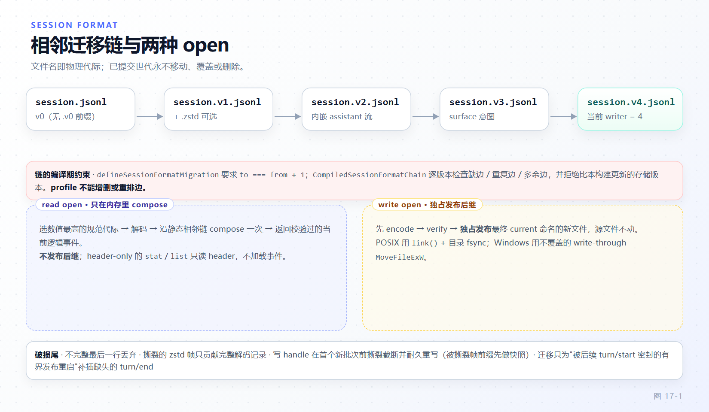

# 第 17 章 会话格式演进与持久化后端

[← 上一章：低代码定制](16-low-code-customization.md) · [下一章：调试、可观测性与性能 →](18-debugging-performance.md)

> **本章目标**
>
> - 说清会话格式的三个权威：代码写入常量、finalize/release 记录、物理文件名，及各自更新纪律。
> - 掌握迁移链"相邻且无缺口"的构造期校验，理解 profile 为什么不能增删或重排迁移边。
> - 分清读 open 与写 open：前者只在内存 compose 迁移链，后者必须编码、校验、独占发布后继世代。
> - 理解撕裂尾（torn tail）三层处置：丢弃、恢复完整记录、写 handle 首个批次前截断重写。
> - 能独立写一个迁移包并跑通校验闸门；掌握 `SessionPersistence` 接缝的五个抽象方法与 `SessionHandle` 不变量。

第 8 章说过：日志是产品的事实源。本章讲它如何跨格式版本活着——**可重放（replayable）、不可回退、绝不破坏已提交世代**。这三条不变量决定了本章所有机制的形状。

## 17.1 版本与世代的三个权威

第一个权威是代码常量：

```ts
// packages/core/session/src/types.ts:90
export const SESSION_FORMAT_VERSION = 4
```

它的 JSDoc（`packages/core/session/src/types.ts:68-89`）把 bump 门槛钉死：只有"既有判别符无法阻止不安全解释"才升级版本，纯结构性差异不够格；存储与当前版本一致时迁移链根本不运行，同版本读者必须保留早期表示、下一条边必须兼容源世代的全部受支持表示。

第二个权威是发布记录（`docs/session-format-status.md:31-47`）：`latestFinalizedVersion: 4`（接受过的兼容基线）与 `latestReleasedVersion: 4`（evidenceTag `dsh-v0.2.0-rc.2`，已发布世代）分开记账，开发 trunk 上永不下调 release 记录（`:54`）。包版本、codec 导出名、fixture 文件名都不是写入权威。

第三个权威是物理文件名（`packages/session/session-format/src/filename.ts:5,14-17`）：

```ts
// packages/session/session-format/src/filename.ts:5,14-17
const CANONICAL_LOG_FILENAME = /^session(?:\.v([1-9][0-9]*))?\.jsonl$/u

export function sessionFormatLogFilename(version: number): string {
  const generation = sessionFormatVersion(version, 'Session log generation version')
  return generation === 0 ? 'session.jsonl' : `session.v${generation}.jsonl`
}
```

v0 保留原始名 `session.jsonl`，v1 起每代一个 `session.vN.jsonl`，压缩再加 `.zstd`（`packages/session/session-persistence-jsonl/src/format.ts:42-60`）。解析器只认规范名：大写、前导零、`.v0`、临时名一律不匹配（`filename.ts:26-32`）。运行时总选**数值最高的规范世代**（`packages/session/session-persistence-jsonl/README.md:73`），格式拒绝诊断点名该绝对路径。

> **不一致 #1**：`packages/session/session-persistence-jsonl/README.md:59-71` 的磁盘布局注释仍把 `session.v3.jsonl` 标为 "v3/current"，而写入常量已是 4。以常量与发布记录为准。

## 17.2 迁移链：相邻、无缺口、静态装配

每条边声明一对相邻版本，`defineSessionFormatMigration` 声明即拒绝跨代：校验 `fromVersion`/`toVersion` 为安全整数后，只要 `to !== from + 1` 就抛 `SessionFormatError`（消息 "must declare adjacent vN->vN+1"），通过则 `Object.freeze` 成不可变声明（`packages/session/session-format/src/chain.ts:24-34`）。

`CompiledSessionFormatChain` 构造期逐版本对账：重复边与重名边（`chain.ts:55-63`）、缺边（0 到 currentVersion 逐格查表，`:64-71`）、多余边（`byFrom.size` 与有序长度不等，`:72-75`）；`plan()` 再拒绝比本构建更新的存储版本（`:79-87`），消息 "stored Session uses newer format v…; this build writes v…"——让用户看到"升级 harness"而不是"日志损坏"，JSONL 在 header 解析处有同语义前置拒绝（`packages/session/session-persistence-jsonl/src/format.ts:333-346`）。

链是**构建期静态装配**：`packages/session/session-format-catalog/src/generated.ts:16-31` 直接 import 四个迁移包的声明与五部 codec，`currentVersion: 4`；"让已挂载插件注册迁移"被决策记录明确否决——历史可读性不能依赖部署（`.agents/notes/implemented/architecture/2026-08-31-released-session-format-migrations.md:251`）。所以 profile **不能**增删或重排边，改链唯一途径是发布新包再重新生成目录。多跳迁移不落地中间产物：`createStream` 为每条边建一个 stage、从下游向上反向接线 context（`chain.ts:89-127,208-227`），中间版本"只作为 stage 状态存在"（决策记录 `:114,250`）。

## 17.3 读 open 与写 open 的路径分叉

header-only 的 `stat`/`list` 只翻译受支持的历史 header，不打开事件体、不发布世代（决策记录 `:118`）。body open 才分叉：

- **读 open** 只等逻辑准备（preparation）：`prepareJsonlMigration()` 读一个稳定历史修订、跑完整条 Stage 链、在内存返回当前工件——不编码、不写盘、不发布后继（`.agents/notes/implemented/architecture/2026-09-05-read-only-session-migration-preparation.md:29-41`）。历史日志因此能在只读存储上展示。
- **写 open** 复用同一 preparation，但返回可追加句柄前必须完成：编码到同目录独占临时文件并 sync → 至多两个 Worker 的完整工件校验 → 源一致性复查 → **独占发布**最终版本命名的新文件。`publish()` 一旦开始不接受取消，已发布世代永不回滚；迟到者须验证胜者文件以已校验迁移前缀开头（决策记录 `:100-106`；preparation 笔记 `:41-45`）。

发布原语分平台：POSIX 用 `link()` + 目录 `fsync`——link 遇 `EEXIST` 即天然的 no-overwrite 独占发布（`packages/session/session-persistence-jsonl/src/index.ts:1299-1312,1396`）；Windows 拿不到目录 fsync 契约，用内核 `MoveFileExW` write-through 不覆盖移动（`packages/session/session-persistence-jsonl/src/win32.ts:5-8,137`）。



*图 17-1 · 迁移链与读/写 open 分叉：同一条 Stage 链，前者不发布、后者独占发布，已提交世代永不被移动、替换或删除。*

> **不一致 #2**：`docs/architecture.md:166` 说新后端要实现 `create`/`open`/`stat`/`list`/`export`。实际抽象方法是 `create/open/flush/stat/list`（见 17.7），**没有** `export`——导出属于 `session-log-export` 消费者，不是接缝的一部分。

## 17.4 撕裂尾与崩溃语义

崩溃可以把物理文件停在三处：一条不完整 JSONL 行、一个撕裂 zstd 帧、一个未 resolve 的批次。分层处置：

1. **不完整最后一行直接丢弃**。扫描器只把 `committedBytes` 推进到完整行结尾（`packages/session/session-persistence-jsonl/src/format.ts:461-475`；`packages/session/session-persistence-jsonl/src/index.ts:840`：`tornTruncateTo: committedBytes < buffer.byteLength ? committedBytes : undefined`）。
2. **撕裂 zstd 帧只贡献完整解码的记录**。该帧的追加从未 resolve，但帧内已刷出的完整行是真实发出的事件：收进 `recoveredTail`，记 `tornTruncateTo = tornStart`（`packages/session/session-persistence-jsonl/src/index.ts:1046-1068`）。**完整**帧内的校验和/解压/结构失败按损坏拒绝（`packages/session/session-persistence-jsonl/README.md:77`）。
3. **写 handle 在首个新批次前撕裂截断并耐久重写**：先 `truncateTornTail(header, tornTruncateTo)` 清掉撕裂字节，再把 `recoveredTail` 经 `persistBatch` 耐久重写，每步成功才清状态、失败留给下一次变异重试（`packages/session/session-persistence-jsonl/src/storage.ts:328-336`）。

区分两种破损尾。**普通未密封尾**（开着 `turn/start` 没写 `turn/end`）的修复是 handle 消费者责任：恢复读取保留被打断的最后一轮，续跑的写 handle 用正常追加补合成收尾（`packages/session/session-persistence-jsonl/README.md:77`）。**迁移**不修任意未密封尾，只补插一种被后续事件"密封"的有界重启形态——`turn/start` 开、无开步、后接非空 `next-turn` inbox splice 与下一编号 `turn/start`；检测在逐事件 `observeRestart`，并要求源 seq 稠密（`packages/session/session-format-v3-to-v4/src/migration.ts:66,117-135`）。

> **不一致 #3**：`packages/core/session/src/types.ts:494-499` 注释列举条件字段适用的 surface 类型时漏了 `developer/message`；权威枚举在 `types.ts:447-452`，五个成员。

## 17.5 从零写一个新迁移包

以 v4→v5 为例（官方 cookbook：`/reference/cookbook/adding-a-session-format-version`）。`package.json` 的 `dsh.sessionFormatMigration` 块是目录生成器的唯一输入；v3-to-v4 真实整块（`packages/session/session-format-v3-to-v4/package.json:29-40`）逐字段照此改名：

```json
  "dsh": {
    "sessionFormatMigration": {
      "from": 3,
      "to": 4,
      "export": ".",
      "migration": "sessionFormatV3ToV4",
      "sourceCodec": "releasedV3SessionFormatCodec",
      "targetCodec": "releasedV4SessionFormatCodec",
      "targetHeaderValidator": "assertReleasedV4Header",
      "targetRestorer": "restoreReleasedV4Artifact"
    }
  },
```

依赖只允许指向上一档包外加 session-format 框架包（v3-to-v4 依赖 v2-to-v3，`package.json:41-44`）。然后 `pnpm run gen-session-format-catalog`（`package.json:194`）扫描全部 `dsh` 字段、校验相邻边恰好抵达写入常量、重写 `generated.ts`（文件头：GENERATED、do not edit by hand）。

**迁移声明**参照 v3-to-v4：静态声明 + 证据绑定工厂双形态，需要工件级额外证据的边才有工厂（`packages/session/session-format-v3-to-v4/src/migration.ts:15-38`）：

```ts
// packages/session/session-format-v3-to-v4/src/migration.ts:15-27
export const sessionFormatV3ToV4 = defineSessionFormatMigration({
  name: '@deepseek-ai/dsh-session-format-v3-to-v4',
  fromVersion: 3,
  toVersion: 4,
  migrateHeader(header) {
    assertReleasedV3Header(header)
    return { ...header, version: 4 }
  },
  createStage() {
    throw new SessionFormatUnsupportedMigrationError('V3 catalog migration requires explicit historical child facts, including an empty array for a parent without children')
  },
  validateTargetHeader: assertReleasedV4Header,
})
```

未绑定的 `createStage` 直接拒绝，意味着静态声明只服务 header-only 与原生当前世代读取；历史 body restore 必须用 `createSessionFormatV3ToV4(children)` 把父目录证据闭包进工厂（`:34-39`；决策记录 `:142-143`）。拒绝永远抛 `SessionFormatUnsupportedMigrationError`，链把 stage 的其它异常也包装成带边名的拒绝（`packages/session/session-format/src/chain.ts:244-255`）——"拒绝"与"损坏"在诊断上是两个世界。

**源 codec 必须再导出而不是复制**：

```ts
// packages/session/session-format-v3-to-v4/src/index.ts:3
export { releasedV3SessionFormatCodec } from '@deepseek-ai/dsh-session-format-v2-to-v3'
```

一代 codec 由进入该世代那条边的包永久拥有，连 `assertReleasedV3Header` 也从上一档 import（`packages/session/session-format-v3-to-v4/src/migration.ts:5`）；复制校验器等于 fork 冻结语义（决策记录 `:74`）。

**Stage 协议**是状态机不是纯函数（决策记录 `:30-54`）：

```ts
// .agents/notes/implemented/architecture/2026-08-31-released-session-format-migrations.md:33-49
interface SessionFormatMigrationContext {
  emitEvent(event: SessionFormatEvent): void
  emitRun(run: SessionFormatEventRun): void
}

interface SessionFormatMigrationStage {
  readonly headerInheritedEventCount?: number
  transformEvent(
    event: SessionFormatEvent,
    context: SessionFormatMigrationContext,
  ): void
  transformRun(
    run: SessionFormatEventRun,
    context: SessionFormatMigrationContext,
  ): void
  finish(context: SessionFormatMigrationContext): number
}
```

三条铁律：声明不可变、stage 每工件独占，**绝不跨 Session 共享可变 stage**（决策记录 `:28,249`）；`headerInheritedEventCount` 在源 EOF 前可能未知（V2 从 seed 标记推导），链原样传递 `undefined`、**不得填 0** 冒充实证，预声明了就必须由 `finish()` 兑现否则被对账拒绝（决策记录 `:80-82`；`chain.ts:200-203`）；`emitRun`/`transformRun` 的存在理由是打包 chunk——一条 `SessionFormatEventRun` 可展开上百万逻辑事件，116 MB 真实会话的 9,143,111 个 v0 展开事件不必物化、折叠后仅 72,784 个当前 v2事件（决策记录 `:16,88,127,180`），兜底的逐条 `expand()` 转发要诚实评估量级（`packages/session/session-format-v3-to-v4/src/migration.ts:113-115`）。兼容性评审与迁移义务落进 `.agents/notes/`，常量与发布记录同步推进（`docs/session-format-status.md:24`）。

## 17.6 校验闸门与生成式目录

评审前自检（`docs/cookbook/adding-a-session-format-version.md:104-106`）：

```sh
pnpm run verify-session-format-catalog
pnpm exec vitest run scripts/gen-session-format-catalog.spec.ts packages/session/session-format/tests packages/session/session-format-v2-to-v3/tests packages/session/session-format-catalog/tests
pnpm run test:snapshot scripts/session-snapshot-corpus.corpus.ts
```

`verify-session-format-catalog`（`package.json:196`，生成器 `--check`）对账目录与包元数据；快照 corpus 用已提交历史字节验证"成功迁移保留内容、拒绝迁移保持源文件不动"。committed-corpus inventory 把故意不支持的历史转换按源路径、世代、精确拒绝理由登记：**每个清单项仍必须抛类型化拒绝，清单外的必须能恢复**（决策记录 `:84`）。

同一套"生成+保鲜"覆盖类型指纹：`docs/persistence-catalog.md` 给每个可达类型一个 SHA-256，只对口名、值类型、可选性、元组顺序敏感，注释/位置/别名/readonly/重排不动指纹（`docs/persistence-catalog.md:14-16`）；`pnpm run verify-persistence-catalog` 保鲜（`package.json:188`）。实验包退让到 `plugin:*` ignorable 命名空间，单独列于 `docs/experimental-persistence-catalog.md:8-19`：log-only、不进已知事件集与指纹、迁移尽力保留。读取用 `pluginRecordOf(event)`（定义在 `packages/core/session/src/index.ts:511-515`；`types.ts:548-557` 是 `PluginRecord` 类型），其 `data` 永远是 `unknown`（`packages/core/session/src/types.ts:548-557`）——恢复的记录可能是 owner 更早构建写的 JSON，或被 v3→v4 边改名进 `plugin:` 的未知事件，**owner 必须自校验**（`packages/core/session/src/index.ts:501-515`）；`appendPluginRecord` 的生产调用方由 `verify-plugin-record-callers` 闸门限制在 `packages/experimental/` 下。

## 17.7 SessionPersistence 接缝：实现新后端

抽象服务恰好五个抽象方法（`packages/session/session-persistence/src/index.ts:159-210`）：`create(header)` 新建并取写入所有权、`open(id, access)` 以 `read`/`write` 打开（write 原子认领单写者，已有活动所有者即拒绝）、`flush()` 一次冲刷本实例全部活动写 handle、`stat(id)` 免读事件体地观察一个会话、`list()` 枚举全部——**没有 `export`**（呼应不一致 #2）。`stat` 的 `revision` 是只供派生读模型缓存比较的不透明令牌，与 open/read/resume 无关（`index.ts:176-198`）。

真正的工作量在 `SessionHandle`（`packages/session/session-persistence/src/handle.ts:59-117`）：`read/append/flush/close` 加 `AsyncDisposable`；`close` 是唯一拆除，幂等、不可取消，已关句柄上一切操作拒绝。不变量清单（`packages/session/session-persistence/README.md:83-90`）：

- **只追加、seq 连续**：已提交事件永不重写，`append` 首批 `seq` 必须等于存储 next-seq，空洞即拒绝。
- **撕裂物理尾绝不进入读结果**：它属于从未 resolve 的追加，写路径在其首个新追加前耐久截断。
- **lossless JSON**：批次与 header 走共享单遍校验-快照边界，不可序列化负载在调用点拒绝。
- **`append` 尽力而为，`flush` 才是栅栏**：append resolve 只承诺被接受且本实例可读；resolve 的 flush 才承诺崩溃幸存并物化给其它进程。
- **读 fail-closed**：`validateStoredEvents` 拒绝未知事件词汇与退役预发布形态，`assertVersion` 拒绝外来格式版本。
- **每后端实例单写者**：`create`/`open('write')` 认领、句柄关闭释放；JSONL 另有内核支撑的跨进程 `SessionWriteLease`。

跨句柄新鲜度：append/flush resolve 之后**开始**的读至少看到该前缀；并发读只承诺有效连续前缀（`handle.ts:53-57`）。行为由共享契约套件 `runPersistenceContract` 与 `runLiveWritePathContract` 钉住（`packages/session/session-persistence/README.md:81`）——过套件即向消费者兑现全部条款；接缝是 seam 不是框架，不导出实现脚手架。

## 17.8 会话之外：存储枢纽与域数据

`ctx.storage` 是双身份注册表（`packages/storage/storage/src/index.ts:1-4,47-51`）：`backend` 名→介质（`BackendRegistry`，重名抛 `duplicate-backend`，`storage/src/registry.ts:25-37`），`StorageForms` 键→数据形态设施（domain 层声明合并挂载）。介质由 `storage-json`/`storage-sqlite` 提供，语义由 `storage-domain` 提供，枢纽自身零 IO。

`defineDomain({ name, version, tables })`（`packages/storage/storage-domain/src/spec.ts:35-72,107-113`）用 zod 在耐久边界校验每条记录，非法域名/版本在模块装载时抛；消费方拿到**同步读 + 耐久写**（`packages/storage/storage-domain/README.md:28`）。版本治理两层：`storage-sqlite` 物理布局版本存 `PRAGMA user_version`，必须恰好相等、其它戳值拒绝而非迁移（`packages/storage/storage-sqlite/README.md:76,80,132`）；域单元版本存 `units` 表，可经 `compatibleVersions` 承认旧记录，不匹配抛 `version-mismatch`（`packages/storage/storage/src/error.ts:12`；`storage/src/backend.ts:34-37`）。

## 17.9 本章小结

格式演进的全部约束还原成一句话：**已提交字节是证物，新世代是证物的推论——推论可重建，证物不可涂改**。链相邻且静态装配，因为可读性不依赖部署；读 open 不发布，因为展示历史不该改历史；写 open 独占发布，因为两个写者只能有一个赢；撕裂尾由写者截断，因为未 resolve 的追加不是事实；`plugin:*` best-effort，因为实验记录不是事实源。接缝侧，五个抽象方法与六条不变量构成后端契约的最小充分集，契约套件替你验证。

**检查点**

1. 问：`session.v2.jsonl.zstd` 在读 open 与写 open 下分别发生什么？ 答：共享同一份内存准备——扫帧、增量解析、跑完 v2→v3→v4 Stage 链；读 open 到此为止；写 open 额外编码进独占临时文件、Worker 校验、复查源一致性、不覆盖发布 v4 世代，源文件不动。
2. 问：为什么迁移包必须 re-export 上一档的源 codec 而不是拷贝校验器？ 答：一代 codec 的冻结语义由其入边包永久拥有；拷贝等于 fork 语义，两包漂移后同样的历史字节不再得到同一解释。
3. 问：`append` 与 `flush` 的耐久承诺差在哪？`stat` 的 `revision` 能当乐观锁用于 resume 吗？ 答：append resolve 只承诺被接受且本实例可读，flush resolve 才承诺崩溃幸存并物化；`revision` 只能同实例同 id 比较、服务于派生缓存，不参与 open/read/resume。

**延伸阅读**

- 官方 `/reference/subsystems/persistence`、`/reference/subsystems/session`：接缝与事件词汇表完整面。
- 官方 `/reference/cookbook/adding-a-session-format-version`：迁移包权威步骤与兼容性评审要求。
- 官方 `/reference/persistence-catalog`、`/reference/experimental-persistence-catalog`：指纹表与 `plugin:*` 目录。
- 仓库决策记录（`.agents/notes/implemented/architecture/`）：`2026-08-31-released-session-format-migrations.md`（流式 Stage 链与发布原语）、`2026-09-05-read-only-session-migration-preparation.md`（准备/发布分离）、`2026-08-10-session-log-version-mechanism.md`（版本机制权威）。
