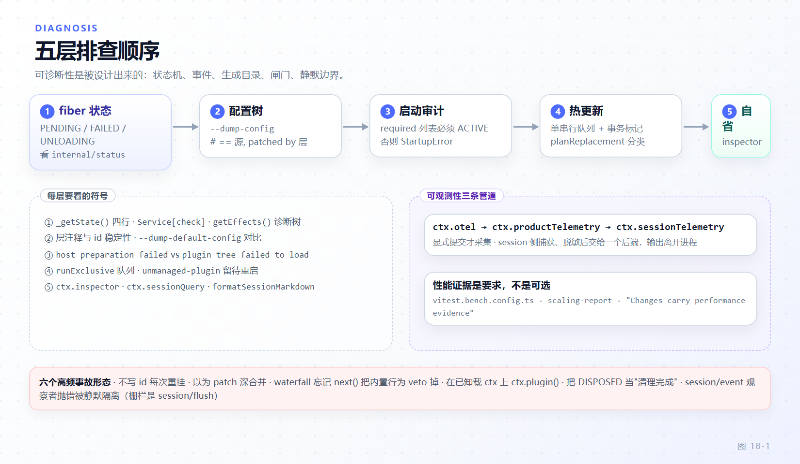

# 第 18 章 调试、可观测性与性能

[← 上一章：会话格式演进与持久化后端](17-session-format-evolution.md) · [下一章：结业项目 →](19-capstone.md)

> **本章目标**
>
> - 建立五层排查决策树：fiber 状态 → 配置树 → 启动审计 → 热更新 → 运行时自省，每层知道看什么命令、什么事件。
> - 读懂 `--dump-config` 的分层注释，说出哪个配置层赢了；知道三个 dump 开关各自的代价与风险。
> - 理解 fail-loud 启动审计为什么宁可疑案当场中止也不带伤运行，以及 required 列表的边界语义。
> - 掌握 `ctx.hmr` 的串行队列与替换计划（`host-module`/`unmanaged-plugin`），能解释一次热重载为什么"没生效"。
> - 分清三条遥测管道各自的承诺，会读压缩锁、attempt 结算与 PTC 派发这些"事件即可观测状态"。
> - 知道性能改动必须带前后测量，并能用快照回放离线复现一次真实对话。

框架的可诊断性是**被设计出来的**：状态机把失败显式化，事件把过程持久化，生成目录把承诺可校验，闸门把回归拦在合并前，静默边界把"不采集"写成默认。本章按五层给你一张排查决策树，再讲可观测性管道与性能纪律。

## 18.1 第一层：fiber 状态——"插件不加载"的第一站

第 2 章推导过 fiber 状态四行：

```ts
// vendor/cordis/src/fiber.ts:574-579
  private _getState() {
    if (this.uid === null) return FiberState.DISPOSED
    if (this._error) return FiberState.FAILED
    if (this._runner.epoch !== INACTIVE) return FiberState.ACTIVE
    return FiberState.PENDING
  }
```

每次状态迁移，`_updateState` 向全局发一条 `internal/status` 事件（`vendor/cordis/src/fiber.ts:581-586`）；Web Client 的启动链、agent-loop 都订阅它投影进度（`packages/client/web/src/boot-client.ts:42`、`packages/core/agent/src/index.ts:283`）。插件"不加载"的排查顺序固定为五问：

1. **它停在哪个状态？** 用启动审计的 fiberState（见 18.3）或监听 `internal/status`。
2. **停在 `PENDING`——它 `inject` 了什么？** 审计层的算法就是答案：`Object.keys(fiber.inject).filter(service => fiber.ctx.get(service) === undefined)`（`packages/boot/app-boot/src/index.ts:1075-1080`），列出的即缺失服务。
3. **谁 `provide` 那个服务？** 查 `docs/capability-seams.md` 与注册表；提供它的包根本没挂载，是配置树问题，转 18.2。
4. **服务挂了名但不可用——`Service[check]` 返回了假？** `Service` 构造时把 `[Service.check]` 连同实例交给 `reflect.provide`（`vendor/cordis/src/service.ts:57`）；check 是"依赖者可见的可用性谓词"（`vendor/cordis/src/reflect.ts:274-288`），实现返回假时依赖方永远 `PENDING`——它不是坏了，是还没资格。
5. **停在 `FAILED`——看 `ctx.logger.error` 与诊断树。** 失败 fiber 的拒绝原因可被 `await` 取回（app-boot `:1066-1073`）；`fiber.getEffects()` 返回每个带标签 effect 的 `EffectMeta` 树（`vendor/cordis/src/fiber.ts:568-572`），能看到拆除卡在哪一层。



*图 18-1 · 五层排查决策树：从 fiber 状态出发，沿配置树、启动审计、热更新到运行时自省逐层放大视野。*

## 18.2 第二层：配置树——哪一层赢了

```sh
dsh --profile web --dump-config
```

输出是合成后的条目树，每个连续段带一行来源注释：`# == <源文件>, patched by <层1>, <层2>`（生成算法在 `packages/boot/app-boot/src/index.ts:698-727`；注释拼接在 `:716-718`）。它的机制值得知道：dump 从基础层出发，逐层重放 `applyEntryPatches` 并对每层做 JSON 快照 diff，条目没变就不加层名——所以这条注释**直接告诉你哪一层赢了**，与启动时应用的是同一套补丁算法（`vendor/include/src/index.ts:44-46`："a dump can never drift from what boots"）。

三个开关各管一件事（`apps/cli/src/args.ts:171-173`，互斥于 `:120`）：`--dump-config` 看完整合成树；`--dump-default-config` 看出厂 bundle 层、剔除用户层与 `--patch` 覆盖——回答"是不是我自己改坏了"；`--dump-config-schema` 不挂载任何插件地打印 JSON Schema（含 `x-cordis` 诊断），但它**会导入每个组合模块**执行顶层代码：模块文件被当作受信代码处理，不评估 `!!js`，可 import 副作用照样跑（`apps/cli/src/dump-config-schema.ts:3,15-23`）。对不受信 profile 不要用它。

坑在这里：补丁语义是**顶层键替换**，不是深合并——

```ts
// vendor/include/src/index.ts:120-123
    for (const [key, value] of Object.entries(overrides)) {
      if (key === 'id') continue
      target[key] = value
    }
```

想改 `config` 里一个嵌套字段，就得给出**完整**的新 config，否则底层兄弟字段整体消失。另外补丁的 `id` 匹配不上、`name` 与目标不符时只警告并跳过（`:82-118`），静默不生效是默认结局，dump 一下才知道打没打上。

## 18.3 第三层：启动审计——宁可疑案中止，不带伤运行

`installFailLoud` 把 `unhandledRejection`/`uncaughtException` 变成一行 stderr 诊断加 `exit(1)`（`packages/boot/app-boot/src/index.ts:882-931`）。设计决定都有注释撑着：诊断用 `util.inspect(err)` 而不是 `err.stack`——`node:fs` 错误的 `code`/`syscall`/`path` 和 `cause` 链是可枚举属性，栈里没有（`:853-858`）；stdout 一行不碰，留给 ACP 协议（`:852`）；退出前给终端拥有者一次 `release` 机会，有界等待 `FAIL_LOUD_RELEASE_TIMEOUT_MS = 2_000` 毫秒——挂死的 disposer 只能推迟 fatal exit，不能取消它（`:840,899-916`）。为什么绝不让控制权回到抛错点：只有抛出点知道哪些状态完好，监听器中途抛错后"继续跑"留下的是静默错乱的结果（`:847-850`）。

`auditStartupEntries`（`:1156-1170`）在 Loader 落定后审计全局 required 列表：

```ts
// packages/boot/app-boot/src/index.ts:949-960
const requiredStartupEntryIds = new Set<string>([
  'agent-loop',
  'tool-executor-native',
  'tool-executor-ptc',
  'webserver',
  'web-runtime',
  'modules',
  'connection',
  'headless-runner',
  'acp',
  'sdk-jsonrpc-server',
])
```

边界语义要背下来：列表是全局的、不是 profile 元数据——**缺席或被禁用的 required id 不报错；已启用的 listed 条目必须激活**，否则抛 `StartupError`（`:943-948` 注释、`:1161-1168`）。bootstrap Include 自身必须激活，否则根配置不可读就是致命的（`:1148`）。非 required 的失败只降级为警告，成功的兄弟保持活动（`:1169`）。`StartupError` 的 `entries` 携带每个非活动条目的 `id/module/required/fiberState/outcome`，`cause` 是原始 `AggregateError`（`:1007-1026`）。

boot 的失败分两段标签，分界线是"配置树条目挂载"：`prepare` 钩子在 Loader 装好后、任何配置树 entry 挂载前抛错 → `host preparation failed`；此后一切失败 → `plugin tree failed to load`（`:1221-1234`）。看到前者查宿主，看到后者查 profile——两段的世界观不同。

## 18.4 第四层：热更新——队列、事务与替换计划

`ctx.hmr` 承诺"模块与配置重载全部串行"（`docs/capability-seams.md:656`）：应用侧变异通过 `runExclusive` 挂进同一条 promise 链，`AsyncLocalStorage` 标记事务、**拒绝嵌套**：

```ts
// packages/boot/hmr/src/index.ts:268-276
  runExclusive<T>(operation: () => Promise<T>): Promise<T> {
    if (this.executing.getStore()) return Promise.reject(new Error('HMR transactions cannot be nested'))
    const task = this.operations.then(async () => {
      if (this.closing) throw new Error('HMR is disposed')
      return this.executing.run(true, operation)
    })
    this.operations = task.catch(() => {})
    return task
  }
```

自动重载不抢跑：watcher 事件先进 `changed` 集合、经 `ctx.debounce` 成批派发，批处理第一步 `await this.applicationReady`——应用没就绪就整批跳过（`packages/boot/hmr/src/index.ts:436-449,370-383`）。

"改了文件为什么不生效"的答案在 `planReplacement`：它从变更模块反向收集全部 importer，再按两种理由把结果标成 pending、留待重启（`packages/boot/hmr/src/index.ts:817-854`）：

```ts
// packages/boot/hmr/src/index.ts:839-841
      // A plugin registered outside a Loader entry has no owner that can start its replacement.
      const reason = [...affected].some(module => host.has(module)) ? 'host-module'
        : entries.length < running.length ? 'unmanaged-plugin' : undefined
```

`host-module`：入口静态图可达（进程启动时就 import 了，换不了）；`unmanaged-plugin`：受影响插件没有一个 Loader entry 能归属并重启它（`:1021-1024`）。两者都进 `pending` 列表并打 "keep running their previous code until a restart" 警告（`:399-401`）。

`reconcileProfile()`（`:925`）是 HMR 与 Plugin Manager **共用**的 recompose 入口——Plugin Manager 每次增删插件都经同一个 `hmr.reconcileProfile(requiredIds)` 走同一条串行队列（`packages/boot/plugin-manager/src/index.ts:1243`），这保证 GUI 操作与文件监听永不交叉重装；包 README 的表述是 "Module replacements, Include refreshes and profile configuration changes share one queue. Package installation runs outside that queue."（`packages/boot/hmr/README.md` Summary）。注意实现有两套：vendored 上游 `vendor/hmr`（`@cordisjs/plugin-hmr`，框架级依赖变更直接 `loader.exit()` 交给宿主重启）与 Harness fork `packages/boot/hmr`（`@deepseek-ai/dsh-hmr`）——读行为时认准 workspace 实际解析到哪份。

## 18.5 第五层：运行时自省——把"看"做成服务

`ctx.inspector` 拥有 Worker 托管的 CDP target 与跨 realm 观察、Cordis 树查询 API（`docs/capability-seams.md:744`；`packages/experimental/inspector`）。面向模型的只读面是 `ctx.cordisInspect`（Host 侧 provider 注册表 `packages/extensions/cordis-host-runner/src/inspect-registry.ts`）与 `ctx.dynamicCordisRunner`（`packages/extensions/cordis-host-runner/src/index.ts:98,158`，Client 经 Remote 命名空间镜像）；`tool-cordis` 把它们封成两个只读工具（`packages/extensions/tool-cordis/src/index.ts:21-67`）：`cordis_inspect_list` 列出全部 Inspect Provider 及其方法与 schema，`cordis_inspect_query` 执行声明式查询——工具描述里明写 "This Tool cannot invoke business Service methods or modify the runtime"。

会话侧的自省是 `ctx.sessionQuery`：`SessionQueryEngine` 提供 `listSessions/readSession/readSurface/readEvent/traceSession/traceEvent/searchSessions/observeSession`（`packages/session-query/session-query/src/index.ts:98-360`），人读的导出走 `session-log-export` 的 `formatSessionMarkdown(events, sourcePath)`（`packages/session-query/session-log-export/src/markdown.ts:65`）。第 8 章说过日志是唯一事实源——这组 API 就是那本"账"的只读查询器：排查时先 `readSurface` 再 `traceSession`，比人肉扫原始 JSONL 可靠得多。

## 18.6 可观测性管道与事件语义

三条管道各管一段，默认全部静默：

- **`ctx.otel`**：共享 OTLP 通道工厂，产品分析与 Session 反馈适配器各自建独立 channel，"never share queues or requests"；只挂载 OTel 服务不产生 provider、transport 或网络连接（`docs/subsystems/otel.md`；`docs/capability-seams.md:702`）。
- **`ctx.productTelemetry`**：只提交显式选定的分析事件，**"mounting alone collects nothing"**（`docs/capability-seams.md:703`）；exporter 不自动采集任何 Session 数据或标识符（`docs/subsystems/product-telemetry.md:4`）。
- **`ctx.sessionTelemetry`**：seam——捕获、脱敏、交给一个后端，输出离开进程，没有别的消费者（`docs/capability-seams.md:704`）；脱敏走 `session-telemetry/record` redact waterfall（`docs/subsystems/README.md:74`）。
- **`ctx.tokenMeter`**：每 Session 隔离的 replay fold，压力消费者共享**不可变、带修订版本**的测量（`docs/capability-seams.md:676`）——token 计数是推导值，这里把它做成可核对的快照而不是随手累加。

会话事件本身就是可观测状态。`compaction/*` 四种事件（start/summary/end/prune）全部仅日志（log-only，不进 surface；`docs/subsystems/compaction.md:11`；事件声明 `packages/compaction/compaction/src/types.ts:82`）；压缩锁由 `compaction/start`…`compaction/end` 括号表达，且锁**最后**释放：崩溃留下的是可见的孤儿锁（有 start 无 end），而不是谎报完成的 end（`docs/subsystems/compaction.md:19`）——恢复者能看见"上次死在哪"。`assistant/attempt` 结算失败/重试/取消的模型尝试，保留 provider usage 而不伪造 assistant 消息（`packages/core/session/src/types.ts:363`；`docs/subsystems/session.md:682`）；`tool/ptc-dispatch` 让 PTC 子调用进账可溯（`packages/core/tool-executor-ptc/src/types.ts:61`，追加于 `src/ptc.ts:550`）。

观察者语义有一个常被误解的分界：`session/event` 是 post-commit、fire-and-forget 的 append feed，**单个观察者抛错被逐个隔离**、只记日志，既不撤销已提交的追加也饿不死后续监听（`packages/core/session/src/index.ts:67-68,765-771,888`）；而 `session/flush` 是 `parallel` 分派且被 await 的耐久栅栏（`packages/core/session/src/index.ts:1330-1335`；`docs/subsystems/session.md:1366`）。UI 抛错不会弄坏日志，但 flush reject 是真实耐久失败——两者的处理等级完全不同。

## 18.7 性能：基准、增量机制与测量纪律

CI 性能闸门在 `vitest.bench.config.ts`：场景收集 `benchmarks/**/*.bench.ts`（浏览器走 `.bench.client.ts`），`globalSetup` 指向 `benchmarks/support/scaling-report.ts`（清空旧计时、跑完渲染 report.html），`maxWorkers: 2` 让四 vCPU runner 两端都忙，`testTimeout: 600_000`（`vitest.bench.config.ts:18-25`）；预算注释写明纪律——"a pairing that inflates an endpoint surfaces as a failing budget and is never loosened to accept it"（`:5-11`）。产品级基准见仓库根 `BENCHMARK.md`，场景目录 `benchmarks/` 按"一条被测用户路径一个目录"组织（`docs/defensive-patterns/general.md:159`）。

测量纪律出自 `docs/defensive-patterns/general.md:151-157` 的 "Changes carry performance evidence"：能动热路径成本改动，必须对**改动路径**报 runtime、peak memory、steady-state memory 三个数，同环境同输入；"整体没变慢"不算证据，别处的提升不能豁免此处的退化；基线是**不带测量钩子**的原实现——两边都挂钩子会把差异稀释成"没有变化"。

值得认识的四个增量机制：`deriveMessages()` 缓存已派生历史，纯尾增长只付 O(新节点)，`replace` 或消息投影变更（`contentGeneration` 前进）才整体重建（`packages/core/session/src/index.ts:975-1019`，缓存策略注释在 `:991`）；`SessionFormatEventRun` 让迁移不把打包 chunk 展开成百万事件（第 17 章；`SessionFormatEventRun` 定义在 `packages/session/session-format/src/types.ts:125`）；`ctx.sessionProjectionCache` 按 Session 耐久 checkpoint 投影单元状态，节流 + `turn/end`/detach 强制点（`docs/capability-seams.md:721`）；`spill-policy` 用 `maxInlineTokens` 预算决定内容内联还是落盘（`packages/spill/spill-policy/src/index.ts:28,50-53`）。它们共同的形状：**增量路径 O(增量)、全量重建有显式触发条件、预算是配置不是运气**。

## 18.8 快照回放与常见事故形态

可复现是调试的前提。`DSH_SNAPSHOT=record|refresh|replay` 三档（`vitest.snapshot.config.ts:28-41`）：replay 是默认——boot 真实子进程路径、用录制响应驱动，比对组装请求与持久化日志，**不读 `.env`**；record 调真实 API 更新 fixture，只有它加载 `.env`；refresh 用已提交脚本重放并更新期望输出。并行度也是设计：replay 文件级并行，record/refresh 强制串行——record 每场景烧真实配额，refresh 并发回写会毁期望输出（`:58-69`）。`packages/test-support/llm-replay` 注册进 `ctx.llm`（有 provider 映射时走 `ctx.llm.registerAdapter`，否则挂 `llm/stream`，`packages/test-support/llm-replay/src/index.ts:1107-1110`），离线复现一次真实对话；脚本耗尽时报 "session requested model call #N … re-record the scenario"（`:1082-1086`），`assertConsumed` 检查消费比例——回放不静默吞掉没跑到的剧本。

事故形态清单，每条给机制：

1. **配置条目不写 `id`**：Loader 的 Group 对账以 `id` 为键，匿条目拿 `Symbol('anonymous')` 当键（`vendor/loader/src/config/group.ts:51-52`），永远配不上旧行——每次更新都卸旧挂新（remount），副作用重放一遍。想要原地更新就得写 `id`。
2. **把 patch 当深合并**：18.2 的键替换语义，patch 一层 `config` 抹掉整层兄弟字段。
3. **waterfall 忘调 `next()`**：瀑布监听器的契约是"要拥有结果就返回，要交给下游就 `next()`"（`docs/subsystems/approval.md:86`；分派模式见 `docs/cordis-primer.md:19`）；忘了 `next()` 等于 veto 掉内置行为——注册即改写，不注册才透明。
4. **在已卸载 ctx 上 `ctx.plugin()`**：effect 登记进无 uid 的 fiber，`assertActive` 抛 `CordisError('INACTIVE_EFFECT')`（`vendor/cordis/src/fiber.ts:346-355`）；回调持 ctx 跨异步边界前必须确认 fiber 还活着。
5. **把 `DISPOSED` 当"清理完成"**：`DISPOSED` 只是状态机的终点，异步拆除可能仍在途——第 2 章引的纪律 "Dispose must reach quiescence, not just request it"（`docs/defensive-patterns/general.md:194`）说的是杀子进程后要 await 退出；agent-loop 的拆除用 memoized quiescence 边界让所有 owner 等同一个静默点（`packages/core/agent-loop/src/index.ts:495`）。
6. **在 `session/event` 观察者里做必须完成的副作用**：观察者抛错被隔离、fire-and-forget（18.6），它"最好执行"但无人等待；必须耐久的动作走被 await 的 `session/flush` 栅栏。

## 18.9 本章小结

五层排查是五份**已存在的数据源**：fiber 状态机与 `internal/status`、配置 dump 的 `patched by` 注释、启动审计的 `StartupError.entries`、HMR 的 pending 计划、inspect/sessionQuery 只读 API——框架没有"隐藏状态"，只有你还没打开的层。可观测性的统一姿态是**显式提交才采集、事件即状态、静默有默认**：三条遥测管道挂载不采集，compaction 用孤儿锁交代死因，attempt 结算不留悬案。性能上，闸门有预算、缓存有触发条件、改动有测量。全部合起来：这套 harness 的故障不该需要 attach 调试器——先跑决策树，跑不完是框架的 bug。

**检查点**

1. 问：一个启用了 `tool-executor-ptc` 但缺 `tool-executor-native` 的 profile，启动审计的结果是什么？ 答：两者都在 required 列表，但"缺席/禁用不报错、已启用必须激活"——`tool-executor-ptc` 启用后若激活失败会 `StartupError`；`tool-executor-native` 缺席本身不触发错误。
2. 问：为什么 `--dump-config-schema` 对不受信 profile 不安全，而 `--dump-config` 不受此限？ 答：schema 生成必须 import 每个组合模块来读其 `Config` 声明，顶层代码随之执行；dump-config 只解析 YAML 并应用补丁算法，不执行插件模块。
3. 问：改了插件源文件，HMR 报告 pending 原因为 `unmanaged-plugin`，什么意思？ 答：受影响插件没有一个挂在 Loader entry 下，没有所有者能启动它的替身——这条链留在内存里跑旧代码，等进程重启；这是 `planReplacement` 的显式边界，不是失败。

**延伸阅读**

- 官方 `/reference/subsystems/otel`、`/reference/subsystems/product-telemetry`、`/reference/subsystems/session-projection`：三条管道与投影缓存的完整契约。
- 官方 `/reference/agent-lifecycle`：激活/拆除时序，对照 18.1 与 18.8 第 5 条。
- 官方 `/develop/framework/`：框架开发向文档入口，含基准与闸门说明。
- 仓库内：`docs/defensive-patterns/general.md`（quiescence、dispatcher 隔离、性能证据三条纪律原文）、`benchmarks/AGENTS.md`（测量归属）、`vitest.bench.config.ts` 与 `vitest.snapshot.config.ts` 的头部注释。
- 第 2 章（状态机）、第 6 章（agent-loop）、第 8 章（日志事实源）、第 17 章（EventRun 与迁移性能）。
