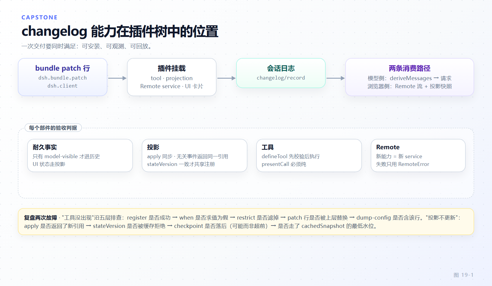

# 第 19 章 结业项目：把会话变更摘要做成可安装、可观测、可回放的扩展

[← 上一章：调试、可观测性与性能](18-debugging-performance.md) · [返回目录](README.md)

> **本章目标**
>
> - 用第 11 章的判据顺序，把一项新能力的五个侧面各归其位：工具、投影、事件、命令、Remote。
> - 走通十个阶段，每阶段说出做什么 / 为什么这样选 / 验收什么。
> - 守住四条纪律：model-visible ⟺ logged、投影同步且无关事件返回同一引用、守卫单调不可撤销、Remote 失败只按 `code` 分支。
> - 说清两条发布轨道的退让：`SessionEventMap` 命名 vs `plugin:*` ignorable 记录。
> - 用第 18 章的五层排查法走一遍两个故障，并带走一份可勾选的验收清单。

题目是"会话变更摘要（session changelog）"：agent 每完成一段可交付的改动就记一条人读的"改了什么"，浏览器随时看到滚动摘要，模型在自己的工具结果里看到刚写进去的内容。**每个落点都由判据决定，而不是由习惯决定。**

## 19.1 阶段 1 · 选型：五个问句决定五处落点

**做什么**。写第一行代码前，把需求拆成五个问句，按第 11 章顺序各答一次。

| 侧面 | 问句 | 落点 | 判据出处 |
|---|---|---|---|
| 模型可见摘要 | 模型要能主动记吗？ | `changelog_record` 进 `ctx.tools` | `docs/architecture.md:148` |
| 派生状态 | 客户端要"当前值"而不重放日志？ | `ctx.sessionProjections.register` | `docs/architecture.md:130` |
| 耐久事实 | 记录要能被重放？ | `'changelog/record'` 合并进 `SessionEventMap` | `docs/architecture.md:162` |
| 人的入口 | 人不借模型轮次也要看到？ | `ctx.commands.register` | `docs/architecture.md:153` |
| HTTP 面 | 浏览器要新读面？ | 自己的 `TypertRemoteService` | `docs/defensive-patterns/remote-and-api.md:7` |



*图 19-1 · 模型只经 `tool/result` 消费，浏览器只经投影与 Remote 消费，两条路径同源于那条只增日志。*

**为什么这样选**。前两行最易混：模型侧摘要就是那次调用的结果文本（`tool/result` 是 surface 事件，天然进历史），浏览器侧是 `changelog/record` 折叠出的当前列表；合成一条"既是消息又是 UI 状态"的事件，会同时违反两条纪律。

**验收**：五行表齐全；表里若出现"在 loop 里加分支""往 session-controller 塞方法"，说明走深了。

## 19.2 阶段 2 · 耐久事实：`changelog/record` 进 `SessionEventMap`

**做什么**。声明合并（declaration merging），宿主包 `src/types.ts` 是唯一归属地，载荷遵守整值规则（whole-value rule）。

```ts
// packages/changelog/changelog/src/types.ts（骨架）
declare module '@deepseek-ai/dsh-session/types' {
  interface SessionEventMap {
    /** 整值快照：最新一次写入即当前全量列表。仅日志，不进派生历史。 */
    'changelog/record': { entries: ChangelogEntry[] }
  }
}
```

**为什么这样选**。载荷用整值快照而非增量，理由写在投影包模块头（`packages/session/session-projection/src/index.ts:13-15`）。`docs/architecture.md:128` 的"Model-visible means logged…New model-visible inputs require session events"（包级表述在 `packages/core/session/README.md:102`）是**双向**的：既用正向，也守反向——**它若只是 UI 状态，就不该进模型历史**。所以不注册 `@messageProjection`：`Session.append` 只在 surface 型事件上要求携带 `surfaceOp`（`packages/core/session/src/index.ts:806-810`）；`packages/todo/tool-todo/src/types.ts:30-35` 的注释正是"Log-only UI state; never derived history"。

**换轨道时的退让**。先以实验包发布就**不能**占用顶层事件名：读侧对不认识的类型 fail closed，而 `KNOWN_SESSION_EVENT_TYPES` 由仓库内声明生成（`packages/core/session/src/known-event-types.ts:22`）。退让路径是插件记录（plugin record）：`appendPluginRecord()`（`packages/core/session/src/index.ts:495`）落一条 `ignorable: true` 的 `plugin:<owner>/<record>` 记录（`owner` 与 `@deepseek-ai/dsh-experimental-<owner>` 包名对应，但这只是约定：类型只约束 `plugin:${string}` 的分段 grammar，`packages/core/session/src/types.ts:527-532`，真正的调用方限制来自 `scripts/verify-plugin-record-callers.ts:2,38`）；`verify-plugin-record-callers` 只允许 `packages/experimental/` 下的生产代码调用它。

**验收**：append 后 `deriveMessages()` 长度不变；第二次写入完全覆盖折叠结果；`pnpm run gen-persistence-catalog` 后该事件以 log-only 出现。

## 19.3 阶段 3 · 投影：同步折叠、版本与可选 wire

**做什么**。

```ts
// packages/changelog/changelog/src/index.ts（骨架）
await ctx.sessionProjections.register<'changelog', ChangelogEntry[]>({
  key: 'changelog',
  stateSchema,                                  // 先校验再播种
  init: (_header, _inheritedEventCount) => [],  // 空日志 + fork 继承长度 → 初始态
  apply: (state, event) =>
    event.type === 'changelog/record' ? event.data.entries : state,  // 无关事件返回同一引用
  wire: { viewSchema, view: state => state },   // 带 wire 即进客户端快照；省略则宿主私有
  stateVersion: 1,
})
```

**为什么这样选**。合同整体是 `ProjectionDefinition`（`packages/session/session-projection/src/index.ts:81-131`）：`init(header, inheritedEventCount)` 收元数据与确切的 fork 继承长度；函数**必须同步**且 `state` 必须是纯 JSON；`apply` 对无关事件**必须返回同一引用**，因为 `Object.is` 判等下未变引用产生零下游工作（drive 对每个单元都跑 `apply`，`:284-286`）；`stateVersion` 是失效版本，字段或折叠语义一变就 +1（四处分别见 `:86-92`、`:73-80`、`:94-101`、`:124-130`）。检查点也白拿：三个强制写点（会话创建、`turn/end`、会话拆除）加两个节流触发 `writeEveryEvents` / `writeIntervalMs`，见 `packages/session/session-projection-cache/src/index.ts:96-104`、`:312-363`。

**验收**：冷读 `restore` 与热驱动 `drive` 在同一日志上给出同一 `view`；卸载 fiber 后 `snapshot()` 里不再有 `changelog` 键（`packages/todo/tool-todo/tests/projection.spec.ts:110-117`）。

## 19.4 阶段 4 · 工具：模型可见面

**做什么**。`defineTool`（`packages/core/tools/src/schema.ts:555`）定义一次写入，条件注册。

```ts
// packages/changelog/tool-changelog/src/index.ts（骨架）
const changelogRecord = defineTool({
  name: 'changelog_record',
  description: 'Record one human-readable "what changed" entry for the work you just finished.',
  parameters: { entries: { type: 'array', required: true,
    items: { type: 'object', additionalProperties: false, properties: {
      summary: { type: 'string', required: true }, scope: { type: 'string', required: true } } } } },
  output: {
    schema: { type: 'object', required: true, properties: { count: { type: 'integer', required: true } } },
    render: (_args, value) => [{ type: 'text', text: `Changelog now has ${value.count} entries.` }],
  },
  execute(args, exec) {
    const entries = toEntries(args.entries)
    if (!exec.agent) throw new Error('changelog_record requires an owning agent session')
    exec.agent.session.append('changelog/record', { entries })
    return Promise.resolve({ count: entries.length })
  },
  presentCall: args => ({ card: 'generic', title: 'Record changelog', kind: 'other', rawInput: args.entries }),
})
ctx.tools.register(changelogRecord, { when: ({ agent }) => agent.session.seq > 0 })
```

**为什么这样选**。`output` 必须是 `{ schema, render, presentationMeta? }`（`packages/core/tools/src/index.ts:130-135`）；`presentCall` 必须纯——同一个函数跑在实时流与日志回放两条路上，故回放期软校验、失败退回通用卡片（`packages/core/tools/src/schema.ts:533-538`、`:547-553``）。条件注册（`register(def, { when })`，`packages/core/tools/src/index.ts:128`）是 v0.2.1-rc.2 起收窄工具面的正道：`when` 每步只求值一次，为假则同时从声明与派发消失，抛错则该步以 `TOOL_ACTIVATION_FAILED` 结束（`docs/upgrade-guide/v0.2.1-rc.2/conditional-tools/guide.md`）。

**验收**：条件为假时 `ctx.tools.schemas()` 里没有该工具；一次成功调用恰好产生 `tool/call` + `tool/result` + `changelog/record` 各一条。

## 19.5 阶段 5 · 策略：`pre-execute` 与 `guard` 的分界

**做什么**。写保护有两个挂点：可协商的策略挂 `tools/pre-execute`——waterfall（`packages/core/tools/src/events.ts:18`），监听者返回 `{ kind: 'deny', reason }` 或 `next()` 委托下游；不可绕过的不变量挂 `ctx.tools.guard(exec => string | undefined)`，它没有 allow 结果。

**为什么这样选**。次序在 `docs/tool-execution-pipeline.md:64`："owner policy that must not be reordered remains a registered guard"，且 `ctx.approval` 先于单调守卫解决 ask。守卫的语义是"listener ordering cannot turn a denial back into permission"（`packages/core/tools/src/contracts.ts:387`）。

**验收**：再注册一个恒 allow 的 `tools/pre-execute` 监听者，守卫拒绝仍生效；被拒调用不留 `changelog/record`。

## 19.6 阶段 6 · 边界：Remote 服务与双面 Client 卡片

**做什么**。宿主侧一个新 service；浏览器侧一个 Host 半边为空、Client 半边有内容的包。

```ts
// packages/api/changelog-controller/src/index.ts（骨架）
export class ChangelogController extends TypertRemoteService {
  constructor(ctx: Context, config: Config) {
    super(ctx, 'changelogController', { namespace: 'changelog' })   // 业务边界即 namespace
  }
  @Remote('entries')                                       // 一元读：读投影，不读原始日志
  entries(request: ChangelogEntriesRequest): ChangelogEntriesValue {
    const session = this.ctx.sessions.get(request.sessionId)
    if (!session) throw new RemoteError('changelog/session-unavailable', 'not live', { sessionId: request.sessionId })
    return { entries: this.ctx.sessionProjections.snapshot(session, ['changelog']).values.changelog ?? [] }
  }
  @Remote({ mode: 'stream' })                              // 流：无自然终点，由 carrier 关闭
  watch(request: ChangelogWatchRequest, signal: AbortSignal): AsyncIterable<ChangelogFrame> {
    return streamChangelog(this.ctx.sessionProjections, request, signal)
  }
}
```

`@Remote` 打在**执行操作的具体方法**上；一元与 stream 两种形状、"失败即抛 `RemoteError(code, message, details)`"见 `packages/api/job-controller/src/index.ts:43-59`、`:75-78`、`:109-121`。失败码先合并进 `RemoteErrorDetailsMap`（该包 `src/types.ts:41-46`），`details` 由 code 反推类型；客户端**永不 instanceof**——"Discrimination is always by `code`, never by instanceof"（`packages/typert/protocol/src/remote-error.ts:8-16`）。

```tsx
// packages/client/ui-changelog-panel/src/client/index.ts（骨架）
export const inject = ['slots', 'locale', 'remote', 'configForms']
export function apply(ctx: ClientContext): void {
  const card = new ChangelogCardController({ panel: ctx.configForms.get(CHANGELOG_NS) }, ctx)
  // 宿主不提供该 namespace 时，这张卡片在 UI 上完全不存在
  ctx.effect(() => ctx.configForms.whileServed([CHANGELOG_NS], () => ctx.slots.inject('plugins.item', () =>
    ctx.slots.register({ name: 'plugins.item', id: 'changelog', order: 24, locale: NS,
      label: () => ctx.locale.bind(NS)('title'), inject: () => card.inject() }, ChangelogCard))), 'ui-changelog: card')
}
// 只按 result.error.code 分支
const result = await ctx.remote.changelog.entries({ sessionId })
if (!result.ok && result.error.code === 'changelog/session-unavailable') return EMPTY_STATE
```

**为什么这样选**。形状来自 `packages/client/ui-settings-web-search/src/client/index.ts` 的 `:44` 与 `:52-66`：`whileServed` 按宿主真实提供的服务门控 UI，`slots.inject` 等真实声明、声明崩塌即移除贡献；三处注册面缺一不可（`tsconfig.client.json` 的 `references`、web-app `cordis.patch.yml` 的 `dsh.client` 行、web-app `package.json` 的依赖，见 `packages/client/AGENTS.md:148-150`）。新 namespace 而非塞进已有 service，依据是 `docs/defensive-patterns/remote-and-api.md:7,13`——"一个调用者也不构成合并理由"。

**验收**：注释掉宿主那行则卡片不出现且不报错；code / message / details 两端一致，客户端只分支 code。

## 19.7 阶段 7 · 配置与热更新；阶段 8 · 测试

**阶段 7 做什么**。

```ts
export interface Config {
  maxEntries: number                     // 非 volatile：被烘焙进守卫与 schema 文案
  panelTitleHint: Volatile<string>       // volatile：每次 .get()，无需重建内部状态
}
export const Config: z<Config> = z.object({
  maxEntries: z.natural().min(1).required(),
  panelTitleHint: z.string().default('Changelog').volatile(),
})
```

**为什么这样选**。判据从 Loader 行为倒推：只有当变化的键全为 volatile、fiber 处于 ACTIVE 且上下文未变，Loader 才原地提交并广播 `loader/volatile-update`，否则整条 entry 重挂载（`vendor/loader/src/config/entry.ts:145-150`、`:160-191`）。所以"改它不需要重建内部状态"→ volatile；"改它会改变注册物"→ 非 volatile（形状见 `docs/cookbook/adding-a-settings-card.md:14-27`）。volatile 不禁止重建，但它把重建的成本与一致性交给你评估：**命名不出一个廉价正确的重建，就把字段留在非 volatile 侧**。另一条纪律：patch 整段替换 config、不做深合并（`docs/architecture.md:25`；`packages/boot/app-boot/README.md:208`）。

**阶段 8 做什么**。四层互不可替代，断言全打在耐久事实上。

```ts
// packages/changelog/changelog/tests/integration.spec.ts（骨架）
const ctx = new Context()
await mountAgentLoopTestDependencies(ctx)
await ctx.plugin(AgentLoop, { agents: [] })
await ctx.plugin(Changelog, { maxEntries: 32, panelTitleHint: 'Changelog' })
ctx.llm.registerAdapter(['mock'], adapter)          // 只 mock 模型
it('record lands, projection reflects it, history does not change', async () => {
  const before = agent.session.deriveMessages().length
  // …MockAdapter 脚本驱动一次 changelog_record 调用…
  expect(agent.session.snapshotEvents().findLast(e => e.type === 'changelog/record')!.data.entries).toEqual(entries)
  expect(ctx.sessionProjections.snapshot(agent.session, ['changelog']).values.changelog).toEqual(entries)
  expect(agent.session.deriveMessages().length).toBe(before)   // 反向不变量：仅日志
})
afterEach(async () => { await context?.fiber.dispose(); context = undefined })   // HMR-safety
```

四层各证什么：行为单测证 schema 之外的语义；真 loop 集成证工具与日志皆真（`packages/todo/tool-todo/tests/integration.spec.ts:17-24`、`:67-74`）；Loader 组合冒烟证 Config 字段是真可配置而非常量（tool-todo 用的是 `allowParallelInProgress`）（`packages/todo/tool-todo/tests/loader-composition.spec.ts:59-96`、`:105-148`）；HMR-safety 证 disposer 真撤销了注册（`afterEach` 在 `:27-32`）。

**验收**：`pnpm run test:coverage` 每文件 100%；新事件进 persistence catalog、新工具进 tool-catalog manifest（闸门清单见第 12 章 12.7）；同一份日志喂冷读与热驱动，`view` 逐字段相等。

## 19.8 阶段 9 · 交付；阶段 10 · 复盘

**阶段 9 做什么**。组合层用 bundle manifest 声明，再用两条命令验证：`dsh plugin --profile web add @you/dsh-changelog-bundle`（转发 pnpm），`dsh --profile web --dump-config | grep -n -A3 changelog`（`apps/cli/src/args.ts:171`）看它落在哪层、谁赢了。

```json
// packages/bundle/changelog-bundle/package.json（骨架）
{ "name": "@deepseek-ai/dsh-changelog-bundle",
  "dsh": { "bundle": { "patch": ["./cordis.patch.yml"] } } }
```

```yaml
# packages/bundle/changelog-bundle/cordis.patch.yml（骨架）
- insert:
    - id: changelog
      name: '@deepseek-ai/dsh-changelog'
      config: { maxEntries: 32, panelTitleHint: Changelog }   # 整段替换：覆写即重述
    - id: changelog-controller
      name: '@deepseek-ai/dsh-api-changelog-controller'
    - id: ui-changelog-panel
      name: '@deepseek-ai/dsh-client-ui-changelog-panel'
```

**为什么这样选**。`dsh.bundle.patch` 是**组合层声明**，值可为文件或有序列表，由 `bundlePatchFiles` / `bundlePatchPaths` 校验并解析（`packages/boot/app-boot/src/profile.ts:54-60`、`:69-70`）。`dsh plugin` 除三条自有命令外把参数原样交给 profile 目录里的 pnpm（`apps/cli/src/plugin.ts:20`、`:96-98`）。实验轨道两道闸：前缀 `@deepseek-ai/dsh-experimental-`（`scripts/experimental-package-policy.ts:31`）与 `verify-default-product-isolation`（`package.json:145`，按前缀或目录把实验包挡在默认交付之外）；实验身份降低支持承诺而非工程标准（`packages/experimental/README.md:26`）。

**阶段 10 做什么**。按第 18 章五层（fiber 状态 → 配置树 → 启动审计 → 热更新 → 运行时自省）走两个故障。

故障 A「工具没出现」：`PENDING` 就查 `inject` 里哪个服务没人提供（`sessionProjections` 常是第一个）；`ACTIVE` 就用 `--dump-config` 看那行在不在、`patched by` 指向哪层；自省点 `ctx.tools.schemas()`——有 schema 而请求里没有是 `when` 算成假，连 schema 都没有是注册没发生。

故障 B「投影不更新」：同键两个不同 `stateVersion` 在注册期直接抛错，易被误读成"插件没加载"；`stateVersion` 忘 bump 最阴——旧行被当作新语义前向折叠。自省先 `ctx.sessionProjections.snapshot(session)`、再 `readSurface` / `traceSession`（第 18 章 18.5）确认事件进没进日志；事件在、值不动，就是 `apply` 对无关事件返回了新引用，或 `view` 没复用引用（`packages/session/session-projection/src/index.ts:810-858`）。

**验收**：陌生人在干净 profile 上三步装好，`--dump-config` 看见三行，跑一次任务后浏览器面板与 `/changelog` 给出同一条最新摘要——同源，即交付完成。

## 19.9 本章小结

- 五个侧面各归其位：模型可见 → `ctx.tools.register`（带 `when`）；派生状态 → `ctx.sessionProjections`；耐久事实 → `SessionEventMap` 声明合并；人的入口 → `ctx.commands`；HTTP 面 → 自己的 Remote service。
- "model-visible ⟺ logged" 是双向的：模型侧走 `tool/result`，UI 侧走仅日志事件；同步 fold、无关事件返回同一引用、`stateVersion` 失效版本是投影单元的合同，检查点与三个强制写点归 `ctx.sessionProjectionCache`。
- `guard` 与 `tools/pre-execute` 的分界是"能否被后续监听者撤销"；Remote 按业务边界拆包、客户端只按 `result.error.code` 分支；`.volatile()` 的判据是"改它是否需要重建插件内部状态"；patch 整段替换 config。

**验收清单**

- [ ] 五行选型表齐全，无一行落在中心层加分支。
- [ ] `'changelog/record'` 经 `@deepseek-ai/dsh-session/types` 合并，载荷是完整列表；未注册消息投影且 `deriveMessages()` 不变。
- [ ] 投影 `apply` 同步、无关事件返回同一引用；`stateVersion` 在语义变更时 bump；`register(...)` 被 await 后才暴露同步读口。
- [ ] 工具 `output` 带 `schema` 与 `render`；`presentCall` 为纯函数；`exec.agent.session.append(...)` 是唯一落盘路径；`when` 为假时声明与派发同时消失。
- [ ] 不可绕过的不变量走 `ctx.tools.guard()`；可协商策略走 `tools/pre-execute` 且正确 `next()`。
- [ ] Remote 有自己的 service 与 namespace，失败码先合并进 `RemoteErrorDetailsMap`；客户端只按 `result.error.code` 分支；三处 Client 注册面齐全、卡片由 `whileServed` 门控；`/changelog` 注册在 `ctx.commands`。
- [ ] 需重建内部状态的字段未标 `.volatile()`；示例 patch 重述整段 config；`--dump-config` 能指出赢家层。
- [ ] 四层测试齐全（含卸载 fiber 后键从 `snapshot()` 消失）、覆盖率每文件 100%、两份生成目录刷新；实验轨道的包名前缀与 `plugin:*` + `ignorable: true` 隔离闸门为绿。

**延伸阅读**

- 官方 [投影子系统](https://deepseek-harness.github.io/deepseek-harness/reference/subsystems/session-projection)、[工具执行流水线](https://deepseek-harness.github.io/deepseek-harness/reference/tool-execution-pipeline)；范本 `packages/todo/tool-todo/`、`packages/api/job-controller/`、`packages/client/ui-settings-web-search/`；本书第 8、11、12、18 章。
