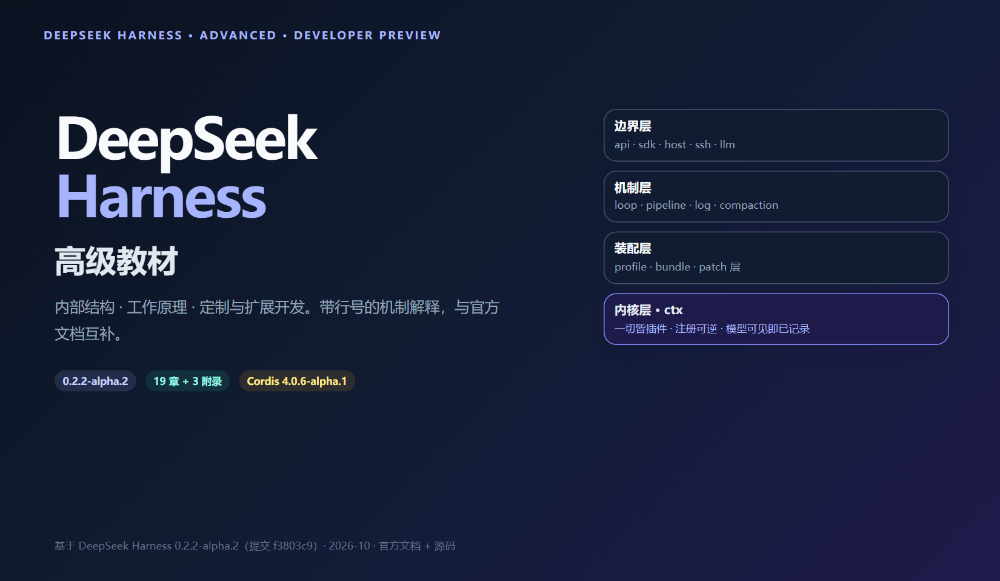
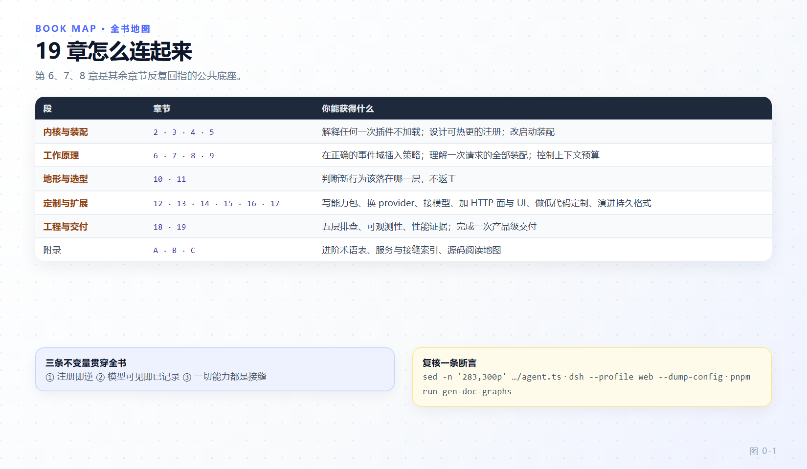

# DeepSeek Harness 高级教程

内部结构 · 工作原理 · 定制与扩展开发。

本教程基于 DeepSeek Harness `0.2.2-alpha.2`（源码提交 `f3803c9`（2026-10-28））、Cordis 内核 `4.0.6-alpha.1` 编写，内容同时对照[官方文档](https://deepseek-harness.github.io/deepseek-harness/)与本地源码，所有机制性断言都标注了源码路径与行号。DeepSeek Harness 处于开发者预览阶段，接口和配置会继续变化；读到与当前代码不一致的地方时，以你检出的版本和仓库生成目录为准。



---

## 这本适合谁

- 已经能启动 dsh、写过导出 `apply` 的插件、用 `defineTool` 定义过工具。
- 想知道**换掉框架的一个零件**需要知道什么，而不只是在它旁边加一个零件。
- 需要为团队做架构评审、性能诊断、持久化演进或扩展规范的人。
- 读过[配套入门教程](https://github.com/John-Shao/dsh-beginner-tutorial)或官方 [develop/basic](https://deepseek-harness.github.io/deepseek-harness/develop/basic/) 线的人。

本书**不**重讲：如何安装、如何配置模型密钥、插件的基本写法。这些在入门教程与官方文档里更合适。

## 学完能做什么

1. 解释任何一次"插件没加载"：区分 `PENDING`、`FAILED`、`UNLOADING`，并定位到缺失的 provider。
2. 说清一次 turn 从 claim 到 `turn/end` 的全部事件，标出哪些可重放、哪些是进程内扩展点。
3. 判断一项新行为该落在哪一层：tool、seam provider、事件监听器、preset、patch 还是平台面。
4. 设计一个作用域感知的注册表，让注册同时获得"只对这个 agent 可见"和"随这个 agent 回收"。
5. 为 dsh 增加一个模型适配器、一个执行世界 provider 或一个 Remote API，而不触碰 loop。
6. 安全地演进会话格式：相邻迁移链、独占发布、破损尾修复与生成目录校验。
7. 用五层排查法（fiber 状态 → 配置树 → 启动审计 → 热更新 → 运行时自省）定位疑难行为。
8. 交付一个可安装、可观测、可回放的产品级扩展，并知道每一项验收判据的源码依据。

---

## 全书地图



*图 0-1 · 19 章按"内核与装配 → 工作原理 → 地形与选型 → 定制与扩展 → 工程与交付"推进；第 6、7、8 章是其余章节反复回指的公共底座。*

### 第一部分：内核与装配

| 章节 | 内容 |
|---|---|
| [第 1 章 高级导读：四层心智模型](01-mental-model.md) | 四层模型、三条不变量、阅读路径、与官方文档的分工 |
| [第 2 章 Cordis 内核](02-cordis-kernel.md) | 插件三形态、以回调为键的注册表、Fiber 状态机、epoch、父子 fiber 与配置 |
| [第 3 章 可逆 effect、服务与事件分派](03-effects-services-events.md) | 四种可逆形态、并发与串接、Service 符号钩子、realm、五种分派模式 |
| [第 4 章 作用域与 agent 世界的装配](04-scope-agent-world.md) | ScopeKey、一条关系两个方向、ScopedLayers、setup window、静默回收 |
| [第 5 章 组合根](05-composition-root.md) | boot 顺序、层叠语义、manifest、`--dump-config`、CLI 与 boot 组 |

### 第二部分：工作原理

| 章节 | 内容 |
|---|---|
| [第 6 章 Agent Loop](06-agent-loop.md) | turn/step/round/exchange、inbox、pre-step、重试不变量、取消与补全 |
| [第 7 章 工具执行管线](07-tool-pipeline.md) | 三层分工、defineTool 契约、执行器选择、六个阶段、批次调度、PTC |
| [第 8 章 会话日志](08-session-log.md) | 模型可见即已记录、事件信封、位置品牌、写路径、surface 与派生 |
| [第 9 章 上下文工程与压缩](09-context-compaction.md) | prompt 装配、system 节点、runtime context 快照、计量、剪枝与摘要 |

### 第三部分：地形与选型

| 章节 | 内容 |
|---|---|
| [第 10 章 仓库地形与工程骨架](10-repo-anatomy.md) | 包分组、命名纪律、生成物即真相、入口闸门、四套测试池、实验门控 |
| [第 11 章 扩展点地图与选型](11-extension-map.md) | 六种定制深度的判据顺序、seam 三角色、反例判据 |

### 第四部分：定制与扩展开发

| 章节 | 内容 |
|---|---|
| [第 11 章 扩展点地图与选型](11-extension-map.md) | 六种定制深度的判据顺序、seam 三角色、反例判据 |
| [第 12 章 开发一个能力包](12-capability-package.md) | 包骨架、工具真实形态、条件注册、测试三件套、质量闸门、分发 |
| [第 13 章 能力接缝与执行世界](13-seams-execution-world.md) | fs/shell/subprocess/sandbox/terminal、一个世界三种 provider、审批与预设 |
| [第 14 章 模型接入层](14-llm-adapter.md) | adapter 接缝、流协议义务、prepareCall、计量与重试、wire 扩展 |
| [第 15 章 平台面](15-platform-surfaces.md) | Typert、Remote service、一元与流、访问控制、浏览器启动、设置卡片、SDK |
| [第 16 章 低代码定制](16-low-code-customization.md) | overlay、preset、skill、command、hook、插件市场与作者化闭环 |
| [第 17 章 会话格式演进与持久化后端](17-session-format-evolution.md) | 物理代际、相邻迁移链、两种 open、破损尾、SessionPersistence 接缝 |

### 第五部分：工程与交付

| 章节 | 内容 |
|---|---|
| [第 18 章 调试、可观测性与性能](18-debugging-performance.md) | 五层排查、启动审计、HMR 队列、自省工具、三条遥测管道、性能证据 |
| [第 19 章 结业项目](19-capstone.md) | 会话变更摘要能力：从选型到可安装交付的十个阶段 |

### 附录

| 附录 | 内容 |
|---|---|
| [附录 A 进阶术语表](appendix-a-glossary.md) | 按主题分组的精确术语 + 易混淆对照表 |
| [附录 B 服务与接缝索引](appendix-b-service-index.md) | 按主题分组的 `ctx.*` 索引、多 provider 接缝清单、生成物自查 |
| [附录 C 源码阅读地图](appendix-c-source-map.md) | 可执行的阅读顺序 + 按问题查文件对照表 |

---

## 四条阅读路径

| 目标 | 建议顺序 |
|---|---|
| 给框架写扩展（主线） | 2 → 3 → 4 → 11 → 12 → 13 → 19 |
| 排查疑难行为 | 3 → 6 → 7 → 8 → 18 |
| 接入自己的模型与执行环境 | 5 → 13 → 14 → 17 → 15 |
| 评估 / 审计这套架构 | 1 → 2 → 4 → 8 → 11 → 附录 B |

每章开头有"本章目标"，结尾有"本章小结""检查点"和"延伸阅读"。第 2、3、4、6、7、8 章信息密度最高，建议连续读完这一段再进入第三部分。

## 图表索引

全书插图为自制示意图，源文件与渲染脚本在 [`diagrams/`](diagrams/)；读者可以忽略，维护者修改后重新渲染。

| 图 | 主题 | 所在章节 |
|---|---|---|
| 封面 | 四层模型与本书定位 | 本页 |
| 图 0-1 | 全书地图 | 本页 |
| 图 1-1 | 四层心智模型 | [第 1 章](01-mental-model.md) |
| 图 2-1 | Fiber 状态机 | [第 2 章](02-cordis-kernel.md) |
| 图 2-2 | epoch 驱动加载与重载 | [第 2 章](02-cordis-kernel.md) |
| 图 3-1 | 五种分派模式 | [第 3 章](03-effects-services-events.md) |
| 图 4-1 | 作用域事件准入 | [第 4 章](04-scope-agent-world.md) |
| 图 5-1 | 层依次施加到空条目列表 | [第 5 章](05-composition-root.md) |
| 图 6-1 | 一次 turn 的完整时序 | [第 6 章](06-agent-loop.md) |
| 图 7-1 | 工具调用六个阶段与批次调度 | [第 7 章](07-tool-pipeline.md) |
| 图 8-1 | 日志 → surface → 派生历史 | [第 8 章](08-session-log.md) |
| 图 9-1 | 预算治理的三层 | [第 9 章](09-context-compaction.md) |
| 图 10-1 | 仓库地形与解析边界 | [第 10 章](10-repo-anatomy.md) |
| 图 11-1 | 六种定制深度决策树 | [第 11 章](11-extension-map.md) |
| 图 12-1 | 能力包骨架与四条线 | [第 12 章](12-capability-package.md) |
| 图 13-1 | 执行世界与三种 provider | [第 13 章](13-seams-execution-world.md) |
| 图 14-1 | 从 prepareCall 到耐久结算 | [第 14 章](14-llm-adapter.md) |
| 图 15-1 | 服务如何变成 wire API | [第 15 章](15-platform-surfaces.md) |
| 图 16-1 | patch → preset → 能力集 | [第 16 章](16-low-code-customization.md) |
| 图 17-1 | 相邻迁移链与两种 open | [第 17 章](17-session-format-evolution.md) |
| 图 18-1 | 五层排查顺序 | [第 18 章](18-debugging-performance.md) |
| 图 19-1 | 结业能力的插件树位置 | [第 19 章](19-capstone.md) |

---

## 书中的约定

- 源码路径以 `deepseek-harness/` 为根，形如 `packages/core/agent-loop/src/agent.ts:287`。**行号是入口，不是坐标**：定位靠符号名与文件路径。
- 命令默认在仓库根目录或章节明确指定的目录执行。`$DSH_HOME` 是配置根目录，未设置时默认 `~/.dsh`（Windows 为 `%USERPROFILE%\.dsh`）。
- 事件名后的 `(wf)` 表示 waterfall；"仅日志"指耐久但不进入 `deriveMessages()` 派生结果。
- 代码块中的 `// ...` 表示省略，不是可直接运行的代码。
- 各章末尾若出现"偏差""纠偏"小节，说明本书在该处选择源码而非文档；欢迎据此回推上游更新。

## 与官方文档的关系

官方文档站（<https://deepseek-harness.github.io/deepseek-harness/>）是**契约与目录的权威**：事件签名、配置字段、工具 schema、持久化类型都在生成式参考里，且随版本更新。本书是**机制与不变量的解释**。冲突时按这个优先级：

1. 你检出的源码；
2. 仓库生成目录（`docs/config-catalog.md`、`docs/tool-catalog.md`、`docs/persistence-catalog.md`）；
3. 官方文档叙述页；
4. 本书。

主要对应关系：官方 [develop/basic](https://deepseek-harness.github.io/deepseek-harness/develop/basic/) ↔ 本书第 12 章；[develop/framework](https://deepseek-harness.github.io/deepseek-harness/develop/framework/) ↔ 第 2、3 章；[develop/practice](https://deepseek-harness.github.io/deepseek-harness/develop/practice/) ↔ 第 11、13、14 章；[reference 概念](https://deepseek-harness.github.io/deepseek-harness/reference/) ↔ 第 5～9 章；[reference/cookbook](https://deepseek-harness.github.io/deepseek-harness/reference/cookbook/extension-cookbook) ↔ 第 12～17 章。

仓库：<https://github.com/deepseek-ai/deepseek-harness>

## 安全边界

DeepSeek Harness 是实验性软件，可以执行模型生成的命令、加载第三方插件，并访问你授予它的文件、网络、进程和凭据。沙箱、审批与权限控制能降低风险，但不构成安全保证。本书第 13 章描述的"执行世界"越完整，一次错误授权的后果越严重。

- 只授予完成任务所需的最小权限与目录。
- 在一次性虚拟机、容器或专用环境中试用不信任的插件。
- 运行前检查插件源码、配置与将要执行的命令。
- 不要把生产凭据或敏感数据暴露给未审计的 agent 或插件。

完整说明见仓库根目录的 [`SAFETY.zh.md`](https://github.com/deepseek-ai/deepseek-harness/blob/master/SAFETY.zh.md)。

## 维护本书的插图

```sh
cd dsh-advanced-tutorial/diagrams

PLAYWRIGHT_CORE=<path>/playwright-core/index.mjs \
CHROMIUM_PATH=<path>/chrome-headless-shell.exe \
node render.mjs                 # 全部
node render.mjs fig-part2       # 只渲染某一文件的图
```

- 画布 1100×640，`deviceScaleFactor: 1.5`，输出 1650px 宽 PNG。
- 颜色：DeepSeek 蓝 `#4D6BFE`、墨色 `#0F172A`、辅助灰 `#64748B`；共享样式在 [`diagrams/base.css`](diagrams/base.css)。
- 新增一张图：在对应 `fig-partN.html` 里加 `<section class="figure" id="fig-<name>">`，渲染后在正文插入 `` 与图注，并更新本页图表索引。

## 许可与致谢

DeepSeek Harness 以 MIT 许可证发布。本教程引用的文档、代码与命令均来自该项目；引用时请保留原始仓库的许可与署名。
